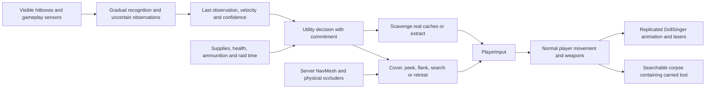
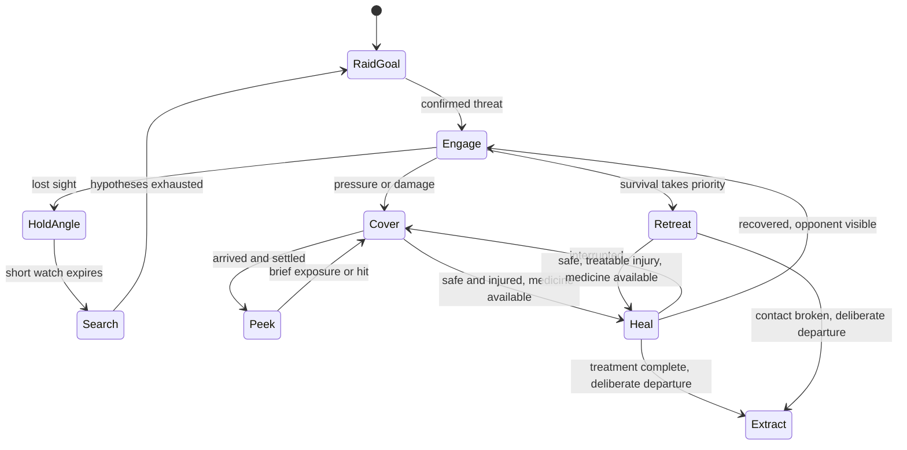

# DollSinger PMC raid actors

The DollSinger actors are independent raiders with supplies, finite ammunition
and an extraction objective. They use the same player ghost, movement controller,
weapon cooldowns, reload cost, ballistics, health and death inventory as humans.
Other PMCs are hostile competitors too; these actors are not a coordinated guard squad.
They have no transport clients or persistent accounts.

## Raid decisions

普通搜打撤中，人形敌人连续看到附近的能量手雷、破片雷或炸药约 0.25 秒后，会中断搜索、治疗或撤离，尝试沿导航路线远离爆炸范围。墙体、视角和烟雾会挡住观察。转身或失去视线后，敌人只记住最后看到的位置，最长记到爆炸或 4 秒，不会隔墙追踪手雷。路径会避免先靠近手雷；找不到安全路线时原地停留。赏金模式不使用此规则。

手雷识别与路径规则的 30 项检查通过，游戏与编辑器程序集隔离编译通过。已补充能量手雷、墙体、烟雾、实际敌人决策和移动输入的编辑器夹具，尚未在编辑器执行；导航效果和战斗难度仍需实战验证。

普通搜打撤的人形敌人按实际水平位移消耗冲刺体力。负重越高，消耗越快，恢复越慢。体力耗尽后会改为步行恢复；看到手雷时仍会尝试冲刺逃生，但沿用耗尽时的速度惩罚。顶墙、垂直位移和位置突变不算冲刺。赏金模式保持原规则。

18 项人形冲刺规则检查通过，游戏与编辑器程序集隔离编译通过。真实服务端敌人状态与移动输入夹具已补充，尚未在编辑器执行；战斗节奏和性能仍需实战确认。

普通局每个人形敌人有三分之一概率携带能量护盾发生器。没有护盾的敌人完成搜刮时，会优先装备找到的可用护盾，例如人形尸体上的护盾；已装备时不会替换。护盾和能源都耗尽的物品只能作为货物携带。取用仍受容器版本、格位和负重限制。

这是真实装备，使用现有的受击、延迟恢复与有限供能规则。敌人死亡时先写回最后的护盾和能源，再进入尸体库存；玩家拿到的是原物品和剩余资源。教学和赏金敌人不使用这套配装或搜刮装备规则。人形敌人暂不消耗氧气，装备护盾不会改变这一现状。

35 项隔离检查覆盖初始配装、真实搜刮、受击、恢复、负重、教学排除、尸体取回和库存序列化。游戏与编辑器程序集隔离编译通过。已补充真实服务器更新夹具，但尚未在编辑器执行；盾牌表现、遭遇频率和交火难度需要正式地图试玩。

独立档案检查还覆盖受损护盾与敌人搜获物一起进入尸体，玩家取回后撤离并重新读档。检查直接调用伤害和死亡掉落入口，不代表已完成真实交火。

普通人形敌人受到火区、毒区或铁丝影响且仍在实际区域内时，会中断搜索、撤离或治疗，尝试沿可达路线离开。判断复用对应区域的场景、范围和墙体遮挡规则；未受到影响或身体在区域外时不会凭空知道危险位置。解毒保护有效时不把毒区视为伤害来源。逃离时不会开火或开始充能，手雷危险优先。无法找到路线时不瞬移。

脱离火区后，敌人可在安全时花 3 秒灭火并同时止血，不消耗医疗物品。自己的火和流血继续造成伤害，但不会反复误判成新攻击；新的身体伤害、护盾命中或中毒伤害会中断自救。正在使用医疗品时新发生燃烧或流血，会先中断治疗且不消耗该物品。赏金模式保持原规则。

危险区条件与路径方向 9 项、自救状态 9 项、压力与伤害区分 16 项检查通过，游戏与编辑器程序集隔离编译通过。真实区域遮挡、敌人决策、移动输入和服务端伤害夹具已补充，尚未执行；实际路线、特效及难度仍需试玩。

PMCs choose reachable caches with different route preferences, spend 2.5 seconds
searching within pickup range and line of sight, then transfer actual shared items
through `LootInventoryExchange.TryApply`. Quantities and versions follow the normal
inventory transaction; there are no manufactured rewards. Cells go into pockets/rig
before backpack space. Backpack cells must move into an accessible slot before
reloading. A loaded secondary weapon remains an option when cells run out.

受伤的人形敌人会在安全时把背包或嵌套包里的医疗用品移到口袋或胸挂，再按原有治疗时间使用。附近有威胁时先撤离，不会因为药暂时在背包就永久放弃治疗。可用位置全满时保留原物品并记住失败；库存变化后才重新尝试。切枪或充能时不开始治疗。赏金模式保持原规则。

真实库存和治疗事务的 18 项检查通过，覆盖可访问位置、嵌套背包、格位旋转、占满回滚和库存变化后重试。游戏与编辑器程序集隔离编译通过；真实敌人的安全撤退和治疗夹具已补充，尚未在编辑器运行，战场表现仍需试玩。

人形敌人搜完固定补给箱后，会按需要取电池和医疗用品，也会按物品占格与出售价值选择其他物资。电池和医疗用品优先放入口袋或胸挂，其他物资优先放背包。兼容的物品会堆叠；空间不足时可旋转物品，重量不足时可只取部分堆叠。每次都使用共享库存事务和 45 公斤上限。任务关键物品和内部有物品的容器保留在箱内。敌人被击杀后，其实际携带的物资仍可从尸体取回。

33 项生产规则检查覆盖价值排序、限重、旋转、电池余量、旧版本竞争、尸体取回、任务物品保护和搜索期间的补货。游戏与编辑器程序集隔离编译通过。真实敌人计时搜箱和服务器补货的编辑器检查已补充，但尚未执行；正式地图上的路线、遭遇密度和物资平衡仍需试玩。

独立单人档案的数据闭环另覆盖：敌人先取走共享箱里的数据盘，玩家的旧请求被拒绝；测试直接触发敌人死亡后，玩家搜索尸体并取回原物，再成功撤离和重新读档。物品 ID、局内来源和首次回收奖励均保留。该检查不运行敌人战斗、导航或 Unity 场景。

人形敌人也可选择附近已注册的建筑抽屉。目标选择最多检查 20 米内最近的 12 个抽屉，不提前读取内容。选定前检查导航、接近距离和视线；抵达后仍被阻挡时会放弃，继续寻找其他目标。完成搜索使用同一份共享抽屉库存。每搜索三个小抽屉，才按一个普通箱子计算撤离目标。未修改地图几何或交互点。

抽屉目标的 9 项生产规则检查和游戏、编辑器程序集隔离编译通过。已补充真实敌人的计时搜索、空抽屉、遮挡退出和失效目标夹具，尚未在编辑器执行；正式建筑导航与实战节奏尚未试玩。

人形敌人在搜刮状态下会留意身边可见的人形尸体。尸体必须在交互范围内且无遮挡，搜索需要原有的计时；战斗会中断搜索。敌人可从尸体的背包和胸挂内取走普通物资，仍使用共享库存与版本校验。任务关键物品保留在原处。异形遗骸和地面丢弃物不作为人形尸体搜索。每秒最多检查一次附近尸体，并最多检查四个候选的视线。

尸体目标和真实库存的 19 项检查通过，覆盖敌人拿取、旧版本竞争、任务物品保护、击杀后取回原物，以及受伤、充能和切枪时停止搜索。游戏与编辑器程序集隔离编译通过；敌人的现场计时和墙体遮挡夹具尚未在编辑器执行，正式战场行为仍需试玩。

敌人执行限时搜索时，会转向并低头看向当前箱子、抽屉或尸体；完成或中断后恢复其他目标方向。游戏与编辑器程序集隔离编译通过。实际敌人输入夹具已补充，尚未在编辑器运行；人物动作和观察角度仍需试玩。

Three searched caches, critical health, exhausted ammunition or the departure time
make a PMC plan to leave. Extraction requires the existing radius, height tolerance
and eight-second dwell; a visible threat, recent damage or pressure interrupts it.
Extraction removes the actor and input without making a corpse. The NPC takes its
loot out of this raid; it is not credited to any human account or an NPC database.
A killed PMC drops its real remaining inventory. Permanent actor removal retires
its leaderboard entry after queued kill-feed messages have resolved their names.

普通搜打撤的人形敌人会根据已看见的目标距离选择武器：11 米内优先使用有弹霰弹枪，18 米外优先使用有弹步枪。中间距离保持当前武器；两次战术切换至少间隔 3 秒。切换时不同时开火或充能，换弹、切枪、治疗和搜索期间不会启动这次切换。赏金模式不使用这套规则。

武器选择的 14 项生产规则检查通过，覆盖距离边界、空弹、切枪/充能、死亡和武器槽位置。游戏与编辑器程序集隔离编译通过。真实武器配置和敌人输入夹具已补充，尚未在编辑器运行；近距离伤害、动作和敌人难度仍需实战校准。

普通搜打撤中，人形敌人被未知方向的攻击命中后，会中断搜刮并短暂转移。它优先使用已有掩体；否则沿已知撤离方向寻找短距离可达路线。没有识别出攻击者时不会凭空锁定目标或开火。短暂危险结束后恢复原来的决策；无可达路线时留在原处。赏金模式不使用此规则。

未知攻击的 12 项生产规则检查通过，覆盖危险时限、模式隔离、目标记忆和有限方向。游戏与编辑器程序集隔离编译通过；真实敌人决策和导航夹具已补充，尚未在编辑器运行，正式战场反应仍需试玩。

身体命中与回血同时发生时，人形敌人根据真实命中记录中断当前行动，即使最终血量没有下降。持续火和流血不会反复伪装成新攻击；同帧的新枪伤、护盾命中和中毒伤害仍会触发反应。16 项生产伤害与压力检查通过，游戏与编辑器程序集隔离编译通过。完整敌人决策夹具尚未在编辑器运行。

## Perception and combat

Sight uses three physical rays (head, torso, hips), range, view angle, movement and
global expedition daylight. Suspicion accumulates before confirmation. Decision code
uses observation records rather than a hidden opponent's current transform. Lost
sight decays confidence and expands search around the remembered position and
observed velocity. Sound estimates can update memory but carry positional error.
Partial head exposure never changes torso aim into an automatic headshot.

Authoritative shot/reload ticks and distance travelled produce gameplay sensor events.
These are stylized suit/acoustic cues for Moonkov, not physical sound simulation in
a lunar vacuum. Distance and obstruction affect their range. Nearby gunfire and
received damage increase pressure. Sound does not simulate propagation through individual rooms.

2026-10-27：普通搜打撤中，真实直击弹体从人形敌人身体旁 1.4 米内经过时会增加压制。墙体会阻挡判定；直接命中沿用受伤压力，不重复算近失弹。连续射击会让敌人更倾向于寻找掩体。敌人只得到不确定的来弹方向，不获得射手精确位置或开火视线。赏金模式、范围弹体和射线武器保持原规则。

`AlienEnemyChecks.RunProjectileThreatContract()` 的 21 项检查覆盖真实弹道推进、墙体、距离、直接命中、自身射击、限频、未知目标与掩体决策。单人临时档案通过正常输入开火，临时服务器目标未受伤但记录了压制与不确定线索。此目标是测试夹具，尚不能代表正式敌人实战、多人或目标设备性能验收。

2026-10-27：人形敌人和异形都会调查真实位移形成的脚步声与落地声。人形敌人按配置的脚步听觉距离计算：轻装时冲刺为 1.3 倍，普通行走为 0.65 倍，蹲行为 0.45 倍，匍匐为 0.3 倍，踮脚为 0.25 倍。异形的移动声基础距离是自身枪声听距的 60%。遮挡将听距乘以 0.55。普通搜打撤中，负重越高，移动声听距与音量越大，最多增加 25%；赏金模式不受负重影响。空中位移和位置突变不制造脚步，落地仍会发出声音。声音只提供有误差的搜索线索，不提供视线或直接开火条件。

玩家打开容器和人形敌人开始搜刮时会产生近距离声音。人形敌人与异形都能调查，规则见[局内耗时操作](../RaidTimedActionsAndDrop.md)。

窒息状态的咳嗽也能让附近敌人调查。人形敌人的无遮挡听距为 25 米，隔墙为 13.75 米；异形不超过自身听力范围。线索有误差，不提供视线。8 项规则检查通过，真实敌人和墙体夹具尚未执行。见[战术道具](../TacticalItems.md)。

2026-10-27：月核切割和档案下载时，附近人形敌人与异形可以调查机器位置。两种声音的听距分别为 40 米和 25 米，墙体缩短听距。声音不指认玩家，不直接允许开火，也不生成敌人。战斗、治疗和撤离保持优先。真实听感和现场反应尚未试玩。

普通战局的警报绊雷触发时也会发出一次调查线索。无遮挡听距为 35 米，隔墙为 19.25 米。已有对手或正在撤离的人形敌人不会改变目标。具体规则和验收边界见[战术道具](../TacticalItems.md)。

破片雷、炸药包和能量手雷的真实爆炸会让附近空闲敌人调查爆炸位置，不揭示投掷者。无遮挡听距为 50 米，隔墙为 27.5 米。规则和隔离编译通过；服务器夹具和正式战局尚未验证。

人形敌人充能前会把背包电池移动到口袋或胸挂。如果这些位置已满，敌人记住本次失败，不会每帧重复尝试。当前枪无弹时会使用有弹的备用武器；没有备用弹药时会脱离战斗并尝试撤离。库存、武器或单发耗能变化后重新检查。充能判断使用实际模块后的容量与耗能。

实际库存与电池转移规则的 10 项检查通过，游戏与编辑器程序集隔离编译通过。包含正式武器配置的人形决策夹具已补充，但尚未在编辑器运行；不能当成正式地图交火验收。

Decisions run at 5 Hz, with staggered perception at 10 Hz and action commitment to
avoid frame-by-frame oscillation. Aggression/caution differ between actors. Sustained
duels can trigger a flank; lost targets trigger search. Pressure favors cover, low HP
or no ammunition favors withdrawal, and an empty magazine favors reloading. Turn
rate, recognition/reaction delays, burst pauses, first-shot error, movement and
pressure affect shooting. Projectile lead uses observed velocity and real weapon
data. The final aim point follows the imperfect look ray so it cannot bypass aim
error or turn rate. Firing still requires current physical line of sight.

Cover candidates must block a torso ray from the remembered threat. Reachable
lateral peek positions improve their score. Path length, exposed route corners,
distance and temporary reservations affect selection. Brief peeks alternate with
concealment. Navigation accepts complete paths only, retries stalled movement and
skips unreachable supply objectives. The player controller retains movement
authority; there is no teleport recovery or moving NavMeshAgent.

## Player-like decisions (2026-10-15)

This increment uses explicit observations, utility scores and timed action phases;
it does not use deep learning or a runtime language model.

- Motion estimates use consecutive sightings made by this observer. Reacquisition
  starts with zero estimated velocity and a fresh reaction delay. Sound has a
  persistent short-lived bearing error, with larger uncertainty through geometry;
  a weaker sound does not overwrite a recent precise visual observation.
- After losing an identified opponent, a raider briefly holds the remembered exit
  (three seconds by default), then checks reachable sectors along the observed
  motion. Search has travel, stop-and-look and abandonment phases. Near path turns
  the actor slows and looks into the next segment. These are navigation-based
  checks, not semantic understanding of rooms or doors.
- Cover requires both head and torso occlusion. The actor reaches cover, settles,
  advances to a reachable peek, briefly holds, and returns. Visible opponents can
  be engaged while advancing to a peek or returning to safety. Damage interrupts
  exposure immediately. Repeated or punished
  peeks retire that cover temporarily. The approach route is scored before the
  peek path overwrites the reusable navigation probe. Flanking compares both sides
  using path distance and exposure to the remembered threat.
- A confirmed threat interrupts looting and searching. Wounded or loaded raiders
  stop hunting stale contacts and can continue toward extraction after disengaging.
  Low magazines may reload during a safe opening; no new ammunition is created.
- Each new PMC carries two real medical injectors and can take more from caches.
  Treatment requires a safe opening, no recent damage, and arrival at the chosen
  position; it takes 3.5 seconds by default and prevents movement and firing.
  Damage, renewed sight of a threat, a changed action, or an inventory version
  change cancels treatment. Completion uses `RaidHealth.UseMedical`, prioritizing
  severely injured head/chest, and consumes exactly one accessible injector.
  Unused medicine stays in the death inventory. No medical hand animation is added.

`HoldAngleSeconds`, `TacticalReloadFraction`, `HealSeconds` and `HealSafetySeconds`
are additive tuning fields with defaults on `DollSingerAITuning`. Existing assets
do not require scene or prefab rewiring. The PMC Debugger also shows cover phase,
peek count, search step, observation uncertainty, medicine and treatment state.
**Moonkov → AI → Check Humanlike Decisions** runs bounded Edit Mode checks of
action transitions and the shared medical transaction without starting a raid.

Validation for this increment: Unity Editor compilation completed without errors;
the focused checks passed for cover arrival/holding/damage interruption, treatment
timing and single consumption/cancellation, danger interrupting commitment,
stale-contact extraction and bounded angle holding. The arrival checks include
the navigation motor's stopping-radius boundary. The loaded tuning asset returns
three-second angle holding and 3.5-second treatment defaults. Play Mode was not
started or stopped for these checks. Live Host/client encounters, geometry-specific
search/flanking quality, runtime cost and final tactical feel remain unverified.

## Combat response correction (2026-10-22)

Branch `feat/pmc-combat-response` starts from `feat/weapon-balance` at `410d5b45`.
The focused regression reproduced a wounded PMC with carried medicine permanently
latching `Leaving`. A treatable wound now selects temporary Retreat without setting
permanent extraction intent; after actual medical recovery it can contest the
opponent again. Exhausted supplies, no medicine for a critical wound, completed
loot goals, exhausted caches and raid timeout retain their departure behavior.

Pressure now scales with actual tissue loss instead of adding 0.5 for every health
decrease. Recovery is 0.32 per second, so even maximum pressure falls below the
0.4 peek threshold after about 1.9 quiet seconds. Shield impacts also trigger a
bounded reaction, once per observed shield event. Pressure still disrupts aim and
recent damage still interrupts unsafe peeks and treatment.

The real motor can return short bursts while withdrawing, flanking or failing to
find usable cover. Visible armed return fire uses walking instead of sprinting;
empty or occluded withdrawal can still sprint. Original perception, reaction delay,
aim error, turning, firing cadence, physical sightlines and squad shot-lane checks
remain in force. Healing, interaction, reloading and empty magazines block fire.

Unity compilation and `DollSingerHumanlikeChecks.Run()` passed. The expanded suite
exercises the production decision, pressure, motor and physical raycast paths:
treatable critical injury, real medical recovery, deliberate extraction, minor
damage, pressure recovery, shield-event deduplication, walking backward while
shooting, failed-cover fallback, unseen target, physical blocker, treatment and
empty-magazine escape. It uses one isolated ECS World and temporary colliders;
it does not start a server, client, Play session or another Editor. Formal-map
navigation, complete raid encounters, multiplayer and final tactical feel remain
unverified.

## Configuration and inspection

- `MoonRaidMap` retains initial enemy count, sight range and starting cells. Zero disables AI.
  Optional enemy spawn points separate entry locations from the supply route; empty lists use loot points.
- `Assets/Resources/Moonkov/DollSingerAI.asset` holds recognition/reaction/memory,
  night sight, preferred range, aim error, retreat health, cache/departure goals,
  search time and scheduling, plus population and placement controls. Rebuild both platforms after changes.
- During Host Play Mode, open **Moonkov → AI → PMC Debugger** for each actor's
  decision/reason, confidence, pressure, supplies, path failure and extraction timer.
  Optional Scene drawing shows route, remembered contact and cover/peek.

Population starts when the first living human is present, after a two-second delay.
The initial count is limited by `MaxAlive` (zero uses the map count). The default map
session has a finite budget of three additional actors: a vacancy from death or
extraction can receive one reinforcement after 75 seconds. Failed placement retries
after five seconds without consuming budget. All arrivals stop at 65% of the map's
raid duration measured from the first living human; late joiners do not reset this
shared population clock. No new actors arrive while no living humans remain.

Placement first tries authored anchors, then randomized nearby positions. Candidates
must be on the runtime NavMesh, have physical standing space and a complete path to
the extraction area. They avoid the exit, other actors by eight metres, and living
humans by 30 metres; visible positions within 80 metres are also rejected using the
server controller look direction, including free look. Unsafe or unavailable locations defer spawning rather
than consuming initial/reinforcement slots. Map changes and system shutdown remove
actors, input entities and navigation. Only a map change starts a fresh population
budget; disconnecting every client and reconnecting to the same world preserves the
spent budget and cutoff. These new placement
and reinforcement rules still need Host and second-client gameplay acceptance.

The bounded runtime NavMesh bake uses terrain and collider geometry. Imported
unreadable meshes use conservative bounding boxes for Player compatibility.
Scene cover density and nav connectivity limit tactical choices. Night visibility
uses the global clock, not per-character physical shadow evaluation. Crouching
and grenades await corresponding player abilities. Squad communication
and authored tactical links remain future work.

Historical baseline checks (before the 2026-10-15 decision changes): three moving server actors and three client proxies;
gradual recognition; a physical blocker preserves last-known position; low HP and
exhausted ammunition trigger retreat; timed search transfers real cache contents
without duplicating quantities; extraction dwell removes actor/input without a
corpse. Additional focused checks passed for physical cover selection, a completed
flank returning to engagement, unreachable path rejection, queued leaderboard spawn
cancellation, and death/extraction/map cleanup of inventory, inputs and scoreboard.
Persistence was disabled for Host checks. Windows ClientAndServer and Mac Client
Player script compilation passed (93 and 94 assemblies respectively); these are not
complete executable builds. Human Play Mode/LAN acceptance judges tactical feel.
