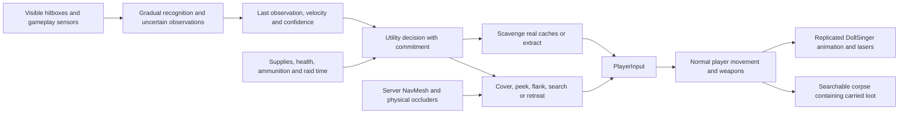
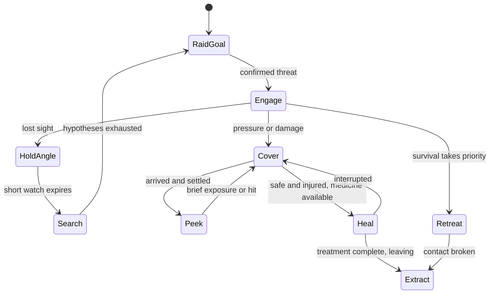

# DollSinger PMC raid actors

The DollSinger actors are independent raiders with supplies, finite ammunition
and an extraction objective. They use the same player ghost, movement controller,
weapon cooldowns, reload cost, ballistics, health and death inventory as humans.
Other PMCs are hostile competitors too; these actors are not a coordinated guard squad.
They have no transport clients or persistent accounts.

## Raid decisions

PMCs choose reachable caches with different route preferences, spend 2.5 seconds
searching within pickup range and line of sight, then transfer actual shared items
through `LootInventoryExchange.TryApply`. Quantities and versions follow the normal
inventory transaction; there are no manufactured rewards. Cells go into pockets/rig
before backpack space. Backpack cells must move into an accessible slot before
reloading. A loaded secondary weapon remains an option when cells run out.

Three searched caches, critical health, exhausted ammunition or the departure time
make a PMC plan to leave. Extraction requires the existing radius, height tolerance
and eight-second dwell; a visible threat, recent damage or pressure interrupts it.
Extraction removes the actor and input without making a corpse. The NPC takes its
loot out of this raid; it is not credited to any human account or an NPC database.
A killed PMC drops its real remaining inventory. Permanent actor removal retires
its leaderboard entry after queued kill-feed messages have resolved their names.

## Perception and combat

Sight uses three physical rays (head, torso, hips), range, view angle, movement and
global expedition daylight. Suspicion accumulates before confirmation. Decision code
uses observation records rather than a hidden opponent's current transform. Lost
sight decays confidence and expands search around the remembered position and
observed velocity. Sound estimates can update memory but carry positional error.
Partial head exposure never changes torso aim into an automatic headshot.

Authoritative shot/reload ticks and distance travelled produce gameplay sensor events.
These are stylized suit/acoustic cues for Moonkov, not physical sound simulation in
a lunar vacuum. Distance and obstruction affect their range. Nearby gunfire and
received damage increase pressure; this version does not detect every near-miss
projectile or simulate sound propagation through individual rooms.

Decisions run at 5 Hz, with staggered perception at 10 Hz and action commitment to
avoid frame-by-frame oscillation. Aggression/caution differ between actors. Sustained
duels can trigger a flank; lost targets trigger search. Pressure favors cover, low HP
or no ammunition favors withdrawal, and an empty magazine favors reloading. Turn
rate, recognition/reaction delays, burst pauses, first-shot error, movement and
pressure affect shooting. Projectile lead uses observed velocity and real weapon
data. The final aim point follows the imperfect look ray so it cannot bypass aim
error or turn rate. Firing still requires current physical line of sight.

Cover candidates must block a torso ray from the remembered threat. Reachable
lateral peek positions improve their score. Path length, exposed route corners,
distance and temporary reservations affect selection. Brief peeks alternate with
concealment. Navigation accepts complete paths only, retries stalled movement and
skips unreachable supply objectives. The player controller retains movement
authority; there is no teleport recovery or moving NavMeshAgent.

## Player-like decisions (2026-10-15)

This increment uses explicit observations, utility scores and timed action phases;
it does not use deep learning or a runtime language model.

- Motion estimates use consecutive sightings made by this observer. Reacquisition
  starts with zero estimated velocity and a fresh reaction delay. Sound has a
  persistent short-lived bearing error, with larger uncertainty through geometry;
  a weaker sound does not overwrite a recent precise visual observation.
- After losing an identified opponent, a raider briefly holds the remembered exit
  (three seconds by default), then checks reachable sectors along the observed
  motion. Search has travel, stop-and-look and abandonment phases. Near path turns
  the actor slows and looks into the next segment. These are navigation-based
  checks, not semantic understanding of rooms or doors.
- Cover requires both head and torso occlusion. The actor reaches cover, settles,
  advances to a reachable peek, briefly holds, and returns. Only the holding phase
  permits cover fire. Damage interrupts exposure immediately. Repeated or punished
  peeks retire that cover temporarily. The approach route is scored before the
  peek path overwrites the reusable navigation probe. Flanking compares both sides
  using path distance and exposure to the remembered threat.
- A confirmed threat interrupts looting and searching. Wounded or loaded raiders
  stop hunting stale contacts and can continue toward extraction after disengaging.
  Low magazines may reload during a safe opening; no new ammunition is created.
- Each new PMC carries two real medical injectors and can take more from caches.
  Treatment requires a safe opening, no recent damage, and arrival at the chosen
  position; it takes 3.5 seconds by default and prevents movement and firing.
  Damage, renewed sight of a threat, a changed action, or an inventory version
  change cancels treatment. Completion uses `RaidHealth.UseMedical`, prioritizing
  severely injured head/chest, and consumes exactly one accessible injector.
  Unused medicine stays in the death inventory. No medical hand animation is added.

`HoldAngleSeconds`, `TacticalReloadFraction`, `HealSeconds` and `HealSafetySeconds`
are additive tuning fields with defaults on `DollSingerAITuning`. Existing assets
do not require scene or prefab rewiring. The PMC Debugger also shows cover phase,
peek count, search step, observation uncertainty, medicine and treatment state.
**Moonkov → AI → Check Humanlike Decisions** runs bounded Edit Mode checks of
action transitions and the shared medical transaction without starting a raid.

Validation for this increment: Unity Editor compilation completed without errors;
the focused checks passed for cover arrival/holding/damage interruption, treatment
timing and single consumption/cancellation, danger interrupting commitment,
stale-contact extraction and bounded angle holding. The arrival checks include
the navigation motor's stopping-radius boundary. The loaded tuning asset returns
three-second angle holding and 3.5-second treatment defaults. Play Mode was not
started or stopped for these checks. Live Host/client encounters, geometry-specific
search/flanking quality, runtime cost and final tactical feel remain unverified.

## Configuration and inspection

- `MoonRaidMap` retains initial enemy count, sight range and starting cells. Zero disables AI.
  Optional enemy spawn points separate entry locations from the supply route; empty lists use loot points.
- `Assets/Resources/Moonkov/DollSingerAI.asset` holds recognition/reaction/memory,
  night sight, preferred range, aim error, retreat health, cache/departure goals,
  search time and scheduling, plus population and placement controls. Rebuild both platforms after changes.
- During Host Play Mode, open **Moonkov → AI → PMC Debugger** for each actor's
  decision/reason, confidence, pressure, supplies, path failure and extraction timer.
  Optional Scene drawing shows route, remembered contact and cover/peek.

Population starts when the first living human is present, after a two-second delay.
The initial count is limited by `MaxAlive` (zero uses the map count). The default map
session has a finite budget of three additional actors: a vacancy from death or
extraction can receive one reinforcement after 75 seconds. Failed placement retries
after five seconds without consuming budget. All arrivals stop at 65% of the map's
raid duration measured from the first living human; late joiners do not reset this
shared population clock. No new actors arrive while no living humans remain.

Placement first tries authored anchors, then randomized nearby positions. Candidates
must be on the runtime NavMesh, have physical standing space and a complete path to
the extraction area. They avoid the exit, other actors by eight metres, and living
humans by 30 metres; visible positions within 80 metres are also rejected using the
server controller look direction, including free look. Unsafe or unavailable locations defer spawning rather
than consuming initial/reinforcement slots. Map changes and system shutdown remove
actors, input entities and navigation. Only a map change starts a fresh population
budget; disconnecting every client and reconnecting to the same world preserves the
spent budget and cutoff. These new placement
and reinforcement rules still need Host and second-client gameplay acceptance.

The bounded runtime NavMesh bake uses terrain and collider geometry. Imported
unreadable meshes use conservative bounding boxes for Player compatibility.
Scene cover density and nav connectivity limit tactical choices. Night visibility
uses the global clock, not per-character physical shadow evaluation. Crouching
and grenades await corresponding player abilities. Squad communication
and authored tactical links remain future work.

Historical baseline checks (before the 2026-10-15 decision changes): three moving server actors and three client proxies;
gradual recognition; a physical blocker preserves last-known position; low HP and
exhausted ammunition trigger retreat; timed search transfers real cache contents
without duplicating quantities; extraction dwell removes actor/input without a
corpse. Additional focused checks passed for physical cover selection, a completed
flank returning to engagement, unreachable path rejection, queued leaderboard spawn
cancellation, and death/extraction/map cleanup of inventory, inputs and scoreboard.
Persistence was disabled for Host checks. Windows ClientAndServer and Mac Client
Player script compilation passed (93 and 94 assemblies respectively); these are not
complete executable builds. Human Play Mode/LAN acceptance judges tactical feel.
