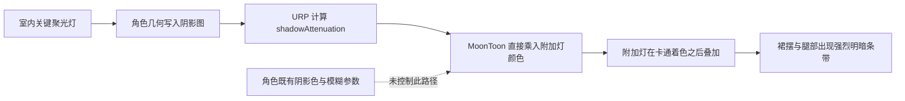

# MC00 灯光与角色阴影审查

日期：2026-10-16。审查基线：`0aabfe4f`，Unity 6000.5.10f1 / URP 17.5.0。

状态更新：用户随后授权修复，已完成本文末尾“2026-10-16 修复与验证”。下面保留修复前的审查与实验记录；其中的“未落地修改”指最初审查阶段。

范围：`7498c4df` 的角色受影、`5b44f34f` 的整楼回路烘焙、`12971d0b` 的烘焙精度修正，以及正式 Theophilus 场景实际配置。检查灯具、建筑投影、角色投／受影、Lightmap／SH 合成和房间反射。此次交付为审查，未落地修改运行代码、材质或场景。

## 结论

正式离线 Play 已复现角色裙子和腿部的大块明暗条带。控制实验将其定位到**室内关键灯对角色的实时自投影**。当前证据不能把全部条带统一认定为 shadow acne：裙摆等真实几何自遮挡也参与其中。可以确认的是，新增受影路径把这些遮挡按全强度直接呈现，现有角色的柔和卡通阴影参数没有约束这条路径。

只提高分辨率、只启用作者原先填写的 Bias，均没有完成修复。关闭角色投影只是诊断，不能作为交付方案。

## 1. P1：室内自投影与角色卡通着色未协调，已复现

证据：`Assets/DollSinger/Shaders/MoonToonHooks.lilblock:8-16,19-46,54-59`。

`MoonToonAdditionalLight()` 返回 `light.color * distanceAttenuation * shadowAttenuation`。lilToon 的 `lil_pass_forward_normal.hlsl:450-457` 在 `OVERRIDE_SHADOW` 之后再把这部分直接乘反照率叠加；角色的 `_ShadowColor`、`_ShadowBlur` 等无法为室内灯自阴影提供与太阳／基础卡通着色一致的颜色和过渡。

当前 `_MoonShadowNear=0.12` / `_MoonShadowFar=0.8` 也只用于主方向光阴影图，不作用于室内附加灯。之前关于“近距离自阴影柔和、远处建筑阴影压暗”的策略并未覆盖本次新增路径。

影响：接收墙、设备投影确实有效，但头发、裙摆和肢体相互投影同样按强遮挡呈现。之前的外部遮挡片实验只能证明“接收阴影有效”，不能证明角色自阴影观感通过。

建议：保留建筑遮挡与角色对环境的真实投影，明确设计室内自阴影的强度、颜色和过滤方式；不能简单关闭 `receiveShadows`、头发投影或整个角色投影。修正后只需对本次固定站位、一个脸部近景及一个墙／门遮挡位置验收。

## 2. P2：灯具 Bias 配置实际未生效，已确认

证据：`Assets/MoonEnvironment/Editor/BuildingLightingTools.cs:39-40,65-71`。

工具写入 `Light.shadowBias=0.03`、`shadowNormalBias=0.15`，却没有关闭 `UniversalAdditionalLightData.usePipelineSettings`。正式 G01 两盏灯读取值均为 `true`，实际使用独立管线的 **Depth Bias=0.1 / Normal Bias=0.5**。

本地 URP 的 `UniversalRenderPipeline.cs:1970-1973` 明确按该开关选择 Bias 来源。作者填写的数值与实际渲染数值不一致，后续照着灯具 Inspector 调参会误判。

按本地 `ShadowUtils.cs:390,414-416,441` 公式，16m、150°、256 分辨率及 Low PCF 下，管线偏移量约为深度 3.5cm、法线偏移上限 17.5cm（应用法线夹角项之前）。这是量级估算，不是逐像素测量。

控制实验启用原先写入的 0.03 / 0.15 后，条带形状改变但仍存在；进一步只把 Normal Bias 改为 0，仍存在。因此 Bias 配置错误需要修正，但不是单独消除此问题的充分条件。

## 3. P2：大角度灯具沿用低档阴影预设，不适合直接作为角色近景质量基线

证据：`BuildingLightingTools.cs:68-70`；`Assets/MoonEnvironment/Variants/MC00BakedBuilding/MC00BakedPipeline.asset:50-53`；正式 G01 灯具读取结果。

关键灯为 150° 聚光、16m 范围，单灯请求 Low=256，PCF=Low。管线的 2048 是共享图集尺寸，Soft Shadow Quality=High 也被灯具自己的 Low 覆盖，不能据管线面板认定角色获得高质量软阴影。

150° 光锥在灯下约 5m 处覆盖约 37m 宽；256 纹素的采样对角色细部十分粗糙。此项是明确的质量风险，但不能把所有条带归因于采样分辨率。

控制实验仅将 G01 两盏灯提高至 High=1024，保持其它参数不变：裙／腿强分层仍存在，部分遮挡更锐利。不要直接把全楼 38 盏灯全部升档作为修复；应在角色受影策略明确后，再分配阴影质量和性能预算。

## 4. P2：太阳阴影钩子存在独立的明暗连续性风险，静态确认，未作为本次室内根因

证据：`MoonToonHooks.lilblock:62-97`。

钩子先调用 `lilGetShading()`，其中已使用主光阴影衰减，再通过原始阴影图的 Point 采样估算遮挡距离，并乘整个 `fd.col.rgb`。因此：

- “近距离返回 1”不会撤销基础着色已经应用的自阴影。
- 远距离压暗作用于已着色结果，可能同时压暗其中的探针／环境贡献，而非只压太阳直接光。
- 遮挡距离来自单个原始深度纹素，并不是与过滤后的可见度完全一致的连续量。

正式场景太阳当前为 Hard shadows；材质原先的紫灰阴影色与 Blur=0.18 仍在，没有发现回退到早期纯黑阴影色。此次没有进行室外太阳／级联边界对照，故不声称此项造成当前室内条带。

## 5. 烘焙与反射方案的已知限制

这些是现有方案边界，不与上面的角色条带混为同一个缺陷：

- 每回路两盏关键灯使用实时直接光；其余辅助灯的直接光和间接光烘焙。移动门关闭时，辅助灯的烘焙贡献不会重新计算，不能承诺所有照明均被门实时截断。
- 角色的辅助光来自传统 Light Probes 的低频 SH，不能代替每盏辅助灯的精确遮挡。跨薄墙、房间边界及门洞的最终表现尚未逐处验收。
- 房间反射为静态 128 HDR Cubemap，回路关闭时强度归零，不追踪门、角色或邻房开关导致的反射变化。
- 38 盏关键灯仍重复提交建筑与动态角色阴影。既有文档的性能记录未达到 60FPS；本轮未做性能优化，也没有把提高阴影分辨率称为性能无代价的方案。

对应实现：`BuildingBakedLighting.cs:345-398`，`MC00BuildingReflectionTools.cs`；既有说明见 `Docs/MC00BakedBuilding.md:7-34`。

## 本轮确认正常的部分

- 正式管线为 MC00 专属 Legacy Light Probes 副本；室内阴影距离适配使用运行时副本，本次室内观察到 40m，原资产仍为 1800m。
- 正式 owner 已应用且 `ConfigurationError` 为空；19 回路、118 灯具、38 关键灯的接入关系存在，未发现用隔离样板代替正式地图。
- 2083 个烘焙建筑块中 1427 个投影开启、656 个关闭；没有整栋建筑投影被统一关闭的情况。关闭的装饰块不据此认定为错误。
- HDR Lightmap 合成、SH 按回路组合、保存／恢复全局 Lightmap 和探针的路径存在。SH 未按系数逐项夹零；运行时只在开关变化时重组合，没有发现每帧重新组合全楼图集。
- 角色正常 Renderer 的投影与受影均启用；第一人称专用完整影子 Renderer 在本次第三人称固定模型中为禁用，不能将本次条带归咎于重复启用的第一人称影子。

## Play 证据与复现

正式入口使用项目现有 `MC00LightingValidation.Boot`，自动建立临时离线档案；最终对照只有一台 Game Camera。临时角色使用 DollSinger 模型固定姿态，关闭其移动／交互逻辑，不代表所有动画姿态均已验收。关闭相机后处理并冻结时间，以下有效对照保持角色、机位、光强和烘焙数据一致。

角色位置 `(1607.7,211.64,2124.5)`，旋转 Y=200°；相机位置 `(1609.8,213.28615,2122)`，看向角色脚底上方 0.95m，FOV=38°，2560×1440。

证据位于 `Library/BuildValidation/MC00LightingAudit/`（忽略目录）：

1. `06-LampBaseline.png`：原始设置，裙子和腿部可见分层。
2. `07-KeyShadowStrengthZero.png`：仅关键灯阴影强度置零，角色条带消失，同时建筑失去遮挡导致强烈漏光；仅用于隔离，不能交付。
3. `08-G01Shadow1024.png`：恢复原阴影强度，仅提高 G01 两盏灯分辨率，条带未解决。
4. `09-BodyNoCast.png`：恢复原分辨率，仅临时关闭角色自身投影，保持受影；角色条带消失，建筑画面保持遮挡。
5. `10-AuthoredBias.png`：恢复角色投影，仅让 G01 使用原填写的 Bias，条带仍存在。
6. `11-NormalBiasZero.png`：在上一项基础上只将 Normal Bias 置零，条带仍存在。

早先直接叠加载入正式场景的 01–04 图像受到主菜单预览渲染／捕获路径干扰，05 站位又位于设备强遮挡下，均不作为上述结论的有效对照。后续通过正式离线入口重新建立现场。

所有灯光实验值在退出 Play 前恢复；已退出 Play 并恢复原 Play 起始场景设置，临时角色和相机未保存。本轮未重烘、未修改第三方包、未打包或运行第二客户端，也未重复既有的墙面烘焙黑斑实验。

## 建议处理顺序

1. 先修室内附加灯的角色自阴影表现：保留对环境的投影与建筑遮挡，避免把局部自遮挡直接变成过强黑带；以本次固定站位验收。
2. 修正 Bias 的配置来源，再针对关键灯校准光锥、范围、分辨率和 PCF。不要同时改动全楼光强与烘焙数据。
3. 单独审查太阳钩子对主光、环境和自阴影的处理；它与室内灯是不同路径。
4. 最后对移动门边界、相邻房间开关和室内外过渡做少量人工验收；性能／多人同步另立明确的验收范围。

## 2026-10-16 修复与验证

### 最终修改

1. `BuildingBakedLighting.Apply()` 改为**先将组合探针绑定到 `LightmapSettings.lightProbes`，再调用 `Compose()` 写入 SH**。新增调查发现，在当前 Unity 版本中，给尚未绑定的环境探针克隆写入组合系数，并没有让该克隆保留目标数据；原先第一次 `Apply` 后全局 SH 最大绝对系数仅为环境状态的 `0.00116356`。同一对局通过既有回路 API 关／开一次 G01 后立即恢复为 `22.25171`，角色位置向上求值恢复到约 RGB `(0.210,0.242,0.299)`。这解释了为何旧的开关测试通过，却漏掉首次进场时角色缺少间接补光。
2. `MoonToonHooks.lilblock` 在主光合成阶段拆开太阳直接光与探针光，太阳遮挡只作用于太阳贡献；不再在 `lilGetShading()` 之后乘整个颜色。基础卡通着色也不会再次把太阳遮挡作用于已经保留下来的探针补光。附加灯仍使用 URP 的完整 `shadowAttenuation`，没有放弃外部遮挡。
3. 正式场景仅修改 **38 盏实时关键灯**的两项 URP 设置：`usePipelineSettings=false`、`softShadowQuality=High`。使用现有灯具的 0.03 / 0.15 Bias，继续保留 150° 光锥、16m 等原范围、Low=256 分辨率、原图集大小与阴影强度 1。G01 同机位下，原来的强条带变成平滑明暗过渡；未用关闭角色投影或降低全楼光强掩盖问题。
4. `MC00BuildingBakeTools.Install()` 同步设置上述关键灯策略，避免将来重建烘焙表示时恢复旧预设。`BuildingLightingTools.Calibrate()` 在写入自定义 Bias 时同步选择该 Bias 来源；普通辅助灯仍保留原 Low 过滤预设。

本轮没有新增材质参数、渲染 Pass、灯光或每帧探针组合，没有重烘图集，也没有修改第三方包。正式场景 diff 为 76 行替换，仅对应 38 个 URP 灯光组件的上述两项设置。

### 最小充分验证

- 通过既有正式离线入口重新启动，对局首次进场、**尚未触发任何回路命令**时，SH 最大绝对系数已为 `22.25171`，owner 正常应用、无配置错误。
- 保存后的 38/38 关键灯读取结果均为自定义 Bias + High 过滤，实时阴影继续开启、强度为 1。固定角色投影为 On、受影为 true，只有一台 Game Camera。
- 原站位 `(1607.7,211.64,2124.5)` 和原机位下检查脸、裙子与腿部，原强黑色条带已消除，保留平滑自阴影。
- 保持角色、光源、探针和相机不变，仅加入两块不可见的临时外部遮挡片：角色仍明显变暗，同时保留紫灰色间接补光，没有恢复到全黑剪影。证明此次没有通过忽略建筑／外物遮挡来消除自阴影。
- 因主光处理有变化，将临时角色移到建筑上方做太阳直射抽查，角色正常显示并保留明暗；该点只用于渲染检查，没有作为落地、行走或屋顶碰撞验收。
- 三个 MoonToon Shader 当前编译消息均为 0 个错误；相关 C# 在 Unity 内编译并执行通过，定向 `git diff --check` 通过。

修复证据位于 `Library/BuildValidation/MC00LightingFix/`：

- `01-ProbeLightPreserved.png`：仅改变主光／探针着色分离的中间版本，条带仍存在，未作为完成结果。
- `02-FilteredShadows.png`：启用有效 Bias 与 High 过滤后，观察到条带平滑；此时尚未修正首次进场的探针发布顺序。
- `03-ExternalOccluders.png`：探针初始化修正前的外部遮挡实验，暴露了缺少补光的全黑结果。
- `04-RecomposedProbes.png`：手动关／开房间后探针恢复的诊断，不是最终交付所需操作。
- **`05-FinalFreshStartup.png`**：最终代码与保存后的灯光设置，首次进场无需开关灯的角色结果。
- **`06-FinalExternalOcclusion.png`**：最终版本对外部投影的接收结果。
- `07-OutdoorSunCheck.png`：最终版本的室外主光抽查。

已退出 Play、清除临时角色／遮挡片／相机，恢复进入验证前的 Play 起始场景设置。本轮没有运行多人、打包或全动画姿态验收；高质量软阴影过滤具有额外 GPU 采样成本，现有工具附带的帧率采样不作为这次改动的性能 A/B 结论。移动门的烘焙辅助光与静态反射限制保持原说明。
