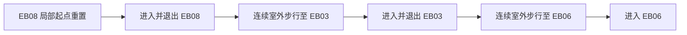

# 外楼正式角色局部试走记录

2026-10-14，在 `Theophilus_Shoulder_Return_Study.unity` 使用已有 `AirlockPrototypeDemo` 创建的正式 `DollSingerNetworkPlayer.prefab` 运行实例，完成八栋新增入口的局部试走。结果在后续“本地不必检查太多”指令到达前已完成，已保留事实并停止复测。

此次不是复制胶囊参数的编辑态探针：脚本输入调用实际角色实例的 `FirstPersonController.AccumulateMovement` 和 `ApplyMovementUpdate`，读取正式角色作者参数，并使用当前场景碰撞。实例上的输入适配器和 `DollSingerMovement.Update` 临时停用以避免双重驱动，动画/第一人称视角通过既有呈现接口更新。每步水平位移仅在接近路点时限幅，防止越过终点。没有改正式角色资产或玩法代码。

## 实际覆盖

EB08、EB03、EB06 使用同一角色实例 `568105589212594092`，从 EB08 局部起点重置一次后连续完成三栋入口及两个室外连接，中间没有重置或传送。两段室外连接实走距离分别为 55.5206 m、56.4044 m；从原生坡肩经过门前绕行点，未新增测试道路。

| 建筑 | 正式角色试走结果 | 分段边界 |
| --- | --- | --- |
| EB08 | 到达门内三米，站立于楼面 | 首组连续段起点重置一次 |
| EB03 | 到达门内三米，站立于楼面 | 与 EB08 室外连续衔接 |
| EB06 | 到达门内三米，站立于楼面 | 与 EB03 室外连续衔接 |
| EB01 | 到达门内三米，站立于楼面 | 独立局部起点重置 |
| EB02 | 到达门内三米，站立于楼面 | 独立局部起点重置 |
| EB04 | 初次走到新连接坡起点；后续完成原入口坡与楼面 | 脚本误判停止后，后续 Play 在已记录断点重建起点 |
| EB05 | 到达门内三米，站立于楼面 | 后续运行实例的独立局部起点重置 |
| EB07 | 到达门内三米，站立于楼面 | 后续运行实例的独立局部起点重置 |

EB04 的停止来自验证脚本错误地将“坡顶终点高度减两米”当成当前位置跌落判据，正常上坡刚开始即触发。实际角色在 `(1685.0438, 218.1203, 2325.4316)` 接地，脚下原生地面约 Y=218.0688；没有发现建筑物理缺陷，因此只将判据改为与当前位置原生地面比较，没有修改建筑或重新测试前五栋及两段室外连接。

续走前原 Play 已结束、原运行角色销毁，结束原因没有确定。一次准备恢复的 Play 未产生新增行走结果；随后重新创建正式角色 `568105589212586980`，在明确记录的 EB04 断点重置后只完成剩余 EB04/05/07。共三次 Play 启动请求，实际记录含两个参与行走的角色实例。记录中 `timeS` 按各参与行走运行段计时，不作为整轮绝对时间相加。

累计实际水平移动 293.2606 m，不包含重置位移；共七次明确起点重置，包含最初首组三栋的起点、其他局部段，以及 EB04 运行实例重建。因此只将首组三栋及两个室外连接称为连续步行，不将八栋分段采样称为整图连续通行。

## 边界与收尾

全部八入口现已有实际正式角色运行证据，不再仅依赖编辑态胶囊检查。仅两个首组室外连接已实际连续走过；第二组及 EB05/07 之间的室外连通、其他门、内部全房间、网络、手动键盘输入与性能均未验收。本轮没有重跑旧 341 点 A 回程，没有截图，也没有扩大 PH01/RB00 选址。

运行记录的 `runtimeErrorsAfterHarnessBegin` 为空，范围仅是捕获回调启用后的运行期；此前 Console 中的 Package Manager 窗口 `path` 参数错误未修复，不能宣称整个 Editor 零错误。误判原始失败记录保存在 `OuterBuildingsActualPlayerWalk_GuardFailure.json`，没有删除失败证据。

核实本任务 Play 所有权及最终实例后已退出 Play。没有实际场景修复，后续专属配色保存重开时确认目标场景干净。按最新停止过度检查指令，没有运行 698 个保护文件的大范围重哈希、追加入口矩阵或继续恢复测试框架。

原始证据在 `LocalData/AI/AssetHandoffs/TheophilusShoulder/OuterBuildingsActualPlayerWalk*.json`。此次实际试走发生在 B 配色之前；配色只改材质和现有照明参数，之后没有再次 Play。
