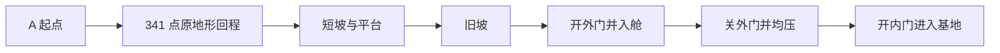

# Theophilus 坑肩连续回程独立场景

独立场景已装配并保存；一次连续碰撞回程走通，同一正式角色由 A 起点返回基地内部。没有截图验证，主观月坑可读性、基地逐渐显露和画面质量尚未验收。

2026-10-14 后续首批已增加 EB08、EB03、EB06 三栋坡肩建筑及独立支柱、入口连接坡，详见 `Docs/AI/Theophilus_Outer_Buildings_Batch01.md`。本页的连续回程属于新增建筑之前的记录；新增部分只做入口碰撞与原 A 走廊静态净空检查，没有再次走全程。

第二组 EB01、EB02、EB04 也已落位，六栋实际总清单及第二组入口验证见 `Docs/AI/Theophilus_Outer_Buildings_Batch02.md`。原连续回程记录不扩大为新增后的再次 Play 验收。

第三组 EB05、EB07 已落位，当前共八栋外围建筑。总清单、新增入口检查与未放置 PH01/RB00 的具体地块约束见 `Docs/AI/Theophilus_Outer_Buildings_Batch03.md`；没有重复前六入口、旧回程或截图验证。

后续仅新增区域完成八入口正式角色局部试走及首组三栋两段连续室外连接，见 `Docs/AI/Theophilus_Outer_Buildings_Actual_Player_Walk.md`；没有重跑旧 A 回程。当前独立场景已实施 B 专属配色，保存状态见 `Docs/AI/Theophilus_Palette_B_Delivery.md`，画面观感仍未验收。

云端 B 加密断环/工业区灰盒也已追加为独立展示根，导入范围及入口未接地等限制见 `Docs/AI/Theophilus_Dense_Ring_Concept_B_Delivery.md`。它未增加碰撞、灯或地形开洞，也没有重启 Play 验证。

## 打开与回退

- Unity 场景：`Assets/MoonEnvironment/Variants/TheophilusShoulderReturn/Scenes/Theophilus_Shoulder_Return_Study.unity`。
- 已退出 Play，重新打开该场景，确认 `isPlaying=false`、场景无未保存修改；退出前检查 `isCompiling=false`。
- 进入 Play 使用当前正式 `Assets/DollSinger/Prefabs/DollSingerNetworkPlayer.prefab` 的本地适配实例。WASD 移动、鼠标观察、F 执行，滚轮切换同组动作；交互 HUD 显示当前选择与禁止执行原因。
- 回退只需打开原 MoonDemo 或 Apollo12 场景。原地形、正式角色 Prefab、原建筑资产和先前 Apollo12 EVA 副本未被本次装配覆盖。
- 本次不提交或推送，不收纳并行武器、敌人、背包和 HUD 改动。

## 实际装配

Theophilus 原始 4 km 背景保留世界坐标。新增 512 m 坑肩近景区域位于 `(1536, 0, 1920)`，高度分辨率 2049；按原高度数据的世界位置合成独立 TerrainData，已有细节数据只在其原覆盖区域使用，其余使用原背景高度。没有把原近景高度图平移到错误位置，没有压平地形，也没有以 Blender 简化地形网格替代原生 TerrainCollider。新场景实例关闭运行时地形高度盖章，避免改变该回程依据的原始高度。

MC00 标准 Y-up 包装根的位置为 `(1614.537598, 211.036148, 2149.009277)`、偏航 `-37°`、缩放 1。内部原导入轴向保留。复制现有建筑实例及 L14 覆盖，保留 118 盏灯、135 个灯控按钮；复制一处既有 EVA 模块与现有气闸规则、硬件和音频绑定。没有新增第二套门控或按钮。

入口 v8 是本场景首次完整安装，位于世界 `(1660, 210, 2130)`，103 个网格、29 个材质、44 个实际引用或转换后的纹理资产。保留原有 101 个静态网格碰撞体；新增两组 M08 装饰无碰撞体。glTF 的 Z 轴与三角绕序只转换一次。

持久输入存放在 `LocalData/AI/AssetHandoffs/TheophilusShoulder/`：

| 输入 | SHA-256 |
| --- | --- |
| `Moonkov_Theophilus_Current_Space_Contract_Study_v11.blend` | `93dc734d6170f975b850387b694be830c2402bf37f8e8dddd10d2baa4bc002e1` |
| `Moonkov_Entry_Static_Visual_Consolidated_v8.zip` | `9f868b0a1f532afc07427fdabdae86eeed5815c7793d8833dc3934d140cff0d3` |

装配、导出和回程辅助脚本在上述 LocalData 目录，不加入 Assets 运行时代码。原有 290 个保护文件哈希核查结果为无变化。

## 一次连续回程证据

`ContinuousReturn.json` 记录 `status=passed`、341 个 A 路线点全部完成、实际水平移动 `192.025925 m`、总耗时 `127.758949 s`；约 `105.211693 s` 到达 A 坡脚。路线之后还包含短坡、转向平台、旧坡和气闸，因此总距离超过 A 段本身。

这是一个实际正式角色实例使用原生 `CharacterController.Move`、当前场景碰撞，以脚本驱动 2 m/s 水平移动并向下贴地的检查。移动和输入组件在此次检查中临时停用。出生后没有瞬移，没有另建测试道路，没有重跑第二次回程；它不替代玩家手动操控体验验收。

短坡和旧坡端点来自实际装配网格边缘。按钮操作通过实际摄像机射线、交互距离和已有 `AirlockButton.Press` 规则执行，所有命令 accepted。完成时同一角色位于基地内，接地且压力 `101.325 kPa`。

实际摄像机相对角色根的高度在起点约 1.30 m，终点约 1.29 m，并非源布局相机的 1.7 m。报告记录原始观察值，不据此修改正式角色。

## 证据边界与已记录问题

- 回程期间捕获一条错误：`[Package Manager Window] The "path" argument must be of type string. Received undefined`。这是记录到的 Editor 窗口错误；没有证据把它归为预存错误，也不宣称零错误。
- `visualQualityActuallyViewed=false`、`screenshotTaken=false`。起点 roof 和 middle 射线均可见，后续存在遮挡变化；该数据不证明基地逐渐显露、坑壁可读性或画面观感达标。
- 本次连续回程验证的是场景碰撞与气闸流程。F/滚轮的手动交互体验、音频主观听感、建筑所有落脚细节、性能、网络 Host/Client 均未追加验收。
- 原 Apollo12 EVA 报告中的声音采样、正式移动组件检查属于此前场景证据，不提升为本场景的新验收结论。

汇总证据见 `Docs/AI/Theophilus_Shoulder_Return_Validation.json`；完整原始路线与事件在持久 LocalData 目录。本次按最小充分原则收尾，不追加截图或新一轮测试。
