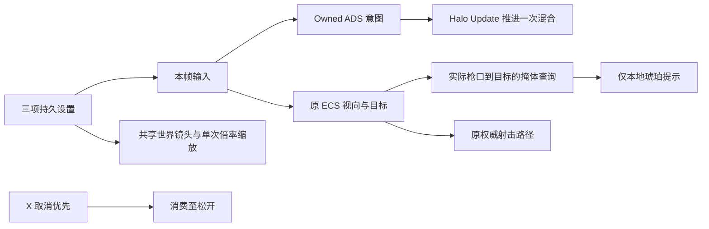

# 瞄准输入与反馈增量

2026-10-21，承接 `CharacterPreviewAndAim.md`，只实施本轮接受的四项；人物预览和手柄布局不改。

## 行为

1. 本地 owned 光环在自己的 Update 开始读取本帧瞄准意图，不再先用上帧 ECS 状态决定抬手/放手。自由观察按住、回中、UI 阻塞、死亡和灯光预览仍单独处理。远端继续使用同步意图；`aimBlend` 仍只在原 Update 推进一次，ECS 的视向/目标/权威射击路径保留。
2. 设置页增加鼠标基础灵敏度、瞄准比例、共享世界 FOV，立即应用并持久保存；恢复默认只影响这三项。默认分别为 0.15、1、70°，范围为 0.02–0.6、0.1–2、40–100°。两视角继续共用世界 FOV，普通/6 倍/8 倍都只做一次投影匹配；独立手部相机设置不改。设置页内容可滚动，保持原音量、语言和 HUD 控件。
3. 本地瞄准时，如果实际枪口到相机目标之间先撞到掩体，在屏幕光环中心显示 12 px 琥珀色禁行圈。查询复用 `PlayerGhost.GetShotRay` 的实际 ShotOrigin/姿态/侧身，使用现有 Default/Ground 掩体层、`RaycastShot` 自身过滤和忽略触发器；目标表面末端 8 cm 不算枪口遮挡，ClientPlayer/ServerPlayer 不算掩体。提示不参与权威命中或伤害，也不表示命中敌人。无武器、放下瞄准、打开 UI、死亡、灯光预览时隐藏。
4. 快捷医疗等耗时操作期间按 X，取消意图优先，踮脚被抑制直到该次 X 松开，即使服务器已经确认取消也不把长按剩余部分转为踮脚。非耗时操作的 X 保持原功能；WASD 不锁死，继续由既有服务端规则中断操作。`RaidHUD.TimedActionInputActive` 只读状态经 Presentation 委托传入 Input，DollSinger Runtime 不引用 HUD 程序集。

## 验证

专项入口：`MoonkovAimInputChecks.Run()`。检查只覆盖新增风险：三项偏好保存/缓存重载/恢复默认和新实例应用、两视角 1.75/6/8 倍比例、微小输入不重复缩放、X 松开重置、owned 最新 ADS 意图单次读取、远端同步意图、真实枪口/侧身/自身/目标表面与 host 两类玩家层过滤。

偏好检查先保存三个键各自的“原本是否存在”及值，finally 原样恢复或删除本来不存在的键；不清其他 PlayerPrefs。UI/Play 验证也必须使用相同备份/恢复方式。需要另查真实页面滚动及读数、实时设置与再次实例化、抬手/放手起点、提示显隐/居中/不抢指针。

本轮证据：

- Unity 6000.5.10f1 编译 completed、0 错误；`MoonkovAimInputChecks.Run()` 全部通过。首次枪口夹具缺少未激活 Controller 的站立高度缓存，导致夹具枪口比实际高 1.7 m；补齐夹具初始化后复验通过，运行逻辑未因此改写。
- 真实设置页临时窗口宽 1280，内容根为 1280×658；滚动视口 300 px、内容 688 px，三滑块实际绑定与恢复按钮的 NavigationSubmit 操作通过。恢复默认仅重置三项视角值，没有碰音量/语言。六条设置文案与协调方交付的十二条库存/结果固定文案共 18 条，按原英文 key→中文字符串格式定向增量写入 JSON、en/zh/SharedData 表；未改 Builder、字体或其他语言。
- 在原 WeaponGestureLab 临时 Play，帧计数持续推进；真实正式角色实例跨 Play 重载读到临时 mouse=0.22、ADS=0.8、共享 FOV=84°，普通镜世界 FOV≈54.45315°、瞄准比例≈0.4571429、独立手部镜头保持 65°。专项另覆盖两视角普通/正式 6 倍/临时 8 倍，没有重跑整套旧矩阵。
- 在真实角色上装入实际 `ReadOwnedAimIntent`，原同步意图 false + 本帧本地输入 true 时正常抬手；原同步 true + 本地松开时正常放手，证明本地意图不再等下一次同步更新。该验证是同一路径的受控输入，不代表已测出主观手感改善值。
- 运行实例的枪口掩体查询为 true，提示的 12 px 居中、Ignore 拾取与隐藏检查通过。试验撤掉临时掩体后直接断言“无障碍”失败；只读核对发现 Lab 自带 `(0,1.5,4)`、8×3×0.08 m 的实心 Backdrop 仍在 20 m 请求目标之前，查询正确发现了另一块实际掩体。未删背景或改变查询掩盖结果；无障碍、目标表面、自身和两类玩家复制过滤已由隔离夹具验证。
- 最终恢复原 WeaponGestureLab 单场景、dirty=false、Play=false；三个偏好键测试前均不存在，已逐个删除并复读确认为不存在，恢复脚本及原值记录在本地忽略目录 `LocalData/ViewValidation/`。没有加载正式战局、写账户或改玩家名称。当前 Console groundTruth 0 错误、1 条 Unity AI Account API 连接超时警告；历史工具缓冲不代表当前错误。

未做完整实战、双客户端或可执行构建；未将受控数值/显隐检查表述为主观手感或最终画面验收。设置页实际语言切换的完整视觉检查、所有墙角/角色姿态组合仍需后续试玩反馈。
