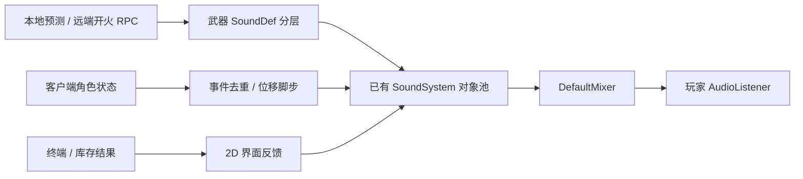

# Moonkov 音效系统

## 2026-10-19 异形攻击与移动（feat/aliens）

- 修复攻击漏声：旧逻辑仅允许 Strike 前 0.25 秒播叫声，Play 中 0.4 秒的存活攻击快照可复现零音源。客户端现在按该物种已提交的攻击有效时长接收新攻击，按攻击序列去重，拒绝旧序列；首次接入不补播已发生的出手。声音观察在视觉 rig 的距离降频之前执行。
- 增加七库、21 个录音加工变体：挥击破空／壳体、口腔喷吐、碎裂撞击、湿润蠕动、重型落脚、吸附抓持和大型喉音。按 Bite／Charge／FaceLeap／RoofPounce／StiltRake／MucusSpit／AcidSpit／LeechDrain／SlimePulse／RootSpikes／TentacleSweep／TentacleSlam 分配动作层；三段攻击按当前脉冲播放，丢快照不补发一串旧脉冲。喷吐不凭空判定命中，抱脸附着期间约 1.25 秒一次抓持细响，脱离／死亡收束。
- 尖刺、酸液池和砸击的接触声放在复制的攻击落点，保持世界位置；怪物发声与挥击附着身体。巨型喉音听距 80 m，重型落脚／撞击 65 m，原甲壳接触从 18 m 调至 26 m；继续使用直达声遮挡与线性衰减。
- 蛇／幼体／水蛭／黏液用蠕动／吸附接触，甲壳生物用骨壳足点，高跷怪物由真实落脚计数与位置触发重型接触，不再按身体每移动 0.8 m 代播。去掉抱脸 rig 的重复音频 Tick；附着期间不播放地面步声。
- 所有新音色由项目已持有的 CC0 口腔、骨壳、碎屑、衣料和拖擦录音加工，未改枪声／UI／呼吸。21 个 48 kHz 单声道 PCM 文件约 16.73 秒、1.61 MB（十进制 WAV 文件）；配方和输入／输出 SHA256 在 `Assets/Audio/Moonkov/AlienCombatAudioSources.json`，可用 `Tools/Audio/build_alien_combat_audio.py` 重建。授权副本随 `StreamingAssets/MoonkovAlienCombatAudioCredits.txt` 分发。
- 沿用原 64 源声音池、SFX／Footsteps 路由与音量设置。声音按库限制 3–6 并发，步声优先级低于攻击预警；不增加 RPC、伤害逻辑、场景常驻 AudioSource 或网络字段。引用已安装；菜单 `Moonkov/Audio/Install species combat audio` 可重装，整套 Raid 音频安装末尾也调用它。资产检查为 `Tools/Moonkov/Check Species Combat Audio`，Play 回归入口 `MoonkovAlienAudioChecks.CheckDelayedStrike()`。

验证：Unity 6000.5.10f1 / macOS Editor。新物种音库、原 Raid 音频及接触／待机三组资产检查通过，21 个成品和每个引用源 SHA256 核对通过。延迟 0.4 秒攻击在旧版本零播放、修复后产生实际 playing 音源。24 秒隔离 Play 测试中：三段尖刺撞击 3 次、黏液脉冲 3 次、喷吐 1 次、附着抓持 3 次、实际高跷 rig 落脚 5 次、蠕动和甲壳接触各 3 次；晚加入攻击零重放，落点不附着怪物；最大同时 4 源，输出峰值约 0.099，仅代表此测试片段。销毁后所有池化源仍有效。

临时离线档案的真实 ServerWorld／ClientWorld 运输与 AI 战局检查：冲锋者实际移动约 16.98 m，观察到 9 次甲壳接触、2 次挥击与叫声；高跷者实际移动约 5.71 m，观察到真实落脚及 2 次挥击／叫声；喷吐者观察到 2 次喷射、3 次落点撞击及攻击叫声。三者都走服务器自主攻击和客户端代理呈现，未手工写攻击状态；临时角色逐帧恢复身体健康以完成观察。该片段最大同时 7 源、监听输出峰值约 0.141。临时敌人结束后移除，返回飞船并释放临时档案；未改真实账号档案。

未做独立 macOS 构建或远程双机听觉验收。编辑器曾出现 Unity ID 获取授权失败、素材安装命令 5 秒超时（安装实际完成）、以及调试探针在旧测试角色死亡后中断的记录，已区分为外部服务／工具与临时测试日志；不声称整段 Console 历史全空。

## 2026-10-18 接触与待机细节（feat/raid-audio-details）

- 异形待机声音改由每只客户端异形自身驱动，替代氛围层给最近异形代播。首次随机等待 2.5–7.5 秒，之后低鸣间隔 8–16 秒；静止身体细响 5–11 秒，扑击后有一次收束动作声。音源附着自身、保留尺寸／物种音高差异，28 m 内才调度。休眠伏击、死亡和远处不会产生这些细节；攻击蓄力会淡出已有待机声。全局待机低鸣最多 3 路，遇到并发限制会错开重试，非战斗声随枪声让位。
- 异形爬墙／天花板根据复制来的姿态法线、位移及真实表面射线产生壳体拖擦；平地沿墙移动另检查身体附近的墙面。离开支撑、没有位移、攻击中或传送时不产生摩擦。粗糙／金属接触使用不同声库，每只最短约 0.52 秒一次。
- 玩家服装蹭墙只有实际近墙且沿面滑动才触发；正面顶墙、静止、触发器、自身碰撞体和远处墙面排除。自己的接触声保留一定方向感，其他角色完全 3D；沿用遮挡、材质标记、SFX／Footsteps 路由及原音量设置。
- 蹲起／趴下／起身有衣料和束带动作声，静止身体转向累计约 50° 后有低声装备轻响。匍匐以身体／衣料拖动代替靴子步声；蹲行及踮脚用较短步距和更低接触音量。由已呈现的客户端姿态变化触发，不改输入、碰撞规则或网络字段；晚加入不重放历史动作。
- 新增 8 库 × 3 变体 = 24 个 48 kHz 单声道 PCM 短音，总长约 12.17 秒，WAV 文件合计约 1.17 MB（十进制，不含 meta）。使用 AntumDeluge 的 CC0 真实拖擦和 Kenney 的 CC0 衣料／皮带／金属件素材，辅以项目原有 CC0 壳体接触层；配方、原素材／成品 SHA256 见 `Assets/Audio/Moonkov/AudioDetailSources.json`，授权见 `Licenses/AudioDetails.md`，分发声明放入 `StreamingAssets/MoonkovAudioDetailCredits.txt`。重建脚本 `Tools/Audio/build_audio_details.py` 只写 Details 目录及其清单。
- 所有声音沿用 64 个池化 AudioSource。接触探测复用静态命中数组，每个移动角色约 160 ms 检查，所有角色共用每帧最多 12 条细节射线；远处异形不作细节探测。未增加每只怪物常驻 AudioSource／运行时生成的音频；释放异形时先归还其附着音源，再销毁角色。

已安装好音频库引用，无需手动绑场景。菜单 `Moonkov/Audio/Install contact and idle details` 可单独重建本轮设置；原整套 Raid 安装菜单末尾也调用它，避免回退到旧待机策略。测试菜单为 `Tools/Moonkov/Check Contact And Idle Audio`。

验证（Unity 6000.5.10f1 / macOS / Editor Play）：

- 本轮音频资产／接触几何检查及原 Raid 音频、射击 AV 检查通过；覆盖真实沿墙接触、自身／触发器排除、顶墙静止静音、离墙缓存失效、传送／卡帧抑制和表面法线。
- 只读呈现状态的隔离 Play 测试中，两只异形分别发出待机声，休眠及 100 m 远异形无细节声；贴壁拖擦、身体细响、玩家蹭墙、姿态切换、匍匐和转身装备声均观察到。重复快照下蓄力／扑击／受伤／死亡各一次，最大同时播放 7 源、监听输出峰值 0.216（仅代表该测试片段）。踮脚源增益约为站立步声的 28%。销毁后无无效源；另通过“蓄力淡出期间立即死亡销毁”回收检查。
- 临时离线档案的真实 ClientWorld／ServerWorld 战局中，四种姿态均到达客户端，实际移动约 6.20 m，观察到地面步声、封闭服装呼吸、姿态切换、匍匐及装备轻响。结束后返回飞船，释放临时档案并退出 Play。没有改玩家真实档案。
- 24 个成品和引用源文件 SHA256 核对通过。战局检查 Console 0 error；未打独立 macOS 构建、未做远程双机听觉验收，最终音色与细节电平仍可在耳机实玩中继续调校。


## 2026-10-16 局内声音重做

- 新增 56 个 48 kHz、单声道 PCM 短音，共约 27.3 秒、2.6 MB 解压音频数据（磁盘含 meta 约 2.8 MB）。源文件、SHA256 和处理配方在 `Assets/Audio/Moonkov/RaidAudioSources.json`；授权及必须随资源分发的 CC BY 署名见 `Assets/Audio/Moonkov/Licenses/RaidAudio.md`，同步副本 `Assets/StreamingAssets/MoonkovRaidAudioCredits.txt` 随 Unity 构建分发。重建脚本 `Tools/Audio/build_raid_audio.py` 使用 numpy／ffmpeg，原压缩包放在被忽略的 `LocalData/RaidAudio/Sources`。
- 脚步：碎石、金属、硬质地面各 8 个真实接触样本，替换旧敲铁／摇木箱素材。Terrain 与 MoonRock／regolith 使用碎石；显式 `RifleImpactSurface.Metal` 或金属材质使用金属；其它硬 Collider 使用硬底靴。沿用现有表面标记，无场景批量改写。按位移计算步点，走／跑步距 0.9／1.35 m，最短间隔 180 ms；停止、离地、传送清步距；落地带地面接触及落速力度。衣料成为低电平附层。自己的接触声以 0.08 spatial blend 保持身体存在感，其他玩家保持全 3D。
- 异形：共享实录口腔表演，经变速、低喉音附层、短阻尼共鸣加工，蓄力／扑击／受伤／死亡／潜伏各 3 变体；壳体／碎屑接触 4 变体。所有渲染物种都观察攻击／健康边沿，按尺寸、物种和个体微调音高。蜘蛛仍由真实足点驱动，其它物种按位移触发摩擦；休眠伏击不发步点。受伤限频 320 ms，旧快照不补播。取消每只怪物生成 AudioClip／SoundDef；销毁 ghost 时收束持有的播放句柄。
- 氛围沿用 `RaidThreatAtmosphere`，只给最近已复制、存活且已激活的异形播放低声息，随机间隔 7–13 秒；没有凭空的敌人音源。保留原结构吱响和低环境床，枪击时自动给环境让位。
- 细节：瞄准进入／退出、光环灯切换、空仓扳机、换弹完成、治疗、补氧、进食／补水衣料动作、服务器物资增加收取声、撤离开始／中断／最后三秒，以及低氧专属面罩告警。呼吸在不适合呼吸的空气／冲刺／重伤时出现，低健康有轻心跳；声音只由拥有者听到。室外以 `!BreathableAir` 识别封闭服装状态；真人吸气／呼气经保持音高的时间拉伸、衣料低通、身体共鸣及 12 ms 阻尼反射处理，以纯 2D 贴耳声播放。安静时约 4.1 秒一轮，冲刺／重伤／低氧时约 3.2 秒并略提高音高和力度；安静时进入可呼吸区域后平滑淡出，运动／重伤喘息保留。补氧声采用 5 点以上离散增长阈值，避免受压空气回补时每帧发声；死亡和卸载拥有者会收束呼吸／心跳。
- 混音：原 Mixer 的 Music／SFX／Footsteps／Menus 路由和音量设置保留；通过 SoundDef 增加角色、优先级、最大并发、最短重触发和遮挡策略。池总容量仍为 64 个 AudioSource，重要攻击／枪声可在满池时回收更低优先级声音；听不见的全 3D 线性衰减声音不占池。近处枪击让环境床压到 0.38、衣料／脚步压到 0.78，约 350 ms 恢复；异形蓄力及面罩告警不被压低。
- 遮挡：原有 AudioLowPassFilter 复用，Default／Ground 非触发器遮挡时平滑降至约 1.5 kHz／0.42 gain，离开遮挡恢复。每源约 160 ms 检查、每帧总计至多 6 次非分配射线，忽略听者自身及挂载音源所属物体；近身／主要 2D 声不作墙体遮挡。监听器挂在独立的拥有者相机子物体，跟随转头／探身，不再跟随模型动画朝向；切换监听器更新正在播放的距离计算。此为直达声遮挡近似，未实现绕射、门缝传声和房间声学模拟。
- 声音池修复：首个 DSP 块使用传入 gain；渐隐包络实际乘到音量；过期 handle 不再停止被复用音源；RandomNotLast 按 SoundDef 记住上一变体；带 local offset 的音源按真实位置计算距离和遮挡。枪声样本、霰弹枪音色、手选 UI／出战确认／飞船音乐未替换。

安装／维护：新引用已经写入 `Assets/Resources/Moonkov/AudioLibrary.asset`，无需手动设置。菜单 `Moonkov/Audio/Install immersive raid audio` 可重复重建本轮 SoundDef 和导入设置；不会重建旧手选素材。新增 `Tools/Moonkov/Check Raid Audio Assets` 与 Play 下 `MoonkovRaidAudioChecks.CheckPlayback()`，覆盖引用、PCM 导入、峰值、表面、去连播、首块 gain、过期句柄、并发／间隔／距离限制和满池优先级回收。


验证（Unity 6000.5.10f1 / macOS / StandaloneOSX 目标，Editor Play）：

- 6 组检查通过：本轮音频资产／PCM／表面检查，以及原射击 AV、射击节奏、模块、命中和弹道检查。
- 独立 4 源池：24 次回收播放不连播同变体，首块 gain、过期句柄、并发／间隔／距离拒绝、满池优先级回收通过，无源池泄漏。
- 临时离线档案的真实 ClientWorld／ServerWorld 战局：实际移动约 6.63 m，走跑、跳落、枪击、瞄准、灯光及能量换弹均观察到声音；7 发消耗后补回 30 发，LastReloadTick=773。另用只读呈现状态驱动异形蓄力、扑击、受伤、死亡；不改服务器战斗判定。
- 该段实测最大同时播放 13 源、监听输出峰值 0.316；这是该场景片段的测量，不代表所有拥挤场景的峰值保证。遮挡／开放低通约 1500／22000 Hz；移开障碍后恢复。独立重复快照检查 Medical／OxygenRefill／ReloadReady 各播放一次。1 秒渐隐半程增益约 0.552，结束后句柄失效。运行中只有一个启用监听器，父物体为 DollSinger Camera；返回飞船并恢复临时档案。另确认出生初始化不误报治疗／补氧、拥有者 Stop 能渐隐回收呼吸。封闭服装呼吸补充验证：室外安静 gain=0.0487、冲刺 gain=0.0770／pitch=1.1096，spatial blend=0；室内安静和死亡后均无残留播放。
- 所有 56 个导出 SHA256 核对；原枪声／UI／音乐文件无变化。当前分支已有 `Umbra08Fluid` Metal Texture atomics shader 错误，未在本轮修改；未重新打独立 macOS 构建，也未做远程双机听觉验收。遮挡是直达声近似；最终恐怖感和音量偏好需实际佩戴耳机体验。


已接入当前网络 DollSinger 流程，继续使用模板的 `SoundSystem`、`SoundEmitter`、`SoundGameObjectPool` 和 `DefaultMixer`。原有 Sonniss、手选 UI／飞船音乐之外，枪声使用 CC0 实录，局内脚步与异形使用下述开放授权素材；电子遥测为离线设计，面罩呼吸来自 CC0 真人录音。下文旧素材表保留为历史记录，以本节和当前 SoundDef 引用为准。

## 已有行为

| 流程 | 播放方式 |
| --- | --- |
| 光环连射 | 4 个金属敲击变体随机且不连续重复 + 明亮金属叮声层，最大听距 70/40 米 |
| 光环左轮 | 真实 .445 SuperMag 单发录音（2 个变体）+ 能量尾声层，最大听距 90/60 米 |
| 充能 / 换弹 | 光环用设计过的能量换弹音；左轮用真实转轮开合退壳录音，每个新事件播放一次 |
| 部署成功 | 手工挑选的 `DSGN VORTEX IN` 上升音，在角色生成时播放 |
| 弹丸命中 | 客户端轨迹碰撞时在命中位置播放金属冲击；服务器仍独立判定伤害 |
| 脚步 | 客户端实际水平位移累计；月壤与金属各 4 个变体，附低音量衣物层 |
| 起跳 / 落地 / 受击 | 客户端表现层观察网络事件 tick；初次接入不重播历史事件 |
| 尸体落下 | 新尸体通知播放身体撞击，超过 0.35 秒的历史尸体不补播 |
| 武器切换 | 当前拥有者的装备声 |
| 终端和战局按钮 | 点击与悬停各为单个手工挑选的机械点击音；禁用按钮不播放。所有 UIDocument 自动绑定 |
| 库存操作 | 收到操作结果才播放装备反馈或错误反馈；本地非法放置有错误声 |
| 打开 / 关闭背包、缓存 | 液压舱门机械声 |
| 撤离 / 战局结束 | 成功播放手工挑选的 `UBL_Lo-Tech_70` 磁带垫底音，失败播放单声警铃 |
| 飞船终端 | 手工挑选的音乐曲目（Music 混音组）循环；进入战局时淡出；月球室外不播放风声 |

射击继续走原有路径：自己的开火使用预测事件，远端使用既有 RPC；既有拥有者 RPC 排除逻辑仍生效。音频在 DollSinger 分支提前返回之前触发，也不再依赖异步枪口特效加载成功。没有新增音频 RPC 或改动服务器伤害规则。



## 修复的间歇性无声缺陷

有两个各自独立的根因，表现不同：一个是**进战局后**大面积消失，一个是**死亡后或撤离回飞船后**完全静音。

### 一、玩家角色销毁后，场景里没有启用的 AudioListener

`PlayerGhost` 在客户端拥有角色生成时会禁用场景里**所有** AudioListener，再把监听器挂到角色模型上：

```csharp
foreach (var a in audioListeners) { a.enabled = false; }
m_OwnerVisuals.AddComponent<AudioListener>();
```

这个监听器随角色模型一起销毁，但**没有任何地方把其它监听器重新启用**。Unity 在场景中没有启用状态的 AudioListener 时不产生任何声音，于是：

- 战局中死亡 → 结算界面（KILLED IN ACTION / CONTINUE）整个静音
- 撤离成功 → 回到飞船后整个游戏静音

修复：记录被抑制的监听器与本 ghost 新增的监听器，在 `OnGhostPreDestroy()` 里恢复（`RestoreAudioListeners()`），并显式重新启用常驻相机监听器。`MoonkovAudioEnvironment` 在回到飞船时也会再确认一次相机监听器处于启用状态，作为独立的兜底。

### 二、发射器对象池复用时的 FadeOutTime


`SoundEmitter.FadeOutTime` 同时充当"请停止"标志：`SoundEmitter.Update()` 一旦读到 0 就立刻 `Kill()`。但 `Init()`（对象池每次复用都会调用）**从不重置它**。飞船环境音在进入战局时淡出，淡出结束后该 emitter 永远停在 0；而它又是池中索引最小的空闲槽位，于是之后几乎每个一次性音效都被立刻杀掉。只有同一帧内发出的第二个声音会拿到下一个 emitter 而正常播放——这正好对应"有时候没有声音"。

| 缺陷 | 影响 | 修复 |
| --- | --- | --- |
| 角色销毁后不恢复 AudioListener | 死亡结算界面与撤离后的飞船完全静音 | `PlayerGhost.RestoreAudioListeners()` |
| `Init()` 不重置 `FadeOutTime` | 淡出过的 emitter 永久吞掉它的下一个声音；因索引为 0 而近乎全灭 | `Init()` 中创建或 `SetValue(1.0f)` |
| `Play()` 失败后 emitter 既不播放也不释放 | SoundGameObject 池每次耗尽就泄漏一个已分配槽位，累积后彻底静音 | 新分配的 emitter 播放失败时 `UnreserveAndKill()` 并返回 null |
| `PlayDelayed` / `PlayScheduled` 期间 `isPlaying == false` | 任何使用 `DelayMin/Max` 或 `StopDelay` 的 SoundDef 在起播前就被判定播放结束 | 记录 `m_PendingStartDsp`，起播时间之前计为仍在播放 |
| `Stop(info, 0)` 直接调用 `Emitter.Kill()` | 活动列表残留条目，之后可能对已改作他用的 emitter 继续 Update | `fadeOutTime == 0` 时走 `Kill(info)`，一并移出活动列表 |
| `UpdateSoundSystem` 在活动列表为空时提前返回 | 空闲时改变音量不会写进 mixer，要等下一个声音才生效 | 先更新 mixer，再判断是否更新 emitter |

另外 `Init()` 现在会重置 `RandomClipIndex`，避免复用 emitter 时"不重复上一个"的判定被前一个声音干扰。

## 按钮音效覆盖面

此前只有仓库界面（`StashScreen`）和战局 HUD（`RaidHUD`）调用了 `MoonkovAudio.BindUI`，主菜单、暂停菜单、死亡结算界面等都没有，因此这些界面的按钮完全无声。

现在由 `MoonkovUIAudio`（挂在 GameManager 上）每 0.25 秒扫描一次所有 `UIDocument` 并绑定其**根元素**，任何界面——包括以后新增的——都自动有点击、键盘确认与悬停音效。

两条约束：

- 只能绑定整个 `UIDocument` 根。若某个界面额外绑定自己的子元素，同一次点击会穿过两个已绑定祖先而播放两次。`StashScreen` 以前绑的是内部的 `stashScreen` 元素，已移除。
- `MoonkovAudio.BindUI` 现在是幂等的（用集合去重），所以界面显式绑定与扫描器绑定同一个根不会重复注册。

点击与悬停各只保留**一个**片段：以前各自有两个变体交替播放，同一个操作每次听起来都不一样。现在两者都只有单个片段，音高随机让重复操作不至于呆板。

## 调音基准

旧配置的电平是坏的，这与素材质量无关，是本次一并修正的重点。`LocalData/AudioRebuild/calibrate_levels.py` 可以重新测量并复现下表。

| 音效 | 旧实际峰值 | 旧实际 RMS | 新目标峰值 | 说明 |
| --- | --- | --- | --- | --- |
| 光环开火 | **-35.97 dB** | -64.76 dB | -13 dB | 旧 `EnergyShot.wav` 本身峰值仅 -22 dBFS，再衰减 14 dB，等于听不见 |
| 左轮开火 | -12.50 dB | -25.61 dB | -12 dB | 旧混音里唯一"正常"的音效，却比主武器高 23.5 dB |
| 左轮能量层 | -41.97 dB | -70.76 dB | -27 dB | 与主开火共用同一素材 |
| 落地 | -27.88 dB | -53.15 dB | -18 dB | 比脚步还轻 11 dB |
| 月壤脚步 | -29.88 dB | -55.15 dB | -20 dB | 比金属脚步低 13 dB |
| 金属脚步 | -16.80 dB | -36.60 dB | -20 dB | 相对其它音效偏响 |
| 受击 | -16.30 dB | -37.04 dB | -14 dB | |

新电平按"目标峰值 − 素材实测峰值"反推，因此每条音效的相对响度由表决定，而不是由素材本身碰巧的峰值决定。所有片段先统一峰值归一化到 -1 dBFS，再套用目标值，避免削波。

## 素材和授权

- **Sonniss GDC 2024 Game Audio Bundle (Part 8)**：609 个 WAV、约 27.5 GB，已与包内 `Filelist.xlsx` 核对。素材以 96 kHz / 24-bit 为主（492 个 96 kHz、42 个 192 kHz、75 个 48 kHz；583 个 24-bit、26 个 32-bit float），本次统一转换为 48 kHz PCM16。另有 18 个四声道及少量 5/6/8 声道环境录音。
- 包内每个供应商目录是**样品集**（多数只有 3–4 个文件），不是完整商业库。因此部分音效来自长录音裁剪：左轮枪声取自 `Dan Wesson 445 - FIRING - Take 2` 第 16.00 秒的单发，金属脚步取自 `Iron - Thick - HIT - Hammer` 在 1.797 / 3.584 / 5.349 / 7.019 秒的四次敲击。
- 光环步枪的金属"叮"取自 `Spade - HIT - Drumstick - Ring - Mute` 在 0.069 / 2.347 / 4.437 / 6.533 秒的四次敲击（每次叠加自身低通副本补厚度），叮声层取自 `BELLHand_Metallic Bell_ 22` 的第一声敲击。
- 包内**没有脚步素材库**。金属脚步用铁锤敲击铁板实录裁剪并加低通厚度；月壤脚步由 `SBvfe2_Shaking Small Wooden Box 030` 的干碎屑裁剪，叠加 `SBvfe2_Medium Rock Dropping 011` 的 200 Hz 低通层获得重量。属于对已有录音的剪辑与均衡，没有合成音源。
- 队友到场音取自 `BELLHand_Metallic Bell_ 22` 的两声敲击。
- **5 个音效是手工挑选后原样搬入的，不由生成脚本产出**，`build_clips.py` 与 `stage_clips.ps1` 里都有 `HAND_SUPPLIED` 名单保护它们。其中 4 条来自素材包且逐字节校验一致：`UI/Click.wav` ← `Bluezone_BC0301_tiny_gears_small_mechanism_click_complex_011`，`UI/Hover.wav` ← `...click_003`，`UI/Confirm.wav` ← `UBL_Lo-Tech_70_one_shot_key_Amin`，`Interaction/DeployConfirm.wav` ← `Chupapsound/DSGN VORTEX IN`。它们没有裁剪、淡入淡出或归一化，改动其内容会作废已按听感调好的 SoundDef。
- `Assets/Audio/Moonkov/Clips/Ambience/ShipInterior.flac` 是**用户提供的一条音乐曲目**（FLAC、44.1 kHz 立体声、2 分 21 秒），用作飞船背景并切到 Music 混音组。**它的来源与授权未记录**，`Sources.json` 中以 `NOT RECORDED` 明确标出；发布前必须确认这条音轨的授权，或换成已授权素材。
- 旧的 GDC 2019 与 Kenney UI 素材已全部不再引用，相应的 `KenneySources.json` 与 Kenney 许可文本已删除，避免记录不存在的素材。
- `Assets/Audio/Moonkov/Sources.json` 记录每个原文件、来源、许可证与 SHA-256；`Assets/Audio/Moonkov/Edits.json` 记录每个片段的裁剪区间、分层与处理。

素材可用于商业游戏并无需署名。Sonniss 素材不能作为独立素材包、项目模板或 SDK 再分发，也不能用于 AI/ML 训练；发布公开源码时需处理这些录音。具体条款见 [Sonniss 许可](https://sonniss.com/gdc-bundle-license/)。

## 调整入口

- `Assets/Resources/Moonkov/AudioLibrary.asset`：角色、界面和飞船音效引用。
- `Assets/Audio/Moonkov/SoundDefs`：23 个配置。音高范围、距离、循环等结构化参数可在 Inspector 修改。
- `Assets/Editor/MoonkovAudioSetup.cs`：**这些 SoundDef 的权威定义表**。每个音效一行，字段带名字（混音组、空间混合、目标 dB、随机范围、音高范围、循环、片段列表），电平数值来自上面的校准表。它同时把原始 FPS Sample 的 `SoundDef_PlayerSpawn`（三个角色 prefab 的 `m_SpawnSFX`）指向新的到场音，只改 clip 与字段，不动那些大 prefab。
- `Assets/Scripts/Audio/MoonkovUIAudio.cs`：扫描所有 `UIDocument` 并绑定点击 / 确认 / 悬停音效；由 `GameManager` 自动挂载。
- `Assets/DollSinger/HaloWeapon.asset`、`RevolverWeapon.asset`：发射主层、副层、换弹和冲击引用。
- 终端 `SETTINGS`：主音量、玩法音效、界面音量。使用 `Moonkov.Audio.Master / Effects / Interface` 的 PlayerPrefs 保存，玩法和界面分别控制现有 SFX / Menu mixer 参数。
- 音频菜单有两个入口，故意分开：`Tools > Moonkov > Audio > Create Missing Sound Definitions` 只创建缺失的 SoundDef，**已存在的一律不动**，所以在 Inspector 里手工拖 clip、调 dB 的成果会保留；`Tools > Moonkov > Audio > Rebuild Sound Definitions (overwrites hand edits)` 才是权威重建，会按上面的表覆盖 clips 与调音。两者都保留已存在 asset 的 GUID，因此库和武器的引用不会断。

`LocalData/AudioRebuild` 是本次的生成工具链。**它在 `.gitignore` 内，不会被提交**，属于本机可重跑的脚手架；真正随仓库走的记录是 `Sources.json`（原文件与 SHA-256）、`Edits.json`（裁剪区间与分层）和 `MoonkovAudioSetup.cs`（电平与结构化参数），三者足以从素材包重建全部配置。

| 脚本 | 作用 |
| --- | --- |
| `catalog_bundle.py` | 扫描素材包，输出每个文件的格式与时长到 `catalog.json` |
| `query.py` | 按包名 / 文件名 / 时长检索 catalog |
| `probe.py` | 单文件波形、电平、起始点与瞬态峰值分析，可导出波形图 |
| `survey.py` | 批量分析候选素材 |
| `build_clips.py` | 按显式切片表生成 31 个片段到 `out/`，并写出 `provenance.json`；`HAND_SUPPLIED` 里的 5 条永不生成 |
| `verify_clips.py` | 独立复读 `out/` 校验格式、削波、起始点与循环接缝 |
| `calibrate_levels.py` | 测量新旧素材电平并求解每条音效的目标增益 |
| `stage_clips.ps1` | 把 `out/` 同步到 `Assets/Audio/Moonkov/Clips`，删除不再引用的片段 |
| `write_provenance.py` | 生成 `Sources.json` 与 `Edits.json` |
| `make_audition_page.py` | 在素材包目录里生成单文件试听页 `_audition.html`（分组、搜索、自动连播、标记导出），双击即用，不会预载 27.5 GB |
| `verify_assets.py` | 逐行解析 22 个 SoundDef 与库、武器资产，校验循环、电平范围、片段 GUID 是否全部可解析、是否有孤立片段 |

短音效使用解压加载、48 kHz、Vorbis quality 0.85。空间音效为单声道，界面保持立体声；座舱音频使用流式加载并保持立体声。专用服务器不创建新的音频组件，继续使用模板 `SoundSystemNull`。

## 验证与边界

已用脚本在 `Assets/Audio/Moonkov/Clips` 上验证：36 个片段全部为 48 kHz PCM16、无削波采样、首个瞬态都在片段前 35% 以内；飞船环境音循环接缝的采样跳变（0.00238）小于文件自身 99.9 分位的采样间变化（0.01376），即无缝；每个片段都能追溯到 `Sources.json` 里的原文件与 SHA-256。SoundDef 侧另有 `verify_assets.py` 逐行解析资产，校验循环标志、电平/音高区间、片段 GUID 是否全部可解析、是否存在未被引用的孤立片段，以及库与两把武器的槽位是否接满。

调音**没有经过实际听音验收**。上表的绝对电平由素材实测与混音目标推导，相对关系可信，但最终手感（连射叠层、远近衰减、金属与月壤脚步的差异、充能时序、菜单音量、撤离提示）需要在实机里听一遍再微调。旧版文档就留有"调音是保守初值且从未听音"的问题，本次修正了其中可测量的部分。

目前 TerrainCollider 使用月壤脚步，其余可行走地面碰撞体使用金属脚步；落地采用月壤冲击，弹丸采用金属冲击。石块、其他地材和精确表面材质映射，以及遮挡、舱室混响，尚未实现。距离和立体声已接入，但不是完整声学模拟。独立 `DollSingerDemo` 场景没有 GameManager，仍保留原有独立角色流程；本次交付入口为 MainMenu 与网络战局。
