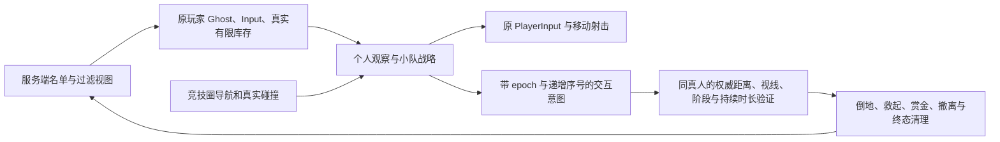

# 单人赏金速战 AI 队伍

2026-10-22。首轮统一 Unity 编译和 AI 专项 23 项检查通过；随后正式地图中六名 AI 自然完成了一局驱散、夺标和撤离。队内救援与真人战斗手感尚未完成实机验收。用户报告 Mac 内存不足后，已停止运行时检查；不再进行联机验收，任何时候最多一个 Unity Editor。

正式离线局使用独立离线仓库，真人按现有离线存档规则扣装、死亡掉装、撤离保留战利品并按权威事实发放赏金；此文描述 AI，离线经济实现由服务端及持久化组维护。固定为真人独立队加三支双人 AI 队，没有增援或真人 AI 队友。AI 无账户档案，不领奖、不访问线上 HTTP 或数据库。

## 接入与权威

只有 `OfflineRaidMode`、显式本地 `ClashSoloMode` 和 `RaidModeState.BountyClash` 同时成立才启用。联网原模式继续关闭旧 PMC，普通 Expedition 的人口和搜刮链保留。

`ClashBotRegistry` 提供出生请求；AI 复用 `SpawnActor` 创建角色、输入实体和携带库存，绑定服务端指定的 Participant/Team/Slot/Epoch/Owner 后登记，不创建伪连接或额外客户端。服务端验证角色链后才确认部署。

倒地与准备阶段禁止 AI 输入并保留身体、输入实体和库存。AI 不走旧 `DropCorpse` 或旧八秒撤离销毁；终死仅由服务端生成一次真实库存包，撤离/超时和换局清理也由服务端负责。AI 不直接修改比赛生命、赏金归属、计时或奖励。

## 战略和战斗

- 个人视觉仍经视角、距离和头/胸/髋物理射线逐渐识别，采样随实际角色胶囊姿态变化；射击保留转速、反应延迟、移动/压力/首发误差、有限弹药、真实弹道和短连发。发射前同时检查目标视线与实际带误差射线上的友军，避免把误差绕过友军挡枪。
- 同队、自己、旧 epoch 和非活动威胁不会进入敌方感知。小队仅在 60 m 内约每半秒共享成员亲自看见/听见的近期线索，报告增加至少 2 m 位置误差且不变成接收者的个人可见目标；不转发“报告的报告”，也不用传递时间为旧证据续命。记忆到期后仍会放弃搜索。
- 两名队员使用不同接近侧；在队友有已识别目标、合法射击姿态和剩余弹药的窗口交替掩护/换侧。没有无限盲射或假设每发附近枪声都是近失弹。掩体继续采用接近、稳定、探出、短持、返回阶段，受伤打断，两次暴露后换位；低血量退避并消耗真实携带药品治疗。
- 默认推进公开目标，接近后由一人交互、另一人在不同侧警戒。驱散和拾取仅提交服务端意图。敌方携标只使用公共粗格线索和实际感知，不读取全比赛敌人的实时坐标。
- 安全窗口、可达路线、自己生命和剩余时间允许时优先救起近处倒地队友。开始后停止移动/射击，每约 0.2 秒续租五秒救援；重新见敌、受伤或失去可交互距离时取消，最终复活由服务端裁决。
- 携标者优先撤离，同队保持间隔护送；依据本队公开出口阻挡状态、实际路径长度和已记忆威胁比较两个出口。可达开放出口优先，持续阻挡或反复路径失败会重新选路；不再因搜够三个箱子或旧局时额度退出速战。

## 导航与恢复

沿用现有服务端异步碰撞 NavMesh，速战烘焙范围限定为竞技圈周围，不按每个 bot 重烘焙。使用半径 0.35 m、高度 1.8 m、爬阶 0.35 m 和 0.2 m 体素；正式碰撞流入并完成构建后，检查十二个配置出生点的站立净空及到目标的完整圈内路线，以及目标到至少一个出口的完整路线，全部通过才报告 NavigationReady。导航失败明确阻止开局，向 UI 给出可本地化的失败状态，详细原因保留在 Console，不制造假 AI 开局。

战术候选和路线受竞技圆约束；角色若被推到圈外，只允许向内恢复。完整路径拒绝截断角点、错误楼层和危险出圈路线。移动受阻仍按有限周期重算，同时记录失败目的点冷却并尝试有限侧向/后退可达点；最多连续三次局部恢复后等待冷却，不传送穿墙。出口不可达会比较另一个出口，不无限执行旧单出口目标。

## 验证记录

专项入口为 `BountyClashBotAIChecks.Run()`：生产方法的友军/epoch 过滤、带误差且会过期的小队记忆、竞技圈路线、速战目标替代旧搜刮额度，以及救援 begin/renew/cancel 与倒地禁交互。服务端组在其独占 Editor 窗口完成首轮全项目编译并实际运行，本组 23 项检查通过。该检查不启动 Raid、Transport、档案或导航烘焙；运行时创建的单个临时 World 在退出时释放。检查后恢复 MainMenu clean/nonPlay/World0；没有改场景、用户 Prefs 或两份字体。

2026-10-22 首次真实入口检查：出生等待生命门禁修正后全项目重编译 completed/failed=false/compilationFailed=false/errors=0/warnings=0。运行 `Assembly-CSharp` MVID 为 `7478c221-7876-4161-8013-6baa573d0c7a`，写入 UTC `2026-10-21T18:41:22.941815Z`。仅使用单 Editor，经 Play 后注入 Library 隔离 `OfflineProfileStore` 身份，再走真实 `GameManager.StartGameAsync(Offline)` 与本地 Transport；实际建立一个 Server 和一个 Client，但旧服务端入口仍无条件拒绝 OfflineClash，于 Ghost 同步阶段断开，尚未生成比赛或 AI。这是失败证据，不是导航/实战通过。服务端所属组已修复该遗留条件，下一轮须加载新程序集再试，不能绕过入口验证。

第一轮记录保留于 `Library/BuildValidation/BountyClash/SoloRuntime/20261021-184209/`，启动日志为上层 `startup-console.json`。已经正常返回 MainMenu 并退出 Play、World0；项目相关八个 Prefs 键恢复，用户原离线档 SHA 指纹一致。Console 基线已保留（UI 自定义 GameView 尺寸清理三条错误及此前错误命令一条），未清 Console；启动失败、批量 tick 警告和返回预览时发现的 missing-script 警告另行保留，不掩盖或归为 AI 导航通过。

后续真实一局记录位于 `Library/BuildValidation/BountyClash/SoloRuntime/20261021-190151/`。`match.txt` 每两秒保留比赛阶段和七名参与者的生命、血量与出口状态，实际记录了 AI 交战、倒地、驱散、拾取和携标队两人从北出口撤离，最终真人超时。`profile-before.txt` 与 `profile-after.json` 使用隔离测试档案；真人部署装备及四枚携带电池按失败结算，AI 的赏金没有发给真人。`running-assembly.txt` 记录该局实际程序集 MVID 为 `ac5fa560-4490-4651-b812-2f40ca30a78d`。没有直接设置 AI 位置、生命或赏金来伪造闭环。

这局的真人是被动观察角色，不能据此声称真人射击、近战、护盾视觉或完整单人战斗体验已经通过。AI 尝试接近倒地队友，但没有完成救援；交互接近距离已在源码修正，尚未实机复验。该局返回主菜单后检查被内存问题中断，最后一次 Prefs 清理尚未重新确认，不能沿用首轮的恢复结论。

实机截图还暴露了圈内持续显示越界警告：规则层在圈内返回完整的 20 秒容错额度，而 HUD 以负数表示隐藏，服务端原来直接发送了规则额度。现已让快照仅对活动、存活且确实出圈的参与者发送倒计时，其余发送 `-1`；保留规则层 20 秒语义。源码已核对，与现有 UI fixture 的负数约定一致，未重新进入 Play 或截图验收。

当前执行限制：不自动重启 Unity，不运行额外客户端、MPPM 或联机验收；源码工作和必要的轻量检查串行进行。救援、近战动作、护盾效果和小尺寸模式选择界面保留为未完成的实机验收项，不用状态模拟代替真实效果。无需获取厂商私有玩家数据、训练新模型或调用在线大模型；当前采用独立实现的经典感知、效用决策和小队战术设计，没有复制 SAIN 源码或二进制。
