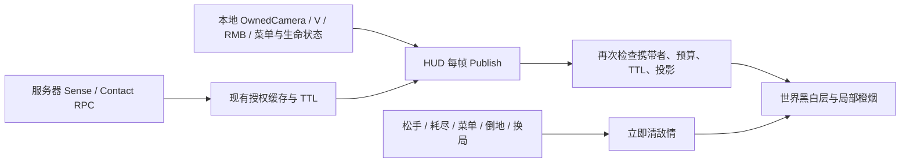

# 黑暗视野的相机表现层

2026-10-21。实现与接入已统一编译；正式场景v2环境、云与两张叠加图已全部通过协调组本轮视觉门禁，渲染代码与美术参数冻结。

## 表现与玩法边界

视觉参考是 Crytek [2018 年 Dark Sight Boost 官方说明与示意](https://www.huntshowdown.com/news/point-blank-a-look-at-the-dark-sight-boost-mechanic-from-patch-2)的黑白环境与暖橙敌情层级。该文的旧150m/20秒规则不采用；本项目继续使用既有125m增强范围、5秒预算、75m基础存在感。采用项目自有角色素材与原创音效，没有Hunt原版双手动画、音频或手部模型。云为授权不确定区域的软烟表现，没有敌人精确轮廓；此实现不表述为完全原版或AAA美术复刻。

普通暗视把环境转为冷黑白高反差，保留暗部可走空间、近景深度轮廓，边缘柔暗与低强度流动噪声；进入0.12秒、退出0.18秒。只影响实际OwnedCamera的世界颜色，UI文字不染色。

75m存在感只是一圈无方向的柔橙呼吸，不给方位。125m云仅由服务器已授权、未过期的Contacts产生，至少3m不确定度，以有流动噪声的软烟团提示大致位置；不画骨架、边框或精确人体轮廓，不把背后/屏外目标挪成边缘雷达。烟团不采场景深度，可以透过遮挡；能否视作实际穿墙图验，必须另有射线证据。

## 授权与生命周期

`BountyClashDarkSightRenderer.Publish(camera, view, boost, presence, authorizedCache, now)`只接受实际玩家的Game/base OwnedCamera，HUD在`SetSenseInput`之后每帧调用。表现层不查询任何敌方ghost或实体位置。云再次经过`SenseVisible`、`ContactVisible`、Alive/Active/Connected/IsCarrier与实时剩余预算门禁；presence另有0.7秒header TTL，增强预算耗尽后仍可保留基础存在感。

`Publish(false...)`或`Clear()`同步清空敌情数组及已排队pass的Count/Presence；只有普通环境允许退出过渡，不保留敌情拖尾。HUD停止发布0.2秒后失效。Hide、Reset、Dispose、换World、退出模式、丢失Owner须`ClearImmediate()`，同步归零已排队pass的Blend/Count/Presence/Owner并退订、释放材质/音源/音频。对象销毁或相机停用不依赖未来回调才能清理。

旧UITK平罩、Painter圆盘和硬矩形存在感已移除，UI保留操作提示与预算。声音只在进入/退出状态转换时播放原创短低频提示，复用现有SFX混音组，不修改音量或混音器资产。

## 渲染接线

`BountyClashDarkSightRenderer.cs`与`Resources/Moonkov/BountyClashDarkSight.shader`新增独立层；全局SilverPrint599保持，Dark600，战术透明601，受伤/黏液警示602。环境从活动颜色读取，写一张按该图资源descriptor派生的临时颜色纹理；同一raster pass随后绘制最多11个局部烟团quad。没有常驻RT、全屏多采样模糊、新Gameplay World或全场重阴影。用公开纹理UV方向查询构造GPU投影；Metal投影方向已由v1/v2实图复核，实际颜色已通过v2视觉门禁。

## 验证状态

- 主程序组已按RenderGraph技能完成只读复核：授权/预算/TTL/数组边界、源读/目标写、静态两次Draw、深度只读、owner与音源生命周期可进入编译/图验。内部翻转API调用、清理旗标与色域微边缘项已修正。
- 正式MC00对照脚本为`/tmp/BountyClashDarkSightPreview.cs`，实际输出为`Library/BuildValidation/BountyClash/DarkSight-World-v1/`。使用Receive + SetSenseInput +递增获权header构造视觉样本，不是实际联网敌人；不创建Gameplay World。
- UTC13:52:08首轮正式MC00实际执行完成（脚本compile1294ms/execute18073ms、C# compile error0）。10张图和报告在上述目录：授权云1，其余9场景云0；实际Hull collider遮挡射线为True；ClearImmediateDriverNull=True；finally恢复单一cleanLab/play=false。根已认可软橙云、无精确骨骼与Metal投影，但认为普通环境和存在感变化偏弱，故未最终放行。
- v2仅调整shader四组美术常量（中间调、低光保底、近景边缘、存在感强度），不改结构或门禁。`/tmp/BountyClashDarkSightArtPreview.cs`只复采普通/存在感/增强三图，并同一次正式场景加载补必要的火/云/伤害与黏液602叠加两图；不重跑10场景、7道具图或64业务项。实际5图与report保存在`Library/BuildValidation/BountyClash/DarkSight-World-v2/`，UTC14:04:02完成（脚本compile1764ms/execute19826ms），finally恢复clean单Lab/play=false。Console cursor79428→79486新增error0；其余warning为既有Airlock序列化提示与账号API包提示，不记为暗视运行失败。普通/Presence云0、增强及两叠加各云1，实际遮挡True；根已亲读三主图认可明暗层次/softcloud/presence，参数冻结。两叠加图使用真实战术火与既有damage/mucus材质在602绘制，属于表现层注入，不是伤害/网络验收；根已亲读并确认两叠加图层次正确，本轮视觉门禁通过。最后统一编译与全项目Console收口由UI/协调组完成，不额外重复本轮图或业务测试。
