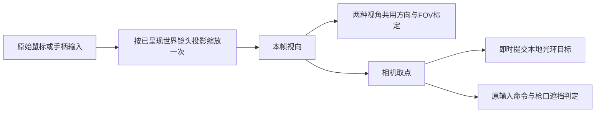

# 角色预览拖动与视角瞄准

2026-10-21，当前 develop。

## 证据与修正

- 首页、出战角色确认、仓库装备页和局内装备页复用 `MenuCharacterView`。原实现将图片设为 `PickingMode.Ignore`，且每次动画推进重写模型 yaw，没有指针检视入口。现在只允许在人物图片上开始鼠标左键拖动，横拖一个图片宽度旋转 180°，指针捕获可延伸到图片外；松手、取消、丢失捕获后停止。关闭或隐藏时释放预览舞台并复位。开始检视后固定用户选择的角度，不再叠加展示动画的自动转身角度；人物动作继续播放。
- 装备按钮、物品拖动继续拥有自己的指针目标与捕获。库存组配套将 `ContainerInventory.uxml` 中空白 `slotLayer` 设为 Ignore，使空白区域能拾取下方人物；子装备按钮仍可拾取。
- `DollSingerPlayer.prefab` 的原第三人称镜头为 45°，`DollSingerView.firstPersonFieldOfView` 为 70°，原代码随视角混合这两个值。两种视角现在共用现有 70° 世界相机标定，保留序列化字段名和可调值；第三人称轨道位置、碰撞回缩、第一人称眼部位置仍独立。
- 原 `TargetAimMagnification` 只在第一人称使用武器倍率，第三人称退回 1.75 倍。现在两种视角使用相同武器倍率与同一抬手后变焦时间线；镜头 FOV 仍按投影正切计算。70° 下，1.75 倍约 43.61°，8 倍约 10.00°。普通手势的独立手部相机 FOV、狙击手部镜头跟随世界变焦、光环和手臂平滑过渡不改。
- 原第三人称中心射线带有镜头初始 12° 局部俯角，第一人称命令射线直接采用 look rotation。现在两种视角世界相机的局部旋转均为零，由同一输入视向驱动；第三人称仍通过轨道与肩部偏移改变相机位置。命令取点与屏幕中心方向一致，保留枪口到目标的原有视差和遮挡判定。
- 输入路径未发现双重倍率缩放；鼠标原始 delta 直接乘基础灵敏度，`DollSingerLookController` 再使用 `AimLookSensitivity` 一次。原比例根据 aim blend 推算，可能早于实际画面的变焦；现在从当前已呈现的相机 FOV 投影计算比例，8 倍为 1/8，保留原瞄准灵敏度配置。自由观察沿用原速度。
- MonoBehaviour 的网络表现 Update 早于 ECS 的 GhostInputSystemGroup，本地光环 LateUpdate 可能沿用上次表现 Update 提交的旧目标。`CaptureAimPoint` 现在立即将最新本地目标提交到光环，再由原 LateUpdate 和既有平滑链路表现。未修改武器伤害、射速、散射或服务端弹道。



## 回归入口

先用本项目 Unity 6000.5.10f1 编译，然后在停止 Play 的状态运行：

```csharp
MoonkovViewInteractionChecks.CheckCamera();
MoonkovViewInteractionChecks.CheckPortrait();
// UI 检查在独立临时 EditorWindow 排版后异步执行。
// 查询 MoonkovViewInteractionChecks.LastPreviewResult，最终应为 passed。
MoonkovShootingFeelChecks.Run();
MoonkovThirdPersonCameraChecks.Run();
```

专用检查使用临时 fixture，不保存或切换用户场景。相机检查实际执行 `DollSingerView.LateUpdate` 并测量 Camera 投影，验证两视角 1/1.75/6/8 倍、中心方向、屏幕目标尺寸、缩放一次、微小输入与当前画面变焦一致。人物检查使用真实预览模型和 UI Toolkit 指针事件，验证拖动、释放、取消、叠放按钮、移除清理与重开复位。

当前实际 `SniperHalo.prefab.scopeMagnification` 为 6，Player/NetworkPlayer 没有覆盖；旧射击文档中的“默认 8 倍”不代表当前资产。保留该配置，8 倍作为可配置倍率回归场景单独验证。

人工验收：在首页、出战角色页、仓库及局内装备区左右拖动人物；松手停止、离开重开复位，按钮与物品拖动不旋转人物。在真实战局使用同一武器依次切第一/第三人称，检查普通镜和 8 倍镜目标比例、中心取点、近墙枪口遮挡、QE 侧身、换镜、抬手/放手、自由观察及 UI 开关。相机位置引起的近距离视差保留。主观手感、多人网络及可执行构建不能由专项数值检查替代。

## 验证记录

- 静态 `git diff --check` 通过。
- Unity 6000.5.10f1 全工程编译 completed，0 错误，无新增相关警告。首次编译的 `PointerType` 同名歧义已显式限定后复验；既有序列化分析器警告未扩大处理。最终 Console groundTruth 为 0 错误、1 条 Unity AI Account API 30 秒连接超时警告；历史工具缓冲中的旧编译/超时记录不作为当前错误。
- `CheckCamera`、`CheckPortrait` 均通过，UI 异步结果明确读取为 `passed`；既有 `MoonkovShootingFeelChecks.Run()`、`MoonkovThirdPersonCameraChecks.Run()`、`MoonkovShotChecks.Run()` 通过，包括精细输入、轨道碰撞回缩、头部/自身/枪口遮挡和密集取点回归。
- 在现有 `WeaponGestureLab` 临时 Play，真实正式角色 Prefab 的普通镜两视角 FOV 均约 43.61454°，正式 6 倍均约 13.31276°，临时运行实例的 8 倍均约 10.00424°；灵敏度分别约 0.5714286 / 0.1666667 / 0.125。普通手部镜头保留 65°，狙击手部镜头跟随世界镜头；第三人称关闭手部镜头。放下瞄准后 AimBlend=0、世界镜头回到 70°、手部显示关闭。运行帧计数实际持续推进。
- 初始数值夹具在 10 km 坐标、3 cm 近裁面重建 `ViewportPointToRay` 出现浮点抵消，已将常规投影夹具移到原点附近，并额外在正式出生点量级复验，未用改阈值隐藏结果。正式 Spawn 1 无父变换，位置 `(1796,180.90761,2164)`；将真实角色运行实例临时移至该位置，以 pitch=-17°、yaw=-100° 检查两视角：命令射线方向与实际 camera.forward 向量差均为 0，100 m 中心目标的投影误差约 4.89e-6 个视口单位。该坐标的 `ViewportPointToRay` 方向向量差约 0.00075（第三人称）/ 0.00135（第一人称），说明直接用相机视向建命令射线可避开近裁面重建误差；未引入浮动原点。
- 最终恢复原 `WeaponGestureLab` 单场景、dirty=false、Play=false；正式狙击资产仍为 6 倍。未加载战局、改账户/玩家名称或保存测试场景。原始量化记录保留在本地忽略目录 `LocalData/ViewValidation/runtime-projection.json`。
- 本轮没有完整实战或双客户端/延迟丢包/可执行构建验收，未宣称主观瞄准手感和最终画面通过。手臂与光环沿用原平滑代码，运行数值和显隐状态回归不能替代实际游玩评价。
