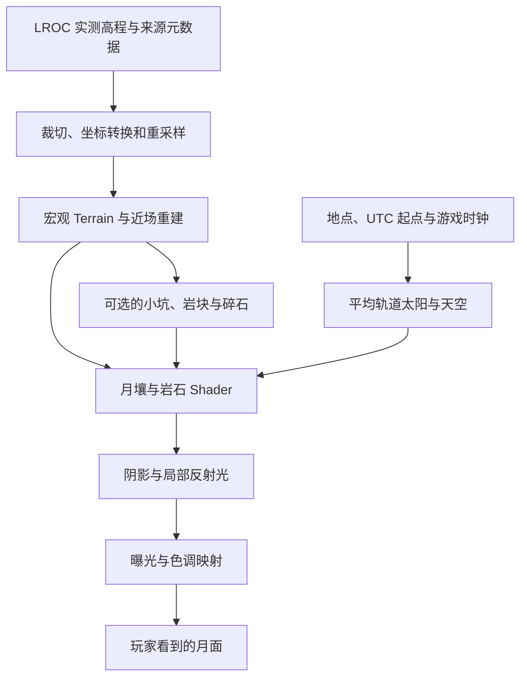

# 在 Unity URP 中构建真实感月球环境：从 LROC 实测地形到月壤反射

> Moonkov 项目技术总结 · 第一篇
>
> 技术栈：Unity 6 / URP / Terrain / C# / HLSL
>
> 本文按 2026-10-24 仓库实现整理，介绍真实数据驱动的游戏环境重建与实时渲染近似。

在制作 Moonkov 的月面地图时，我希望玩家能从地形尺度、岩石接地和受光方式中感受到月球环境。这个目标需要同时处理遥感数据、近场几何、材质反射、阴影和相机显示。

最容易尝试的方案是：生成一片起伏地形，铺上灰色岩土贴图，再把天空设成黑色。它能快速建立主题，但经常仍像一片灰色荒漠：山坡没有可信的尺度，贴图重复明显，岩石像摆上去的道具，太阳降低以后又会出现漏光和阴影圆弧。

我的实现围绕三个层次展开：用实测数据约束宏观地貌，用程序和材质补充近场细节，再让反射与照明遵循月面环境的主要特征。

## 1. 先定义“真实”的范围

这个项目中的真实感有明确的数据边界：

- **实测部分**：LROC 数字地形模型所提供的宏观高程与地貌结构。
- **合成部分**：测量分辨率以下的小坑、碎石、岩石摆放与颗粒细节。
- **渲染近似**：月壤反射、有限范围的一次反射光、平均轨道天空和相机曝光适应。

这套划分决定了后续实现和表述方式。地形插值可以提高网格密度，却不能创造新的测量信息；程序化生成的小坑也不能标注成真实地点的实测坑。



## 2. 用 LROC 数据建立可信的地形尺度

### 2.1 选择真实地形，而非任意噪声

项目选用的产品是 `NAC_DTM_THEOPHILUS3`。仓库保留的元数据显示，源栅格为 3494 × 14547，原生采样间距为 3 米，从中选择了一个 1367 × 1367 的有效窗口。

这个窗口经过重采样后生成 2049 × 2049 的高度网格，对应约 4096 × 4096 米的环境范围。垂直比例保持 1:1，裁切区域的高程约为 -1727.10 至 -1010.92 米。

选择窗口时还要考虑游戏视角。元数据记录，中央 512 米区域的高差约为 210.34 米。这个数字提示了一个实际问题：真实地貌未必适合直接摆放大型基地。选址、建筑支撑和通行路线都需要尊重坡度，不能仅因为用了真实数据，就假定地图已经适合游玩。

来源入口：[LROC Theophilus3 产品页](https://data.lroc.im-ldi.com/lroc/view_rdr_product/NAC_DTM_THEOPHILUS3)。本文的具体裁切与分辨率取自项目保存的 `dem.json`；该产品页本次未能通过检索工具访问。

### 2.2 高程导入要同时保留水平与垂直尺度

Unity Terrain 的高度通常以 0～1 存储，而 DEM 保存的是以米为单位的高程。转换时需要同时处理高度归一化和 Terrain 的世界尺寸。

下面用简化示意说明这种关系；它用于解释转换原则，并非仓库导入工具的逐行摘录：

```csharp
float heightRange = maximumHeight - minimumHeight;
float normalizedHeight = (elevationMetres - minimumHeight) / heightRange;

// 整个地形系统使用同一个垂直基准。
terrainData.size = new Vector3(widthMetres, heightRange, depthMetres);
terrain.transform.position = new Vector3(originX, minimumHeight - sharedDatum, originZ);
```

只把高度数组塞进 Terrain、再随意设置 Y 尺寸，会改变坡度和高差。近远地形如果各自归零而没有正确恢复世界高度，还可能在边界产生台阶。

水平轴向也需要明确。项目约定 Unity X 向东、Z 向北，并将 TIFF 行方向翻转为从南到北。这一约定也被天空系统复用，使地貌方位与天体方向使用同一个参照系。

### 2.3 保存重建所需的元数据

项目保留了原始产品名称、版本、下载地址、SHA-256、裁切窗口、投影信息、轴向约定、有效数据比例及垂直倍率。

这些信息能回答实际开发中经常遇到的问题：当前地形来自哪里？是否做过拉伸？重新生成后为什么方位变了？本地文件与原始输入是否一致？

这里最需要强调的是：**3 米原生数据重采样到 2 米网格，再重建为 0.25 米近场网格，都不会获得新的实测细节。** 更密的网格只是为插值和合成地表提供载体。

## 3. 用多尺度结构连接远景与玩家脚下

### 3.1 宏观地形与近场地形分开组织

模块的原始结构包含一块 4096 米范围的宏观 Terrain，以及中央 512 米范围的近场 Terrain。近场同样使用 2049 个采样点，因此网格间距为 0.25 米。

远景负责山体和大坑的轮廓，近场为浅坑与地表变化提供几何密度。远景中央通过 Terrain Holes 留出近场区域，避免两块地形重叠产生深度冲突。

切换演示中的“原始 DEM / 近场细节”时，需要配套切换远景孔洞。关闭近场以后恢复远景覆盖，才能避免地表出现空洞。

这个结构也有成本：高分辨率近场仍占用内存，并产生地形与碰撞更新开销。划分近远场只是预算分配方式，最终效果仍需要目标设备的测量。

### 3.2 用同一套地貌参数驱动几何和材质

`MoonSurfaceDetail` 提供可选的程序化补充：使用固定种子生成坑位，以坑底下凹和坑缘隆起组成高度轮廓，再加入角向扰动，降低规则圆环感。

它还保护出生区域和已有岩石接触区。这样既能保留坑形，也能降低生成过程破坏落脚点、使旧岩石悬空的风险。

程序生成不止改变高度。相同的坑位、半径和“新鲜度”参数还会写入地质遮罩，用于控制坑缘、坑底、抛射物和碎石分布。几何与材质共享空间依据，能够减少“坑挖在这里，亮斑却画在别处”的割裂感。

这里的“新鲜度”是艺术控制参数，不代表测得的岩石年龄或撞击年代。

### 3.3 将装饰细节与游戏碰撞分开

大岩块可能成为掩体或阻挡移动，因此按 32 米空间块组织合并网格，并保留 `MeshCollider`。纯装饰碎石则不需要参与碰撞，可以随视距淡出。

这项区分对多人游戏尤其重要。相机决定什么值得绘制，但不能独立决定世界里有哪些掩体。模块为大岩块保留各端生成碰撞的路径；固定种子也便于重建相同布局。不过，这些设计本身不等于已经完成跨平台确定性或联机一致性验收。

## 4. 在月壤 Shader 中表达非朗伯反射

### 4.1 引入 Lunar-Lambert 混合盘函数

普通漫反射经常从 `max(dot(N, L), 0)` 出发。月壤的方向性反射需要进一步考虑观察方向，项目因此采用 Lambert 与 Lommel–Seeliger 的加权混合。USGS ISIS 的 Lunar-Lambert 模型也使用这类组合。[模型说明](https://isis.astrogeology.usgs.gov/8.3.0/Application/presentation/Tabbed/photemplate/photemplate.html)

令 `mu0 = max(N·L, 0)`、`mu = max(N·V, 0)`，仓库实现中的核心盘函数可以写为：

```hlsl
half mu0 = saturate(dot(normal, light.direction));
half mu  = saturate(dot(normal, view));
half disk = lerp(mu0, 2 * mu0 / max(mu0 + mu, 0.05h), _LunarWeight);
```

`_LunarWeight` 在两种响应之间插值，分母下限用于数值稳定。它改变了地表随光照方向和观察方向变化的亮度关系，使月壤表现有别于只调整灰色贴图的普通漫反射。

这段代码是实时着色中的盘函数近似，不能单独作为完整、经过能量与测量标定的月壤 BRDF。

### 4.2 用相位函数表达反向散射增亮

相位角由表面指向光源、表面指向观察者的两个方向决定：

```hlsl
float cosPhase = clamp(dot(normalize(lightDirection), normalize(viewDirection)), -1, 1);
float alpha = acos(cosPhase);
```

`MoonPhase.hlsl` 在盘函数之外叠加宽角度衰减，以及参考 Hapke 模型的阴影遮蔽增亮（SHOE）和相干后向散射增亮（CBOE）角度形状，用于近似小相位角附近的亮度峰。相关理论背景见 [Hapke 等人的月球相位曲线研究](https://doi.org/10.1029/2011JE003916)。

实现中还有两个细节：用有限太阳盘的少量采样对增亮峰做平均；在 30° 参考相位处归一化，便于调节相位参数时保留参考亮度。

太阳盘平均只作用于相位增亮项，并没有生成面积光源的真实半影。峰宽参数也是角度尺度，不能直接解释为两个峰各自的半高全宽。

项目没有进行本地月壤样本的参数拟合，因此更准确的表述是“参考月球光度模型实现的实时反射近似”。

### 4.3 用随机晶格采样削弱贴图重复

月面缺少植被，地表会占据大面积画面，普通平铺很容易暴露重复纹理。月壤材质采用三角晶格采样：选择相邻三个晶格顶点，为各单元生成随机旋转和偏移，再按权重混合颜色、法线与粗糙度。

随机旋转不能只应用于 UV。法线 XY 分量需要变回统一方向，显式纹理梯度也要跟随旋转，才能维持正确的法线朝向和 mip 选择。

细节还按距离分配：较粗颗粒与近距离细颗粒分层采样，视差偏移逐渐在约 22 米内淡出，细颗粒层在约 18 米内淡出。远处降低合成颜色变化的对比，让轮廓、投影和法线承担主要深度线索，减少大块噪声形成“涂色条带”。

### 4.4 让岩石接入地表

`MoonRockGrounding` 为岩石保存接地平面、尘土混合高度、反照率变化和新鲜度，并通过 `MaterialPropertyBlock` 传给材质。岩石底部据此向月壤外观过渡，降低模型与地面的割裂感。

这些数据在启用或配置变化时恢复，不需要每帧查询 Terrain，也不需要为每块岩石创建独立材质。实际合批效果仍取决于渲染路径、实例属性与材质设置，不能仅凭使用了 PropertyBlock 就认定已经完成批处理优化。

## 5. 低太阳高度角暴露了哪些阴影问题

低角度光照会放大小坡面和坑缘的阴影，也会放大实时阴影系统的缺陷。项目中有两项值得单独记录的处理。

### 5.1 为地形保留双面投影

Terrain 是高度场表面，缺少封闭体积。在掠射角条件下，背面剔除可能参与漏光。项目将月球 Terrain 的 `shadowCastingMode` 设为 `TwoSided`，月壤的 ShadowCaster Pass 使用 `Cull Off`。

这个处理限定在月球地形的投影路径。它不会把高度场变成实体，也不能解决所有偏移、自阴影或精度问题，但能针对单面表面在低角度投影中的一个风险进行修正。

### 5.2 按像素选择级联并平滑切换

另一个症状是地面出现随相机移动的明暗圆弧。级联阴影具有跟随相机的分区边界；如果先在顶点端选择级联，再把阴影图坐标插值到像素，跨级联的地形三角形可能得到错误采样结果。

项目在级联变体中从片元世界位置重新计算阴影坐标：

```hlsl
return TransformWorldToShadowCoord(input.positionWS);
```

随后，在当前级联球外侧约 12% 半径的区域内，额外采样下一级阴影并平滑混合。代码同时检查下一级是否真实存在、片元是否位于其覆盖范围内，避免混入阴影距离以外的占位矩阵。

这种处理保留了分级阴影的近处精度，也把额外采样限制在过渡带。它的视觉收益与成本需要结合真实画面和目标设备判断。

## 6. 黑色天空、深色月壤与可读暗部如何共存

### 6.1 把反射率、照明与显示亮度分开

月球具有极稀薄的外逸层，项目在常规地表画面中采用无大气散射的近似，关闭地球式雾效。[NASA 月球事实资料](https://science.nasa.gov/moon/facts/)

但黑色天空不意味着阴影区域在所有条件下都没有入射光。附近受光地面仍可向其他表面反射光；项目的 `MoonLocalBounce` 因此从四个邻近地形位置近似一次漫反射，并结合朝向、简化地形遮挡与太阳阴影限制贡献。

这是一个近场、有限采样的补光模型，不能替代完整全局光照，也没有解决建筑内任意多次反弹。

月壤本身较暗，强烈日照下依然可以在画面中显得明亮。反射率、入射照明和相机显示亮度需要分别处理。[NASA Moonlight](https://science.nasa.gov/moon/moonlight/)

项目使用 HDR、曝光与色调映射控制显示范围；灯光 Intensity 仍属于游戏渲染标度，没有完成真实 lux 与相机曝光的整体标定。

### 6.2 用轻量测光近似支持曝光适应

模块中的 `MoonCameraExposure` 每秒约四次从画面若干位置发射射线，估计可见表面是否受到阳光直射，并增加脚下采样，降低站在日照地面却因抬头看黑色天空而突然大幅提亮的风险。

估计结果被转换为有上限的曝光目标，再按不同时间常数平滑适应明暗。相比画面亮度直方图，这个方法容易控制开销，也不需要 GPU 回读；代价是无法可靠计量自发光、人工灯光和整个画面的亮度分布。

因此，它应称为基于几何可见性与阳光遮挡的曝光近似。

## 7. 让天空与地形使用同一套坐标和时间

星图采用 NASA 的 Deep Star Maps 2020 HDR 素材，地球采用 Blue Marble 拼接图。前者基于恒星目录，后者是多期观测的拼接，均需要保留素材署名。[星图来源](https://svs.gsfc.nasa.gov/4851/)、[地球来源](https://svs.gsfc.nasa.gov/2915/)

`MoonAstronomy` 使用 DEM 对应地点的经纬度，计算东、上、北局部基底，并将太阳、地球和星空映射到世界坐标。

时间来自可配置 UTC 起点与现有服务器游戏小时，而非各客户端的本地系统时间。平均轨道模式采用约 29.530588 天的朔望周期，太阳越过地平线时按有限太阳盘做亮度过渡，避免直接套用地球式日落大气衰减。

这个系统仍采用平均轨道和零天平动近似，未接入 SPICE 精密星历，也没有完整处理天平动、食现象和实时地球云况。地球在局部天空中的位置、星空方向随时间的变化都建立在这些简化假设上。

## 8. 工程组织与性能取舍

月球模块集中在 `Assets/MoonEnvironment`，运行时、编辑器、Shader、数据与演示入口分开组织。

运行时对比会复制 TerrainData 与材质，退出时恢复引用并释放副本，避免演示开关污染源资产。相应代价是副本占用额外内存，因此仍需控制生命周期。

岩石 LOD 则将绘制与碰撞分离：`MoonRockLod` 以约 0.25 秒间隔更新距离分级，默认阈值为 18、80 和 600 米，切换共享网格或关闭远处 Renderer，保留碰撞。小碎石使用独立的距离淡出，地貌生成时也尽量集中提交高度更新。

这些措施体现的是预算分配思路。本文没有进行新的性能采样，因此不提供帧率、显存占用或优化百分比结论。

## 9. 当前正式地图与模块能力的区别

截至本文整理时，正式地图 `TheophilusGameScene` 引用 `TheophilusOriginalRegolith.mat`，天空时钟使用 `MeanLunarOrbit`，地点为南纬约 13.7855°、东经约 25.164°。

同时，正式场景序列化配置中 `surfaceDetail.enabled = 0`、`adaptExposure = 0`。前文的运行时浅坑与曝光适应属于模块已经实现的可选路径，不应描述为当前正式地图正在启用的效果。编辑器中的已保存地形和岩石也不能简单等同于这次运行时生成。

演示控制器设置过 1.62 m/s² 的重力，但这不能证明正式网络角色已经完整使用相同运动参数。本文聚焦地形与渲染，没有覆盖热环境、辐射、真空声学或完整低重力运动模拟。

本次整理核对了源码、元数据、材质引用和场景开关；没有启动 Unity、运行 Play、做联机验收或采集新截图。历史视觉与编译记录有各自的版本边界，本文不把它们当成本次版本的完整验收。

## 10. 这次实现带来的经验

月球环境的开发让我更重视信息在各系统之间的一致性：DEM 的单位影响坡度与路线；地貌参数影响几何、材质和碎石；世界方位影响天空；照明与反射共同决定曝光需求。

最值得保留的工程经验，是让每一层细节都有清楚的职责和来源。真实数据决定宏观尺度，合成内容服务近场表达，实时模型在预算内保留关键光学特征。这样既便于迭代，也能在介绍项目时准确说明已经解决的问题。

---

## 附录：仓库实现入口

以下链接供源码阅读与面试准备使用；对外发布时可按需要改为公开仓库链接。

- [DEM 元数据](../../Assets/MoonEnvironment/Editor/Source/dem.json)：产品、裁切、轴向、比例和哈希。
- [环境管理](../../Assets/MoonEnvironment/Runtime/MoonEnvironment.cs)：引用管理、运行时副本、近远场切换与释放。
- [程序化地表](../../Assets/MoonEnvironment/Runtime/MoonSurfaceDetail.cs)：坑形、遮罩、岩块与碰撞。
- [月壤 Shader](../../Assets/MoonEnvironment/Shaders/Regolith.shader) 与 [表面采样](../../Assets/MoonEnvironment/Shaders/MoonSurface.hlsl)：随机晶格、距离分层与地质变化。
- [光照和阴影公共实现](../../Assets/MoonEnvironment/Shaders/MoonInput.hlsl)：混合盘函数、局部反射光、级联处理。
- [相位函数](../../Assets/MoonEnvironment/Shaders/MoonPhase.hlsl)：SHOE/CBOE 形状、参考相位归一化与太阳盘平均。
- [岩石接地](../../Assets/MoonEnvironment/Runtime/MoonRockGrounding.cs) 与 [岩石 LOD](../../Assets/MoonEnvironment/Runtime/MoonRockLod.cs)。
- [场景照明](../../Assets/MoonEnvironment/Runtime/MoonSceneLighting.cs)、[平均轨道天空](../../Assets/MoonEnvironment/Runtime/MoonAstronomy.cs) 与 [曝光近似](../../Assets/MoonEnvironment/Runtime/MoonCameraExposure.cs)。
- [地形与表面素材来源](../Moon成果迁移/MoonSources.md)、[天空素材来源](../../Assets/MoonEnvironment/Art/Space/Sources.md)。表面素材用于视觉类比，不代表月球现场扫描。

可用作后续配图的三个题材：同机位的原始 DEM / 近场对比、不同太阳高度角的投影对比、固定照明下不同观察方向的月壤反射对比。当前文档未附这些图，也未将其作为已完成的视觉证据。
