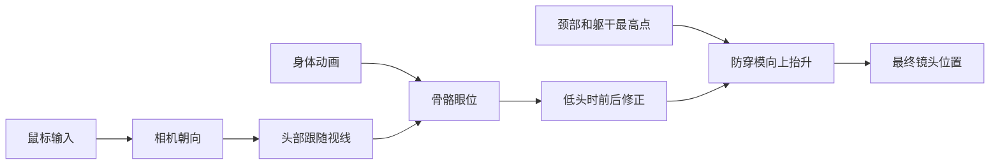

# 第一人称相机差距调查

日期：2026-10-28。以下记录调查时的实现与测量。后续修正见 [第一人称身体与镜头](FirstPersonCamera.md)。

## 目标与结论

目标是低头看见自然衔接的胸部、衣服和下半身。本人不应看到脖子断口、头部内侧或领口内部。保留身体带来的运动感，同时保证观察和瞄准舒服。

当前主要差距是第一人称身体呈现和镜头运动的控制。继续单调 FOV 或叠加随机晃动，不能解决根因。

1. 本人网格仍保留颈部。低头构图先把眼位拉回胸上方，再由全局躯干最高点把相机顶高。这两个修正在争夺构图。
2. 镜头位置直接使用动画骨骼眼位。走路和跑步的位移几乎完整传入镜头。当前防穿模算法不是运动稳定器。
3. 检查只保证近裁面高于躯干，不检查低头实际看到什么。通过旧检查不能证明胸部构图正确。
4. 世界镜头、胸部与手部已部分分开。普通手部仍有动态重算投影的路径。它是需要实际试玩确认的风险。

## 已核对的实现

| 环节 | 当前行为 | 影响 |
| --- | --- | --- |
| 眼位 | `DollSingerView.LateUpdate` 直接取头骨骼中的眼位 | 动画的上下、左右运动直接传给世界画面 |
| 低头 | `GetFirstPersonEyePosition` 在约 20.5°～71.8°间逐步修正前后位置 | 接近极限低头时，眼位被收回到胸前约 4 cm |
| 防穿模 | `KeepAboveTorso` 取 Chest、UpperChest、Neck 权重顶点的最高处，再加近裁面包围球和 1.5 cm | 不管顶点是否挡住当前视线，都可能抬高镜头。没有时间平滑 |
| 低头姿势 | LookAt 的身体权重为 0，头部为 1；随后强制头部追随视线 | 没有专门随低头弯身的胸廓构图层 |
| 本人身体 | 隐藏头部材质和部分头饰；原角色代码明确保留颈部 | 头被隐藏以后，颈部和领口附近仍可能被本人看到 |
| 手部 | 普通手势镜头名义 FOV 65°，并按安全区域重新缩放投影、移动手部镜头 | 手部和胸部使用不同投影。重新构图是否造成缩放感，需正式战局确认 |
| 检查 | 只覆盖 DollSinger、初音，断言近裁面各角高于躯干最高点 | 不含诗岸，也不判断胸部面积、颈部可见性和时序连续性 |

相关代码：

- [DollSingerView](../../Assets/DollSinger/Runtime/DollSingerView.cs)：眼位、低头修正、本人网格。
- [DollSingerTorsoClearance](../../Assets/DollSinger/Runtime/DollSingerTorsoClearance.cs)：每帧躯干最高点和抬升。
- [DollSingerMovement](../../Assets/DollSinger/Runtime/DollSingerMovement.cs)：`StabilizeHeadLook`、`OnAnimatorIK`。
- [DollSingerFirstPersonHands](../../Assets/DollSinger/Runtime/DollSingerFirstPersonHands.cs)：`FrameHands`。
- [MoonkovFirstPersonCameraChecks](../../Assets/Editor/MoonkovFirstPersonCameraChecks.cs)：现有检查边界。

## 隔离测量

使用现有的单个 Unity 6000.5.10f1 Editor。没有进入 Play，没有启动客户端或战局，没有保存场景或预制体。

在临时 PreviewScene 中实例化三个本地角色预制体。停用脚本和原相机。沿用真实网格、权重、眼位和相机求解方法。逐片段采样，扣除角色根节点位置。按现有头部绑定方式把头转到指定视线角度。没有执行完整 Animator 混合、Humanoid LookAt IK、姿态层、移动器或网络预测。

每个角色测量 8 个片段、2 个角度，每组 121 帧，共 5,808 个片段采样。另测量 7 个静态俯角，共 21 个姿态，生成 9 张低头预览。角度、身体姿态和渲染设置均为隔离条件，不能当作正式战局录像。

### 平视走跑

下表是一个动画周期中的峰峰值，即最高点减最低点。不是单侧振幅，也不是摄像机角度。数值为防穿模求解后的最终镜头位置变化。

| 角色 | 走路上下总行程 | 跑步上下总行程 | 跑步左右总行程 |
| --- | ---: | ---: | ---: |
| DollSinger | 5.42 cm | 9.90 cm | 8.17 cm |
| 初音 | 6.45 cm | 10.24 cm | 11.08 cm |
| 诗岸 | 6.14 cm | 9.99 cm | 9.96 cm |

走路片段为 `Walk_N`，周期约 0.967 s。跑步片段为 `DollSinger_Run_N_RelaxedFingers`，周期约 0.667 s。当前算法没有把上述位移分成稳定基准和有上限的步态表现。片段间的差异也会直接成为镜头差异。

落地片段的变化更大，但它同时含角色姿态压低。此次不能把整个落地行程都算成需要去掉的晃动，因此不将它作为首轮调参依据。

### 低头抬升

取 `Unarmed_Idle` 的 25% 时刻。下表只统计防穿模额外增加的高度，不包含动画自身位置和此前的前后构图修正。

| 低头角度 | DollSinger | 初音 | 诗岸 |
| --- | ---: | ---: | ---: |
| 45° | 2.69 cm | 5.66 cm | 5.32 cm |
| 60° | 4.46 cm | 8.54 cm | 7.63 cm |
| 80° | 7.00 cm | 11.92 cm | 10.56 cm |

初音在 60°时还向后修正约 7.02 cm。80°时约 5.87 cm。这里的“向后”相对当前水平视线。

在初音的 70°和 80°隔离姿态中，取画面中部 9×9 条射线查询本人裁切网格，可以命中以颈骨为主要权重的表面。射线分类只能证明颈部附近的几何仍可见，不能据此推算整屏脖子面积。DollSinger 和诗岸在这组稀疏射线中没有相同命中；不能把初音的结果说成三个角色均已复现。

本地证据位于 `Library/BuildValidation/CameraAudit20261028/`。该目录不入 Git。包含 `measurements.json`、预览图和本次诊断脚本。图片使用本人裁切网格、独立相机和简单灯光；没有正式地图、装备、后处理或 HUD。

## 对照主流 FPS

可公开核实的是设计原则和渲染能力，不能据此宣称已经拿到《猎杀：对决》或其他商业游戏的内部相机参数。

- **镜头晃动服务于读画面。** DICE 在《战地 V》说明中明确区分了镜头冲击和瞄准偏移，并调整受击晃动，使 ADS 时仍可留在目标上。这里是受击设计案例，不代表走路晃动必须完全相同。[DICE 官方说明](https://careers.ea.com/games/battlefield/news/battlefield-5-open-beta-update-notes-full-details)
- **本人模型可以专门处理。** Epic 的第一人称渲染文档分别处理本人几何、世界表示、独立 FOV、贴墙裁切和完整阴影。高级方案也保留下半身并对齐脚部。项目已经有部分对应结构，无需重做整套系统。[Epic 官方文档](https://dev.epicgames.com/documentation/en-us/unreal-engine/first-person-rendering)
- **舒适度需要可调。** 《战地 6》公开提供镜头晃动和减少冲刺上下晃动的设置。Xbox 指南也要求考虑 FOV、步态晃动、武器晃动和次级镜头运动。[EA 官方设置说明](https://www.frostbite.com/able/resources/battlefield-6)，[Xbox 指南 117](https://learn.microsoft.com/en-us/xbox/accessibility/xbox-accessibility-guidelines/117)
- **中央准星不是此处根因。** Crytek 官方确认《猎杀：对决 1896》同时提供中央和偏下准星。项目保持中央准星符合已有目标，无需为解决脖子问题更改它。[Crytek 官方介绍](https://www.huntshowdown.com/news/introducing-hunt-showdown-1896-out-now-on-pc-ps5-xbox-series-x-s)

当前默认 75°是垂直 FOV。在 16:9 下约等于水平 107.5°。不能直接和其他游戏的“90”比较。更宽的 FOV 可能放大边缘拉伸和近处身体的透视差异，但此次没有做用户主观 A/B，不能把它判为主要原因。狙击和普通举枪的倍率也不能混在一起比较。

## 建议修改顺序与验收

| 顺序 | 修改目标 | 成功标准 |
| --- | --- | --- |
| 1 | 本人低头身体呈现。按各角色处理颈部裁切、领口封口、胸部衔接与姿态分配 | 45°～80°渐进低头时，不见脖子断口或内部；胸部自然进入下方画面。第三人称和完整阴影正确 |
| 2 | 给动画带来的镜头位移设预算。保留步态节奏，分开控制上下、左右、前后和落地反应 | 观察远处目标时不被跑步横移和高频上下运动持续打断；停止移动不突然跳位；ADS 更克制 |
| 3 | 固定常用手势的构图规则，再比较 FOV | 小角度转头、连续开火、举枪和取消举枪时，手部不出现非动作导致的缩放或跳位 |
| 4 | 正式场景内测量帧间隔和镜头连续性 | 区分步态运动、台阶位移、预测修正和真正卡顿；先测量，再决定是否需要额外插值 |

旧约束要求眼位绑定、保留骨骼驱动和中央准星。在这个约束下，优先调整本人可见网格和上半身动画。若采用独立稳定镜头加位置滤波，则会改变“完整跟随真实眼位”的含义。这是需要明确选择的设计取舍，不应伪装成小幅 FOV 调节。

不能只删除整块脖子。原实现保留它就是为了避免领口破洞。也不能只关闭现有抬升，否则会重新出现近裁面切入身体。应把本人身体呈现和安全眼位作为同一项修正。

后续验证覆盖站立、走跑、举枪、下蹲、趴下、Q/E 侧身、Alt 自由观察和角色切换。检查 30/60/144 Hz、不同 FOV 与宽高比。检查屏幕中心射线、实际瞄准和发射规则一致。复用本人表现层，避免每帧新增 BakeMesh、材质实例、全层级搜索或无必要的额外相机。

## 验证边界

诊断脚本在现有 Editor 内存编译和执行成功。执行后仍处于 MainMenu，场景未变脏。正式项目 `compilationFailed=false`。Console 中另有工具命令错误，不能据此声称 Console 完全无错。

这次确认了相机位置求解、保留颈部和动画位移的具体行为。完整战局中的晃动观感、手部重构图、台阶平滑、网络插值、帧间隔与后处理影响尚未实测。没有进行联机验收或平台构建。
