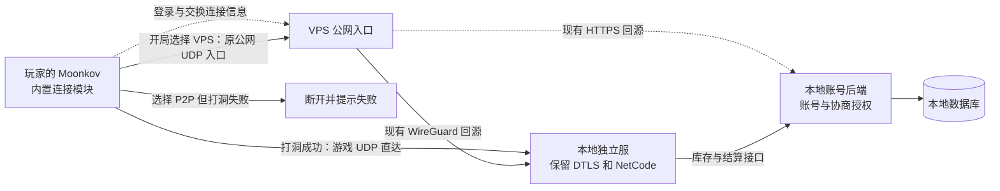

# Moonkov 内置公网连接方案研究

日期：2026-11-07。状态：已接入 Windows x64 内置 ICE、已鉴权协商和小队开局选线，见[当前实现](../Tools/Networking/EmbeddedIce/README.md)。用户最终要求 P2P 失败直接断开，不自动回退 VPS；下文已按此更新。账号后端已更新。Player 打包、跨网络直连和性能尚未验证。

## 建议

采用 `libjuice + Unity Transport`。玩家只安装 Moonkov，使用现有游戏账号。队长在准备阶段选择本局走 P2P 直连还是现有 VPS 入口。P2P 由游戏自行协商，失败直接断开，不自动切换线路。

选型依据与底层收发已有证据，完整游戏入口仍没有端到端结果。账号与仓库的低延迟通道单独列为后续工作，不能用战局变流畅代替全部联机完成。

- 发布包不依赖玩家安装 Tailscale、ZeroTier 或 Radmin。
- 不安装系统虚拟网卡，不要求玩家配置路由或注册额外网络账号。
- 本地独立服继续掌握战斗、库存和结算权威。P2P 在这里指网络路径，不把游戏改成玩家互相裁定结果。
- 保留用户要求的本机公网路径。同机客户端不能自动走回环、IPC 或本机网卡地址；P2P 只交换公网候选，选择 VPS 时使用原公网入口。
- Mac 暂时不可用不妨碍源码研究或内置原型。真实打洞成功率和延迟仍需要另一条网络的设备验证。

## 项目中已确认的接入点

| 位置 | 当前行为 | 内置方案需要的变化 |
| --- | --- | --- |
| `EntityDriverConstructor.cs` | 使用 Unity NetCode 驱动，在线直连固定采用 UDP，并配置 DTLS | 增加 ICE 收发接口；保留普通公网 UDP 路径 |
| `OnlineTransportSecurity.cs` | 公共 CA 校验服务器，证书名称与传输地址分开 | 保留 DTLS、证书名称和服务器私钥边界 |
| `OnlineLobbyClient.Join()` | 从大厅快照取得连接方式、地址、证书名和协议版本 | P2P 使用已鉴权协商；VPS 使用原公网入口，失败不换线 |
| `LobbySnapshot` | 只下发普通地址和端口，没有 ICE 协商字段 | 增加按玩家和战局授权的协商接口；不广播其他人的连接凭证 |
| `OnlineInstanceWorker` | 按局启动独立服，普通 UDP 端口固定；协议文件只检查标记 `1` | 启动后注册 ICE 能力，并保留旧入口；补明确的客户端兼容版本判断 |
| `AccountClient` | 登录、仓库拖放和商店操作使用 `HttpClient` | 战局传输改造不会自动加速这些 HTTPS 请求 |

当前工程是 Unity `6000.5.10f1`，NetCode 和 Transport 均为 `6.5.0`。安装包源码明确提供 `INetworkInterface`、`NetworkDriver.Create` 和 `DefaultDriverBuilder.CreateClientNetworkDriver/CreateServerNetworkDriver`。可以替换最下面的收发方式，继续使用现有 NetCode 管线。

`NetworkEndpoint` 支持 `NetworkFamily.Custom`，适合保存逻辑对端标识。ICE 选中地址变化时，不应把整个游戏状态绑定到一次临时公网 IP 上。

原型可评估 `WrapToUnmanaged()`。但当前源码在 Windows 检查中拒绝 class 实现，必须使用 struct；包装也有额外开销。不能把“支持托管接口”理解为任意 C# 类直接可用。正式实现需验证原生回调、Burst、对象释放和实际 Player 后端。

## 方案比较

| 方案 | 玩家需要另装 VPN 吗 | 对本项目的代价 | 结论 |
| --- | --- | --- | --- |
| 内置 libjuice / ICE | 不需要 | 实现 C# 原生库绑定、UTP 接口、协商和开局选线 | 当前实现 |
| 内置 ZeroTier libzt | 不需要 | 同样要接 UTP；另有节点身份、网络控制器和用户态 Socket 接入 | 备选，不是放进 DLL 就能接管现有网络 |
| EOS P2P | 不需要 | 接 Connect 身份、P2P 收发；还需验证无交互独立服身份与仅直连配置 | 备选，当前不优先换账号与网络服务体系 |
| Tailscale tsnet | 不需要独立桌面客户端 | Go 库桥接、节点注册、网络权限和部署管理 | 更适合内部工具，当前不优先用于公开玩家客户端 |

libjuice 官方源码提供 C 接口、Windows/macOS 支持、STUN、TURN 和 UDP 多连接复用。固定版本为 [v1.7.4](https://github.com/paullouisageneau/libjuice/releases/tag/v1.7.4)，提交为 `b89c792e3612faf2f12cf35bcc56857313a06be3`。后续原型已从此提交构建 Windows x64 插件，未修改上游源码；其他平台未构建或验证。[版本说明](https://github.com/paullouisageneau/libjuice/blob/v1.7.4/README.md)

libzt 确实提供 C# Socket 接口，但这些是用户态网络中的 Socket。现有 UTP 和 `HttpClient` 不会自动使用它；私有网络还需要节点授权。[官方 Socket 文档](https://docs.zerotier.com/sockets/)

EOS 有官方 P2P 与中继回退，P2P 使用 Connect 身份。Connect 不等于强制玩家登录 Epic Games 账号。不过，不能据此认定当前无玩家登录的独立服可直接接上；服务器身份与现有账号绑定仍是待验证项。也没有确认它能把当前 WireGuard/DNAT 入口直接当作 EOS 中继。[P2P 指南](https://dev.epicgames.com/docs/epic-online-services/multiplayer/nat-p2p-interface/p2p-guide/p2p-intro?lang=en-US)、[中继控制](https://dev.epicgames.com/docs/en-US/api-ref/enums/eos-e-relay-control)、[账号与 Game Services 的区别](https://dev.epicgames.com/docs/epic-online-services/accounts-and-social/eos-epic-account-services/epic-account-services-intro)

tsnet 是可嵌入 Go 应用的库。它提供用户态网络，但仍要管理加入网络的身份与权限。[官方 tsnet 文档](https://tailscale.com/docs/features/tsnet)

## 当前连接路径

队长在准备阶段选择本局连接方式。客户端和独立服同步打包后使用。现有 DNAT 不是 TURN；P2P 失败不会进入 VPS 分支。

P2P 成功后，游戏数据直接到达本地服务器。VPS 仍承载 HTTPS 登录和协商。选择 VPS 的战局继续使用原线路，其延迟不会因加入 P2P 功能而自动降低。

## 接入边界

1. 隔离编译原生库和薄 C# 绑定，先证明启动、收发、关闭和重复创建可用。DLL 随游戏包发布，不要求玩家另外运行服务。依赖和运行库也必须随包解决。
2. 实现一个 ICE 网络接口。用逻辑对端 ID 对接 UTP，保留现有 DTLS。原生线程只读写有上限的队列，不直接操作 Unity 对象或 ECS。
3. 通过已有 HTTPS 账号后端交换候选地址和临时协商凭证。凭证绑定玩家、战局、有效期和协议版本。服务器身份及中继长期密钥不进入客户端。
4. 在准备阶段选择路径并锁定到该局。ICE 协商总时限为 20 秒。客户端同时只发起一个游戏连接，避免两条路径重复入场。
5. 每个独立服实例只创建该局所选的 ICE 或普通 UDP driver。P2P 失败直接结束连接，不自动创建 VPS 连接。
6. 中途断线沿用现有重连入口和入场票据，连接方式保持不变。改线需回到下一局的准备阶段。

libjuice 的收发 API、回调、POLL/MUX 模式及选中候选查询均在[公开 C 头文件](https://github.com/paullouisageneau/libjuice/blob/v1.7.4/include/juice/juice.h)中。其线程模式不应机械设置成每个玩家一个线程；优先评估共享线程或 UDP 复用。

打洞必须由实际承载游戏数据的 ICE agent 完成，后续数据也继续由它收发。不能另开一个 UDP socket 测出公网地址，再把地址交给原来的 UTP socket。两者的 NAT 映射可能完全不同。

## 仓库和登录如何处理

当前继续用 HTTPS 作为账号登录、仓库和协商入口。战局数据改用 P2P 不代表仓库延迟已经解决。

若完整目标包含仓库拖放也绕开 VPS，需要增加一条常驻、加密、可靠的应用请求通道。它不能依赖按局启动、战局结束即退出的 Unity 服务器。优先让常驻网关调用现有账号后端接口，继续由后端检查账号、库存版本和交易规则。

具体的可靠通道仍需单独选型。libjuice 提供连接和数据报，不会自动把 `HttpClient` 变成走 ICE 的 HTTPS 客户端。不要把 HTTP 内容直接塞入裸 UDP，也不要临时拼一个缺少重传、鉴权和请求边界的协议。重连后不能自动重放不具备幂等保障的库存写操作。

数据库仍只供后端访问。玩家不需要数据库地址、账号或网络权限。

## 必须验证的实际风险

| 风险 | 最小验证 |
| --- | --- |
| 校园网与其他 VPN 共存 | 指定并核对数据实际出网接口；`bind_address` 本身不视为已保证 Windows 物理出口 |
| 数据包变大或握手被分片 | 覆盖 64、1200 字节及 DTLS 握手；当前 UTP 默认最大消息为 1400 字节，调整时按外层开销重新计算 |
| 多人流量拖慢主线程 | 原型后按真实队伍/战局人数测新增 CPU、内存和队列丢包；避免每包分配、无界队列和整帧等待 |
| 原生库与 Player 不兼容 | 验证目标架构、Mono/IL2CPP、裁剪及回调释放；Editor 能加载不等于正式包可用 |
| 旧客户端误入 | 客户端和服务端成对更新；新协议为 `2`，后端拒绝旧客户端和旧服务器标记 |
| 中继变成开放转发器 | 若后续部署 TURN，使用短期授权、会话和流量限制，拒绝未经授权的转发 |

libjuice 的 README 以常规单网关场景为主要目标，并含有 TCP 支持描述与限制文字并存的情况。当前仅使用 UDP 打洞，不承诺 TCP/TLS 中继可以无改动使用。没有部署 TURN；VPS 上 WireGuard 的 UDP 443 已占用，不能直接复用。[固定版本 README](https://github.com/paullouisageneau/libjuice/blob/v1.7.4/README.md)

真正的低延迟结论必须来自不同网络的两台设备。比较同一对设备在直连和原 VPS 路径下的 RTT、中位数、尾部延迟及丢包，同时记录最终路径和物理接口。一次 ping 成功或同机回包不能代替这些证据。当前仅有校园网本端 STUN 预检，没有对端数据。

## 分发许可

libjuice 使用 MPL 2.0。分发时要保留许可，并提供所分发 MPL 部分及其修改的源码获取方式；独立、不含 MPL 代码的游戏文件不因此要求整仓开源。具体打包内容应与固定版本源码一致。[Mozilla FAQ Q8–Q11](https://www.mozilla.org/en-US/MPL/2.0/FAQ/)

不以“libzt 闭源集成必然要付费”作为淘汰理由。当前根 LICENSE 写有 `2026-01-01` 的变更日期和 Apache 2.0 变更许可；许可证也明确按版本分别适用。若选 libzt，仍要固定具体版本并检查 ZeroTierOne、lwIP 等依赖，不能只看 README 的 BSL 标签。[根许可证](https://github.com/zerotier/libzt/blob/main/LICENSE.txt)、[依赖清单](https://github.com/zerotier/libzt/blob/main/.gitmodules)

## 本轮交付

已接入内置 ICE/UTP、现有 DTLS、账号后端协商、开局选线和取消释放。新队伍默认 P2P，队长可选 VPS；P2P 失败直接断开。后端已更新，客户端与独立服需要同步打包。按用户要求，后续接入没有运行额外测试；此前底层结果不代表完整公网联机结果。
