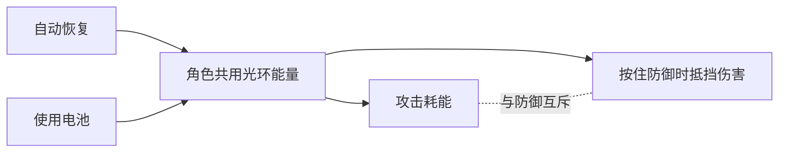

# 光环共享能量

2026-11-04。此规则取代光环弹仓供能和独立能量护盾。

## 玩家规则

- 角色只有一条光环能量。基础上限为 100。
- 同一角色装备的光环共用能量。切换、卸下和重新装备不会补能。
- 开局有光环时能量充满。局内捡到光环不会额外赠送一池能量。
- 每次开火扣除武器的每发耗能。霰弹按一次击发扣费，不按弹丸数重复收费。
- 停止消耗并松开防御 3 秒后，每秒恢复 10 点。防御期间不回能。
- 按住 T，或手柄方向键右，展开光环防御。松开即结束。按住防御时不能射击；已排队的射击和连发会清除。
- 防御不额外收取持续费用。实际抵挡 1 点伤害消耗 1 点能量。能量不足的部分伤害进入身体。
- 防御可挡子弹、爆炸、近战和火焰。缺氧、饥渴、跌落等伤害沿用原规则。
- 能量耗尽时防御瓦解。必须松开按键后才能再次展开，避免低能量反复闪烁。
- R 使用口袋或胸挂中的一节电池。库存右键也可补能。一次最多补 100 点；优先用当前电池的余电，未转移的电量保留。满能量不消耗。
- 防御、医疗、其他占手动作、死亡和失去行动资格时不能使用电池。空能量不会自动消耗电池。

## 物品与模块

- 旧护盾发生器保留物品 ID 和旧存档字段。它不再提供防御，不再出售给玩家，也不再由敌人生成或主动装备。已有物品可存放或出售。
- 旧护盾槽只在仍有旧物品时显示，便于取出。项圈、头罩和氧气不改。
- 旧 `LoadedAmmo` 只为存档及独立演示兼容保留。正式战局按共享能量决定能否开火，不会把旧弹量兑换成新能量。
- 电容模块提高共享容量 50%。多个光环的容量加成取最高值，不叠加。换下容量模块会截断超出的能量，装回不会免费补满。
- 原充能速度模块改为影响自动恢复速度。快充桥提高约 67%，电容降低约 26%，月核回收器降低约 17%。每发耗能加成仍生效。
- 聚焦镜保持散布降低 55%。原“少一发弹仓”的代价改为每发耗能提高三分之一并向上取整。
- 敌人沿用同一套资源。安全时可用真实电池。退避或回掩体时可主动防御；不会同时射击。没有电池不再等同于永久弹药耗尽。

## 表现与入口

- 光环能量接入现有 `RaidVitalsMonitor`，作为底部的一行分段资源条。战斗 HUD 和 Tab 健康页共用。保留透明底和原有对齐，不另建护盾卡片。光环格子跟随当前武器配色，空格使用同色淡边框。低能量只改变标签的警示色，格子仍保留武器色。其他健康信息沿用蓝白色。
- 生理资源“体能”和“光环”分开显示。光环条按真实容量归一化。未装备时隐藏。电池失败提示复用监测器原提示行，健康警告优先。成功补能直接反映在资源条上。
- `HaloEnergyRules` 统一负责资源、恢复、攻击扣能和防御状态。后续光环能力从同一池扣能，不能另存一套权威数值。
- `HaloEnergyInventory` 负责真实电池事务。服务器检查所有权、库存版本、可取用位置和角色状态。
- `EnergyShieldRules.Absorb` 保留原伤害入口，内部转为主动光环防御。原受击序号仍用于动作中断和命中反馈。
- `HaloDefenseSphere` 按当前武器选用正式光环的完整图案，在球面排列十二组。步枪、左轮、霰弹、狙击和九种扩展光环各自保留轮廓。开启约 250 毫秒，收回约 200 毫秒。受击时局部亮起。
- 球体颜色跟随当前手持光环的正式配色。切换光环后，形状和颜色一起更新。使用同步武器 ID，不读取被隐藏的攻击表现或关闭灯光的旧色。受击只增强亮度。手持近战时，HUD 与防御统一按主武器、副武器、手枪顺序取已装备光环。
- `HaloAppearanceSetup.Rebuild()` 从正式光环预制体烘焙完整精灵和线条组合，生成 `HaloAppearance` 配色表及共用图集。修改正式外形或配色后须重烘焙。库存图标可能只有外壳，不能代替完整组合。行动进度条的 `HaloProgressArtwork` 独立保留。
- 球体共用一份网格、图集和材质。每个开启的球体有 972 个顶点、1536 个三角形和一个材质批次。切换只改材质属性。不生成灯光、粒子或碰撞体，不逐帧重建网格。第一人称压低中心透明度。
- 新 Ghost 字段要求客户端与服务器使用匹配版本。本次不部署线上服务，也不做联机验收。

## 验证

- `HaloEnergyChecks.Run()` 检查攻防互斥、共用扣能、伤害溢出、恢复延迟、耗尽锁定、切换、卸装、电池余量和旧物品兼容。
- `HaloDefenseReview.Capture()` 在隔离的正式角色预览中检查展开、收回、真实表现入口、材质批次及碰撞体数量，并输出 13 种外形、明暗背景、受击、侧面和第一人称视图。`CheckWeapons()` 检查三套正式角色的图案、配色、隐藏攻击表现、近战回退和资源复用。
- `RaidVitalMonitorReview.CheckHaloEnergy()` 检查 HUD 与健康页一致、容量升级、耗尽、未装备和健康警告优先。`CheckHaloAppearance()` 检查全部武器的格子配色、同能量切换、空格和低能量警示。原 `CheckInteraction()` 继续检查部位治疗与补给按钮。
- `EnergyShieldBudgetChecks.Run()` 检查三套正式角色的防御显示和硬件预算切换。普通回能不展开防御。
- 本地证据保存在忽略目录 `LocalData/HaloEnergy`。规则和隔离渲染不等于完整战局、真实输入手感或目标设备性能验收。
- 旧护盾自动吸收、护盾供能、分段弹仓充能的历史夹具不再代表新规则。当前功能验证以本页入口为准。
