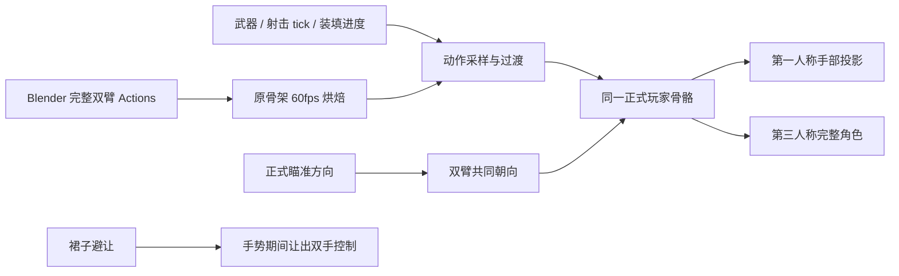

# 光环武器手势与第一人称展示

当前正式与本地玩家使用 Blender 完整双臂动作，详见 [源文件、导出与实测对照](BlenderWeaponGestures.md)。四种武器均包含定姿、射击、装填三段动作；切枪由采样器在 0.16 秒内过渡。瞄准仍由玩家相机及正式网络系统决定。

| 武器 | 手势 | 射击表现 |
|---|---|---|
| 步枪 | 雷轨·交叉剑诀 | 前刺、弹指与交叉回位 |
| 左轮 | 审判·剑指拨锤；指枪食指沿瞄准方向 | 左手剑指拨击拇指击锤并抬手回位 |
| 霰弹 | 魔王掌炮；恶魔角、左手托腕 | 五指爆发张开、双臂共同后撤 |
| 狙击 | 双手闭合直角取景框，食指各节伸直 | 保持框形，双臂共同回弹 |

`DollSingerHaloAim` 播放 Blender 烘焙的肩、臂、加权扭转辅助骨骼和手指旋转；瞄准选择 Blender 的俯仰姿态后调整双臂的共同方向；左轮在中间角度只对整组双臂做小幅共同校正，食指继续指向瞄准方向。旧的屏幕锚点、手腕朝向计算和双节臂重摆已经移除。

`DollSingerView` 保留第一人称头部过滤和完整影子。`DollSingerFirstPersonHands` 从同一蒙皮网格拆出双臂，复用实时骨骼、材质及表情权重，通过拥有者相机的 URP Overlay 展示。拥有者身体网格暂时排除双臂；其他相机继续看到完整角色。

世界相机继续使用原有瞄准倍率，手部相机默认 65°。普通手势通过居中的等比投影与相机位置放在画面下方，转头时连续更新取景，指枪食指延长线指向准星；中央 12% 方形区域在射击／换弹期间保留为空。切枪、重新瞄准或画幅改变时重新取景。普通武器瞄准时，拥有者相机只显示双臂，防止低头时身体／裙装挡住准星；第三人称和完整阴影继续显示全身。狙击保留闭合框形的原取景。此步骤不改变世界相机或骨骼姿态。裙子避让在手势期间清除手部 IK／肘部提示，服装弹簧和手部布料碰撞继续运行。

打开 `Assets/DollSinger/Scenes/WeaponGestureLab.unity` 并 Play，可以同时查看第一人称、正面、右侧、背面。`Tools / Moonkov / Check Weapon Gestures` 或 `Validate Blender Gestures In Playing Lab` 均运行新的实际玩家验证，包括源动画一致性、可见性、直角和闭合检查。结果保存在 `Temp/GestureValidation/Blender`，验收须结合画面。

`Capture Playing First Person` 截取 Play 中的实际拥有者相机。旧四个 Humanoid Gesture 动画及其生成工具保留为历史资源；正式玩家引用 Blender 烘焙，编辑旧动画不会改变本轮动作。
