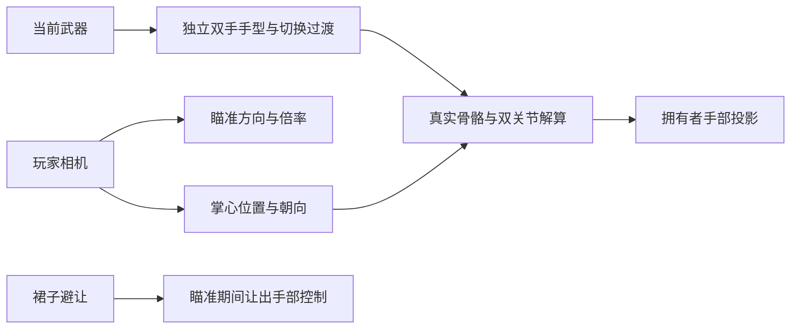

# 光环武器手势与第一人称展示

四把武器使用独立的双手手型，切枪由 Animator 在 0.16 秒内交叉过渡。手势、充能及回弹负责表现，瞄准仍由玩家相机决定。

| 武器 | 手势 | 释放与充能 |
|---|---|---|
| 步枪「雷轨·指诀」 | 双手并拢食指、中指，立起指诀 | 短促回弹；左手扫动为光环充能 |
| 左轮「审判·指枪」 | 右手抬拇指、伸食指，左手展开双指印 | 单手转腕；左手靠近转位区域 |
| 霰弹「崩裂·双掌」 | 两手展开、略微弯曲，包住能量团 | 双手后撤；左手展开再收回 |
| 狙击「取景·锁定」 | 双手拇指、食指组成相对的 L 形，围出摄影取景框 | 释放后左手解锁回位；充能时转腕收回 |

## 第一人称

`DollSingerHaloAim` 用相机空间的掌心位置、手指轴和掌面法线设置双手朝向；手指弯曲由四个 Humanoid 动画提供。双关节解算保持骨骼长度，不沿用裙子避让留下的手腕旋转。

`DollSingerView` 保留原有的第一人称头部过滤和完整影子。新增 `DollSingerFirstPersonHands` 从同一蒙皮网格拆出双臂，复用实时骨骼、材质及表情权重，通过拥有者相机的 URP Overlay 展示。只有这台手部相机可见双臂副本；拥有者的身体网格暂时排除双臂，其他相机继续看到完整角色。

世界相机继续使用原有瞄准倍率，手部相机默认保持 65° 视野。因此狙击六倍瞄准不会把手指裁掉。普通武器的手势留在画面下方，狙击允许取景框围住中央区域。定位后再次检查所有手指关节；极端俯仰导致手腕被实际臂长限制时，只后移手部投影相机容纳最终姿态，不推动世界相机。

瞄准意图生效到瞄准权重完全退出期间，`SkirtHandAvoidance` 清除普通避让及护裙的手部 IK 目标、肘部提示，并跳过后置掌面修正。服装弹簧和手部布料碰撞继续运行。

## 编辑与验证

四个 `Assets/DollSinger/Animation/DollSinger_*Gesture.anim` 可在 Animation 窗口调整。原 `DollSinger_FingerGunAim.anim` 保留为模板，`FingerGunAim` 状态引用新的步枪手势。`HaloGesture` 选择武器；`HaloPoseTime` 采样首帧，正常状态时钟保留交叉过渡。

- `Tools / Doll Singer / Create Missing Weapon Gestures` 只补缺失状态及旧有三种动画，保留已有手工修改。
- `Tools / Doll Singer / Rebuild Expressive Weapon Gestures` 重建四个本轮手势，保留资源 GUID，**会覆盖这四个动画的手工修改**。
- `DollSingerView.gestureFieldOfView` 调整手部投影视野；每把武器的掌心锚点和朝向在 `TryGetGestureWrist` 中调整。旧支撑手偏移保留序列化兼容并隐藏，不再控制位置。
- `Tools / Moonkov / Check Weapon Gestures` 在独立预览场景执行 48 组四武器 × 两种宽高比 × 三种俯仰 × 静止/充能检查，验证手指入镜、臂长、相机射线、裙子后置修正优先级和投影清理。
- `Tools / Moonkov / Capture Playing First Person` 仅截取 Play 中正在第一人称瞄准的实际玩家相机，保存到 `Temp/GestureValidation/Play-FirstPerson.png`。编辑模式的同步骨骼采样不作为视觉验收截图。

本轮 Unity 脚本编译及 48 组检查通过。在 `DollSingerDemo` 实际 Play 中逐把切换并检查双手显示；六倍狙击取景框以及低头充能画面均确认没有头部内部遮挡。世界相机狙击视野约 13.31°，手部投影视野 65°。未进行双客户端实战验收或独立程序构建。
