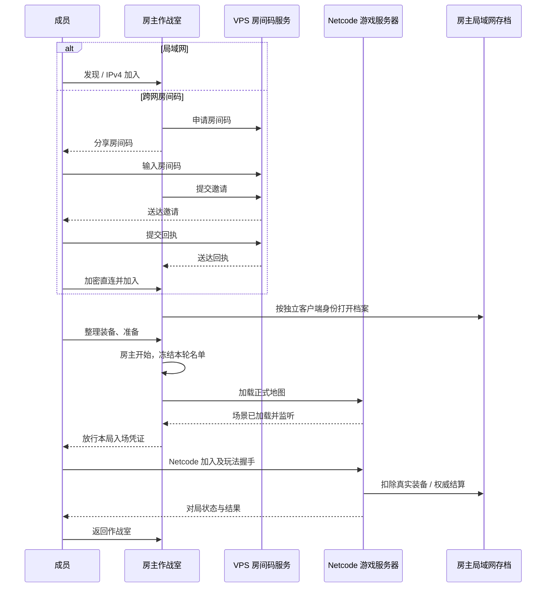

# 好友联机

好友联机支持局域网找房和跨网邀请。房主的游戏进程运行战局，保管仓库和结算。两种方式都可在账号后端、PostgreSQL 和独立服关机时使用。

## 跨网邀请

1. 双方使用相同游戏版本。房主打开「好友联机 → 创建房间」，将连接方式选为「跨网邀请」，创建房间。开房需要 Windows x64 或 macOS 的 Client+Server 游戏版本。
2. 房主点击「复制房间码」，发给朋友。朋友在「好友联机 → 跨网加入」输入同一个码。游戏自动交换连接信息并加入。
3. 成员整理装备并准备，房主出发。结算回房后可以直接开下一局。再邀请新成员时，房主复制新的房间码。

VPS 通过 HTTPS 发房间码，并在加入时转交两边的连接信息。公共 STUN 帮玩家查询自己的地址。房间和战局的 UDP 数据加密直达房主。VPS 停机只影响尚未完成交换的房间码加入。部分网络会拦截 UDP 打洞，连接失败时游戏会提示重试。房主退出后本房间结束。

房间码服务不可用时，双方可展开「手动邀请」。房主复制邀请给一位朋友。朋友粘贴邀请并发回生成的回执。房主粘贴回执后，游戏开始打洞。房间码、邀请和回执均应私聊分享。

## 局域网

1. 双方使用相同游戏版本，连接同一个局域网。在主菜单打开「好友联机」，无需登录在线账号。
2. 在深色房间页顶部填写干员代号。「寻找房间」「创建房间」「IP 直连」分别承担浏览、开房与手动连接。
3. 房主在「创建房间」选择「局域网」，填写房间名、玩法及人数。远征上限 32 人。极速赏金上限 12 人。开房需要包含服务器代码的 Client+Server 版本。需要修改端口时展开高级连接设置。
4. 成员刷新附近房间并点击房间行加入；未发现房间时，切换到「IP 直连」，输入房主提供的 IPv4。默认 TCP 房间端口为 7978，更改时展开端口设置。
5. 进入房间后，左侧查看成员和准备状态，右侧查看玩法与邀请信息。通过底部「整理装备」进入现有装备、商店和仓库界面。完成后重新打开右上角房间入口，点击准备。准备后更改装备需先取消准备。
6. 底部会显示尚未准备的成员。全员准备后，房主点击「开始远征」或「进入极速赏金」。房主先加载正式地图，再放行客机连接。
7. 极速赏金进入后仍使用原有集结区：创建或加入 1–3 人小队，至少两支队伍准备后开始比赛。房间准备与小队准备分别负责共同进入地图和开始赏金比赛。
8. 返回主菜单后仍保留房间，待本局成员全部返回或离开、装备结算完成后，可以重新准备下一局。房主返回会结束当前游戏服务器，其他成员随之返回。房主关闭房间后，成员需要重新加入新的房间；不提供房主迁移或进行中插队。Esc 在创建与直连页先返回浏览页，在浏览或房间页返回主菜单并保留房间连接。

默认端口：房间控制 **TCP 7978**，游戏 **UDP 7979**，自动发现 **UDP 7980**。房主可修改前两者，发现端口固定。自动发现使用 IPv4 广播，部分访客网络、AP 客户端隔离、VPN 和防火墙会阻止它；可用正确网络适配器的 IPv4 直连。Windows 游戏防火墙提示应允许所在的专用网络。房间端口与游戏端口分开填写；直连输入 IPv4 本身，端口填入单独的字段。

## 装备与存档

- 好友联机使用独立的客户端身份。跨网成员的凭证按房主区分，与局域网凭证分开。两种方式均使用房主本地档案。
- 房主维护每个玩家的装备、商店交易、回收箱和撤离成果。存档位于 `Application.persistentDataPath/LAN/host-v1/`。账号档和单人档分开保存。Editor 还按项目路径隔离。
- 房主本人沿用原好友房间档。成员回到同一房主的同种房间，可继续使用对应档案。换房主、切换连接方式或清除客户端 PlayerPrefs 会使用不同档案。
- 玩法共享这位房主的局域网仓库，但装备扣除、死亡损失及赏金队伍奖励由服务器判定。客户端不能上传仓库快照或自行提交结算。
- 本局入场凭证由房间产生，离开或下一轮后失效；长期客户端身份不能直接绕过房间进入对局。
- 使用原有持久化 outbox 记录扣装和结算。赏金记录保存完整真人名单，按原队伍人数计奖；多人撤离、重试及重启恢复使用不可变收据，避免重复奖励。没有结算快照的中断远征按丢失装备恢复。
- 局域网的 TCP 控制连接适用于可信内网。跨网模式关闭 TCP 监听和广播发现。房主为每个房间创建临时证书。成员从邀请取得公钥证书，通过 DTLS 验证房主。游戏取得匹配的回执后才接受成员。

## 实现流程

主要代码：`Networking/Lan/` 负责轻量房间、发现与局域网档案路由；`LanRaidMode` 选择独立持久化上下文，不改变 `OfflineRaidMode` 的单人限制。`GameManager` 的 `LanHost` / `LanJoin` 复用原有直连创建世界、加载、断开和收据落盘流程。UI 固定结构保留在 `LanRoomPanel.uxml/.uss` 与行模板内，由 `LanRoomView` 绑定动态数据。

跨网邀请同时交换房间和战局的 ICE 地址。房间用可靠消息同步装备与准备。NetCode 每局借用战局 ICE 上下文，回房时释放本局驱动，保留地址和连接。房主本人通过进程内 IPC 加入。公共 STUN 与账号模式沿用同一地址，详见 [P2P 实现](../Tools/Networking/EmbeddedIce/README.md#连接与生命周期)。

## VPS 部署

- `Backend/FriendSignaling` 是独立的 Go 服务。它使用内存保存房间码和临时连接信息，监听 `127.0.0.1:5081`。房主每 1.5 秒检查一次待加入请求。出发和关闭房间时停止检查。加入请求在 60 秒后过期。房主停止检查两分钟后，房间码失效。
- 在 `Backend/FriendSignaling` 运行 `go test -race ./...`。创建 `../../LocalData` 后，用 `CGO_ENABLED=0 GOOS=linux GOARCH=amd64 go build -trimpath -o ../../LocalData/moon-friend-signaling .` 生成 Linux x64 可执行文件。
- 把可执行文件安装到 `/usr/local/libexec/moon-friend-signaling`。把同目录的 systemd 文件安装到 `/etc/systemd/system/`。运行 `systemctl daemon-reload` 和 `systemctl enable --now moon-friend-signaling`。先检查回环地址的 `/friend-signaling/v1/health`。
- 把 Nginx 片段放进 `/etc/nginx/snippets/`。在现有游戏域名的 HTTPS `server` 中引用该片段。执行 `nginx -t`，再重载 Nginx。检查公网的 `/friend-signaling/v1/health`，并核对账号入口的响应。
- Player 从随包的 `moon-client.local.json` 读取 `FriendSignalingUrl`。未填写时，从该文件的 HTTPS 账号地址取得域名，并使用 `/friend-signaling/v1/`。房间码和账号服务可以使用同一个域名。VPS 本机处理房间码请求。

## 验证边界

在现有 Editor 中运行 `LanRoomChecks.Run`，传入独立的临时数据目录。局域网 49 项检查覆盖房间名单、版本拒绝、准备和开局、过期票据、回房、档案隔离和重复结算。跨网另检查了邀请、加密和连接清理。检查没有启动游戏客户端，也没有打开真实玩家档案。

Unity Editor 已导入和编译运行时代码及原生 UI。`Moonkov > Networking > LAN Room UI Preview` 与 `LAN Lobby UI Preview` 可分别查看原生 UXML 示例布局。预览与运行时复用 `LanRoomPresentation`，示例房间与成员不会进入网络服务。原生面板离屏捕获匹配 Editor 的高 DPI 分辨率与线性色彩，避免读取桌面其他应用。

深色 UI 重做使用项目现有月面拼贴素材和钴蓝选择色；端口渐进展开，房间浏览与开房分离，名单与底部准备/出发操作分区。按 1440×900 与 960×720 检查浏览、创建、房间准备、IP 直连和空列表。本次 UI 改动的验证不等同于重新运行上述存档检查或真实联机验收。

局域网界面由 USS 引用现有 Noto Sans CJK SC 源字体，避免共享 SDF 资产在该界面出现的字缘杂线；`moonkov-style-font` 允许局部样式持有字体，同时保留字符串本地化。全局字体资产及其他界面的字体选择不变。

遵循项目约定，没有运行 Play、第二个 Unity、MPPM 或独立游戏客户端，没有进行真实联机验收。真实设备上的广播发现、防火墙、正式地图 Host/Client 同步、断线时序和完整对局仍需人工验收。
