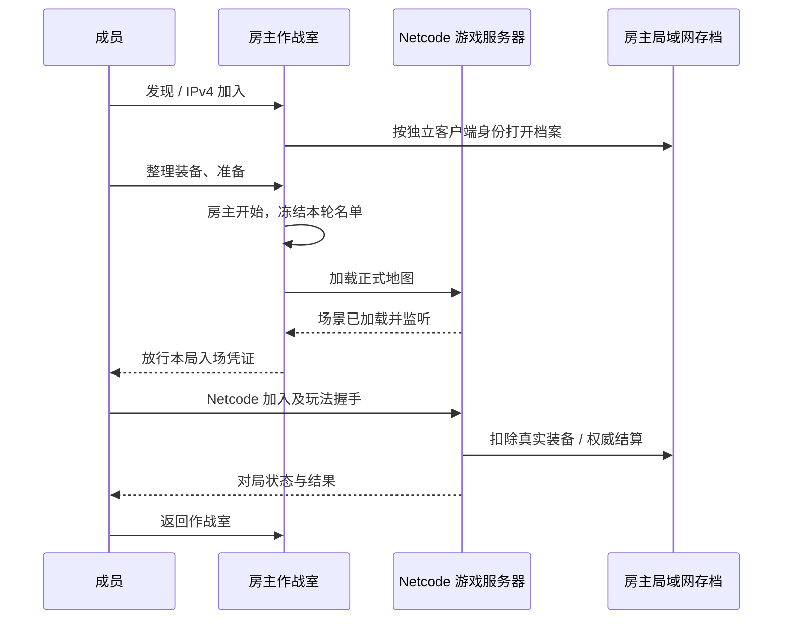

# 局域网作战室

本功能基于 `develop` 的 `dab93d9e`，位于 `feat/lan-rooms`，沿用项目的 Netcode for Entities、GhostBridge 和正式地图 `TheophilusGameScene`。

## 使用

1. 双方使用相同游戏版本，连接同一个局域网。主菜单右上角打开「局域网 / LAN」，无需登录在线账号。
2. 房主填写代号、房间名、玩法及人数，创建房间。远征上限 32 人；极速赏金上限 12 人。开房需要包含服务器代码的 Client+Server 版本。
3. 成员刷新附近房间并加入；未发现房间时，输入房主界面显示的 IPv4 和房间端口直连。
4. 每个人通过「整理装备与补给」进入现有装备、商店和仓库界面。完成后重新打开右上角房间入口，点击准备。准备后更改装备需先取消准备。
5. 全员准备后，房主点击「全员出发」。房主先加载正式地图，再放行客机连接。
6. 极速赏金进入后仍使用原有集结区：创建或加入 1–3 人小队，至少两支队伍准备后开始比赛。房间准备与小队准备分别负责共同进入地图和开始赏金比赛。
7. 返回主菜单后仍保留房间，待本局成员全部返回或离开、装备结算完成后，可以重新准备下一局。房主返回会结束当前游戏服务器，其他成员随之返回。房主关闭房间后，成员需要重新加入新的房间；不提供房主迁移或进行中插队。

默认端口：房间控制 **TCP 7978**，游戏 **UDP 7979**，自动发现 **UDP 7980**。房主可修改前两者，发现端口固定。自动发现使用 IPv4 广播，部分访客网络、AP 客户端隔离、VPN 和防火墙会阻止它；可用正确网络适配器的 IPv4 直连。Windows 游戏防火墙提示应允许所在的专用网络。房间端口与游戏端口分开填写；直连输入 IPv4 本身，端口填入单独的字段。

## 装备与存档

- 局域网使用独立的客户端身份凭证 `Moonkov.LAN.Credential.v1`，不发送在线账号凭证。
- 房主维护每个玩家的装备、商店交易、回收箱和撤离成果。存档位于 `Application.persistentDataPath/LAN/host-v1/`，与在线数据库、`SinglePlayer/` 存档隔离；Editor 下还按项目路径隔离。
- 同一客户端回到同一房主，可继续使用原局域网档。更换房主不会携带另一位房主的装备；清除客户端 PlayerPrefs 会生成新身份。不要共享身份凭证。
- 玩法共享这位房主的局域网仓库，但装备扣除、死亡损失及赏金队伍奖励由服务器判定。客户端不能上传仓库快照或自行提交结算。
- 本局入场凭证由房间产生，离开或下一轮后失效；长期客户端身份不能直接绕过房间进入对局。
- 使用原有持久化 outbox 记录扣装和结算。赏金记录保存完整真人名单，按原队伍人数计奖；多人撤离、重试及重启恢复使用不可变收据，避免重复奖励。没有结算快照的中断远征按丢失装备恢复。
- 房间通信面向可信局域网，TCP 控制链路未加密。没有公网匹配、Relay、口令房间或跨房主档案迁移。

## 实现流程



主要代码：`Networking/Lan/` 负责轻量房间、发现与局域网档案路由；`LanRaidMode` 选择独立持久化上下文，不改变 `OfflineRaidMode` 的单人限制。`GameManager` 的 `LanHost` / `LanJoin` 复用原有直连创建世界、加载、断开和收据落盘流程。UI 固定结构保留在 `LanRoomPanel.uxml/.uss` 与行模板内，由 `LanRoomView` 绑定动态数据。

## 验证边界

执行：

```powershell
dotnet run --project Backend/BountyClashContextChecks -- --lan-only
dotnet run --no-build --project Backend/BountyClashContextChecks -- --offline-solo-only
```

局域网 49 项数据/协议检查覆盖两种玩法的房间名单、人数上限、版本拒绝、准备、开局权限、地图加载等待、过期入场凭证、回房流程、档案隔离、多人赏金、跨队拒绝、重复结算及中断恢复。原有 40 项单人赏金检查通过。测试只使用独立临时目录，没有创建 Netcode World 或游戏客户端，也没有打开真实玩家档案。

Unity Editor 已导入和编译运行时代码及原生 UI。`Moonkov > Networking > LAN Room UI Preview` 与 `LAN Lobby UI Preview` 可分别查看原生 UXML 示例布局；示例房间与成员不代表真实联机。本次未取得可用的原生界面截图，视觉效果仍待人工查看。

遵循项目约定，没有运行 Play、第二个 Unity、MPPM 或独立游戏客户端，没有进行真实联机验收。真实设备上的广播发现、防火墙、正式地图 Host/Client 同步、断线时序和完整对局仍需人工验收。
