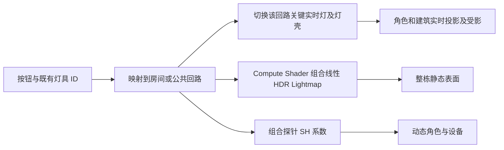

# MC00 房间回路烘焙

## 目标与照明分工

正式地图为 `Assets/MoonEnvironment/Variants/TheophilusBase/Scenes/TheophilusGameScene.unity`。每个房间独立开关，走廊、楼梯和入口按各自公共回路控制；既有按钮的灯具 ID 保留，单灯命令扩展为所属回路。

每回路保留至多两盏主要灯的实时直接照明与完整阴影，采用 Mixed / Baked Indirect；其他灯的直接光与间接光提前烘焙。墙体、设备及角色仍参与关键灯的实时阴影，角色接收附加灯阴影的 MoonToon 修复已在 `7498c4df` 提交。

2026-10-16 修正室内角色阴影分层：38 盏关键灯使用自身的 Depth Bias=0.03 / Normal Bias=0.15，并使用 High 软阴影过滤；单灯分辨率和图集尺寸未提高。运行时先绑定组合探针再写入 SH，避免首次进场仍使用环境全关系数、必须开关一次房间才恢复角色补光。MoonToon 仅对太阳直接光应用太阳遮挡，保留烘焙探针光，不再用太阳阴影二次压暗整个着色结果。关键灯完整投影和角色投／受影继续启用。修复与有效对照见 `Docs/AI/MC00LightingShadowAudit.md` 的修复记录；高质量过滤增加采样成本，本次未进行性能对照。

辅助灯的烘焙光不会随移动门的位置重新计算，这是本方案的画面限制。动态门、抽屉、按钮、可动部件和可切换发光壳不进入固定合并网格；原对象及碰撞保留。

## 独立回路组合

不能为每房间独立替换全局 Lightmap，也不能只把整个建筑烘焙成开／关两态。这里对整栋相同几何分别烘焙黑环境全关基底、19 个回路单独开灯的贡献，以及正式环境填充。所有状态共享同一图集、UV 和探针布局。

合成公式为 `环境状态 + Σ(开启回路单独开启状态 − 黑环境全关基底)`。跨房间的漏出光照保存在贡献中，会随光源房间一起切换。只在开关变化时合成，不在普通帧运行 Compute Shader。

正式地图的 `ambientFill=(0.015,0.015,0.015)`、`nightAmbient=0`，环境填充不随昼夜改变；太阳仍实时。单独烘焙环境状态可以保留室外探针的原环境亮度，并让建筑遮挡该环境光。只使用黑基底会让全局探针覆盖原环境填充，压暗室外角色。将来若修改环境颜色，应重烘环境状态。

源图使用线性 HDR / BC6H，GPU 输出为 RGBAHalf。SH 允许负系数，不能逐系数夹零。主灯使用 Baked Indirect，避免为大量重叠灯分配 Shadowmask 四通道。

正式地图使用独立的传统 Light Probes 管线副本。源 MoonPipeline 的室外设置保留，封闭室内采用已有的保守阴影距离适配。Lightmap 编码需为 Standalone High/HDR。

纯金属不能仅靠漫反射 Lightmap 恢复原高光。每个回路附带一张 128 像素 HDR 房间反射 Cubemap，运行只采样静态纹理、不实时重新捕获；回路关闭时对应反射强度归零。它不会追踪邻房灯、门或角色的反射变化，关灯态也不保留微弱环境反射，这是当前反射近似的限制。

## 生成与接入

1. 加载正式地图，在 Edit Mode 调用 `MC00BuildingBakeGeometry.Prepare()`。工具保存工作区和场景备份，在独立烘焙场景准备网格；等待 `Status == Ready`。
2. 调用 `MC00BuildingBakeTools.Start()`。全关基底及每回路依次 GPU 烘焙，检查每次图集、Renderer index/ST、probe 数量和位置一致；不一致立即停止。
3. 回路完成后调用 `BakeEnvironment(new Color(.015f,.015f,.015f))`，等待环境状态完成，再调用 `RestoreFormalWorkspace()`，随后 `Install()`。正式地图保留原物理和交互层级，新增静态绘制表示及烘焙状态组件，现有开关转接至新 owner。
4. 在正式离线对局内验证相同位置、室内外、房间独立开关和角色受影。

接入后在 Edit Mode 调用 `MC00BuildingReflectionTools.BakeAndInstall()` 生成并绑定静态反射。该过程使用已合成光照，不重烘回路 Lightmap。

几何准备期间不能重编译脚本；烘焙批次的进度保存于 `bake-job.json`。若烘焙失败，原正式地图不会被自动替换。

当前生成规模：8,044 个静态源 Renderer 合并为 2,083 个空间网格块，1,300 个活动或交互 Renderer 保留；118 盏灯归属 19 个回路，其中 38 盏保留实时阴影。所有状态使用 6 张图集和 7,227 个探针。

## 测量记录

原始证据放在忽略目录 `Library/BuildValidation/MC00BakedBuilding/`。

2026-10-15 接入前：正式离线对局，固定相机 `(1609.8, 213.28615, 2122)`，朝向 Y=20°，2560×1440，六秒采样67帧；中位 **87.37 ms**，P95 **112.60 ms**，draw calls **273590**，shadow casters **668330**。这组数据是正式地图的基线，不是隔离样板。

初次正式接入（尚未补房间反射）：同机位、同分辨率六秒156帧，中位 **36.30 ms / 27.5 FPS**，P95 **54.96 ms**；相对基线中位帧率约 **2.4 倍**。UnityStats draw calls 67,811、shadow casters 169,020。

正式对局通过原 `LightCircuitControls` 单灯 ID 发送 G01 关闭命令：整房状态变为 AllOff，G02 保持 AllOn，G01 两盏实时灯实际关闭；Toggle 恢复。GPU 图集0缩采样能量 `566.6861 → 531.427`，探针 SH 最大系数变化 `22.25038`，确认烘焙贴图和动态角色探针均真实变化，owner 无配置错误。

补反射后、本次黑斑修复前（含19张静态房间反射）：同机位、同分辨率六秒134帧，中位 **40.34 ms / 24.8 FPS**，P95 **62.94 ms**；相对原版中位帧时间减少 **53.8%**，帧率约 **2.17 倍**。UnityStats draw calls 67,772、shadow casters 169,020。反射材质恢复具有额外渲染开销，因此该阶段性能以这一组为准，不使用未含反射的27.5 FPS。尚未达到60 FPS，也不能把整个地图的低帧率问题宣称彻底解决。这组数据不是黑斑修复后重新测量的结果。

补反射后的正式 Play 验证：G01 静态反射强度随回路 `1 → 0 → 1`；纯渲染 DollSinger 在相同姿态/机位/灯光下，只启用关键灯与角色之间的两个仅投影遮挡片，头部、躯干和腿部随之变暗。角色 `receiveShadows=true`、`ShadowCastingMode.On` 保持启用。证据为 `AfterFinal.png`、`CharacterUnoccluded.png` 和 `CharacterOccluded.png`。退出 Play 后临时相机、角色和遮挡片销毁，没有保存进正式场景。上述检查确认了开关、反射与角色受影，但早先画面验收漏检了墙面的云状黑斑，不能作为整体画质通过的结论。

以上为当前机器 Unity 编辑器的局部室内验收；没有据此推算打包版本、RTX 4060 或全地图帧率。没有运行多人同步验收。

## 2026-10-15 墙面黑斑回归与修复

用户在正式 Play 中发现多处墙面出现云状黑斑，并澄清地板没有该问题。G01 墙面命中点约为世界坐标 `(1602.58, 213.94, 2125.24)`，对应 `MC00Surface0512`、图集1的 texel `(748,234)`。原生 `BakedTexelValidity` 读取值为 RGB `(0.930,0.078,0.053)`，呈红色无效 texel；移除该 Renderer 的 Lightmap 后云斑消失，只剩平滑的实时直接光。

现场隔离结果如下；每项都针对同一处墙面，不代表全楼画面验收：

| 对照 | 结果 |
| --- | --- |
| 关闭房间反射 | 云斑不变 |
| 强制 mip 0，检查输入贴图 mip 限制 | 云斑不变 |
| 合成时不减全关基底 | 整体略亮，云斑轮廓不变 |
| 直接／间接采样从 `32/64` 提高至 `256/512` 后重烘 G01 | 云斑几乎保持原形 |
| 保持原材质、UV 和 `32/64` 采样，仅将 Push Off 从 `0.0001` 改为 `0.005` 米 | 云斑消失；同一 texel 的有效性变为绿色 RGB `(0.004,0.125,0.002)` |

离线检查确认该墙面 UV2 没有三角形重叠，命中 texel 位于大面内部；面法线与顶点法线一致，没有镜像或反向法线。沿正确法线推出1毫米后，64条半球射线在附近合并几何中的首次命中全部为正面，未发现将该位置包住的反向结构壳。

根因是远离原点的坐标精度与过小的射线起点偏移共同造成壁面自遮挡。合并网格使用约 `x=1600、z=2125` 的世界坐标顶点；这里 float32 的相邻可表示数间隔分别约为 `0.000122` 和 `0.000244` 米。原 Push Off 为 `0.0001` 米，沿该墙法线分配到各坐标分量后被浮点舍入吞掉，部分烘焙射线仍从面后发出，形成无效 texel。离线 float32 插值模拟中，两片主墙三角形的149个 texel 中心有83个落在面后，加入 `0.0001` 偏移后数量不变；改为 `0.001` 或 `0.005` 后为0。该模拟提示了原因，Unity 中仅改 Push Off 的单变量重烘进一步确认了修复效果。Unity 6.5 官方也将远离世界原点的浮点精度列为无效 texel 的成因，并建议调整 Lightmap Parameters 的 Push Off。[官方排障说明](https://docs.unity3d.com/6000.5/Documentation/Manual/troubleshooting-lightmapping-artifacts.html)

生产修正使用 `Assets/MoonEnvironment/Variants/MC00BakedBuilding/MC00Geometry.giparams`，将 `pushoff` 固定为 `0.005`；`MC00BuildingBakeTools` 在烘焙配置时应用该参数。现场证据位于 `Library/BuildValidation/MC00BakedBuilding/BlackPatchWall.png`、`WallNoSubtract.png` 和 `WallPushoff5mm.png`。

另一个独立缺陷是原生烘焙得到的全关基底存在非零残留。合成每个开启回路时都会减去该基底，19个回路全开就会减去19次，使最终光照额外变暗。关闭基底相减只能让整体略亮，不能消除上述云状黑斑；两者分别修复。残留的具体来源尚未确定。

现在全关基底导出前严格确认：仅加载 MC00 烘焙场景，环境为无天空盒的 Flat 黑色，环境探针全部27个 SH 系数接近零，所有灯均禁用，活动且参与 GI 的 Renderer 没有有效的 BakedEmissive 材质。在这些条件下，物理上的全关参考应为零，因此导出零 RGB 图集和零 SH 系数；图集 alpha 保持1，表示有效的黑色 texel。图集尺寸、UV 绑定和探针原生位置／布局保留，各房间及环境状态的烘焙结果不做此清零处理。

`MC00BuildingBakeTools.Capture()` 仅在全关基底分支执行上述处理；`ExportZeroBaseline()` 可在烘焙结束后修正既有基底，并保留图集 GUID 和导入设置，无需重烘19个房间。本次已执行既有基底修正，确认其 SH 最大绝对系数为0。运行时仍使用原有合成公式，正式 Play 验收另行记录。

全关基底、19个回路和环境状态共 **21个状态已全量重烘并发布到原 GUID 路径**，19张房间反射也已刷新。2083个 Renderer 的图集索引与 UV 变换保持一致。正式 Play 同机位截图 `WallPrecisionFixedGame.png` 与另一层的 `WallPrecisionFixedUpperFloor.png` 均未再出现原来的云状黑斑；这是两处代表性画面的抽查，不是逐面墙验收。

正式 Play 通过原 `LightCircuitControls` 关闭、恢复 G01：图集1缩采样能量 `207.9803 → 198.0546 → 207.9803`，G02保持开启，基底 RGB 能量为0，owner 无配置错误，38/38关键灯仍开启实时阴影。角色投／受影代码未改，本轮不重复此前的角色遮挡片试验。启动验证附带六秒132帧采样，中位39.81ms，P95 68.64ms，仍约25FPS；本次黑斑修复不构成新的性能突破。

墙面分格另做了均匀辐照度对照（`WallSeamBaked.png`、`WallSeamUniform.png`）：只替换0512的烘焙输入，保留材质、直接光与反射，细板缝仍然存在。源墙板约1.917×2.832m，中心节距1.925×2.84m，板间约8mm且带倒角；合并没有新增切割。新的间接光使这些原有接缝更容易看见，不能把所有明暗变化都当作新增几何。

### 后续性能隔离：未接入的实验

本轮后续采样仍在相同位置／朝向、2560×1440编辑器输出下进行。`ShadowCostBefore` 中位36.15ms，临时禁用38盏关键灯的阴影后 `ShadowCostWithoutKeyShadows` 为17.44ms，支持附加灯实时阴影是主要成本之一；期间对局仍运行，不能把差值视为稳定可获得的生产收益。测试后恢复所有灯的原阴影。

对2083个固定块按灯的 `range + 2m` 球并集分配独立阴影层，原受光层和所有关键灯均保留，测得23.23ms；切回原掩码后为24.91ms。最初36.15→23.23ms的跨时段比较混入角色阵亡等对局变化，不能宣称由此获得约43FPS的新版本。进一步观察到阵亡后 `RespawnCamera` 与固定测试相机同时渲染；这些较晚数据不能代表正常存活状态。移除额外测试相机后，原设置中位22.71ms；GPU Resident Drawer与GPU遮挡剔除确实启用，但为26.84ms，反而变慢。范围投影剔除覆盖试验也只有小幅变化，没有形成新的显著性能结果。

上述分层、投影矩阵和GPU绘制试验全部恢复，未写入正式运行配置。临时重复烘焙资源及诊断资产已移出Assets，保存在 `Library/BuildValidation/MC00BakedBuilding/ArchivedBlackPatchDiagnostics`。本次实际落地的是整栋墙面烘焙修复；正常对局的低帧率仍未解决。后续需要针对静态建筑阴影的重复提交或完整存活对局的CPU开销处理，不能把关掉角色阴影当作优化交付。
