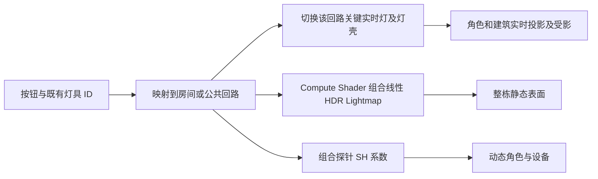

# MC00 房间回路烘焙

## 目标与照明分工

正式地图为 `Assets/MoonEnvironment/Variants/TheophilusBase/Scenes/TheophilusGameScene.unity`。每个房间独立开关，走廊、楼梯和入口按各自公共回路控制；既有按钮的灯具 ID 保留，单灯命令扩展为所属回路。

每回路保留至多两盏主要灯的实时直接照明与完整阴影，采用 Mixed / Baked Indirect；其他灯的直接光与间接光提前烘焙。墙体、设备及角色仍参与关键灯的实时阴影，角色接收附加灯阴影的 MoonToon 修复已在 `7498c4df` 提交。

辅助灯的烘焙光不会随移动门的位置重新计算，这是本方案的画面限制。动态门、抽屉、按钮、可动部件和可切换发光壳不进入固定合并网格；原对象及碰撞保留。

## 独立回路组合

不能为每房间独立替换全局 Lightmap，也不能只把整个建筑烘焙成开／关两态。这里对整栋相同几何分别烘焙黑环境全关基底、19 个回路单独开灯的贡献，以及正式环境填充。所有状态共享同一图集、UV 和探针布局。

合成公式为 `环境状态 + Σ(开启回路单独开启状态 − 黑环境全关基底)`。跨房间的漏出光照保存在贡献中，会随光源房间一起切换。只在开关变化时合成，不在普通帧运行 Compute Shader。

正式地图的 `ambientFill=(0.015,0.015,0.015)`、`nightAmbient=0`，环境填充不随昼夜改变；太阳仍实时。单独烘焙环境状态可以保留室外探针的原环境亮度，并让建筑遮挡该环境光。只使用黑基底会让全局探针覆盖原环境填充，压暗室外角色。将来若修改环境颜色，应重烘环境状态。

源图使用线性 HDR / BC6H，GPU 输出为 RGBAHalf。SH 允许负系数，不能逐系数夹零。主灯使用 Baked Indirect，避免为大量重叠灯分配 Shadowmask 四通道。

正式地图使用独立的传统 Light Probes 管线副本。源 MoonPipeline 的室外设置保留，封闭室内采用已有的保守阴影距离适配。Lightmap 编码需为 Standalone High/HDR。

纯金属不能仅靠漫反射 Lightmap 恢复原高光。每个回路附带一张 128 像素 HDR 房间反射 Cubemap，运行只采样静态纹理、不实时重新捕获；回路关闭时对应反射强度归零。它不会追踪邻房灯、门或角色的反射变化，关灯态也不保留微弱环境反射，这是当前反射近似的限制。

## 生成与接入

1. 加载正式地图，在 Edit Mode 调用 `MC00BuildingBakeGeometry.Prepare()`。工具保存工作区和场景备份，在独立烘焙场景准备网格；等待 `Status == Ready`。
2. 调用 `MC00BuildingBakeTools.Start()`。全关基底及每回路依次 GPU 烘焙，检查每次图集、Renderer index/ST、probe 数量和位置一致；不一致立即停止。
3. 回路完成后调用 `BakeEnvironment(new Color(.015f,.015f,.015f))`，等待环境状态完成，再调用 `RestoreFormalWorkspace()`，随后 `Install()`。正式地图保留原物理和交互层级，新增静态绘制表示及烘焙状态组件，现有开关转接至新 owner。
4. 在正式离线对局内验证相同位置、室内外、房间独立开关和角色受影。

接入后在 Edit Mode 调用 `MC00BuildingReflectionTools.BakeAndInstall()` 生成并绑定静态反射。该过程使用已合成光照，不重烘回路 Lightmap。

几何准备期间不能重编译脚本；烘焙批次的进度保存于 `bake-job.json`。若烘焙失败，原正式地图不会被自动替换。

当前生成规模：8,044 个静态源 Renderer 合并为 2,083 个空间网格块，1,300 个活动或交互 Renderer 保留；118 盏灯归属 19 个回路，其中 38 盏保留实时阴影。所有状态使用 6 张图集和 7,227 个探针。

## 测量记录

原始证据放在忽略目录 `Library/BuildValidation/MC00BakedBuilding/`。

2026-10-15 接入前：正式离线对局，固定相机 `(1609.8, 213.28615, 2122)`，朝向 Y=20°，2560×1440，六秒采样67帧；中位 **87.37 ms**，P95 **112.60 ms**，draw calls **273590**，shadow casters **668330**。这组数据是正式地图的基线，不是隔离样板。

初次正式接入（尚未补房间反射）：同机位、同分辨率六秒156帧，中位 **36.30 ms / 27.5 FPS**，P95 **54.96 ms**；相对基线中位帧率约 **2.4 倍**。UnityStats draw calls 67,811、shadow casters 169,020。

正式对局通过原 `LightCircuitControls` 单灯 ID 发送 G01 关闭命令：整房状态变为 AllOff，G02 保持 AllOn，G01 两盏实时灯实际关闭；Toggle 恢复。GPU 图集0缩采样能量 `566.6861 → 531.427`，探针 SH 最大系数变化 `22.25038`，确认烘焙贴图和动态角色探针均真实变化，owner 无配置错误。

最终版本（含19张静态房间反射）：同机位、同分辨率六秒134帧，中位 **40.34 ms / 24.8 FPS**，P95 **62.94 ms**；相对原版中位帧时间减少 **53.8%**，帧率约 **2.17 倍**。UnityStats draw calls 67,772、shadow casters 169,020。反射材质恢复具有额外渲染开销，因此最终数字以这一组为准，不使用未含反射的27.5 FPS。尚未达到60 FPS，也不能把整个地图的低帧率问题宣称彻底解决。

最终正式 Play 验证：G01 静态反射强度随回路 `1 → 0 → 1`；纯渲染 DollSinger 在相同姿态/机位/灯光下，只启用关键灯与角色之间的两个仅投影遮挡片，头部、躯干和腿部随之变暗。角色 `receiveShadows=true`、`ShadowCastingMode.On` 保持启用。证据为 `AfterFinal.png`、`CharacterUnoccluded.png` 和 `CharacterOccluded.png`。退出 Play 后临时相机、角色和遮挡片销毁，没有保存进正式场景。

以上为当前机器 Unity 编辑器的局部室内验收；没有据此推算打包版本、RTX 4060 或全地图帧率。没有运行多人同步验收。
