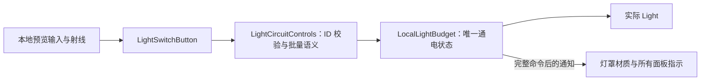

# MC00 灯光按钮最小闭环

2026-10-11。本次为独立本地试点，不是联网灯光或存档系统；旧正式地图及 MC00 性能候选场景保留。早期云端 L22 示例声明 `example_only=true`、`physical_buttons_exist=false`，不当成已交付按钮；空 `emissive_targets` 且状态为 unresolved 不能解释成没有灯罩。

随后收到并归档完整来源注册表：`SourceData/Models/MC00GameExport/MC00_LightRegistry.v2.json`。实解析为 118 个唯一灯 ID、112 个 resolved 发光面映射、6 个 `audited_no_separate_emissive_face`、0 个按钮。来源 SHA-256、所有灯位身份及 Renderer/材质名与本地导出 manifest 一致；这只确认来源数据可对齐，不代表 118 盏灯已完成 Unity 绑定或 Play 验收。L22 两灯的发光面现在已明确，替代早期 unresolved 示例。该注册表不是实体面板安装包，后续须合入实际按钮对象/映射并补齐安装包标识；本地两灯试点不因此自动扩展为全部灯。

## 全量 v02 已接入（当前入口）

2026-10-11：已从用户下载路径取得 `MC00_Game_Light_Controls_Full_v02.blend`，本地大小 **14,435,303 字节**，SHA-256 **e61f2fab253a0801f3ebb7084fbb7163e48bd156c9ce79074825e4e81d5ca5f0**。源文件原样归档于 `SourceData/Models/MC00LightControlsFullV02`；禁用自动执行后台导出，未保存改写原 blend。

完整候选场景：`Assets/MoonEnvironment/Variants/MC00LightControlsFullV02/Scenes/MC00GameExportPreview.unity`。本轮已打开并保存，出生点位于 **L22 操作台附近**。也可用 **Tools → Moon Environment → MC00 Full Lights v02 → Open candidate** 打开。旧正式地图、v07 及早期临时面板保留，未替换正式联网环境。

- 135 个实际按钮 / 44 处面板，控制全部 118 灯；新增 129 键帽自身兼作指示面，旧六键按约定保留。
- 112 个独立灯罩发光面绑定；另外 6 灯为源端已审计无独立发光面的对象，只控制实际 Light。
- 瞄准实体键，3 米内按 **F / 手柄 X**。L22 原 ON / OFF / TOGGLE 仍控制原六灯；新 **L0 / L1 / L2 / STAIRS / ENTRIES** 分组键分别覆盖 34 / 29 / 26 / 20 / 9 灯，**ALL MC00** 切换全部 118 灯。全开时按 Toggle 全关，否则全开；混合状态显示橙色。
- G03 与 L22 编辑态站位菜单仍可用；只变更完整候选的出生点。L22 沿用位置未变的 v07 作者接近点，不新增运行时传送。

导入后 CPU 整理：活动 Renderer **9,292 → 8,280**，阴影投射对象 **5,243 → 4,251**；343 个局部合批组，128 个精确盒碰撞替换，277 个建筑代理保留。CPU 整理前后三角形均为 975,755。以上是结构计数，不是 FPS 测试或稳定 60 帧结论。

必要检查已完成并停止：编译通过；实际绑定过程检查全 118 ID 覆盖、原六键约定、对象/材质槽/位置边界和状态槽冲突；保存后一次读回得到 **135 按钮、118 Light、112 发光面、129 自身指示键帽、0 缺失引用**。没有逐键行为循环，没有自动 Play、真实输入注入或 FPS 采样。报告位于本版 SourceData 目录的 `IntegrationReport.json`、`CpuOptimizationReport.json`、`UnityIntegrationReadback.json`，后者明确 `playTested=false`。

导出适配差异：本版新键的 indicator 字段位于主 `MC00_LIGHT_SWITCH_MAP_V2.json`，部分 INTERACTION_HINTS 不重复该字段；导出器按同一 switch_id 从真实主映射读取，按 hints/实际矩阵提取几何与按压数据，不猜测邻近物件。完整 JSON / CSV / 贴图已提取；交付参数保存在 `Delivery.json`，编辑器入口为 `MC00FullLightControlTools`。

### 角色手感边界

Full v02 当前候选通过 `DollSingerGameplayPreview` 离线调用正式 `FirstPersonController` 的输入、移动、跳跃、落地和碰撞处理。`DollSingerMovement` 只负责动画/IK，不再执行演示版的转头阈值和身体追赶。正式游戏与预览共用 `DollSingerLookController`，使用相同的俯仰限制、Alt 自由观察回正、Q/E 侧身与世界空间相机朝向；普通转身直接跟随视角。

移动参数在每次 Play 从 `DollSingerNetworkPlayer.prefab` 的 `PredictedPlayerControllerConstsAuthoring.BuildControllerConsts()` 读取，与实体烘焙使用同一来源。安装时同步正式角色的输入灵敏度、视角/侧身参数及碰撞胶囊，保留本场景的相机、骨骼和按钮引用。以后修改正式角色的这些参数，可用 `Tools > Moon Environment > Use Gameplay Controls In Current Preview` 重新同步并保存场景；新建 Apollo12 预览自动安装，旧候选不批量改写。

该预览对应健康、无负重修正的基础移动，不启动服务器或预测回放，也不模拟局内伤势、饥渴和网络延迟。武器、HUD 与联网交互不属于本次控制对齐。只做编译及编辑态配置检查；实际 Play 手感由用户验证：普通转身/停鼠标、Alt 松开回正、V/中键切视角、WASD/Shift/空格、Q/E，以及 F 灯光按钮仍可用。

以下准备与 v07 记录为历史过程；以本节实际完成状态为准。
## 全量接入准备（交付前记录，现已完成接入）

已准备通用编辑器入口，尚未运行全量模型导入；现有 v07 的模型、Prefab、场景和六键状态未重新生成。没有自动 Play，没有新增网络或存档系统，也不再以重复样板验证作为下一版接入前提。

`MC00SwitchSampleTools.Delivery` 接收真实 `sourceFolder`、独立 `assetFolder`、`sourceSha256`、`revision`；`lightCount` / `controlledLightCount` 默认 118，`switchCount=0` 表示以真实映射数量为准，或填写交付的明确数量。依次调用 `ImportDelivery`、`CreateDelivery`、`OptimizeDelivery`、`BindDelivery`，复用已有导入、材质、灯光预算和状态控制。新版入口拒绝覆盖旧版及 v07 根目录；原 v07 菜单仍使用六键九灯的固定预设。

准备阶段增加了这些与全量直接相关的检查/适配：

- 全部灯 ID 必须有按钮覆盖，未知目标、重复按钮、映射与交互元数据不一致会明确报错；6 个已发布按键的对象、指示、动作、目标和位置/行程约定继续保留。
- 新键使用 `button_object == indicator_object`，各自的指定材质槽显示状态。一个指示槽只允许一个按钮拥有，指示 Renderer 不同时交由灯罩状态控制，避免整份材质数组写入冲突。
- 新版状态材质按原材质资源和用途复用；新键帽保留原 BaseMap / EmissionMap 并按状态着色，旧六键的独立指示面沿用原纯色方案。不使用 MPB，不在运行时逐键克隆材质。贴图最终观感尚无新模型可核对。
- CPU 整理显式排除按钮、指示面、灯罩及其子物件，避免作者分类变化导致运动/状态对象被合进固定建筑；绑定时也释放键帽的旧合并表示。
- Blender 导出器支持新交付参数 `--expected-sha256`、`--expected-render-objects`、`--expected-proxy-objects`、`--expected-excluded-objects`。参数来自真实文件核验和只读盘点，不再为每个版本修改脚本内固定哈希表。原版与 v07 默认导出预设保留。

最小数据仍沿用现有协议，无需新试件：真实完整 blend、大小/SHA256/版本；内嵌 v2 map 的 118 个稳定灯 ID、锚点、默认状态与发光面映射（6 个已审计无独立灯罩的记录允许为空）；每键唯一 ID、对象、动作、目标数组、interaction_anchor、indicator_object/material_name；INTERACTION_HINTS 中真实边界、物体及 ROOT 矩阵、轴与行程。原碰撞合同、SOURCE_TO_OUTPUT、LIGHT_REFERENCE 和打包贴图继续携带。JSON/CSV 显式提取，不依赖 FBX 自定义属性携带。

准备验证仅执行 C# 编译及 Python 语法检查，均通过；没有运行新版本导入/绑定，也没有重新跑 v07 的行为检查。当前具体依赖为下一版真实模型、最终映射和哈希。

## v07 实体按钮候选（最新接入）

用户已下载 `MC00_Game_Switch_Sample_v07.blend`，本地确认 13,950,212 字节、SHA-256 `c985ea16ff85e0ff53d8566860ec33374d8213bd4e35976fc200874056627fc0`。原样归档在 `SourceData/Models/MC00SwitchSampleV07`，后台 Blender 5.1.1 使用 `--disable-autoexec` 导出，不保存改写源文件。完整 JSON / CSV / 中文说明保留在 `AuthorNotes`；没有执行文件内的 Python 配方。

独立候选：`Assets/MoonEnvironment/Variants/MC00SwitchSampleV07/Scenes/MC00GameExportPreview.unity`。

| 位置 | 实体按钮 | 控制范围 |
| --- | --- | --- |
| G03 工作台 | 原任务灯开关 | 工作灯单灯 Toggle，保留点击式结构 |
| G03 走廊隔板 | 两个吊顶灯按钮 | 各自单灯 Toggle |
| L22 控制台 | ON / OFF / TOGGLE | 三键共同控制六盏灯 |

总计 6 个实际按钮、9 个不同目标灯；118 灯注册表已保存，未宣称全部配齐按钮。瞄准按键，3 米内按 **F / 手柄 X**。指示色：绿为全开、暗为全关、橙为混合、红为不可用。受控灯罩与实际 Light 同步切换，其余灯不纳入本次控制。

五个新键帽按作者交互 ROOT 局部 +Z 运动 3 mm，先转换源世界坐标，再转换到 Unity 键帽父级局部坐标；L22 斜面不使用猜测的 Unity forward。按压动画只在成功操作时运行，禁用组件或重入按压均先复原。原工作台开关无行程。Collider 使用导入后的 Mesh.bounds，适配时与作者世界位置和包围盒核对；每个键只保留一个点击 BoxCollider。指示材质仅替换指定槽，保留同 Renderer 其他槽。

复建入口：**Tools → Moon Environment → MC00 Switch v07** 下依次执行 1 Import、2 Create、3 Optimize、4 Bind；已有候选拒绝重新创建/绑定。原 CPU 合批和精确盒碰撞替换流程应用于新版本，按钮不纳入建筑固定件合并。新增版本使用独立模型、材质、网格、Prefab 和场景，旧候选、临时面板及正式 Apollo12 地图保留。

同菜单提供 **Stand at G03 ceiling controls / Stand at L22 controls**：仅编辑态、当前场景无未保存修改时使用；按作者 approach 点向下找地板并更改此候选出生点，不是运行时传送功能。

导出三角化保持关闭；Unity 切线使用 Calculate Mikk。两个新固定面板各有 17 个源零面积三角形，Unity 各剔除了 16 个；逐材质计数检查允许源非退化总数到源总数之间的范围。材质重接、两块软垫 UV0 处理继续沿用原导出适配器。

本次仍不自动进入 Play 或做 FPS 采样。用户重点确认：G03 三灯分别开关；L22 三键控制同组六灯且三枚状态指示一致；灯罩同步；五键按压方向/回弹正确；站位可操作且墙后不能误触。没有新增网络或存档实现。

本地结果：编译通过；新版 CPU 整理后活动 Renderer 9,122 → 8,110，阴影投射对象 5,140 → 4,148，343 个局部渲染组，128 个精确盒碰撞替换。三角形总数在 CPU 整理前后均为 949,997（不是减面）。版本报告分别为 `SourceData/Models/MC00SwitchSampleV07/IntegrationReport.json` 与 `CpuOptimizationReport.json`；这些是编辑态结构计数，不代表 FPS 验收。

最终编辑态绑定检查通过，包括六个作者站位射线命中、9 灯实际引用、五个 3 mm 位移向量、单灯互不干扰、L22 六灯关/开/混合切换、三个 L22 指示同步、受控灯罩材质同步、其他灯状态不变。检查后全开并保存；报告为 `Library/MC00SwitchSampleV07/Check.json`，`playTested=false`。当前已打开新候选，出生点位于 G03 吊顶灯开关附近。旧试点出现未保存状态时已另存 `Library/MC00SwitchSampleV07/PreIntegrationTrialSnapshot.unity`，未写回旧场景。

协作消息工具本次返回 `AbsolutePathBuf deserialized without a base path`，本地接入结果未成功转发给云端中转会话。

下面保留早期两灯临时面板的说明，入口与 v07 独立。
## 打开与操作

场景：`Assets/MoonEnvironment/Variants/MC00GameExport/Scenes/MC00LightSwitchPreview.unity`。可从 Project 打开；首次生成入口为 **Tools → Moon Environment → MC00 Game Export → 4 - Create separate light switch trial**。场景已存在时拒绝覆盖。

出生点前方约两米有独立临时面板，明确命名 `LOCAL TRIAL - replace with authored MC00 panel`。进入 Play，瞄准实体按键，在 3 m 内按 **F / 手柄 X**：

| 按钮 | 目标 | 行为 |
| --- | --- | --- |
| READING | A | 单灯切换 |
| BOTH / TOGGLE | A、B | 全开则全关；全关或混合则全开 |
| BOTH / ON | A、B | 全部开启，重复执行不翻转 |
| BOTH / OFF | A、B | 全部关闭，重复执行不翻转 |

A 是 G02 阅读灯 `SRC_5328cb8663556e3b29dc` / `MC106_Reading_Bar_Actual_Light`，B 是 G03 工作灯 `SRC_e6365998da3f1684fc26` / `MC108_Task_Bar_Actual_Light`。面板用于远程控制试点，不移动房间里的实际灯具。颜色和文字同时显示 ON / OFF / MIXED / UNAVAILABLE；不是按钮自身的锁存状态。Esc 释放鼠标时、角色输入被 UI 禁用时、暂停时不可交互，墙体和面板实体会遮挡射线。预览采用 F，避开现有 E 侧身/拾取绑定。

实际灯光仍保持原来的强度、范围和阴影。发光面仅绑定 `MC106_Lamp_opal_diffuser` / `MC106_Reading_Diffuser` 和 `MC108_Task_Bar_Lens` / `MC108_Task_Diffuser`。亮灭使用每种原材质对应的一对共享材质资产，按 Renderer 的匹配槽切换；不写共享原材质，也不为每帧/每盏灯实例化材质。灭灯后灯罩仍可反射环境照明，不代表电源仍开着。

## 状态与调用路径

`LocalLightBudget.TryGetPowered` 读取通电状态；`SetPowered` 保持兼容；`SetPoweredBatch` 在写入前检查全部目标，仅在整批完成后发出一次 `PowerChanged`。距离预算和渐变不作为电源状态。

`LightCircuitControls` 保存 ID 到实际 Light 的引用，不复制电源布尔值。`TryApply(ids, command)` 去重并验证全组；空组、未知 ID 或失效 Light 拒绝整条命令，`GetState` 返回 Unavailable。`StateChanged` 驱动所有面板和发光面，无每帧灯位扫描。直接调用预算组件改变同一盏灯也会更新面板。

`LightSwitchButton.Press()` 是独立于输入的调用入口。当前射线适配器只挂在试点场景，使用 DollSinger 本地输入拥有者和相机，不挂到环境 Prefab 或网络角色。尚未接正式游戏的交互仲裁、服务端命令、请求去重、权限、供电故障或持久存档；后续应在权威端接受命令后调用控制层，禁止各客户端独自执行 Toggle。

## 云端 v2 数据接入

本地样例：`Assets/MoonEnvironment/Variants/MC00GameExport/LightingTrial/LocalTrialMapping.v2.json`，其中实体按钮是本地生成的临时对象，不是云端制作成果。

- 顶层：`schema_version=2`、`asset_id=MC00`、`asset_revision`、`example_only=false`、`physical_buttons_exist=true`。
- `lights[]`：`target_light_id`（既有 source_id）、`anchor_object`、`anchor_output_id`、`default_on`、`emissive_targets:[{renderer_object,material_name}]`、可选 `emissive_resolution_status`。
- `switches[]`：`switch_id`、`button_object`、`target_light_ids` 数组、`action`（SetOn / SetOff / Toggle），可选 `label`。
- 默认状态属于灯，同灯可以出现在任意多个按钮目标中。ID 跨版本保留，层级路径和槽号不作身份。
- 按钮需要独立对象和明确的 Collider 点击面，灯罩、指示面及按钮不静态合并，资源可以共享。新增合并成员单独改材质前仍需 `ReleaseFor`。

编辑器适配入口为 `MC00LightSwitchTools.Bind(mapping, modelRoot, panelRoot, budget)`，只允许在 Edit Mode 为尚未绑定的新面板调用。模型根、面板根、预算组件由调用方明确提供；它校验灯 ID/锚点与现有来源 manifest 的对应关系，再按实际导入 Renderer 和材质名解析槽，写入直接引用。示例数据拒绝安装；目标缺失、重复对象或两灯争用同一发光槽会拒绝。接入新版本前先更新来源 manifest。实体状态指示的 Renderer/材质可通过 `LightSwitchButton.Configure` 绑定；当前 JSON 尚未定义通用指示面配色协议。

适配器只在首次创建试点时应用 `default_on`；运行时组件重新启用会读取当前通电状态。未来存档恢复应在初始默认值后由权威状态覆盖。对于 unresolved 发光面可以先接实际 Light，但必须在交付说明中保留未完成状态。

## 最小验收与边界

编译和编辑态检查不能替代实际 Play。本轮不自动进入 Play，不做新 FPS 采样。

本地编译通过。22 项编辑态检查已通过：显式初始化启用钩子后检查真实场景的命令/指示/材质结果，包含无效目标拒绝、重复 ID 去重、单次批量通知、幂等命令、组件重新启用、非目标灯与材质保持不变，以及四个点击面的物理射线命中。检查后恢复两灯开启。该检查没有模拟玩家按 F，也不是 Play 生命周期验收；报告在 `Library/MC00GameExport/LightTrialCheck.json`。

URP 17.5 的材质验证依据 GI emissive 标记决定是否保留 `_EMISSION`。试点亮材质使用相应标记，同时受控发光面排除 Contribute GI，防止日后烘焙残留无法开关的间接光；没有启用或烘焙 GI。原候选共享材质没有为此全局改动。

用户 Play 检查：先按 READING 让 A 灭、B 保持亮，批量键应显示 MIXED；再按 BOTH / TOGGLE 应恢复两灯全亮。试一下全关、全开和重复全开。进入对应房间检查实际照明与灯罩同步；确认其他灯不跟随熄灭。再检查 3 m 距离、墙体遮挡、Esc 释放鼠标后不误操作。

原性能候选入口 `MC00GameExportPreview.unity` 和正式 Apollo12 地图没有加入试点按钮。删除新试点场景与 LightingTrial 资产即可移除临时面板；通用代码可留待云端正式按钮接入。没有覆盖原作者版或原建筑 FBX。
