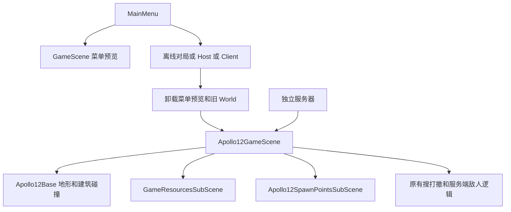
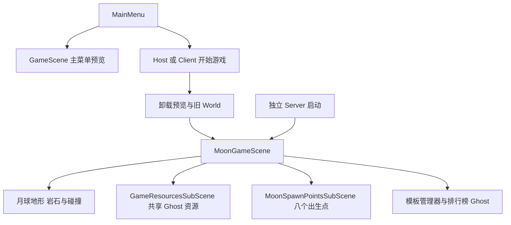

# Moon 正式联机地图

正式入口仍是 `Assets/Scenes/MainMenu.unity`。2026-10-11 起，开始离线对局、启动 Host 或连接独立服务器，会加载 `Assets/MoonEnvironment/Variants/Apollo12Base/Scenes/Apollo12GameScene.unity`。

新场景引用已优化的 `Apollo12Base.prefab`（真实 DEM、建筑群 3、Laptop 管线与装饰阴影简化），沿用原正式地图的管理器、Ghost 资源、MoonRaidMap、HUD 与后处理。没有带入预览玩家或启用模型展示相机。`ExpeditionClockPresentation` 连接现有服务端时钟；角色、敌人、战斗、背包、撤离和结算仍走原逻辑。

独立 `Apollo12SpawnPointsSubScene` 提供 8 个出生点，位于 MC00 东南侧空地并朝向基地。12 个物资点已重新落地：7 个室内点、5 个室外点；撤离点位于南侧 `(1219, 28.11, 1043)`。原有 3 个服务端敌人、10 分钟对局与 8 秒撤离参数保留。AI 继续使用既有运行时导航生成逻辑，未逐房间验证路径。

`GameManager.GameSceneName`、全局 Build Settings 和独立服务器的覆盖场景列表均指向/包含新地图。客户端和服务器需要同一版本，已有可执行文件需重新构建。菜单 **Tools → Moon Environment → Apollo 12 → Set Up Gameplay Map (preserve existing)** 只在缺少新地图时创建；已有地图仅补全构建列表，不覆盖手工调整。

本次执行了编译与创建过程中的引用/出生空间检查，没有启动 Play、联机测试或性能采样。旧 `MoonGameScene`、`MoonSpawnPointsSubScene` 和本地 Apollo12 预览保留。

## 旧 MoonGameScene 的历史记录

以下描述原地图接入时的结构、坐标与验证，不代表新 Apollo12 地图的运行验收。

`MoonDemo.unity` 保留为本地地形和光照演示。正式地图复用其中的 Moon Environment 预制体实例、TerrainData、岩石布局、碰撞和 Moon Scene Lighting；移除了 Local Moon Explorer 及其相机，不复制测试角色控制器。

## 场景关系

`GameManager.GameSceneName` 指向 MoonGameScene，服务器和客户端使用同一加载入口。`MenuPreviewSceneName` 保留原 GameScene；菜单预览和正式地图顺序加载，避免两个场景同时注册同一份 GameResourcesSubScene，或让旧竞技场出生点混入月球。

## 出生和物理

出生点位于原演示出生位置 `(2048, 229.33, 1816)` 附近、512 米精细地形的南侧。创建时从月球碰撞向下采样，选择坡度不超过 30°、避开岩石且有角色胶囊空间的位置；最终登记 8 个 SpawnPointAuthoring，由服务器原有出生选择逻辑使用。

客户端新生角色的初始朝向改为使用服务器出生点旋转，解除对旧竞技场坐标 `(0, 0, -12)` 的依赖。地形和岩石碰撞在独立服务器也需要加载，用于移动和命中判定；月球地图本身是静态场景，不给每块岩石创建网络 Ghost。

本次保持角色现有移动、重力和跳跃参数。MoonDemo 的 Tab 地形切换及数字键光照对比属于演示工具，没有接入正式联机地图，以避免各端碰撞不一致。

## 编辑与运行

- 在 MoonGameScene 中编辑地图实例；从 MainMenu 进入游戏进行联机测试。
- 在 MoonSpawnPointsSubScene 中调整出生位置和旋转，并保证角色脚下有地形、周围有站立空间。
- 菜单 **Tools → Moon Environment → Set Up Network Map** 登记地图和出生子场景到 Build Settings。已有地图不会被重建。
- Editor 的 Client + Server 模式从主菜单启动 Host；Server 模式沿用 ServerBootstrap 自动启动流程，默认监听端口 7979。
- 独立客户端和服务器须使用包含新地图的同一版本；旧构建不会自动获得这些场景。

月球地图已接入拾取物与撤离区，见 `Docs/MinimumRaidLoop.md`；仓库仍是连接内存状态，未接持久化数据库。正式地图的太空天空见 `Docs/MoonSpaceEnvironment.md`。

## 验证

已通过 Unity 编译和场景引用检查：无本地演示相机，包含一套管理器生成入口和两个自动加载子场景；8 个出生点均能射线命中月球地形。原 MoonDemo 与共享月球资产没有重写。

Editor Server-only 已进入正式月球场景，服务器加载 8 个出生点、正常监听，且没有创建 ClientWorld；Host 已进入 InGame。按用户敏捷开发要求停止进一步自动测试，双端移动、攻击和实际画面由用户继续实测。没有验证独立构建产物。

画面、角色手感和最终游玩效果由用户在旁验收；不使用截图代替验收。
