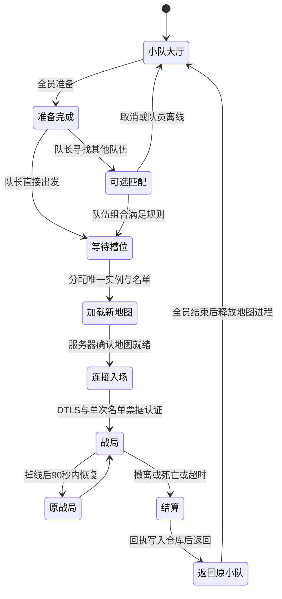

# 1–4 人在线小队与独立战局

默认入口是仓库的出发按钮，打开原生 UI Toolkit 小队面板。创建小队、复制八位队伍码给好友，所有人准备后由队长出发。Direct/Relay 留在折叠的高级连接设置中，不参与默认开局。

- **合作**：1–4 人，无需陌生玩家、无需等待公共匹配；真人同队免伤，AI 和环境伤害仍生效。
- **好友对抗**：2–4 人，在小队内自行选 A/B 队，至少两队后直接出发；同队免伤、敌队正常受伤，地图中的 AI 保留。
- 队友免伤不保护投掷者本人。自己的手雷、火焰等仍可造成自伤。服务器在释放时记录原角色和队伍；延迟爆炸不会把后来复用连接编号的队友误认为投掷者。缺少原角色身份时优先保留队友保护。
- **可选公共匹配**：以整个小队为单位寻找同模式队伍，总人数不超过 4。合作不会为了陌生玩家等待；对抗必须找到另一支队伍，不会把预组队成员拆成敌人。队长可取消队列。
- 默认同时只有一个地图槽，避免这台电脑同时承担多张重型地图；已有局运行时其他队伍等空位。该限制是部署容量，不是必须凑人。

## 服务所有权

账号后端拥有队伍、准备状态、模式、队列、实例名单和队伍归属。玩家的 Team/Instance 不从客户端 RPC 采信。入场票同时绑定账号和实例，其他实例不能消费，且只能成功消费一次。每个账号在本局最多部署一次；掉线恢复转交原角色与装备，不是重新部署。原有离线和 LAN 流程保留。

`OnlineInstanceWorker` 使用直接进程 API，每次分配启动一个全新的 `MoonServer.exe`，监听原 UDP 7979；使用同一公开证书域名。地图全部加载后才通知后端开放入场。没有队伍出发时，不加载地图，也不监听游戏 UDP。地图进程结束才释放实例；不会把旧地图、搜刮状态或尸体用到下一局。

`LocalData/online-lobbies.json` 持久化队伍/活动实例；进程租约在 `LocalData/online-instance-process.json`，包含 PID、进程启动时间和可执行文件路径，后端重启时只接管身份匹配的进程。各局日志位于 `LocalData/instances/<实例ID>/server.log`。服务器密钥和证书私钥仍只在服务器配置中，不发给客户端。

正常结束需每个成员完成结算并返回；尚未入场的成员留 5 分钟加载/连接。全员返回但仍有待处理操作时，调度器要求服务器走原有退出/回执刷新流程，禁止强制杀进程后直接复用槽位。地图最长 50 分钟后请求正常关闭。异常退出保留回执；未结算装备禁止再次准备，不伪造结算成功。

## 超时修复

客户端在大地图加载后才获取有效期 60 秒的入场票，避免票在加载过程中失效。安全 Direct 固定使用 UDP，不因 Editor 中的其他 World 错选 IPC。握手最多重试 15 秒，断线判定为 15 秒，上层等待仍有界。通过本机账号服务连接时，地图地址使用 `127.0.0.1`，证书验证仍使用服务器域名；朋友走配置中的公网入口。错误保留在小队面板，提供重试本局和等待结算返回入口。

这些修复不等于证明外部 UDP 转发可达。域名 HTTPS 可登录与游戏 UDP 可连接是两项不同的证据。

## 部署

1. 在唯一 Editor 使用 `Tools / Moonkov / Build Local Windows Server` 增量更新独立服；构建器恢复原 Player 子目标，保留缓存。成功生成 `Build/MoonServer/online-instance-protocol.txt`，内容为 `1`。
2. 执行 `Backend/Enable-OnlineInstances.ps1`：备份本机私有后端配置、正常停止旧常驻服、保存实例调度配置。遇到陌生端口占用时拒绝强制终止。
3. 使用 `Backend/Start-Backend.ps1 -Background -Update` 更新后端。大厅协议不会新增数据库 schema，不清玩家存档。
4. 后端常驻，游戏地图按需启动。不要再手动运行 `Start-GameServer.ps1`；旧高级直连需显式 `-LegacyPersistent`，会占用实例槽端口。
5. 发给朋友的客户端必须包含本轮网络代码、根目录公开 `moon-game-ca.pem` 和原公网 `moon-client.local.json`。旧构建不能混用。本轮不替用户打包客户端。

## 最小验证

- 后端编译零错误、零警告。
- `Backend/OnlineLobbyChecks`：30 项生命周期断言，包括四人上限、全员准备、权限、合作单人开局、好友分队、公共队列保留预组队、实例票据隔离、结算返回、全新下一局和后端重启恢复。
- `Backend/OnlineSessionChecks`：7 项既有入场票测试。
- `OnlineRaidChecks.Run()`：13 项无驱动 Edit Mode 断言，覆盖合作免伤、对抗伤害、AI伤害、延迟攻击归属、同队出生点、UI资产绑定。
- 10 项既有无驱动 ECS 重连断言通过。
- 按仓库约定不启动额外 Editor、独立客户端或联机验收；完整跨设备对局与公网 UDP 验收仍需用户实际游玩确认。

本机落地：独立服构建 `Succeeded`，0 错误，总大小 1,135,269,299 字节；Editor 已确认恢复 `Player`、`serverOnly=false`、未进入 Play。旧常驻服已正常停止。私有后端配置已备份并启用实例调度，后端重新构建零错误零警告，受保护健康检查显示 `online-lobbies-v1`、`Idle`。9 项部署预检查通过，包括空闲槽位检查与公网账号 HTTPS 401。没有真实玩家注册/出发操作，未跑联机验收。

本机 `moon-client.editor.local.json` 已备份后补入 `ServerAddress=127.0.0.1`、`ServerPort=7979`、`GameServerName=moon.morrowhome.site`、`ConnectionMode=1`；原本地账号地址保留。朋友使用的 `moon-client.local.json` 未改。Editor 下次 Play 读取这些本地覆盖。
