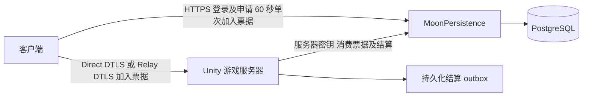

# 公网联机接入与恢复

客户端、Unity 游戏服务器与 MoonPersistence 必须同步更新。旧客户端的长期登录 token 不能用于新游戏加入接口；RPC 布局也已更新，不能混用版本。



## 已接入行为

- 在线服务器缺少 `moon-server.local.json` / `MOON_SERVER_CONFIG` 时拒绝初始化，不再降级为未鉴权会话。单机、LAN 仍通过显式模式标记使用各自档案。
- 账号 token 只走 HTTPS。游戏加入发送有效期 60 秒的随机票据；同一账号只保留最新一张，原子消费、不可重放。服务重启使未消费票据失效，客户端重新申请。已经认证的加入过程等待旧结算时按账号重新读取，不复用已消费票据。
- Direct 游戏传输使用 DTLS，校验 CA 和服务器名称；客户端缺少公共 CA、服务器缺少证书或私钥时拒绝连接。Relay 创建明确使用 DTLS。
- Relay 页分别提供创建房间、六位房间码加入；进入后仍可点击 Session Code 复制。云初始化、会话创建和网络配置共用 30 秒等待上限，取消或超时后清理迟到创建的会话。房主退出会关闭房间，没有主机迁移。
- 在线普通远征断线后最多保留 90 秒；原角色留在世界中，可继续受伤并消耗生存资源，不会自动撤离。重新认证后接回原角色、血量、位置、装备与结算编号，不重复出战扣库。超时、死亡或对局计时结束按原规则结算。
- 飞船仓库提供“重连原战局”倒计时入口，绑定原账号、地址/房间码和玩法。该请求仅恢复原战局；服务器重启、角色死亡或窗口过期时拒绝，不自动开启新战局。主机进程退出后无法恢复已消失的服务器；单机/LAN不使用此入口。赏金模式沿用其已有服务端保留窗口并禁止重连请求创建新参与者。

## 配置

在线房主是有后端服务器身份的受信进程，创建前检查配置。普通玩家发行包不包含服务器密钥，使用房间码或服务器地址加入。不要为了让朋友建房而分发服务器密钥；不使用在线账号服务的自建房沿用 LAN。

在运行 Unity 游戏服务器的 Windows PC 执行一次：

```powershell
powershell -NoProfile -ExecutionPolicy Bypass -File Backend/Setup-GameTls.ps1 -ServerName moon.example.com
```

替换为实际游戏服务器域名。生成的 `LocalData/game-tls/` 仅服务器使用，目录 ACL 限制为当前用户、SYSTEM 与管理员；不得发给玩家。脚本发现旧身份时拒绝覆盖。

仅将根目录的 `moon-game-ca.pem` 连同客户端发行；构建后处理会复制它。客户端 `moon-client.local.json` 使用 `ServerAddress`、`ServerPort` 和可选 `GameServerName`（默认使用连接地址）指定游戏端点及证书名称。通过 IP 连接但证书签给域名时，必须填写 `GameServerName`。macOS 的配置与公共 CA 都放在 `.app` 旁边。

服务器配置可用 `GameCertificateFile` / `GamePrivateKeyFile` 指定相对配置文件目录或绝对 PEM 路径；默认使用 `LocalData/game-tls/server.pem` 和 `server-key.pem`。更换服务器证书应保持 CA，或明确更新并重新分发客户端信任。证书到期前续签；不要无意重新生成 CA。

数据库与后端仍是既有部署：备份后按 `Docs/PostgreSQLPersistence.md` 更新后端。启动器要求 `game-join-tickets-v1` 能力，避免旧后端被误报为已更新。此次票据本身不新增数据库 schema。

VPS 仍需 HTTPS 反代账号接口，以及 UDP 7979 到实际游戏服务器的双向转发。DTLS 是游戏服务器端到客户端的保护，不由 HTTPS 反代终止。不得把 PostgreSQL 或带服务器密钥的内部接口直接暴露给玩家。

## 在这台电脑运行游戏服务器

Unity 6000.5.10f1 需要 Windows Dedicated Server Build Support。本轮已通过 Unity CLI 补装；CLI 安装在 `D:/Tools/UnityCLI`，未另开 Editor。

从现有 Editor 的 **Tools → Moonkov → Build Local Windows Server** 构建到 `Build/MoonServer/MoonServer.exe`。工具等待编译/导入空闲，使用正式地图和共享网络资源；若正式场景有未保存改动，先用 `SaveAsCopy` 保存构建副本到被忽略的 `Assets/OnlineServerBuildSnapshot/`，保留当前内容。Unity 正式构建仍可能弹出原场景保存对话框；场景含并行修改时，由用户决定是否保存，工具不自动确认。构建状态在 `Library/BuildValidation/OnlineServer/build-report.json`。

```powershell
powershell -NoProfile -ExecutionPolicy Bypass -File Backend/Start-GameServer.ps1
powershell -NoProfile -ExecutionPolicy Bypass -File Backend/Stop-GameServer.ps1
```

启动器复用项目根目录的私有配置，以 `MOON_SERVER_CONFIG` 传给子进程，保留原证书及 outbox 路径；不把服务器密钥复制到客户端发行包。隐藏运行专用服务器，等待正式地图加载且该进程打开 UDP 7979 后报告启动完成。PID 与日志在 `LocalData/game-server.pid.json`、`LocalData/game-server.log`。停止脚本验证进程身份后请求原有退出流程，等待结算收据写完，不强杀进程。

## 最小检查

```powershell
# 配置与证书，不连接服务
powershell -NoProfile -ExecutionPolicy Bypass -File Backend/Test-OnlineDeployment.ps1 -ConfigurationOnly
# 额外读取后端能力、公共 HTTPS 状态和本机 UDP 监听；不启动服务
powershell -NoProfile -ExecutionPolicy Bypass -File Backend/Test-OnlineDeployment.ps1
```

结果在 `LocalData/online-preflight.json`；失败返回非零。HTTPS `/auth/me` 无凭证预期 401，502 表示反代上游不可用；本机 UDP 有监听也不等于外部 UDP 可达。

本轮验证：后端编译、7 项票据单次消费/过期/并发检查、10 项不创建网络驱动的隔离 ECS 角色恢复检查、原生 UXML 导入及现有持久化上下文检查。未运行 Play、多个网络 World、独立客户端、跨设备公网对局或丢包验收。既有构建产物必须重新构建，代码提交及预检查不等于上线验收完成。
