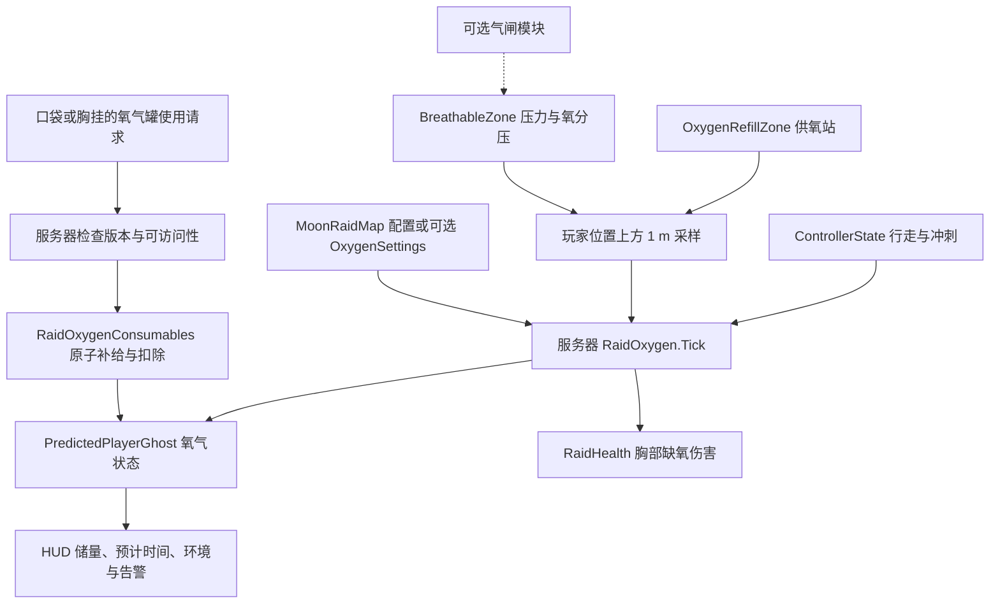

# 氧气系统

氧气沿用现有 Raid、Ghost、身体健康、背包和 UI 架构。服务器负责消耗、环境采样、补给、缺氧伤害和道具扣除；客户端读取同步状态并提交操作请求。储量统一使用 `0–100`，速率使用「储量百分点／秒」。这是可配置的游戏生存模型，不是气体流体模拟。

## 行为与默认值

| 项目 | 默认行为 |
| --- | --- |
| 宇航服容量 | 100，新一局初始化为满氧 |
| 真空静止续航 | 600 秒；基础消耗约 0.167 点／秒 |
| 行走／冲刺倍率 | 1.1／1.75；只在实际移动时应用 |
| 低氧／危急阈值 | 25／10；HUD 显示储量、当前净消耗下的预计续航 |
| 可呼吸环境 | 压力至少 60 kPa，氧分压至少 15 kPa；阈值可在区域中配置 |
| 默认房间空气 | 101.325 kPa、21% 氧气；环境安全时不消耗宇航服储量，不产生缺氧伤害 |
| 空气自动补充 | `AllowsSuitRefill` 开启时每秒补 5 点；可以独立关闭 |
| 储量归零 | 先等待 8 秒，再每秒造成 3 点胸部伤害；只计算这一帧中真正耗尽后的时间 |
| 重新获得空气或补氧 | 清除连续缺氧累计；储量始终限制在 0–100 |
| 补氧站模板 | 每秒供给 10 点，默认有电且要求可呼吸空气；进入范围自动供给 |

`OxygenSettings` 是可选共享配置。在 `MoonRaidMap` 的 **Oxygen Settings** 字段指定资产后使用其数值；不指定时继续使用该地图已有的序列化数值，不会隐式加载 Resources 配置、覆盖旧地图调参。现有地图的 `BreathableZone` 保留 `AllowsSuitRefill = true` 的兼容行为。新建房间模板默认关闭它，适合「室内能呼吸，但补满储气要去补氧站」的玩法。

服务器只更新处于活动 Raid 的存活玩家；结算与死亡后不再耗氧。缺氧伤害经过现有身体伤害与死亡路径。非有限配置使用安全默认值或禁用异常输入；消耗、补给和缺氧宽限由同一权威 Tick 决定。

## 创建与放置

执行 **Tools > Moonkov > Oxygen > Create Reusable Assets** 创建缺失资产：

- `Assets/Resources/Moonkov/Oxygen/DefaultOxygenSettings.asset`
- `Assets/Prefabs/Survival/BreathableRoom.prefab`
- `Assets/Prefabs/Survival/OxygenRefillStation.prefab`
- 同目录下三份补氧站 URP 材质。

再次执行会保留已存在的资产和所有手动调参；若路径存在类型不符的资产则报错，不覆盖。生成过程使用预览场景，不修改打开的地图，不自动指定配置或把整栋建筑标为可呼吸。

在 Hierarchy 选中目标父对象后，使用 **GameObject > Moonkov > Survival > Breathable Room / Oxygen Refill Station** 放置模板。新实例位于父对象原点，未选中父对象时放在当前场景原点；创建支持 Undo。也可以直接拖入 prefab。

**Tools > Moonkov > Oxygen > Preview Health Panel** 打开实际健康面板的编辑器预览。滑块设置储量，Vacuum／Breathable／Refill Station 切换环境，Step 10s 推进十秒真实氧气规则，Reset 恢复生命和三罐氧气。面板补氧按钮会消费窗口自己的临时库存；不修改玩家账号、地图或 Play Mode。

**可呼吸房间：**模板仅有 `BreathableZone` 和 BoxCollider，没有渲染物体。默认范围 `6 × 3 × 6 m`，原点在地面；选中时显示绿色边框。用 BoxCollider 的 Center／Size 贴合实际密封房间，设置有意义的 Airspace Id。区域重叠时使用最高 Priority，同优先级不要依赖注册顺序。门口应明确划界，动态气闸模块可通过 `Configure` 更新独立区域的压力，不要让静态房间区域覆盖泄压中的气闸。

**补氧站：**模板有双气瓶、阀门、连接器与 `O2 / AUTO SUPPLY` 标识。正面为本地 `+Z`；根对象的触发范围为 `2.4 × 2.4 × 2 m`，中心 `(0, 1.2, 1.05)`，覆盖站前玩家躯干。柜体与底座有实体碰撞，其余装饰没有碰撞。青色选中边框表示供氧范围，关闭 Powered 后边框变灰。

补氧站代表**有电时持续供气的自动脐带连接区**，供气无限，不消耗库存或燃料，不要求按键或逐人连接。默认 `Requires Breathable Air = true`，应放在房间空气范围内；需要真空中的密封宇航服接驳站时可明确关闭该项。供氧本身不会令周围环境变成可呼吸空气。`Powered` 可由将来的电力／任务逻辑切换，断电立即停止供给。

多个补氧站与环境自动补给重叠时取**最高供给速率**，不会相加。真空中仍计算人体耗氧，最终储量变化是供给减消耗；站点供给不足时仍可能耗尽。当前模板只表现工作站外形，未接动画、动态断电灯、有限气源或电网。

## 便携氧气罐

物品代码为 `oxygen_canister`，显示名 **O-40 Emergency oxygen canister**，使用一次补 **40 个储量百分点**，最多补到 100。满氧、死亡、失效版本或不可访问位置不扣道具。

| 属性 | 数值 |
| --- | --- |
| 格子尺寸 | 1 × 1 |
| 最大堆叠 | 3 |
| 单个重量 | 0.35 kg |
| 战斗中可使用位置 | 口袋或胸挂；背包中的罐子需要先移动到可访问位置 |

复用现有商城、出战物资、物资掉落、背包使用请求和死亡掉落。健康面板提供氧气补充操作并显示可用数量。非持久化出战附带一罐，编号为偶数的补给箱含一罐，商店沿用现有生存测试物资的免费售价；持久化出战需要从自己的仓库携带。服务器先验证背包版本、物品与存活状态，再完成「补给＋消耗一个」的原子操作，重复／过期请求不会重复补给。

## 后续扩展入口

- 平衡：修改共享 `OxygenSettings`，或保留每张地图自己的 `MoonRaidMap` 参数。
- 压力与气闸：复用 `BreathableZone.Configure` 和 `TrySample`，在同一个位置采样路径内扩展；气闸控制器单独接入。
- 新补给物：增加带 `Oxygen` 数值的 `ConsumableDefinition`，接入现有道具目录与资源呈现。
- 电力：驱动 `OxygenRefillZone.Powered`；有限气源或多人分配需要新增服务器库存规则，不能只在客户端扣除。
- 装备容量与泄漏：当前固定容量为 `RaidOxygen.Capacity`；需要新玩法时同步扩展服务器状态与 HUD，避免客户端独自改变续航。

地图作者需要主动布置可呼吸区与补给点。系统不会根据建筑外形推断密封性，也不会把正式月球地图整体变成安全区。

本次新增 Ghost 同步字段，客户端与服务器应使用同一版本构建。氧气储量和缺氧计时是局内状态；新部署重置为满值，氧气罐物品沿用原有持久化库存。

## 验证边界

实现阶段在当前工作区完成的验证如下；本次独立提交只检查暂存范围和差异，未重新运行 Unity。Unity Editor 编译通过；`Tools > Moonkov > Check Oxygen System` 的 46 条针对性断言通过，覆盖耗尽与宽限分帧、运动倍率、安全空气与储气分离、压力／氧分压与优先级、站点禁用及重叠、氧气罐原子消费和拒绝路径、营养及旧接口兼容。共享库存与物品目录所在的 `Backend/MoonPersistence` 编译通过，零警告零错误。

配置及两个 prefab 已由 Unity 生成并检查组件引用；当前打开场景保持未修改。实际健康面板已在编辑器预览中渲染，确认氧气数据、补氧按钮和健康布局可见，满氧禁用补氧、20% 储量启用按钮。预览截图为 `Logs/OxygenHealthPreview.png`。全程未切换 Play Mode；尚未验证真实地图边界穿越、正式 HUD 的游戏画面、Host＋第二客户端、死亡重生／再次出战或目标设备性能，编辑器预览与规则检查不替代这些验收。

手动验收只需覆盖当前玩法风险：在真空行走／冲刺确认速率差异，进入房间确认停止耗氧，进入站点确认补氧并在断电后停止，验证便携罐与满氧拒绝，最后确认耗尽宽限与缺氧伤害。多人验收应另查服务器与两个客户端显示一致；纯逻辑检查不能替代这一步。
