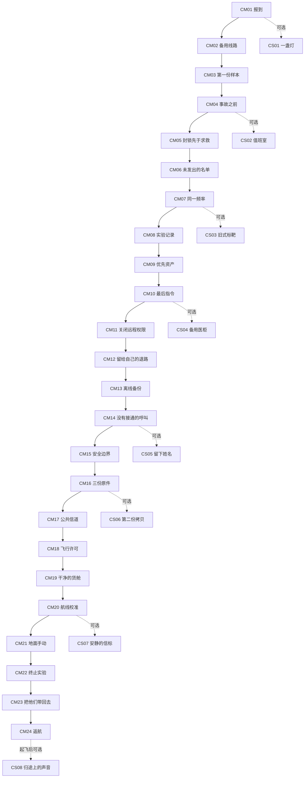

# Moonkov 单人战役任务册

版本：设计提案 v1.0。日期：2026-10-25。

本册定义八章、24 个主线任务和 8 个可选支线。结局是主角携带完整证据，乘作业船离开月球，在地球隔离着陆并交接证据。公司名、人物名和新增地点均为创作提案。

当前已实现的是 MC00 月核与档案两种随机设施行动、真实物品回收、撤离结算、首次成长记录和局内追踪。下文的章节、证据链、船内任务、返航流程和新增机关均待实装。不能把任务描述当成已有可玩内容。既有事实见[任务实施状态](../Missions/Implementation-Status.md)。故事正文见[完整故事](Story.zh-CN.md)，数据、追踪和存档规则见[任务系统规格](System.zh-CN.md)。

## 全战役规则

### 完成任务不依赖追踪

主线按调查进展解锁，关键设备和必要产物提供稳定可完成的机会。支线从已作者化内容中启用；随机性只影响补给、可选事件、合格遭遇与有限路线变体。无需接取。没有点追踪，真实操作和回收仍然有效。

玩家可固定 1 个展开目标和至多 2 个紧凑次目标。展开目标显示任务名、当前动作、已知地点和必要风险。每次只显示当前可做步骤，不把后续章节和反转提前列出来。文字中的数字必须来自任务快照；定位先指向入口，再指向已发现的设备，不能用穿墙直线替代行走路线。

各任务列出的追踪文案是状态序列示例，不要求同时显示。按钮名称使用实际输入绑定。产品文案不显示 CM、CS、EV 等制作编号，也不使用中点分隔文案。

### 同一次出战可以完成连续任务

CM01 至 CM24 是依赖次序，不是 24 次强制出战。前置在当前出战中有效完成后，下一任务可进入临时可用状态。一次撤离可按依赖顺序提交多项事实、多个任务结果和一次性奖励。

共用下列保存语义：

- **出战提交**：现场操作先记入本局结果；成功回到作业船后，与物品入库同一事务保存。死亡、超时或中途退出时，未提交的操作与携带物沿用既有损失及保护容器回收规则，已经保存的章节不回退。
- **保障舱提交**：发生在安全保障舱的分析、装配、船内保管与飞控操作，在权威事务成功并原子保存后完成，不要求为了保存再出战一次。
- **终局检查点**：CM22 至 CM24 使用独立终局事务与安全检查点。已经保存的断源、证据封装和船内装载不能因播放中断再次执行。检查点不额外恢复已经裁决丢失的装备，也不冒充普通撤离成功。

任何必须回收的唯一物品都可从已确认来源重新取得。来源失效时提供原地点重新导出或作业船已验证备份重制，不把“上一份已掉落”变成永久卡档。重制需要原证据事实，不能凭商店同名物品、客户端按钮或旧任务首次记录获得。

证据介质属于拟议任务物品类别，保护容器兼容性必须在现有兼容表中明确。不能默认所有保护容器都能放入证据，也不通过剧情免费免损。凡下文写“死亡丢失”，均指经过现有保护规则裁决后实际遗失的物品。

新任务只改变单人战役的环境状态。在线搜打撤和其他人的地图不因这份个人剧情自动断电、关站或返航。

### 地点与表演边界

| 地点 | 现状与规划用途 |
|---|---|
| MC00 入口、L22 配电 A、配电 B、取样机、档案终端 | 现有设施。复用设备外形与合格操作点；章节调度和剧情产物仍需接入 |
| MC00 值班室、控制间、医疗档案室、实验记录室 | 新作者化房间。优先占用正式地图已可达楼层；名称不代表已有房间或导航 |
| 月面中继、维护通道、转运封存位 | 新作者化点位。必须先验证支撑、通路和往返时间 |
| 作业船保障舱、主飞控舱、货舱、证据保管位 | 新作者化船体与船内任务空间。既有飞船菜单不能替代可见的登船与返航表现 |
| 异常源控制间 | 在已验收可达区域内建立。不得默认深井、无碰撞构件或未验收桥面可走 |
| 地球隔离着陆点 | 结局专用表现空间，展示舱门开启、隔离接收与证据交接 |

## 主线依赖与支线入口

主线图表示必要依赖。下游记录可以提前采集的情况，各任务单独声明；提前采集不会提前播放反转。各支线都不是主线前置，不影响返回地球的资格。

## 第一章 静默着陆

本章让玩家完成一条完整的调查、设备操作、回收和撤离路线。顾衡表现为正常雇主。沈禾帮助玩家辨认设备，不替玩家解题。污染人员的身份通过工牌、工作服和环境留下痕迹。

### CM01 报到

- **解锁与地点**：新单人战役开始。地点为作业船保障舱与 MC00 现有入口；船内报到台为新增落位。完成后临时解锁 CM02。
- **实际流程**：在保障舱核对个人装备和撤离路线；进入 MC00 入口范围；将清理队识别码写入本地门禁，读取站内求救缓存。装备检查只列出缺项，不强制购买指定型号。无可用武器时沿用既有紧急补给资格，发放 1 件 `pistol`（6 发已充能）和 3 颗 `cells`；不修改其领取条件，也不另造无限战役礼包。
- **反馈与风险**：入口应急灯由闪烁变为稳定，广播仍无人工回应；墙上留下研究人员撤退方向。首次接敌使用原遭遇预算，入口终端不生成额外敌潮。玩家随时可原路返回。
- **局内追踪**：“前往 MC00 入口”→“登记清理队识别码”→“调查备用供电”。位置显示入口和已知楼梯，不提前标记 L22 内部设备。
- **完成与恢复**：登记成功记本局事实，首次安全回船时出战提交。若继续完成 CM02/03，可一次提交。死亡后只需重新登记；不重复播放已听过的完整简报。
- **收益与用时**：保存 MC00 入口和普通撤离路线，开启设施调查。没有重复报到奖金。主动操作约 30–45 秒，另计首次找路和往返。

### CM02 备用线路

- **解锁与地点**：CM01 在本局或历史有效完成。复用 L22 配电 A/B；战役实例保障此流程，和档案实例不同时争用唯一 MC00 槽。完成后解锁 CM03。
- **实际流程**：观察 A 柜故障铭牌；在离散线路选项中隔离烧损支路并保留备用母线；到 B 柜恢复维修配电；从走廊状态灯确认取样线路就绪。玩家可先读任一铭牌，已读结果保留到本局结束。
- **反馈与风险**：A 的“18:42 热损故障”、B 的“18:47 备用母线带电”保持原义。接错线路只回报故障，不凭空重伤玩家、不扣唯一道具、不切断所有撤离。备用灯带和取样夹具显示实际供电状态。
- **局内追踪**：“隔离烧损支路”→“恢复维修配电 1/2”→“取样线路已就绪”。只有靠近并发现两柜后才显示其精确方向。
- **完成与恢复**：两柜有效状态记本局事实，与 CM03 同次回船出战提交。死亡重试时恢复未提交设备组合，保留已经保存的故障认知；不能从“看过铭牌”直接跳过实际配电。
- **收益与用时**：解锁安全取样方法，保存两条设备时间记录。主动操作与两柜移动约 75–110 秒，另计交战。此处不发独立战力奖励。

### CM03 第一份样本

- **解锁与地点**：CM02 两路供电就绪。复用 L22 取样机和现有输出槽。成功回船后开启第二章 CM04。
- **实际流程**：启动切割 3 秒；机器自动运行 45 秒，玩家可搜查附近、改变掩体或提前撤退；从真实输出槽取得至少 1 枚月核碎片；携带碎片返回作业船。两枚输出沿现有唯一物品规则处理，不要求全部拿走。
- **反馈与风险**：夹具、转子和结晶按真实状态变化。声音暴露操作位置，但不声称已实现警报听觉或额外刷怪。拿到碎片只显示“尚未入库”，不会立刻记为成功回收。
- **局内追踪**：“启动月核切割”→“切割进行中 31/45 秒”→“带回月核碎片”→“回收正在保存”。背包满时提示所需空位，物品留在输出槽。
- **完成与恢复**：携带合格来源碎片安全回船并保存后完成。死亡或丢弃可在该次行动有效期内找回；有效期结束后，下一次战役行动重新提供产物机会。已完成战役事实不因以后出售碎片回退。
- **收益与用时**：沿用现有首次月核成长 30 月尘和机器产出的 2 枚碎片，只要求带回至少 1 枚；首次奖励已经领取则为 0，不叠发战役奖金。若本次同时满足现有首次普通回收，另按原规则发 10 月尘一次。顾衡要求玩家继续核对异常报告。启动、运行、搜刮约 60–90 秒，回船与交战另计。

### CS01 一盏灯

- **解锁与地点**：完成 CM01 后可发现。入口至楼梯间新增一处独立应急灯配电盒。无后续必需依赖。
- **实际流程**：沿地面熄灭的灯带找到配电盒；核对盒盖内的线路标识；切换独立照明支路。玩家也可保持黑暗并忽略支线。
- **反馈与追踪**：真实灯带照亮已知楼梯和出口牌；不清怪、不建立无敌区。追踪依次为“检查入口照明”“接通应急灯带”“返回已知路线”。
- **保存与恢复**：回船出战提交后，该战役路线保留修复结果；未保存时可重做，不消耗随机保险丝。
- **收益与用时**：获得更清楚的返程地标和一条值班员短记录，不发永久增伤。约 45–75 秒。

## 第二章 错开的五分钟

本章把“设备故障”推进成“事故报告存在隐瞒”。配电柜的五分钟差只构成疑点。人为封锁的结论必须由独立门禁记录和求救记录共同支持。

### CM04 事故之前

- **解锁与地点**：CM03 已保存。复用 MC00 档案终端与两柜扫描位。本次章节保障档案流程，不与月核取样同时占用设施槽。完成后临时解锁 CM05。
- **实际流程**：档案设备自检 3 秒；读取 A/B 两处校验标签，各 4 秒，允许自检前提前读取；返回确认下载 1 秒，设备自动下载 20 秒；取得具备本章来源凭据的 `mc00_archive_drive`。
- **反馈与风险**：自检恢复部分事故画面，五分钟缺口被明确指出，界面不直接定性公司犯罪。流程不额外刷怪，压力来自现有遭遇与停留。下载完成后产物真实进入输出槽。
- **局内追踪**：“恢复档案设备”→“读取校验标签 1/2”→“下载事故记录”→“带回事故档案”。设备状态和持有状态分别显示。
- **完成与恢复**：合格档案安全回船后，验证源签名并登记 EV01 事故黑匣子的设备记录部分；盘内原始数据保留，生成船内离线镜像。完整 EV01 还需 CM05 的门禁与求救记录、CM06 的交叉核验。普通档案盘、商店物品和旧首次成长事实不自动替代本章凭据。丢失时可重新导出。
- **收益与用时**：沿用现有首次档案成长 20 月尘，已经领取则为 0，不叠发战役奖金；合格档案介质 1 份用于证据。满足现有首次普通回收时，原 10 月尘仍只发一次。开启事故时间线。现场流程约 90–140 秒，往返另计。

### CM05 封锁先于求救

- **解锁与地点**：CM04 产物已在本局取得，或 CM04 与设备子记录已保存。新增 MC00 门禁维护面板和相邻通信缓存位，均安排在同一可达楼层。完成后解锁 CM06。
- **实际流程**：从维护面板读取 18:39 封锁动作的控制来源与签名时间；在通信缓存中定位 18:44 第一条求救的发出和排队记录；在现场维护终端按来源对齐两份时间线，确认不是本地时钟偏差。核心操作是证据比对，不能用两次相同长按替代。该 `CompareRecords` 节点使用 `OnExtraction`，回到保障舱只提交结果，不把比对再做一次。
- **反馈与风险**：面板在相同时间基准上突出“封锁指令早于首条求救”；受困者的敲击录音与封闭门相互印证。这里新增门禁记录，不改写 A/B 铭牌。
- **局内追踪**：“读取门禁控制记录”→“取得第一条求救时间”→“核对记录来源”。错误比对只提示来源不同，可重新选择，不扣物。
- **完成与恢复**：两个源记录及一次正确比对形成可提交事实；同次回船出战提交。死亡重做未保存的读取，保留已保存的设备子记录。若先路过读到任一记录，可在解锁后使用该次有效采集结果。
- **收益与用时**：保存“封锁先于求救”的调查结论，顾衡以防扩散解释封锁。此时只产生怀疑；认定故意弃人还需后续风险账本、生命保障与试验回路分离图、公司毁证命令。约 90–150 秒。

### CM06 未发出的名单

- **解锁与地点**：CM05 比对有效。新增 MC00 值班室内人员排班终端，出口在同一走廊；不要求新地图。完成并保存后开启第三章 CM07。
- **实际流程**：根据站内分区表查找被封锁班组；从终端导出当班名单与撤离排程；在撤离排程中找到被自动撤销的人员申请；携带名单介质回船，让沈禾在保障舱核对没有任何对应接收记录。
- **反馈与风险**：名单由匿名数量转为姓名和岗位；顾衡仍以“系统误报”解释。取出介质后终端进入已导出状态，不反复刷新物资，也不突然封死出口。
- **局内追踪**：“前往值班室”→“导出当班人员名单”→“带回名单并核对接收记录”。不把全部姓名铺在 HUD 上。
- **完成与恢复**：名单回船后，与设备、门禁和求救记录交叉核验，完成 EV01 并出战提交；名单可和 CM04/05 的来源介质同次带回。死亡、丢弃或容量不足按真实物品与保护规则处理，原终端提供重导出机会。
- **收益与用时**：保存名单辅助证据，解锁实验项目索引和沈禾的私人通信。约 75–120 秒，保障舱核对约 20 秒。

### CS02 值班室

- **解锁与地点**：CM04 后在值班室门旁发现。新增个人储物格，不是主线名单终端。
- **实际流程**：根据储物格门内的轮班照片辨认一枚录音徽章；打开对应格，取得研究员给家人的离站留言；可放回，也可带回船内记录区。
- **反馈与追踪**：留言谈普通生活，不提前泄露后续反转。追踪为“查看值班室储物格”“带回录音徽章”。不需要撬开全屋容器。
- **保存与恢复**：带回并保存后，留言进入可重听档案。未带回的徽章可重新找到；支线永不阻挡主线。
- **收益与用时**：补充遇难者身份，在地球结尾的交接箱中出现该徽章。约 60–90 秒。

## 第三章 光环的来处

本章解释武器与污染的同源研究背景。玩家用设备测量和原始账本确认公司事先知情。公司提前拥有光环只能支持怀疑，不能单独当作定罪证据。

### CM07 同一频率

- **解锁与地点**：CM06 已保存。新增 MC00 控制间内隔离测量台和邻接实验观察窗。完成后解锁 CM08。
- **实际流程**：将 1 枚已保存的月核碎片放入封闭测量槽；切换两组传感器的读数，找出污染活动与实验场的同步变化；使用任一可用光环向 10 米处指定惰性校准靶形成 1 次有效命中，记录干扰响应。没有碎片时，从受控任务产出重取，不购买随机掉落许可。
- **反馈与风险**：波形与观察窗内的隔离样本同步变化；一次脉冲造成短暂失同步，说明光环有效的原因。隔离测量不放出新的活怪，不要求制作完全无效的常规枪。
- **新增目标能力**：该射击步骤需要新增 `TargetResponse` 目标类别，由权威弹体命中、正确靶 ID 与当前测量档位共同确认，并驱动传感器反馈。现有 `Interact`、`Scan`、`Process`、`Configure` 四种设施目标并不自动支持射击校准；开枪声、客户端命中特效和任意墙面命中都不能代替有效响应。
- **局内追踪**：“检查隔离测量台”→“比对实验场频率”→“记录光环干扰响应”。缺少碎片或充能时指出实际缺项并允许退出。
- **完成与恢复**：测量槽物品在本次操作结束时返回原库存；不得暗中消耗唯一碎片。有效读数回船出战提交。死亡前未保存读数可重测，保底光环也能完成校准，不要求稀有模块。
- **收益与用时**：保存光环与控制设备的技术关联，解锁项目记录室索引。主动操作约 90–150 秒。

### CM08 实验记录

- **解锁与地点**：CM07 测量成立。新增实验记录室的只读存储架与风险审批终端，均在同一已验收区域。完成后解锁 CM09。
- **实际流程**：根据 CM07 得到的项目编号定位一套存储架；读取风险审批单的签署页；将审批单摘要与被修改的试验记录对照；取出带源签名的实验账本介质及生命保障与试验回路分离图。账本明确记录污染风险、异常暴露和继续试验的批准，线路图补证备用供电实际服务的回路。
- **反馈与风险**：玩家亲手发现修改前后的记录差异。许砚在试验注释中留下异议，但录音始终标注为历史记录。储存区可提供绕行掩体与直接穿过开敞区两条路线，不用强制清场判断胜利。
- **局内追踪**：“定位项目记录架”→“核对风险审批单”→“取得实验账本”→“带回带签名的记录”。
- **完成与恢复**：账本介质成功回船后登记 EV02 `trial_ledger`，建立验证镜像并出战提交。介质丢失时从原架重导出，旧物版本不会给多份首次奖励。
- **收益与用时**：确认公司在事故前已知风险；EV02 成为最终证据必要组成。约 100–160 秒。

### CM09 优先资产

- **解锁与地点**：CM08 账本在本局已取得或 EV02 已保存。新增月面转运场的封闭装载清单终端；场地必须有普通撤退路线。完成并保存后开启第四章 CM10。
- **实际流程**：通过记录中的批次号找到转运清单；观察货位编号与人员撤离排程的优先级；读取一条预先下发的“样本先行”命令；导出装载清单并返回作业船，检查船内对应封闭货位的外部编号，不在此阶段开启危险货柜。
- **反馈与风险**：玩家发现自己的返航船已被安排承运研究样本。命令与货位相互印证，避免只靠反派解释。货柜受远程锁控制，点击拒绝开柜不会消耗资源或触发必死陷阱。
- **局内追踪**：“核对样本转运清单”→“记录作业船货位编号”→“回船检查封闭货位”。
- **完成与恢复**：装载清单安全回船且外部货位编号吻合后出战提交，登记 EV03 的回收优先级部分。船内核对是保障舱步骤。丢失清单可重导出；不能从看过货柜直接跳过记录来源验证。
- **收益与用时**：保存辅助装载证据，顾衡发出最后回收要求。约 90–140 秒，船内核对约 20 秒。

### CS03 旧式标靶

- **解锁与地点**：CM07 后，控制间邻接的旧校准位。不是额外武器或隐藏弹种解锁门槛。
- **实际流程**：将校准台切为本地演示；依次切换低、中、高三档设备设置，每档向同一惰性靶形成 1 次有效光环命中，共 3 次；从被覆盖的设备名牌确认光环最初承担隔离控制工作。三档由设备设置完成，不要求三种付费或稀有光环。
- **新增目标能力**：复用 CM07 所需新增的 `TargetResponse`，按靶 ID、档位和有效命中各记录一次响应。必须新增服务端命中接收与可见测量反馈，不能把三次普通长按或纯客户端打靶动画当成已经完成射击验证。
- **反馈与追踪**：靶面只显示测量结果，不伪造活敌伤害。追踪为“开启本地演示”“记录响应 1/3”“读取原始设备名牌”。
- **保存与恢复**：三档读数回船出战提交，受伤中断只重做当前读数；失败不会扣除永久光环知识。
- **收益与用时**：开放一段许砚谈“控制”与“武器”的录音；不新增永久伤害加成。约 60–100 秒。

## 第四章 清理对象

反抗通过实际行为发生。玩家先保存销毁命令，再隔离远程控制，最后给自己留出可用退路。沈禾支持主角承担风险。公司可以撤销主飞控授权，但不能一并抹掉本地生活保障。

### CM10 最后指令

- **解锁与地点**：CM09 已保存。作业船保障舱通信台，新增带签名命令查看与导出交互。完成后解锁 CM11。
- **实际流程**：收到顾衡要求销毁事故记录、保留样本的命令；展开命令来源和清理队处置条款；将原始命令导出到独立介质并关闭自动清除队列。玩家通过保全证据作出反抗，不弹无意义的“是否成为好人”选择。
- **反馈与风险**：返回权限状态改为“公司授权已撤销”；生活保障、库存和改装终端保持本地可用。角色不会在安全界面遭遇无预警秒杀。
- **局内追踪**：“核验最后指令”→“保全原始命令”→“隔离远程控制”。在保障舱同样用任务区域显示当前动作。
- **完成与恢复**：签名核验、导出和队列关闭以保障舱事务一次保存，将 CM09 回收优先级与本次毁证命令合并登记完整 EV03 `cleanup_directive`。保存失败时保持“正在保存”，不得先删远端命令再丢失本地副本。中断后恢复同一命令，不重复扣物。
- **收益与用时**：三份核心证据的第三份成立；解锁独立行动。约 60–90 秒，含可跳过后可重听的通信。

### CM11 关闭远程权限

- **解锁与地点**：CM10 已保存。作业船外部维护柜与邻接月面中继，新增作者化点位。完成后解锁 CM12。
- **实际流程**：在维护柜确认本地保障和主飞控的分离结构；拔除公司控制链路的物理许可桥；到中继关闭只供公司写入的命令通道，保留本地导航接收与公共求救接收。顺序明确，操作都可由一人完成。
- **反馈与风险**：公司指令灯熄灭，本地保障灯保持亮起；顾衡只剩被拒绝的通信记录，不新增佣兵敌人。错误选项被联锁拒绝并说明影响，不把关错一次开关变成坏结局。
- **局内追踪**：“检查船外许可桥”→“切断公司写入链路”→“保留公共接收通道”。
- **完成与恢复**：离开维护区域并回到保障舱后出战提交。未保存时可恢复步骤；已提交后公司写权限不因重进战局自动回来。普通撤离不受主飞控锁影响。
- **收益与用时**：取得本地控制权，保护仓储、制造和证据镜像。约 90–140 秒。

### CM12 留给自己的退路

- **解锁与地点**：CM11 有效。新增已验收维护通道的单向门控与备用撤离信标，连接 MC00 外侧和既有安全返程方向。完成并保存后开启第五章 CM13。
- **实际流程**：依据维护图找到备用通道入口；从可达侧释放机械门闩；沿通道走到出口，接通只对自己战役生效的返程信标；从出口确认能回到作业船方向。原有普通撤离始终可用。
- **反馈与风险**：门体真实开启，出口有对应标识。通道只提供另一条路线，不保证无敌或完全无怪。不开门也可先撤离，下次继续。
- **局内追踪**：“找到维护通道入口”→“释放机械门闩”→“确认备用返程路线”。不把绿色光柱移位当作开通成功。
- **完成与恢复**：门与出口都有效且玩家实际通过通道后，回船出战提交。死亡只回滚未提交开通结果。若门体不可达或无支撑，任务不得生成，更不能把未验收深井当作捷径。
- **收益与用时**：保存已知备用路线，后续回访可用。约 100–160 秒。

### CS04 备用医柜

- **解锁与地点**：CM10 后，由保障舱现有物资清单提示。新增维护通道旁的旧医疗柜，地点需可独自进入。
- **实际流程**：读取柜体维护标签；转动机械释放柄；从柜内取出固定的 1 支医疗注射器 `medkit` 和 2 份医疗凝胶 `med_gel`。无需随机钥匙，也不要求同时守住两个按钮。
- **反馈与追踪**：柜门打开后显示真实容器内容，物资取空保持为空。追踪为“找到维护医柜”“打开机械锁”“回收所需医疗物资”。
- **保存与恢复**：医柜使用稳定容器 ID 与预先生成的物品 ID。首次取出前，先原子记录一次性发出账本及真实库存转移，再让玩家取得物资；任务完成记录仍随有效回船保存。死亡不因任务尚未保存而补发整柜；幸存的保护容器物品与地面掉落沿原规则处理。重进读取原发出账本与剩余数量，不刷新整组补给。
- **收益与用时**：首次有效回收 1 支 `medkit` 和 2 份 `med_gel`，额外月尘为 0，另有维护人员留条；不影响任何主线资格。物资实际遗失后不重复刷新。约 45–75 秒。

## 第五章 留下的人

本章给受害者留下完整的人物声音，也把关停异常源变成可执行计划。许砚的录音是历史遗留，不会在玩家行动时神奇地给出实时回答。分区隔离只降低后续关停风险，核心仍留待最后一章现场断源。

### CM13 离线备份

- **解锁与地点**：CM12 已保存。新增 MC00 可达维护室内的离线检修盒，回到船内档案台归档。完成后解锁 CM14；不依赖未验收深井。
- **实际流程**：根据维护图找到与公司在线记录隔离的检修盒；通过本地检修口读取许砚留下的原始缓存；对照源索引与签名，确认缓存既包含风险异议，也保留许砚曾参与试验的责任记录；导出 1 份缓存介质并携带回船。
- **反馈与风险**：现场恢复的是先前未取得的原始记录，不是把已经拥有的三份核心证据再复制一次。许砚没有删除自己的签名，也没有替自己写无罪结论；保留下来的原始索引指向未接通的呼叫。检修盒不接回公司控制通道。
- **局内追踪**：“找到维护室离线检修盒”→“核验许砚的原始索引”→“带回离线缓存”。
- **完成与恢复**：逻辑附件为 `xu_offline_cache`，物理介质复用现有 `data_drive` 1 份，必须附本章来源，不新增同名普通掉落资格。成功回船后按 `EvidenceOnExtraction` 归档并保存，解锁 CM14 呼叫索引；失败未归档的缓存沿既有保护与物品规则，实际遗失后可从原检修盒重导出。归档保留源索引和责任记录，原始内容不被 CM16 的三证据复核替代。
- **收益与用时**：取得 1 份关键信息附件，无额外经济奖励；开启许砚未接通呼叫的位置与来源。约 100–150 秒。

### CM14 没有接通的呼叫

- **解锁与地点**：CM13 的缓存已在本局取得，或已回船归档。新增 MC00 医疗档案室的独立通信缓存与许砚工作终端。完成后解锁 CM15。
- **实际流程**：通过离线索引找到一条未获回应的呼叫；按录音中的设备编号定位工作终端；核对其记录时间和事故后的停止点；导出完整遗言与关停草图。音频可在移动中播放，字幕进入可重看记录，不要求站在终端听满数分钟。
- **反馈与风险**：现场痕迹确认许砚已经死亡；播放界面始终标注录制时间。故事说明人员被牺牲的过程，也给出保留生活保障、隔离实验场的具体方法。
- **局内追踪**：“找到独立通信缓存”→“核对许砚的工作终端”→“带回关停草图”。不显示“救出许砚”等虚假目标。
- **完成与恢复**：关停草图与记录安全回船后出战提交。记录丢失可重导出；已听内容可跳过，不要求失败后重听整个故事。CM15 所需线路信息来自这份有效记录。
- **收益与用时**：保存人物证言和关停依据。约 100–150 秒，完整录音另计且不阻塞行走。

### CM15 安全边界

- **解锁与地点**：CM14 的关停草图已在本局取得或已保存。新增实验场边界配电柜与安全验证位，采用现有可达楼层。完成并保存后开启第六章 CM16。
- **实际流程**：根据草图辨认实验场、站内生活保障和船体保障三路供电；先隔离两处实验场反馈支路；在独立读数位确认生活保障未受影响；记录最终断源所需的机械隔离位置。两处支路可顺序处理。
- **反馈与风险**：局部警示由扩散告警变为边界稳定；实验场仍在运行，污染敌人不会全部倒地。玩家能看见仍亮着的核心供能状态，明确知道这只是准备。
- **局内追踪**：“确认三路供电”→“隔离反馈支路 1/2”→“验证生活保障读数”。不能提示“污染已消除”。
- **完成与恢复**：两处隔离和一次保障验证回船出战提交。接错的可逆尝试只被联锁拒绝；死亡回滚未提交的本局配置。已提交状态由战役环境差异恢复，下次无需重复两柜。
- **收益与用时**：保存终局可用的安全关停条件和入口知识。约 120–180 秒。

### CS05 留下姓名

- **解锁与地点**：CM14 后，由许砚记录提及。医疗档案室与值班室各一个已有任务区内的新增名册位。
- **实际流程**：读取事故前人员名册与事故后隔离名单；对齐相同工号，恢复被统计表删除的姓名；将结果加入船内遇难者记录。处理两份有效记录，不要求搜集所有尸体或击杀指定数量。
- **反馈与追踪**：名单逐项显示已确认姓名，无法核实的保持“待确认”，不把推测写成死亡事实。追踪为“读取两份人员记录 0/2”“保存已确认姓名”。
- **保存与恢复**：回船出战提交。两处可以分次带回；已保存的一份不因第二次失败丢失。原始终端可重复读取，但不重复发奖。
- **收益与用时**：地球交接时增加一份署名清单和简短致意。约 90–150 秒，跨区往返另计。

## 第六章 带得走的真相

玩家把零散发现整理成可以交接的证据，并建立独立返航能力。公共信道送出的只是求救和摘要；通信成功不能替代携带完整证据返回地球。

### CM16 三份原件

- **解锁与地点**：CM15 已保存。作业船保障舱档案台和证据保管台。完成后解锁 CM17。
- **实际流程**：分别验证 EV01 事故黑匣子、EV02 实验账本、EV03 清理命令的源签名；查看三份材料如何互相证明事故、事先知情和事后毁证；把源数据、签名与来源链写入三份可携带存储模块，制作证据匣的内容清单。模块先存入作业船外屏蔽整备台的受保护输出位，供 CM23 封装；原始镜像仍在船内。此处还不能生成包含最终停机记录的完整证据匣。
- **反馈与风险**：每份证据显示来源与验证结果；玩家只在保障舱查看完整时间线。原始介质和镜像不被自动出售或研究消耗。
- **局内追踪**：“核验三份原始记录 1/3”→“写入携行存储”→“保留最终停机记录位置”。不让玩家重复下楼再捡同样三份盘。
- **完成与恢复**：保障舱提交，登记携行模块清单和可重制版本。空间不足时保管台持有产物，玩家整理后再取。模块丢失可从已验证船内镜像重制，旧版本失效并防止重复计奖。
- **收益与用时**：建立最终证据包的前三项必要组成。约 75–120 秒。

### CM17 公共信道

- **解锁与地点**：CM16 已保存。新增月面公共中继的机柜与可视校准标识。完成后解锁 CM18。
- **实际流程**：绕过已切断的公司写通道，接通独立公共救援频段；根据本地可见校准标识调整中继；发送包含人员情况、返航意向和证据摘要的短包；接收带来源信息的确认回执。连接等待有明确上限，失败可重试，不能要求玩家无限站桩。
- **反馈与风险**：收到地球接收方的简短确认，明示“完整材料请随船保全”。中继发射声只属于环境表现，若后续实现影响遭遇，必须另受总预算约束。
- **局内追踪**：“接通公共救援频段”→“校准中继指向”→“等待求救确认”→“带回接收回执”。
- **完成与恢复**：收到有效回执并回船后出战提交。发包成功但未回船时可在下一次从中继读取同一回执，不重复制造多次求救奖励；未确认则继续重试。公司不能凭此重新获得写入权。
- **收益与用时**：保存独立接收方、地球隔离接近程序和通信回执。约 100–160 秒。

### CM18 飞行许可

- **解锁与地点**：CM17 已保存。作业船主飞控舱外的维护位与保障舱离线手册台。完成并保存后开启第七章 CM19。
- **实际流程**：读取船上原有的应急接管程序；检查船体身份模块、合法维护许可和主飞控独立状态；由玩家在船外维护位解除公司远程许可桥对启动电路的占用；沈禾在本地确认应急接管可以继续。操作顺序可单人执行，无远程队友同时按键要求。
- **反馈与风险**：主飞控从“公司授权已撤销”变为“本地应急接管，等待航前检查”；燃料显示原有存量足够，不能消耗光环电池假装补充飞船燃料。
- **局内追踪**：“查阅应急接管程序”→“核验船体身份模块”→“解除远程启动占用”。
- **完成与恢复**：维护动作与许可核验在回到保障舱时保存。离线操作失败不抹掉身份模块；中断可以从最后已确认的安全阶段继续。取得许可不等于已完成导航、净化或起飞。
- **收益与用时**：解锁合法本地飞控和航前检查表。约 90–140 秒。

### CS06 第二份拷贝

- **解锁与地点**：CM16 后。保障舱离线档案台，使用一枚固定随船配置的空白备份模块，无稀有材料门槛。
- **实际流程**：从已验证镜像生成第二份只读证据副本；断开写接口；随机抽查一个源签名；将副本放入独立防护盒。它没有 CM22 的最终停机记录，不是终局证据匣的替代物。
- **反馈与追踪**：明确显示“离线备用副本”，不给虚假的“完整证据已交接”。追踪为“制作只读副本”“检查源签名”“存入独立防护盒”。
- **保存与恢复**：保障舱提交，只生成一份有效版本；关闭界面可继续。支线未做也不取消 CM13 已有的恢复能力。
- **收益与用时**：地球交接时增加独立副本，体现主角的谨慎。约 45–75 秒。

## 第七章 归航准备

本章让飞船返航成为具体工作。玩家清理危险货物、校准导航、接管地面控制。所有行动都有航前检查结果，不能只在任务列表累计三个勾。

### CM19 干净的货舱

- **解锁与地点**：CM18 已保存。作业船隔离货舱、外部转运封存位和人员净化位均为新增落位。完成后解锁 CM20。
- **实际流程**：按 CM09 清单定位公司预装的活污染样本；先确认封闭转运壳密封，再用现成滑轨将整个封闭壳移至月面固定封存位；锁定货舱与样本之间的物理接口；预览返航货单，按系统规格的首轮分类，将月核碎片、异形组织与器官等受控实物通过库存事务移入月面封存容器；完成舱内残留扫描、装备表面处理和人员检查。玩家不打开活样本，也不把它放进普通背包。
- **反馈与风险**：船内污染读数归零或进入检查合格范围；封存位显示样本仍留月，不作为销毁或已无害的证明。滑轨行程离散且有明确停点，避免加入独立物理搬运模拟。
- **局内追踪**：“核对隔离货位”→“转移密封样本壳”→“完成货舱与人员检查”。未通过时具体指出项目，不接受一键跳过。
- **完成与恢复**：样本壳转移、舱口隔离和检查结果形成保障舱提交。中断后按已确认位置恢复壳体，不复制样本壳，不回滚到船内造成重复净化。受控物品移动前显示名称、数量、去向与后果；原物品记录保留在封存容器中，不静默删除玩家存货。前期船内屏蔽舱可临时保管样本，不代表允许把它们带回地球。此后重新接触污染区的人员与装备，返航前仍需复检。
- **收益与用时**：保证返航不携带活污染物，解锁导航检查。约 120–180 秒。

### CM20 航线校准

- **解锁与地点**：CM19 已保存。作业船导航台与外部两处已可达校准标识。完成后解锁 CM21。
- **实际流程**：读取公共接收回执中的地球隔离接近程序；从两个已知校准标识获得船体姿态基准；回导航台比对本地惯导、接收时间和预定航线；确认独立返航解算。这里校准已存在的航行能力，不从零制造航天技术。
- **反馈与风险**：导航台显示地球目的地、隔离接近点和预计航程；导航数值是游戏设定数据，不能伪称真实航天精度。外部标识只需走到可读位置，无危险像素站位要求。
- **局内追踪**：“读取隔离接近程序”→“校准姿态基准 0/2”→“确认独立返航航线”。
- **完成与恢复**：本次取得的基准与解算结果回保障舱后保存；可以先带回一个基准，下次再取另一个。野外扫描本身不直接写入永久进度。已经回船保存的基准不因后一次出战失败丢失，必要基准不随机缺失。
- **收益与用时**：保存返航航线与地球接收方信息。约 100–160 秒。

### CM21 地面手动

- **解锁与地点**：CM20 已保存。作业船外部发射支撑位、主飞控台和保障舱出口。完成并保存后开启终局 CM22。
- **实际流程**：解除公司地面控制接口；检查着陆支撑与起飞回路；在本地飞控台逐项验证电源、密封、导航、推进剂和证据保管位；将飞船置为等待人员回舱状态。推进剂只读取已有充足存量，不与枪械充能材料混用。
- **反馈与风险**：主飞控接受沈禾和主角的本地指令，舱门保持可返回。界面清楚指出最后未完成项是“异常源未永久隔离、最终记录未装载”，不会提前点亮起飞按钮。
- **局内追踪**：“解除地面远程接口”→“检查起飞回路”→“完成本地航前检查”。
- **完成与恢复**：保障舱提交，保存终局准备检查表。此时可退出并日后继续，不自动起飞，也不把现实离线时间当作倒计时。开始终局前再次列出预计用时、携带空间和可返回条件。
- **收益与用时**：解锁终局出战；从随船固定储备领取 `cells` 2 颗和医疗注射器 `medkit` 1 支，每个战役档仅一次，领取幂等。额外月尘为 0，领完后失败不刷新本包。两种代码均沿用真实物品目录；不存在名为 `medical_item` 的新占位道具。约 90–150 秒。

### CS07 安静的信标

- **解锁与地点**：CM20 后，在船外支撑位发现。新增一台发出重复故障鸣叫的旧地面信标，与主线公共中继分开。
- **实际流程**：辨认旧信标只在重复发送损坏状态；从本地维护位结束无效循环；保留已校准的独立返航定位标识。
- **反馈与追踪**：刺耳鸣叫停止，月面环境声重新清楚。不会顺带切断公共求救或导航，也不未经实现就宣布全区敌人减少。追踪为“检查故障信标”“结束无效发射循环”。
- **保存与恢复**：回保障舱保存，重复访问保持关闭。未做不会使导航失败，也不改变终局时间配置。
- **收益与用时**：一次安静的准备间隙和沈禾的短通信，强化离别情绪。约 45–75 秒。

## 第八章 地球在前方

终局把前七章的知识、路线、战斗和保全证据连成一次完成行动。它有独立时长配置，先按 1200 秒进行路线与遭遇设计，再通过实际试玩决定；不能把全部终局硬塞进现有 600 秒普通出战。起飞后的航程与地球着陆不继续消耗局内撤离时钟。

### CM22 终止实验

- **解锁与地点**：CM21 已保存，终局检查通过。新增异常源控制间，落在已验证可达区域；先前 CM12 备用路线和 CM15 分区隔离实际可用。完成后临时解锁 CM23。
- **实际流程**：从已知路线抵达控制间；检查两处已保存边界隔离状态；关闭实验激励并按顺序释放场内残余负载；在机械隔离位断开重新启动所需的硬件接口。操作期间可选择掩体与绕行，既有精英可替换普通遭遇，但不新增必杀 Boss 门槛。
- **反馈与风险**：实验激励下降、负载转移和机械断开各有独立灯光与声音；最后显示“本地实验源已隔离，远程无法重启”。现存污染体不会为方便通关瞬间消失，普通退路仍可用。
- **局内追踪**：“抵达异常源控制间”→“释放残余负载”→“断开重新启动接口”→“读取最终停机记录”。必须显示当前步骤，不能让玩家对着已失效终端等读条。
- **完成与恢复**：权威端确认最终操作有效后，先原子保存唯一断源回执与永久环境差异，再发布机械断开与已停机表现。保存成功后即使玩家随后死亡，也不复原污染源；装备仍沿原失败和保护规则裁决，重进从取得停机记录继续。保存前操作无效或玩家已死亡，不发布永久断源，不形成假停机检查点。保存重试使用同一动作编号，不能重复发奖。
- **收益与用时**：永久停止本站本次实验并阻止远程重启，开放 EV04 生成。现场约 180–270 秒，抵达与交战另计。

### CM23 把他们带回去

- **解锁与地点**：CM22 断源有效。控制间安全记录位、终局返程路线与作业船外屏蔽整备台。完成后解锁 CM24 的登船准备。
- **实际流程**：从独立记录器取得 EV04 `shutdown_receipt`；核验本次真实断源动作、控制源和签名；带着记录返回作业船外屏蔽整备台；取出 CM16 存在此处的三份携行模块，与 EV04 封装为 `evidence_case`；携带证据匣抵达登船入口。原始镜像留在船内，不要求带旧原件冒险下楼；证据匣真正移入船内保管位属于 CM24。
- **反馈与风险**：封装清单逐项列出三份核心证据和本次停机记录。证据匣使用真实库存尺寸，初始规格 1×2；可装备正常武器，不引入强制双手抱箱系统。背包不足时记录器保管 EV04，不能让它在剧情动画里凭空进入背包。
- **局内追踪**：“取得最终停机记录”→“带证据返回作业船”→“封装完整证据匣”→“携证前往舱门”。进入普通撤离区不等于证据已装船。
- **完成与恢复**：EV04 沿真实携带物及保护规则；实际遗失后，从已保存断源回执对应的记录器重新导出。封装成功后原子保存有效匣体版本与实际位置，在安全登船入口形成 CM23 检查点。封装消耗旧模块时，旧物移动、并发和重试由同一库存事务处理，不能复制证据匣。它仍未完成船内装载，也没有进入地球交接状态。
- **收益与用时**：完整证据可由主角携带登船，遇难者的名字和签名随证据保全。现场读取约 40–60 秒，返回保障区后的核验封装约 50–80 秒，两段合计 90–140 秒；返程另计。

### CM24 返航

- **解锁与地点**：CM23 已确认，玩家实际携带有效证据匣抵达登船入口。作业船舱门、净化位、座舱、离月与航程表现、地球隔离着陆点均为必需作者化内容。
- **实际流程**：主角在入口完成终局返回的人员和装备净化复检，实际通过舱门登船，证据匣此时仍可在随身库存；亲手将证据匣以库存事务移入船内受保护保管位；在飞控核对最终货单与保管位，确认普通清洁装备和四证据匣可返航、受控物品均已留月封存，再核对密封、导航与人员状态；主动点击“启动返航”，提交封舱阶段；从舱内或近景看到飞船离地和月面远去；通过时间转场完成返航；在地球指定地点隔离着陆，打开舱门并把证据交给独立接收方。
- **反馈与风险**：封舱前检查项有真实结果，缺证据或污染检查不合格时明确指出。玩家在飞控主动点击“启动返航”，系统提交 `Sealed` 封舱阶段后，停止月面模拟，不再生成战斗、随机损坏或需要重刷的材料。地球段明确显示接收人员、地球环境与证据交接，不能只用“胜利”文字替代。
- **局内追踪**：“完成入口净化复检”→“携证通过舱门”→“存入船内证据保管位”→“核对最终货单”→“启动返航”→“正在返回地球”→“在隔离区交接证据”。航程阶段隐藏距离和撤离倒计时。
- **完成与恢复**：登船保管、封舱、离月、抵达地球和交接完成各有幂等阶段记录。主动点击“启动返航”并成功提交 `Sealed` 之前，玩家可离舱整理；该阶段提交后不可返回月面，即使飞船尚在起飞表现中。播放中退出，重开从最后保存的安全表现阶段继续，不丢证据、不发第二次通关奖。只有地球交接完成并保存后，战役才标记通关。
- **收益与用时**：主角存活返回地球，完整证据进入独立调查，本站转运被阻止；公司后续调查结果保留余地。开放章节记录、结尾回看和返回主菜单，额外经济奖励为 0。首版不承诺额外自由行动功能；以后若开放，应明确标注为通关前快照或独立模式。封舱前主动操作约 120–180 秒；返航与地球结局约 3–5 分钟，可跳过已看过的表现但不可跳过状态提交。

### CS08 归途上的声音

- **解锁与地点**：CM24 已保存起飞确认，任务正处于 `Transit` 航程阶段；不要求 CM24 整体完成。船内通信台的可选短交互；玩家可直接继续地球结局。
- **实际流程**：选择接收公共频道缓存；根据已确认来源播放地球接收方的回信；若完成 CS02 或 CS05，附加一条针对个人留言或人员清单的接收确认。此处只有回信，不提前完成完整证据交接。
- **反馈与追踪**：月面信号退出，地球频道逐渐清楚。追踪为“接收返航回信”“继续地球接近程序”。没有强制等待的空白倒计时。
- **保存与恢复**：听取或跳过均不影响通关。听取结果在航程安全阶段保存；中断后可重播。结局后可从档案补听，不需要重打终局。
- **收益与用时**：让角色从“有人收到求救”走向“终于有人等待他们”，约 45–90 秒。

## 首轮奖励数值

以下是本版具体提案值，之后可按试玩调整。任务证据、人员记录、路线和设备权限是剧情进度，不生成可重复售卖的奖励副本。所有新任务均无新模块、新配方或永久数值加成奖励。

| 任务 | 月尘 | 实体奖励或固定产物 | 发放规则 |
|---|---|---|---|
| CM03 | 原首次月核 30；已领取为 0 | 原设施输出 `mooncore_fragment` 2 枚，玩家实际带回多少就入库多少 | 不额外发战役奖金。若兼得原首次普通回收 10，也只沿旧事实发一次 |
| CM04 | 原首次档案 20；已领取为 0 | 合格来源 `mc00_archive_drive` 1 份，进入证据归档 | 不额外发战役奖金。原首次普通回收 10 仍全档只发一次 |
| CM21 | 0 | `cells` 2 颗、`medkit` 1 支 | 从随船固定储备一次转入玩家库存。空间不足保存在任务输出位，按同一回执继续领取，不重复发包 |
| CS04 | 0 | `medkit` 1 支、`med_gel` 2 份 | 同一稳定医柜只发出一次；按物品 ID 保存发出账本，死亡或未保存任务不重置供给 |
| CM01、CM02、CM05–CM20、CM22–CM24、CS01–CS03、CS05–CS08 | 0 | 无额外经济奖励 | 只提交任务中明确的知识、证据、环境变化、权限、叙事记录或结局 |

普通搜刮物和现有任务物品的出售仍走原商店规则，不是这张表再发一次的奖金。CM01 的紧急补给是既有兜底服务，不是新增章节奖励；仍须满足原有领取资格。

## 必要道具与设备的首轮数量

| 用途 | 具体型号与数量 | 取得方式与是否消耗 |
|---|---|---|
| 基础战斗与 CM07 校准 | 任意 1 件可用光环；无武器时原兜底为 `pistol` 1 件、已充能 6 发与 `cells` 3 颗 | 沿既有装备或紧急补给；校准只要求 1 次有效命中，不锁稀有型号 |
| CS03 打靶 | 任意 1 件可用光环，低、中、高档各 1 次有效命中，共 3 次 | 沿正常充能规则消耗射击能量；3 个档位在同一固定校准台切换 |
| CM03 与 CM07 样本 | CM03 产出 `mooncore_fragment` 2 枚；CM03 回收要求至少 1 枚；CM07 测量暂存 1 枚 | CM07 完成后退回，不消耗碎片；需要重新取样时使用稳定章节产物机会 |
| 事故证据输入 | CM04 档案介质 1 份；CM05 门禁、求救记录各 1 份；CM06 名单介质 1 份 | 来源附件分别去重，完成 EV01 不要求重复交同一记录 |
| 实验与公司证据输入 | CM08 账本介质 1 份；CM09 装载清单 1 份；CM10 原始签名命令 1 份 | 形成 EV02 与 EV03，不另收随机许可或钥匙 |
| CM13 原始缓存 | 复用 `data_drive` 1 份，逻辑附件 `xu_offline_cache` 1 份 | 从固定离线检修盒导出，必须具有正确章节来源；不以普通商店同代码替代 |
| CM14 关停草图 | `shutdown_plan` 逻辑附件 1 份 | 与许砚记录一并回收，保存后是知识，不是每次关机消耗的钥匙 |
| CM16 携行材料 | 已验证 EV01、EV02、EV03 各 1 份；随船空白存储模块 3 份 | 模块固定随船提供，写入后放屏蔽整备台，不要求额外刷材料；原始镜像保留 |
| CS06 备用拷贝 | 随船空白备份模块 1 份 | 固定提供，制作 1 份只读副本，无新配方 |
| CM17 公共求救 | 固定公共中继 1 台、有效求救包 1 份、确认回执 1 份 | 重试复用同一逻辑请求，不消耗随机天线或通信钥匙 |
| CM18 应急接管 | 固定船体身份模块 1 件、离线维护许可 1 份 | 都在船上，不消耗；按源身份与程序核验 |
| CM19 货舱作业 | 公司预装密封样本壳 1 件、固定滑轨 1 套、月面封存位 1 处 | 样本壳整体留月，不进普通背包；玩家受控物品按实际库存数量全部预览后转移 |
| CM20 航线校准 | 外部姿态基准 2 处、本地惯导 1 套、有效地球隔离程序 1 份 | 都是固定设备或已得记录，不要求买新航行零件 |
| CM22 最终断源 | 既有边界隔离结果 2 项、固定机械断源接口 1 处 | 使用已保存准备结果，不重复消耗材料；永久操作按检查点提交 |
| CM23 与 CM24 完整证据 | EV01–EV04 各 1 份、`evidence_case` 1 件、船内保管位 1 处 | CM23 合并为规格 1×2 的证据匣，CM24 转移到船内固定保管位，不要求高价背包 |

固定检修器、读取器、滑轨、净化设备和空白模块都是作者化内容，不新增玩家随身工具栏。每个必要设备在任务有效时提供稳定访问机会。首次失败不靠刷稀有材料恢复。

## 证据与任务道具

| 制作标识与物品代码 | 获得与状态 | 消耗或转移 | 丢失恢复与最终用途 |
|---|---|---|---|
| EV01 `incident_blackbox` | CM04 取得具章节来源的 `mc00_archive_drive` 设备部分，CM05 补门禁与求救，CM06 回船核验后完整 | 原盘保全；CM16 生成携行模块，不出售原始证据 | 原档案来源可重导出，已验证镜像可重制；证明事故与设备时间线 |
| EV02 `trial_ledger` | CM08 风险审批与实验账本介质 | 原件和镜像保全，进入 CM16 携行清单 | 原记录架重导出或已验证镜像重制；证明事先知情 |
| EV03 `cleanup_directive` | CM09 回收优先级与 CM10 公司原始签名命令组合 | 保障舱原子归档，不真正执行毁证 | 本地签名命令与隔离备份恢复；证明事后回收与毁证意图 |
| EV04 `shutdown_receipt` | CM22 硬件断源后，由 CM23 从独立记录器取得 | 与前三项共同封装 | 从相同断源回执重导出；不能由任意“关机按钮”伪造 |
| `evidence_case` | CM23 在船外屏蔽整备台验证四项材料并封装，规格起点 1×2 | CM24 移入返航船证据保管位；地球交接时转移给接收方 | 船前丢失从已验证材料重制；船内已有时禁止重复生成；CM24 必需 |
| `crew_roster_export` | CM06 名单辅助记录 | 归档，不作为强制四项证据之一 | 原终端重导出；补全人员处置过程 |
| `cargo_manifest_export` | CM09 装载清单 | 归档并提供 CM19 的已知货位 | 原转运终端重导出；说明样本为何已在船内 |
| `shutdown_plan` | CM14 许砚留下的关停草图 | 保存知识，CM15/22 使用 | 原工作终端重导出；不是一次性钥匙 |
| `rescue_ack` | CM17 独立接收确认 | 写入导航与通信记录 | 中继可重读同一回执；只证明摘要送达 |
| 月核碎片 `mooncore_fragment` | CM03 沿现有任务产物取得 | CM07 测量暂存后退回；其他研究消耗仍由玩家主动确认 | 缺少时可重做回收；不把研究误消费变成主线死局 |
| 公司密封样本壳 | CM09 识别、CM19 实际转移 | 沿船内滑轨移至月面固定封存位，不进普通背包 | 保存唯一位置；留在月球，不能与证据匣一起返地球 |

所有制作代码均为拟议内容标识。尚未注册的代码不能直接加入掉落池或宣称库存已支持。证据不是活污染样本，介质表面通过返航复检；光环由电池驱动，不携带活样本核心。

## 章节出战打包与时间预算

下表是一条不额外搜刮的设计路线。普通出战仍为 600 秒。每行按“任务操作上限＋必要移动上限＋遭遇预留＋撤离确认余量”相加，不能只把几个终端的长按秒数当作整局时长。任务自身已包含的局部移动不重复计算；表内移动主要承担入场、跨区域和返程。

这些是作者化时必须满足的预算，不是已实测距离或保证新手一定按时完成。实际落位若超过预算，应拆分出战或缩短必要路线，不能偷偷改动普通局时。支线不塞入已接近上限的主线包。

| 章节与外勤包 | 任务操作上限 | 必要移动 | 遭遇预留 | 撤离确认余量 | 合计与安排 |
|---|---|---|---|---|---|
| 第一章 CM01＋CM02＋CM03 | 245 秒 | 150 秒 | 90 秒 | 60 秒 | 545 秒。回船统一保存，可先完成并保存 CM01 后另行继续 |
| 第二章 A CM04＋CM05 | 290 秒 | 130 秒 | 90 秒 | 60 秒 | 570 秒。取得设备、门禁与求救记录，不再强塞 CM06 |
| 第二章 B CM06 | 120 秒 | 150 秒 | 90 秒 | 60 秒 | 420 秒。保障舱核对另约 20 秒；可顺路加 CS02 的 90 秒上限，总计 510 秒 |
| 第三章 A CM07＋CM08 | 310 秒 | 130 秒 | 90 秒 | 60 秒 | 590 秒。已经接近上限，不附加 CS03；必要时按两个任务拆开 |
| 第三章 B CM09 | 140 秒 | 150 秒 | 90 秒 | 60 秒 | 440 秒。船内货位核对另约 20 秒；不默认与前一包合并 |
| 第四章 CM11＋CM12 | 300 秒 | 130 秒 | 90 秒 | 60 秒 | 580 秒。CM10 在保障舱另约 90 秒；退路开通不替代正常撤离 |
| 第五章 A CM13＋CM14 | 300 秒 | 130 秒 | 90 秒 | 60 秒 | 580 秒。本局有效取得缓存后临时推进 CM14，回船一起归档 |
| 第五章 B CM15 | 180 秒 | 150 秒 | 90 秒 | 60 秒 | 480 秒。原始缓存、呼叫和分区隔离不默认全部硬塞一局 |
| 第六章 CM17 | 160 秒 | 150 秒 | 90 秒 | 60 秒 | 460 秒。CM16 保障舱核验约 120 秒、CM18 船内外维护约 140 秒，均在安全保障区单独提交 |
| 第七章 CM20 | 160 秒 | 150 秒 | 60 秒 | 60 秒 | 430 秒。CM19 货舱作业约 180 秒、CM21 航前检查约 150 秒，在安全保障区分开保存 |
| 第八章 CM22＋CM23 外勤段 | 330 秒 | 300 秒 | 210 秒 | 180 秒 | 1020 秒，使用独立 1200 秒终局配置。另有 180 秒配置余量；回到保障区后封装、装船、航程与地球结局不耗外勤局时 |

这条路线为 10 次普通外勤加 1 次终局外勤。任务允许继续拆分；熟悉路线后也可合并经过验证、余时足够的包，不把次数当作资格条件。约 10–12 次有目的的外勤可作为首轮内容设计起点，实际次数由探索、失败和玩家选择决定。

11 行的外勤预算相加为 6115 秒，约 102 分钟，其中已包含各行撤离余量。再加保障舱操作、剧情观看、首次探索、支线和装备整理，首次完整体验按约 3–5 小时设计。该范围不是实测游戏时长或开发工期。八章的分章感来自信息、角色关系和行为变化，不靠每章重复入场动画。

## 回访时应看得见的变化

| 区域 | 早期状态 | 后期变化与玩家用途 |
|---|---|---|
| MC00 入口与楼梯 | 闪烁应急灯、未知路线 | CS01 可恢复灯带；CM12 增加明确备用返程方向 |
| L22 两配电柜 | 调查故障并恢复取样条件 | CM04 用作记录校验；保持铭牌原义，不因剧情偷偷改时间 |
| 档案终端 | 取出事故记录 | 已验证来源可重导出；不再假装第一次发现同一事故 |
| 实验边界 | 未识别的危险线路 | CM15 隔离反馈支路，CM22 只做最终永久隔离，不重复准备工作 |
| 公司中继 | 接受公司控制指令 | CM11 关闭公司写权限，CM17 公共求救使用独立接收与发射通道 |
| 作业船货舱 | 有编号的封闭货位 | CM19 样本留月封存，舱内通过检查；重新接触污染后必须复检 |
| 飞控台 | 公司授权锁定 | CM18 本地接管，CM20 导航有效，CM21 等待归舱，CM24 执行返航 |
| 证据保管位 | 空置 | 三份核心记录、最终停机记录依次有来历；CM23 封装，CM24 完整匣体真实装载 |

环境变化由已保存战役事实驱动，并有明确恢复规则。不能只改 HUD 文案，世界里的门、柜、线路、货柜和船体状态却保持相反结果。

## 实装前内容落位清单

1. 给每个新增任务点确定唯一锚点、可交互距离、正面站位、楼层、正常路线和撤退路线，并满足本册每个外勤包的秒数预算。未验证通路不进入正式章节。
2. 对 CM02/03 与 CM04 配置章节专用设施调度，保留旧随机模式。共用 MC00 槽时一次只运行一套目标，不能把月核与档案状态混到一张快照里。
3. 制作证据介质、封装匣、船内保管位和样本壳的真实资产及图标；关键道具需要可读轮廓和明确容器归属。实现 CM07、CS03 的 `TargetResponse` 射击目标、有效命中确认与测量反馈，不能用既有四种设施目标的名称冒充能力。
4. 给门禁记录、人员名单、实验账本、装载清单和销毁命令写完整可阅读内容。关键结论同时有简短任务反馈；不要求读长文才能理解下一步。
5. 给沈禾、许砚和顾衡的每条通信标明来源、播放触发、可重听入口和中断策略。许砚全部是录音，不能与实时通信共用误导性表现。
6. 完成作业船登船、关舱、离地、月面远去、航程转场、地球隔离着陆和证据交接。它们是结局必需内容，不作为“以后再做”的装饰。
7. 只按新增风险验证：章节前置与提前采集、未追踪完成、物品丢失重制、同次撤离多任务提交、幂等奖励、终局中断恢复、实际路线时间和追踪可读性。沿用单 Editor、不做联机验收的项目约定。

## 待评审项

- 八章的文学内容、创作名和叙事强度，由完整故事一起评审；任务依赖与最终携证返地球目标保持一致。
- 每个新增房间和船体点位在正式地图的具体坐标、资产来源和通路，须实装落位时确认。
- 本册奖励与必要道具已经给出首轮具体值。经济评审可以调整数值，但不得新增随机稀有材料门槛或临时用未定义模块、配方替代奖励。
- 普通 600 秒不变。终局 1200 秒及其安全检查点是独立配置提案，需要路线和保存风险验收后确定。
- 首版通关后提供章节记录、结尾回看和返回主菜单。额外自由行动属于后续可选范围，若实施必须使用明确标注的通关前快照或独立模式，不改写已经返回地球的结局。
