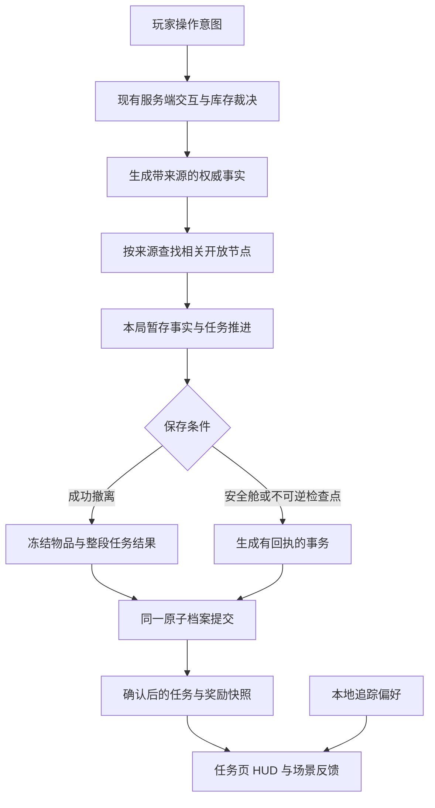

# 单人战役任务系统规格

版本：设计提案 v1.0。日期：2026-10-25。

当前实装范围已按用户最新要求收口到第一章教学版。下文保留完整战役的后续规格，实际接入和验证见[第一章教学版接入记录](ChapterOne-Status.md)。

本规格服务八章、24 个主线任务和 8 个可选支线。任务内容见[完整任务策划](Missions.zh-CN.md)，故事见[战役故事](Story.zh-CN.md)。除第一章接入记录明确列出的内容外，下文新增类型、字段和接口仍待实现，不表示游戏已有整条战役。

核心行为是：任务满足条件后自动开放。玩家追踪任务后，局内显示当前动作和已知去向。取消追踪只隐藏引导，真实操作、物品取得和撤离结果仍然有效。主线一直推进到主角携带证据乘船返回地球。

## 现有实现与复用边界

本节来自当前仓库的静态核对。运行验收仍以相应实施记录为准。

| 已有能力 | 真实入口 | 本次复用方式与缺口 |
| --- | --- | --- |
| 四种设备目标：`Interact`、`Scan`、`Process`、`Configure` | `Assets/Scripts/Networking/Shared/RaidMissionRules.cs` | 复用交互租约、时序、前置和离散配置。尚无跨章任务图、返航流程和证据归档。 |
| 月核取样、事故档案两种模板 | 同文件的 `MissionCatalog` | 可承载 CM02、CM03、CM04 的部分流程。真实档案物品代码是 `mc00_archive_drive`。 |
| 随机导演与单个活动实例 | `Assets/Scripts/Networking/Server/ServerGameSystem.Missions.cs` 的 `RaidMissionWorld` | 当前只有一个 `Operation`，并非 32 项任务的运行容器。保留随机导演；增加来源和设施占用裁决。 |
| MC00 锚点、设备表现与唯一活动区域 | `Assets/Scripts/Gameplay/RaidMissionSite.cs` | 当前仅支持一个活动区域。现有五处为入口、配电 A、配电 B、取样与档案设备。其他任务地点均需作者化。 |
| 设备距离、存活、视线、朝向、受伤打断检查 | `ServerGameSystem.Missions.cs` 的 `MissionAccessible`、请求处理 | 扩展同一服务端裁决链，不让任务页直接宣布完成。 |
| 服务端弹体命中处理 | `Assets/Scripts/Gameplay/Player/Projectile/Projectile.cs` 的 `Impact` | 可接入惰性校准标靶。当前没有 `TargetResponse` 任务目标，需新增明确命中适配。 |
| 有界设备快照与操作 RPC | `Assets/Scripts/Networking/Shared/RaidMissionNetwork.cs` | 当前进度容量为两组 `float4`，即 8 个节点。纯规则虽允许最多 24 节点，`RaidMissionSite.Validate()` 已限制场景模板为最多 8 节点。战役任务不能绕过该限制。 |
| 局内 J 详情、当前步骤、楼层和直线距离 | `Assets/Scripts/Gameplay/UI/RaidHUD.Missions.cs` | 保留真实交互仲裁。现有 `m_MissionPinned` 只是当前 HUD 的内存状态，新事件会自动置为追踪；尚无跨局追踪列表。 |
| 局外三个首次记录 | `Assets/Scripts/UI/Game/MoonkovTerminal.cs` 的 `Tasks()` | 当前只显示 `MissionFirsts` 的三个事实。需要扩展为章节任务日志，不能把三个首次记录当成完整任务系统。 |
| 三个首次事实和两种任务产物来源校验 | `Assets/Scripts/Networking/Shared/InventoryModel.cs` 的 `MissionInventory` | `MissionFirsts` 仅接受 0–7；任务产物仅识别月核与普通档案，内容版本限定为 1。战役进度和四份证据必须有独立记录。 |
| 带回物、首次奖励和容量不足回收 | `Assets/Scripts/Networking/Shared/RecoveryInventory.cs` | 复用库存事务与 `RecoveryInbox`。新增战役奖励不能挤坏现有回收批次上限。 |
| 单人原子存档、订单与结算回执 | `Assets/Scripts/Networking/Client/OfflineProfileStore.cs` | 复用同一锁、完整快照、刷新磁盘后替换、`.bak` 与回执。当前接受格式 1、2、3；格式 3 已用于赏金资料。 |
| 出战与结算日志恢复 | `Assets/Scripts/Networking/Server/RaidPersistenceContext.cs` | 保留先重放结算、再处理未完成出战的顺序；扩展战役检查点恢复，不能另写无协调的进度文件。 |
| 当前选中档案与界面刷新 | `Assets/Scripts/Networking/Client/PlayerProfileClient.cs` | 给已有档案出口增加只读战役摘要和追踪操作，不新增全局档案单例。 |

现有死亡处理包含 `SecureInventory.FailureReturn`。战役沿用现有携带物损失及保护容器例外，不在任务功能中取消已有保护规则。保护容器返回物不会因此自动被认作成功撤离的主线证据。

现有世界标记在被墙体遮挡时隐藏。新增区域引导可以保留已知入口方向，但不能把透墙精确设备标记写成已有能力。

## 产品规则

### 战役范围

- 首版战役只运行在独立单人本地档案与现有本机服务端中。使用当前 Entities、NetCode、GhostBridge、库存和结算链路。
- 不为战役增加 PostgreSQL 表，不给联网账户伪造战役进度，不改变已有 PvPvE 随机事件规则。
- 联网与 LAN 界面明确显示“战役仅限单人”。已有随机设施事件照常使用。
- 所有主线均可由一人顺序完成。不得要求同时按两处按钮、护送第二个可控角色或等待另一名玩家。
- 主线不受随机抽取、每日刷新和现实时间期限限制。退出游戏不推进公司转运倒计时。
- 24 个任务是叙事与记录单位，不是 24 次强制出战。同一次行动内可连续完成已经具备条件的任务，在同一次撤离中提交一整段进度。
- 原有普通局时仍是 600 秒。需要更长时限的终局使用独立配置，并在落位后验证路线。不能把长流程直接塞进基础局。

### 无需接取

任务目录不设置 `Accepted`、接取时间和接取 RPC。角色听过简报或看过任务页，都不是承认操作的前置。

任务开放由已保存事实与本局有效临时事实决定。玩家直接找到设备并完成合法操作，可以在未追踪时推进。尚未开放的终局设备保持明确的锁定状态，不能因玩家提前到场就允许断源。

追踪不决定任务生成、不提高掉率、不授予设备权限、不扩大信息范围、不产生奖励资格。系统不能用“追踪某任务”作为任何权威条件。

## 状态与所有权

不使用一个大枚举同时承载任务、设备、显示和结局。采用以下五份有明确寿命的数据。

| 对象 | 所有者 | 内容 | 保存时机 |
| --- | --- | --- | --- |
| `CampaignCatalog` | 只读内容 | 章节、任务、节点、前置、奖励、文本、地点引用和版本 | 随构建交付；部署时冻结使用的版本 |
| `CampaignProfile` | `OfflineProfileStore` | 已确认任务、调查事实、证据档案、持久设施状态、奖励回执与结局阶段 | 与档案完整快照同事务提交 |
| `CampaignRun` | 当前单人服务端 World | 本次部署绑定、已验证节点、暂存事实、临时设备状态、事件序号 | 普通进度随成功撤离提交；不得由 HUD 持有唯一副本 |
| `CampaignViewPreferences` | 当前本地档案 | 主追踪任务、最多两个次追踪任务、折叠状态和阅读位置 | 操作后合并写入同一档案，不写任务完成事实 |
| `CampaignPresentation` | 当前 UI 与场景 | 当前文本、动画播放位置、光标和可见标记缓存 | 不作为任务成功依据；可从已保存状态重建 |

以上均为拟议命名，不是当前项目已有 API。

### 任务状态

| 内部状态 | 玩家看到的状态 | 规则 |
| --- | --- | --- |
| `Locked` | 未开放或不展示 | 前置尚未满足。未来剧情详情不显示。 |
| `Available` | 可推进 | 所需前置已满足。无需按“接受”。 |
| `InProgress` | 当前步骤 | 本局至少一个有效节点已经发生。 |
| `AwaitingExtraction` | 带回后保存 | 普通节点已满足，但仍缺成功撤离或真实证据入库。 |
| `Saving` | 正在保存 | 已冻结结算或安全检查点，等待存档提交成功。 |
| `Completed` | 已完成 | 所需持久条件与奖励回执已落盘。 |

任务不因取消追踪进入失败或放弃状态。本局失败是一次尝试的结果，重试机会仍然存在。已保存的完成状态不倒退。

任务开放可以在本局临时推进。例如 CM01 的合法报到已经成立后，同一次出战即可开放 CM02；CM02 就绪后开放 CM03。三项都在同次撤离时原子保存。若该行动失败，未到持久检查点的三项临时完成一并回到上次已保存状态。

### 事实保存策略

每个目标必须显式选择一种策略。内容未填写时校验失败，不用默认值猜测。

| 策略 | 适用行为 | 本局可继续后续任务 | 死亡、超时或普通退出 | 重启后 |
| --- | --- | --- | --- | --- |
| `RunOnly` | 长按进度、当前自检、一次设备处理计时、临时配电 | 可作为同局前置 | 清除 | 重置，不假装机器仍在计时 |
| `OnExtraction` | 章节调查、普通设施结果、已经读取的有效记录 | 可以 | 未提交事实不保存 | 只恢复此前成功撤离的事实 |
| `EvidenceOnExtraction` | 带来源的事故盘、实验账本、清理命令、停机记录 | 可以，但后续需物品的步骤仍检查持有 | 实物按既有死亡与保护规则处理；失败不自动发主线证据入库事实 | 从已归档证据恢复；缺失材料可重取 |
| `AtSafehouse` | 已回船后的资料核对、离线备份、应急权限检查、证据匣装配 | 可以 | 只有实际提交成功才成立 | 恢复最后已确认结果 |
| `DurableCheckpoint` | CM22 现场硬件断源、返航阶段的不可逆状态 | 提交成功后可以 | 已落盘设施状态保留；不顺带保存背包或赦免死亡 | 以持久设施状态或返航阶段恢复 |

`AtSafehouse` 操作只在无未结算战局、回收区无阻塞状态时提交。船舱内的安全操作不伪装成“成功撤离一次”。

`DurableCheckpoint` 只用于明确列出的不可逆步骤。不能把每次扫描都变成即时存档，从而绕开现有搜打撤风险。

### 提前行为

目标配置增加 `EarlyPolicy`，只有三种值：

- `Never`：不承认开放前的动作。包括提交消耗、不可逆断源、证据封装、起飞与结局阶段。
- `SameRun`：保留本次有效部署中来自正确设备的事实，任务在同局开放后可重算。用于已修复线路、已核验门牌和到达已知区域。
- `KnownDiscovery`：允许将普通环境发现随成功撤离保存到线索页，但不能自动完成尚未开放的剧情任务。任务开放后仍检查其指定身份、来源和具体目标。

不能拿历史杀敌数、仓库任意同名材料或旧的首次奖励位自动补完新剧情。CM22 之前的普通断电也不等于最终硬件断源。

## 内容目录与依赖

目录使用稳定 ID。任务为 CM01–CM24，支线为 CS01–CS08；节点使用任务内稳定 ID。章节编号与本地化标题分离，改标题不会破坏存档。

初版保留每个运行设备流程最多 8 个节点。24 项主线存为独立任务记录，不占用一个 `uint CompletedMask`。需要更多步骤时拆成明确子流程，由任务图连接；不无限扩大 RPC 数组。

目录可沿用项目已有 Newtonsoft.Json，保存为一次加载的类型化 JSON 内容。运行规则使用普通 C# 数据。场景锚点仍通过作者化组件连接，不在内容文件写 `UnityEngine.Object` 或依赖场景对象名字搜索。不引入脚本语言、通用表达式解释器和新依赖。

### 目录字段

| 字段 | 规则 |
| --- | --- |
| `SchemaVersion`、`ContentVersion` | 分别代表结构与内容版本。新部署冻结内容版本，处理中不替换。 |
| `TaskId`、`ChapterId` | 唯一、不可复用。删除内容必须保留旧 ID 的迁移记录。 |
| `PrerequisiteTasks`、`PrerequisiteFacts` | 类型化 AND 前置；少量可选路线可用显式 `AnyOf` 组，不执行任意脚本。 |
| `OperationGroupId` | 同一设施连续流程的共享占用标识，例如 CM02–CM03 共享取样行动。 |
| `Nodes` | 1–8 个有向无环节点，各有 ID、目标种类、前置、锚点、保存策略、提前策略和显示文本键。 |
| `SourceBinding` | 地图版本、作者化地点、设备、允许产物、所属任务/节点和来源版本。 |
| `CompletionPolicy` | 本局动作、成功撤离、证据归档或安全舱提交的明确组合。 |
| `RewardId` | 一次性任务奖励的稳定 ID；不能从列表位置生成。 |
| `ReplayPolicy` | 可重取证据、可重做流程或仅查看记录。重做不再发首次奖励。 |
| `HUD`、`Journal`、`Disclosure` | 当前短动作、任务详情和信息开放等级。未来反转不进入当前快照。 |

### 目标语法

首版只扩展本战役实际需要的目标。每个类型对应固定事件，不建立可配置的万能条件语言。

| 类型 | 完成依据 | 默认保存策略 |
| --- | --- | --- |
| `ReachArea` | 存活玩家进入作者化范围，满足楼层及可达条件 | `OnExtraction` |
| `Interact`、`Configure`、`Scan`、`Process` | 复用现有权威设备处理器的有效结果 | 按节点指定，通常 `RunOnly` 或 `OnExtraction` |
| `RecoverEvidence` | 正确来源产物实际转入当前玩家携带库存 | `EvidenceOnExtraction` |
| `ExtractWithEvidence` | 成功撤离冻结时仍具有符合来源的实物 | `EvidenceOnExtraction` |
| `TargetResponse` | 服务端确认光环弹体命中作者化惰性标靶，且当前设备档位满足节点要求 | `OnExtraction` |
| `CompareRecords` | 作者化读取器核对两项合格来源记录，玩家完成具体比对；现场与安全舱由节点分别指定 | 现场为 `OnExtraction`，安全舱为 `AtSafehouse` |
| `DepositEvidence` | 指定证据与船舱固定保管位进行真实所有权事务 | `AtSafehouse` |
| `PersistFacilityState` | 合格设备、前置与服务端指令生成一次不可逆检查点 | `DurableCheckpoint` |
| `ShipEndingStep` | 返航阶段处理器与对应场景事件共同确认 | `DurableCheckpoint` |

不以“打开任务页面”“播放完一条语音”或“客户端按钮已点击”承认核心调查与返航。语音播放不影响操作资格，漏听后可在日志回放。

CM07 的一次射击校准和 CS03 的标靶响应必须使用新增的 `TargetResponse`。标靶有稳定 `SourceId`、有效接收面和设备档位。服务端弹体命中后输出 `TargetResponseVerified`，绑定发射者、弹体身份、命中序号和当时档位；同一命中只计一次。客户端预测火花、任意开火、命中墙面和击杀普通敌人均不能替代。任一可用光环均可完成，不要求稀有模块或额外弹种。内容校验需确认目标类型有处理器、标靶锚点有接收组件、所需档位确实存在。

### 两种普通任务内容示例

以下为未来内容结构示例。锚点 `archive` 与 `power_a/b` 已存在；任务来源绑定、归档目标和战役字段尚未实现。

```json
{
  "TaskId": "CM04",
  "ChapterId": "CH02",
  "ContentVersion": 1,
  "PrerequisiteTasks": ["CM03"],
  "OperationGroupId": "campaign.mc00.archive",
  "Nodes": [
    {"Id":"self_check","Kind":"Interact","Anchor":"archive","Seconds":3,"Persist":"RunOnly","EarlyPolicy":"Never"},
    {"Id":"tag_a","Kind":"Scan","Anchor":"power_a","Seconds":4,"Persist":"RunOnly","EarlyPolicy":"SameRun"},
    {"Id":"tag_b","Kind":"Scan","Anchor":"power_b","Seconds":4,"Persist":"RunOnly","EarlyPolicy":"SameRun"},
    {"Id":"download_start","Kind":"Interact","Anchor":"archive","Requires":["self_check","tag_a","tag_b"],"Seconds":1,"Persist":"RunOnly","EarlyPolicy":"Never"},
    {"Id":"download","Kind":"Process","Anchor":"archive","Requires":["download_start"],"Seconds":20,"Persist":"RunOnly","EarlyPolicy":"Never"},
    {"Id":"recover","Kind":"RecoverEvidence","Requires":["download"],"EvidenceId":"EV01","EvidencePart":"device_base","ItemCode":"mc00_archive_drive","SourceId":"campaign.mc00.incident_blackbox","Persist":"EvidenceOnExtraction","EarlyPolicy":"Never"}
  ],
  "CompletionPolicy":"ExtractWithEvidence",
  "RequiredCompleteness":"Partial",
  "RewardId":"campaign.v1.CM04",
  "HUD":{"CurrentActionKey":"campaign.CM04.current","KnownDestination":"MC00_L22"}
}
```

同设备中的“确认下载”仍是实际操作，不能取消 `download_start`，让扫完标签后无提示自动下载。当前档案设备本身不等于新定义中的证据来源。

第二个示例用于 CM16 的安全舱资料核对。它复用已经保存的三份证据，不再次消耗档案盘，也不要求玩家再出战一次。

```json
{
  "TaskId": "CM16",
  "ChapterId": "CH06",
  "ContentVersion": 1,
  "PrerequisiteTasks": ["CM15"],
  "Nodes": [
    {"Id":"verify_sources","Kind":"CompareRecords","Anchor":"campaign.ship.archive_bench","RequiredEvidence":["EV01","EV02","EV03"],"RequiredCompleteness":"Complete","Persist":"AtSafehouse","EarlyPolicy":"Never"},
    {"Id":"prepare_manifest","Kind":"Interact","Anchor":"campaign.ship.evidence_bench","Requires":["verify_sources"],"Produces":"three_evidence_media_manifest","Persist":"AtSafehouse","EarlyPolicy":"Never"}
  ],
  "CompletionPolicy":"VerifiedSourceManifestAtSafehouse",
  "RewardId":"campaign.v1.CM16"
}
```

两个安全舱锚点均待落位。CM05 另需待落位的门禁与求救记录读取点。配电柜原有 A 18:42 热损、B 18:47 备用带电铭牌保持原意；它们只构成疑点。“封锁先于求救”由独立门禁记录与求救记录比对得到，不能直接改写现有两条铭牌的含义。

## 设施调度与随机事件共存

新增 `OperationSource = Campaign | Random`。它是调度来源，不是任务接取状态。

1. 单人部署开始前，由服务端根据已经保存的任务和本次允许目标，计算本章必需设施占用。
2. 本章需要 MC00 时，预留该设施槽给相应战役行动组。预留与是否追踪无关。主线不会进入随机权重池。
3. 不需要 MC00 的章节允许随机导演按原规则使用空闲槽。与主线争用设备、路线或产物的随机事件暂不成为候选。
4. 同一行动组可以在一次出战中接续多个任务，沿用已验证设备状态，不在 CM02 完成时突然重置 CM03 的电路。
5. 章间切换在设施无活动交互、没有待领取的合法产物、上次部署已经结算后执行。切换前保留玩家已带回物和回执；不抢占进行中的操作，不删除玩家库存物品。
6. 单人新部署装载时按持久设施状态恢复场景，并为当前主线准备合格实例。若复用的本机 World 留有已终态旧实例，先按其生命周期安全退役，再开放新设施。此过程在玩家入场前完成，不能让玩家进场等待随机槽空出。
7. 必需锚点不可达、缺少模型或未连接时，部署预检显示具体缺项并保留档案，不把任务标成完成，不让玩家带着不可完成的主线出战。

产物位置改为目录中明确的输出锚点。当前多处代码使用“月核放取样机，其余放档案机”的二选一判断；新增证据不能沿用这个判断，否则实验账本、飞行资料和停机记录会错误出现在档案机。

普通联网世界仍只有原随机导演的规则。战役持久设施状态不会同步修改其他玩家的地图，更不能用“某单人玩家已关核心”使全服敌人消失。

### 场景接入

保留单一 `RaidMissionSite.Active` 与单一服务端设施裁决入口，不为每个任务创建一个相互争用的活动站点。新增的船外、船内、通信和科研锚点通过同一作者化注册表显式引用，并带区域与楼层；设备运行状态仍由服务端 World 持有。按本战役实际点位把作者化锚点校验上限扩为最多 128，载入时验证重复与缺失，不在运行时扫描全场景。

当前 `RaidMissionWorld.Operation` 继续代表正在操作的一个有界设施流程。跨任务事实由同一 World 中的 `CampaignRun` 聚合，不变成同时运行 32 个设施实例。普通地图事件、船内资料核对与返航场景各自提供事实输入，使用同一任务裁决与持久化规则。

终局外勤采用 1200 秒的独立设计起点，普通出战保持 600 秒。实施时必须一并核对 `RaidSession` 局时、设施 `ActiveSeconds`、任务产物期限和撤离余量，避免只延长 HUD 倒计时、后台仍在 600 秒使任务失效。证据过期清理不得触及已归档资料、固定整备位与船内证据匣；已保存断源后过期或丢失的 EV04 通过原记录器恢复。

## 权威事件与任务裁决

沿用服务端的存活、距离、视线、朝向、受伤和请求序号检查。HUD 只发操作意图与显示偏好。

拟议的任务事实输入包括 `DeviceConfigured`、`ScanVerified`、`ProcessCompleted`、`TargetResponseVerified`、`AreaReached`、`ItemTransferred`、`ExtractionFrozen`、`SafehouseTransactionCommitted` 和 `EndingSceneStepVerified`。它们来自具体处理器，不来自客户端上报的“任务成功”。

每条权威事实最少绑定：`CampaignRunId`、`DeploymentId`、`CampaignId`、`ContentVersion`、`TaskId/NodeId`、`SourceId`、`EventSequence`。涉及物品时另带 `ItemId`、来源行动 ID 和物品版本。服务端时间只用于有效顺序与耗时，不把设备客户端时间当证据。



### 裁决顺序

普通战局同一服务端 tick 的顺序保持：伤害与死亡 → 取消失效交互 → 合法设备和库存操作 → 行动期限 → 对仍有效玩家冻结撤离 → 构造任务结算。死亡优先于同 tick 撤离，期限优先于同 tick 撤离。

对于 CM22 的不可逆设备操作，在最后一步合法检查后先生成检查点事务，等待提交结果，再发布“异常源已隔离”的权威状态与表现。写入失败就停在未确认状态，保持可重试。不能先播放永久停机，再把保存错误留给玩家猜测。

设备本身造成的局部世界变化由当前 World 呈现。只有标注为持久状态的结果才在后续出战恢复。敌人保持既有预算；关源不等于即时清空全图已有敌人。

## 证据与物品

### 四份证据

| 证据 | 来源和含义 | 物品与恢复规则 |
| --- | --- | --- |
| EV01 `incident_blackbox` | CM04 的本次战役档案导出形成基底，CM05 补门禁与求救对照，CM06 补人员上下文后形成完整事故黑匣子 | 可以沿用 `mc00_archive_drive` 的外观与物品定义，但必须附本次章节来源凭据。普通旧档案不自动变为 EV01。 |
| EV02 `trial_ledger` | CM08 的实验账本与源记录 | 新任务物品；首次有效带回后建立不可变证据归档。 |
| EV03 `cleanup_directive` | CM09 取得的资产优先命令，CM10 核验其毁证指令与来源 | 新任务物品或已保存原文的后续核验事实。CM10 不凭重新发一件同名物品制造第二份原件。 |
| EV04 `shutdown_receipt` | CM22 断源后现场记录器提供可导出的停机结果，CM23 取得正式记录 | 新任务物品。异常源保持关闭时也能从离线记录器重取同一逻辑记录；不为重取而重启核心。 |

证据的源签名属于故事资料。首版运行验证依靠本机服务端生成并保存的来源绑定、清单和内容摘要，不建设外网证书服务，也不接受客户端随意填写的摘要作为成功依据。

`EvidenceLedger` 区分 `Partial` 与 `Complete`。CM04 可以登记 EV01 基底且完成该任务，不能就此宣称门禁与人员证据已经齐全。CM05、CM06 的同局有效采集结果可在一次回船时合并；全部附件成立后 EV01 才是 `Complete`。CM09 的清理命令同样先形成 EV03 基底，CM10 核验完整毁证指令后才能作为 CM16 的完整输入。

新增证据需要显式扩展 `InventoryCatalog`、来源校验、物品序列化、掉落与回收流程。不能只把新代码塞进 `MissionInventory.IsArtifact`：当前“非月核就是普通档案首次”的分支必须改为明确目录映射，旧三种首次奖励逻辑仍保持兼容。

### 证据归档与重取

- 未归档的证据是实体携带物，占真实格子并遵守既有死亡、丢弃和搜刮规则。
- 成功撤离且来源有效时，将该证据对应的资料、来源与摘要写入 `EvidenceLedger`。只有四种证据和作者化附件可进入此账本，不能借此存放任意战利品。
- 普通保护容器回收不满足 `EvidenceOnExtraction`。玩家仍可在下一次成功出战中携带合格来源物完成入库，或重新取回。
- 此前由合法保护规则返回的未归档介质，可以在后续成功出战中完成带回。保留其原来源与回收回执，不强迫伪造为当前行动新产物。失败结算需将保护回收所需的来源记录随物品一并保存。
- 同一逻辑证据只建立一份归档事实，重复产物不再发首次奖励。无来源的同名物品和已消费的旧事件 ID 被拒绝。
- 已归档的数字资料保留船上离线副本。再次丢失物理介质不抹除已经确认的知识。确需重取时，从正确作者化设备或船上归档打印一份受追踪介质，生成新 `ItemId`，沿用同一证据内容摘要并标为恢复副本。
- 一次只允许该证据存在一个未归档、未装船的有效恢复介质。旧介质已死亡遗失或被事务替换后才能恢复；不能无限生成可出售物。
- 证据物品禁止出售、研究消耗和普通制造。月核碎片的现有出售与研究用途不受影响。

### 证据匣与装船

CM23 在返航船外的屏蔽整备位，将 EV01–EV04 的已归档资料装入 `evidence_case`。未归档停机记录必须先经过成功返回保障区的结算，不能在死亡后凭临时扫描生成完整证据匣。

前三份携行模块可在 CM16 后进入该整备位的固定任务保管槽。此处只容纳目录指定的证据模块，物品归属、版本和恢复受权威事务管理。玩家最后一次进入科研区时不必重新携带前三份模块；这些模块也不会因为“放在船外”变成普通可随机清理的掉落物。

装配事务检查四项来源及摘要，绑定固定 `CaseManifestId`，产生一件真实证据匣。资料归档继续保留，但没有第二件可同时装船的有效证据匣。

CM24 的船内保管位是固定任务容器，不是普通无限仓库。存入时在同一次事务中转移所有权：背包或仓库 → 船内保管位，记录证据匣 ID、清单摘要和保管位置。重复请求只返回原回执，不能复制、重复消耗或把货舱满误报成证据消失。

起飞前，证据匣必须真实位于船内保管位。起飞后保管位属于返航状态，不再进入月面掉落、随机事件清理和战局超时删除流程。

### 受控货物与净化

CM19 移除公司预装的活污染试验货箱，并将其留在月面指定封存位。这件货箱有唯一身份和位置，不进入普通背包，不因净化画面播放而直接消失。

物品目录增加明确的返航分类：`Clean`、`Controlled`、`LiveHazard`。首轮目录按下表冻结，实施时逐代码登记，不能凭物品中文名推断。

| 分类 | 首轮范围 | 返航规则 |
| --- | --- | --- |
| `Controlled` | `mooncore_fragment`、`alien_tissue`、`alien_neural_core`，以及当前 `AlienBiology.Organs` 的九种器官代码 | 未消费实物全部留月封存，不能只处理当前背包而漏掉仓库或回收区 |
| `LiveHazard` | 公司预装活性校准载体及其密封货箱 | 整箱经固定滑轨移至月面封存位，不进入普通背包 |
| `Clean` | 光环武器、已经稳相封装的成品模块、普通电池、常规医疗与食品、常规非生物材料、资料和证据介质 | 通过表面检查后可登船；不因原始配方用过月核碎片就拆掉成品模块 |

目录校验要求所有可登船物品都有明确分类。新增目录代码未配置时阻止该批货单通过，并显示具体物品，不能默认为已安全。分类只处理当前实物，不倒扣已消耗材料、已完成研究或已取得装备能力，也不新增永久感染模拟。

返航检查预览需要留月的具体物品、数量和所有权位置。玩家在货单操作处执行一次“留月封存”事务，将受控物品的完整物品树转入固定月面封存容器；保留物品 ID、模块关系、数量和清单回执。不得静默删除玩家库存、丢掉子物品或把这次转移算成出售。

通关档案保留月面封存库存记录，界面明确它们没有随船返回。返航仅允许符合分类与检查结果的清洁装备、资料和证据。货单、人员净化、舱门、导航、燃料状态与应急飞控都由权威处理器检查。CM19 之后再次接触受控物或开放污染作业区域，会撤销相应净化检查；CM24 启动前必须复检。

## 原子保存与恢复

### 档案结构

在现有 `OfflineProfileStore.SaveData` 中增加可选的战役块和显示偏好块。不要把章节状态塞进 `InventoryGraph.MissionFirsts`，也不要用 `PlayerPrefs` 保存唯一剧情进度。

拟议战役块至少包含：

- `SchemaVersion`、`ContentVersion`、`CampaignId`。
- `FactRevision`、`CompletedTasks`、`VerifiedFacts`、已提交奖励 ID。
- `EvidenceLedger`、固定船内任务容器、证据匣清单。
- 允许持久化的设施状态，例如远程隔离、最终断源。
- `EndingState`、结局事务 ID、已确认阶段与对应的最后安全恢复点。
- 已处理的战役事务回执。已有通用 `Receipts` 可以复用存储与冲突校验，不再建第二份不受同锁保护的文件。

追踪偏好有独立的 `PreferenceRevision`。更改追踪不增加 `FactRevision`，不会让合法撤离因“用户刚切换追踪”而产生任务版本冲突。写入时复制锁内最新档案并只合并该次变更，不能用 UI 缓存的整份旧战役状态覆盖最新结算。

### 普通撤离事务

同一次提交必须包含：部署关闭、带回库存与回收区、有效证据来源回执、满足条件的整段任务事实、持久章节开放、一次性奖励以及结算回执。任何部分失败都不能提前显示“章节已保存”。

`CampaignRun` 向结算提供服务端冻结的任务增量与证据清单，而不是任由客户端上传完成任务列表。保存层再次检查部署绑定、版本、重复来源、证据实际持有与前置。

沿用 `RecoveryInbox` 的容量处理。资料归档与证据有效回收在同一事务成立，即使实体介质因仓库满暂存在回收区，也不能卡住已经完成的故事。实体依然有唯一所有者，领取回收物不会再次发剧情奖励。新增奖励总量与现有批次上限一同校验，不静默丢弃物品。

一次性任务奖励以 `CampaignId + RewardId` 去重。纯知识与权限不占物品格；实体奖励进入正常库存/回收流程。章节不再叠加一个无限重复的“完成奖金”。旧月核/档案首次奖金仍按其原有回执发放，不因战役再次完成而重复领取。

首版额外经济产出只有两处：CM21 的随船固定储备 `cells ×2`、`medkit ×1`，以及 CS04 医柜的 `medkit ×1`、`med_gel ×2`。其他新任务提供知识、权限或剧情结果，不另发月尘、装备和永久增伤。数量为本版策划起点，调值需更新内容版本。

CM21 使用安全舱一次性领取事务。CS04 使用稳定医柜库存和物品 ID：首次发出物资时保存一次性发出凭据，医柜持有的未取物与玩家已取得物分别记录所有权；死亡不重新补发已发出的份额。医柜任务本身的调查完成仍随正常回船保存。这个经济发出检查点仅保存该柜库存与回执，不保存玩家整包装备或普通任务事实。否则玩家可能利用保护容器带回医疗品后死亡，让未保存的柜子不断刷新。

### 日志与启动恢复

普通战役撤离继续使用既有 `.json` 结算日志与 `.deploy` 出战日志。扩展结算数据时保留旧字段解释与不可变载荷检查。

安全舱、CM22 及返航阶段使用有类型、有版本的战役事务日志，例如独立扩展名 `.campaign`。它们仍由同一持久化上下文与同一档案锁处理，不使用另一个存档服务。每个日志记录事务 ID、期望事实版本、所属部署、操作种类、前置摘要和不可变变更集。

启动顺序为：读取并校验档案 → 识别并排序未确认的战役检查点 → 重放这些检查点 → 重放普通结算 → 对没有结算的普通部署执行既有 abandon → 重新构建任务摘要与返航恢复场景。若同一部署同时存在检查点与结算，先确认检查点，再合并结算，不可用后者的旧快照覆盖它。

已提交事务按回执返回原结果；同 ID 不同载荷报冲突并保留原文件。重放没有成功之前，禁止开始竞争同一档案的新部署或返航事务。删除日志仍逐个指定文件，由现有恢复处理器执行，不清空整个目录。

CM22 已保存断源但普通战局随后崩溃时，异常源仍关闭；本局装备按既有 abandon 规则处理。EV04 从断源后的离线记录器重取。这样既保留不可逆结果，也没有凭检查点保住整包战利品。

### 旧存档迁移

现有格式 1、2、3 均保留。实施时新增格式 4，明确允许携带已有赏金块与战役块；更新当前按 `Clash` 决定 2/3 的格式写入逻辑，避免新存档被写回旧格式。

迁移在完整校验旧档后创建空战役状态，CM01 开放。保留库存、回收区、现有三个首次事实、赏金进度和所有旧回执。不以 `FirstArchive` 自动完成 CM04，也不把仓库旧普通档案追认为 EV01。

迁移前的有效 `.bak` 按现有机制保留。不能理解的新版本或损坏档案报具体错误并保留原件，不自动清档，不静默退到旧章节。

### 与现有部署的兼容点

当前 `OfflineProfileStore.Settle` 与 `Abandon` 会将非空 `payload.Mode` 导向赏金处理。战役不能简单写入 `Mode = "Campaign"`。普通战役搜打撤保留原 `Mode = null`，通过独立的、可选且带版本的 `CampaignBinding` 绑定部署与任务增量；赏金既有 `Mode` 与比赛身份不混用。

出战扣装备时，同时冻结战役 ID、内容版本和本次允许行动。装载失败继续使用现有 `LoadingCheckpoint` 退款。该退款目前会恢复完整旧快照，实施时需限制装载期间的战役事实变更，并在退款时合并最新追踪偏好与已确认事务，避免整快照退款覆盖新进度。退款不会创造完成任务或返航阶段。

更新内容版本时，先处理仍绑定旧版本的日志与部署，再迁移持久事实。读取中的目录和来源解释不热替换，不能使一件有效旧证据突然失去所属版本。

## 任务追踪与局内引导

### 局外任务日志

扩展现有任务页：左侧显示当前章节与已经完成的章节，中间列出当前开放任务，右侧或下方显示选中任务的目标、已知地点和发现。完整未来任务名、公司真相和结局步骤在尚未发现时不提前展开。

主操作只有“追踪”与“取消追踪”。出战仍使用现有准备链路，不要求用户先点任务卡才能部署。已经完成的任务可回看记录与关键语音，不能通过回看重新领取奖励。

初次开放 CM01 时默认追踪一次，玩家手动取消后保持取消。主任务完成时，若玩家没有手动取消该主线追踪且设置仍为空，自动接续下一个已开放主线；若用户主动改追支线，则不抢回主追踪位。新发现事件只短暂提示，不强制替换玩家选择。

追踪以任务稳定 ID 保存，不能保存每次变化的 `OperationId`。出战后由任务 ID 解析到本次设施实例。已完成或版本移除的追踪项在读取时清理，最多保留一个主追踪和两个不同的次追踪。

### 战斗 HUD

沿用 UI Toolkit 与当前右侧任务区域。主追踪展开，次追踪各一行。核心信息为：任务名、当前动作、已知去向；只在风险改变当前决策时追加一条短提示。

文案示例：

| 情况 | HUD 当前动作 | 去向或必要状态 |
| --- | --- | --- |
| CM02 | 恢复备用供电 1/2 | MC00 L22 配电区 |
| CM04 | 读取第二处校验标签 | MC00 L22 楼上 |
| CM09 已取得命令 | 带回清理命令 | 返回撤离点 |
| CM15 | 隔离实验供电 1/2 | 科研区控制室 |
| CM23 | 带回停机记录 | 返回作业船 |
| CM24 | 将证据匣装入保管位 | 返航船货舱 |

不把完整剧情段落、奖励说明和未来全部步骤堆在 HUD。任务页展示展开内容。文案不使用中点作分隔符，使用换行与布局区分位置和状态。

取消主追踪后隐藏其 HUD 与远处方向标记，保留真实近距交互提示、关键生存信息和结算反馈。玩家不追踪仍能开设备、取得物品与完成任务。

### 目的地与信息权限

- 远处引导指向已知建筑入口或明确转折点；进入区域后再切换到已揭示设备。
- 显示作者化区域和楼层。只有作者化路径可用时才显示路径距离；否则明确是直线距离，不能把穿墙方向当通路。
- 被墙遮挡时，不显示精确设备透视标签。可保留已知入口方向或区域文字；不显示未知房间内部构造。
- 标记不暴露敌人、未发现证据、未开放房间和动态物资刷新。任务追踪不提高信息权限。
- 若设备有效但路线受阻，详情提示已知入口与楼梯。若锚点本身无效，显示配置错误并保留任务，不把坏坐标包装成谜题。

### J 详情与输入

复用当前 J 入口，显示主线、支线和已发现设施的当前步骤。打开页面与背包、地图、暂停、交互长按使用现有统一仲裁，避免点击任务时开火。返回后恢复原焦点和瞄准输入。

长按进度、处理中、受伤中断、物品空间不足、任务未开放、保存重试和证据丢失，都显示对应的真实状态。未保存只显示“带回后保存”，不能提前给绿色完成勾。

界面使用当前字体和本地化链路。主要字号控制在三种，最小 12px。颜色沿用项目品牌色，并按 Radix Colors 的表面、边框、文本和强调用途分配。动画遵守项目既有约定与减少动态效果选项。上述为实施规范，本轮不改 UI 文件。

## 最后一章与返回地球

### CM22 与 CM23 的边界

CM22 完成现场硬件断源，并阻止公司通过远程指令重新启动。只保存必要设施结果，不清空全图怪物，不取消玩家撤退权。

CM23 取得该次断源的 EV04，按正常携带与撤离规则带回。证据遗失后可在停机记录器重取。返回船外屏蔽整备位，完成核对与证据匣封装。CM24 才把匣体装入船内保管位。玩家在这些步骤之间仍可保存、补给和重试，不要求一次完成全部三项任务。

### CM24 的返航状态机

CM24 在普通战局全部结算、四证据匣封装保存后开放登船准备。不可逆的封舱起飞必须等有效证据匣实际装船后才开始，不能把普通撤离结算当成地月航行。

| 阶段 | 进入条件与玩家行为 | 确认后的持久状态 | 中断后恢复 |
| --- | --- | --- | --- |
| `Ready` | CM21、CM22、CM23 完成；应急飞控、导航、受控货物封存与燃料检查成立 | 可携证前往登船入口 | 回到船外保障区准备位置 |
| `Boarded` | 主角携证经过入口净化复检，实际进入作者化船内范围；沈禾通过通讯确认 | 主角已登船，仍可离舱整理 | 恢复舱内入口位置，保留携带物归属 |
| `CargoSecured` | 主角亲手将证据匣转入固定保管位；清单匹配 EV01–EV04 | 装船回执与唯一所有权保存 | 证据仍在船内，无需再装一件 |
| `Sealed` | 玩家在飞控位置启动返航；舱门关闭与净化结果被确认 | 记录不可返回普通月面行动的节点 | 从封舱后的安全舱内画面继续 |
| `LunarDeparted` | 返航场景完成舱内起飞、离地和离月表现 | 已离开月球 | 继续已离月段落，不再打开月面仓库 |
| `Transit` | 航程时间转场开始，证据保管位仍属本船 | 在地月航程中 | 从最接近的已确认航程片段继续 |
| `EarthApproach` | 地球抵达场景资源就绪，显示目标地球和隔离着陆指令 | 已到地球进近阶段 | 恢复进近画面，不能退回月面 |
| `EarthArrived` | 地球指定地点隔离着陆表现与场景到达事件确认 | 主角和证据匣均已抵达地球 | 恢复地球隔离区或交接画面 |
| `EvidenceHandedOver` | 交接处理器确认封匣清单并保留交接回执 | 完整证据已交接 | 保留交接结果，不再取出第二份匣子 |
| `Completed` | 地球到达与证据交接均已保存 | CM24、战役通关和结局回执保存 | 进入结局记录，可回看结尾 |

每次阶段转换都带预期当前阶段与事务 ID。重复事件返回原结果，跳阶段和旧阶段请求被拒绝。场景播放完成、权威状态提交和玩家看到的画面相互协调，不能只在客户端设置 `CampaignComplete = true`。

封舱前允许离舱整理。`Boarded` 保存的是登船检查点，启动返航时仍核验人物当前在舱内。装匣后若主动取回匣体，同一物品事务把准备状态退回 `Ready` 并撤销起飞资格，不能留下“匣子在背包、系统却认为已装船”的状态。封舱后返航阶段只向前推进。

跳过演出仍需由返航处理器完成必要场景切换，展示地球到达和交接结果，再确认通关。不能从起飞画面直接跳过到没有到达记录的胜利弹窗。

进入 `Sealed` 是玩家在飞控处主动做出的最后出发决定。界面只需在该操作处清楚显示“启动返航”，并告知将离开月球；不在前面每个任务反复要求确认。此后不再并行运行普通月面局时、刷怪或死亡掉落。

如果返航所需场景、船舱或地球到达资源缺失，停在最后已确认安全阶段，显示具体加载问题并允许重试。不得因此丢失证据、回到受雇状态或假记通关。

### 结局表现的最低内容

需要有可见的飞船外部或登船入口、舱内保管位、关舱与起飞、月面远离、航程时间变化、地球进近和隔离着陆。可采用固定镜头、舱内视窗和短场景，不要求可驾驶的完整飞行模拟。

最后清楚回答：异常源已隔离，危险样本未被带回，主角存活并返回地球，完整证据到达并交接。公司的法律后果可以由尾声交代为后续调查，不能因一份证据让公司当场凭空倒闭。

通关后保留章节与证据记录。首版默认提供结尾回看与返回主菜单，不把玩家重新放回公司继续发同类命令的剧情状态。若以后增加自由行动，必须明确属于通关前记录或独立模式，不回写已完成战役。

CS08 在 CM24 的 `Transit` 阶段开放，属于航程中的可选通信。它不要求先完成整个 CM24，也不阻止航程继续。未听内容在结局记录中可补听，不能为了一条支线要求玩家重新离月。

## 性能与数据上限

- 构建或载入时校验目录唯一 ID、无环前置、内容版本、锚点引用、奖励与证据映射。失败时停止开放该内容，不在每帧反复校验整本目录。
- 载入一次建立 `SourceId → 相关任务节点` 索引。设备或库存产生事件时只更新相关开放节点，避免每帧扫描 32 项任务和全部场景对象。
- 主线运行流程保持每组最多 8 节点。任务总目录与当前同步快照分开；只给客户端当前开放和允许披露的摘要。
- 维持现有约 4Hz 的任务状态展示节奏；距离文字按约 4Hz 更新，少量追踪标记才逐帧投影。不因支持 32 项任务而发送每任务每帧 RPC。
- 一次最多展示一个展开目标和两个紧凑目标；复用控件，只在事实版本、阶段或文本实际变化时更新。
- 证据归档限定四项主证据及内容目录列出的附件；恢复介质和奖励均有唯一回执。不能生成无限日志、无限物品和无限活跃任务实例。
- 普通读档、目录解析与磁盘提交离开帧内热路径；使用现有异步和档案锁。保存失败需保留待提交载荷，不靠每帧同步写盘重试。
- 返航演出停止普通月面模拟，释放不再需要的场景资源；始终只使用一个 Unity Editor 和一个本机玩家世界，不为电影镜头开第二客户端。

## 实施顺序与完成标准

各阶段都是同一系统的增量，不另建并行任务框架。本轮尚未实施这些阶段。

| 阶段 | 交付内容 | 必须能看见的结果 |
| --- | --- | --- |
| A 目录与档案 | 类型化目录、任务事实、来源绑定、旧档迁移、原子奖励和回执 | 新旧档均可载入；CM01–CM03 可同局临时接续并随一次撤离保存 |
| B 追踪闭环 | 局外任务日志、跨局追踪、J 详情、主 1 次 2 HUD、已知区域引导 | 追踪后能在正式局内找到下一步；不追踪完成收益相同 |
| C 八章内容 | 全部 24 主线与 8 支线落位、环境反馈、文本和证据恢复 | 每章有实际流程与后果，所有必要锚点可达，无占位假任务 |
| D 最终返航 | CM22 不可逆检查点、四证据匣、船内装载、登船、离月、航程、地球与交接 | 真实到达地球后才确认通关；每个返航阶段可从中断恢复 |
| E 定向验收 | 编译、关键纯规则/档案检查、一次正式单人关键流程与必要画面检查 | 完成条件有证据，未跑平台和人工体验边界如实记录 |

### 定向验收清单

| 验收项 | 方法与通过条件 |
| --- | --- |
| 内容完整 | 目录中恰有 CM01–CM24、CS01–CS08；全部依赖可到达，全部主线可由单人完成，最终指向地球到达与证据交接。 |
| 无接取 | 新档不打开任务页、不追踪，直接完成合格流程；任务、证据与奖励结果与追踪流程一致。 |
| 跨局追踪 | 选择一个主目标和两个次目标，撤离、再次出战、关闭重开；选择保持，且新随机事件不擅自替换。 |
| 同局连续推进 | 一次行动完成 CM01–CM03 的条件；一次结算提交整段结果，无额外强制撤离。死亡则不保存普通临时事实。 |
| 随机共存 | 战役占用 MC00 时不会出现冲突随机事件；无需占用时原随机模板仍可生成。取消追踪不改变这个裁决。 |
| 提前行为 | `SameRun` 合格扫描可以在节点开放后被认出；旧同名材料、未开放断源和伪造客户端完成消息均不能跳章。 |
| 射击校准 | 服务端命中有效惰性靶且档位正确才记响应；预测特效、重复命中消息、打墙和普通杀敌不计数。 |
| 旧档 | 格式 1、2、3 的隔离副本迁移后，装备、回收区、赏金和首次事实不变；CM01 开放；旧档案不变 EV01。 |
| 原子结算 | 在物品回收、任务事实、奖励提交边界注入一次失败后重放；结果不半完成、不重复发奖、不复制证据。 |
| 容量不足 | 证据实际带回但仓库满时进入既有回收流程；归档事实准确保存，介质不丢失且不重复奖励。 |
| 医柜经济 | CS04 取得物资后死亡或重启，固定医柜不会补回已经发出的份额；CM21 重复领取请求只返回原回执。 |
| 失败与恢复 | 死亡、超时、普通退出分别遵守现有保护规则；未归档证据可重取，已保存章节不倒退。 |
| 最终断源 | CM22 提交前崩溃不假装断源；提交后崩溃保持停机，装备仍按普通未结算部署处理，EV04 可在停机状态重取。 |
| 证据装船 | 重复装匣请求、旧清单、缺一证据和同 ID 不同载荷被正确处理；保管位与库存没有双重所有权。 |
| 留月封存 | 返航预览列出全部受控货物；一次事务完整转移物品树，通关后仍保留月面清单。未净化或再次接触受控物时不能绕过复检。 |
| 返航每阶段恢复 | 对上表每个已确认阶段分别关闭重开；从对应安全阶段继续，没有重新装第二件匣子、重开月面局或跳过地球到达。 |
| 终局顺序 | 只有起飞不能通关；只发求救摘要不能通关；没有证据匣不能起飞；地球到达且交接保存后才完成 CM24。 |
| UI 与输入 | 1280×720 和 1600×900 下当前目标、长中文、三目标、保存失败与返航提示可读；J、背包与交互不相互穿透。 |
| 场景与表现 | 正式地图实际下一步可达；终局看得到登船、离月和地球隔离着陆；缺资产时保留安全阶段而非假成功。 |
| 影响范围 | 既有在线随机任务和单人库存流程未被战役标记改写；不进行联机验收，不以单机结论声称多人通过。 |

实施时按改动范围做一次必要编译与定向检查。无新失败或具体风险，不重复运行已有整套复杂验收。目录检查、纯规则通过和文档完整，均不能替代正式任务落位、实际引导与返航画面的验收。

## 待落位资源

现有 MC00 五处设备是已知基础。门禁记录、实验账本、公司指令、离线备份台、分区控制、公共通信设备、应急飞控与导航点、危险样本封存位、最终硬件断源和停机记录器均需明确作者化位置。

返航船需要可识别登船入口、固定证据保管位、舱内操作位与结尾表现资源。它在故事中一直停在月面，保障系统独立于公司锁定的主飞控。返航燃料本来充足，恢复任务围绕导航、净化和离线应急权限，不把光环电池当飞船燃料。

地点沿用可达的正式建筑与月面区域。不得把尚未验收为可行走空间的深井当成必要任务通路。具体坐标、设备模型、声音、镜头与完整路线待实装落位，不在策划中填写未经核验的假坐标。
