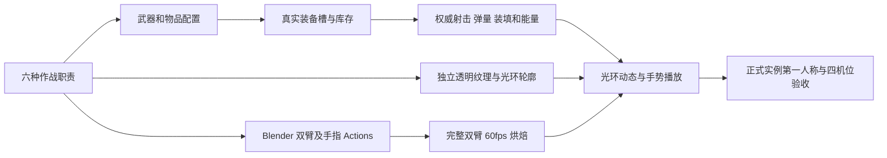

# 光环武器扩展：六种新作战方式

日期：2026-10-21。用户要求新增更多光环武器、同风格图片资产和对应手势，授权由本地「光环」对话制作接入。本文是制作契约；下表为初始设计值，实际完成情况和验证以交付报告为准。

## 玩家体验

保留现有步枪、左轮、霰弹和重狙，再增加六种职责。每把武器必须能够从可靠入口取得，装进真实装备槽，在正式战斗中发射、消耗弹量、装填并造成权威伤害。武器的区别同时体现在节奏、距离、轮廓、动态和双手动作上。

数字键继续选择主／副／手枪装备槽。新增主武器不再各占一个数字快捷键；实验室可独立选择全部十种光环。

## 首批武器

| 名称／内部建议代码 | 作战定位与取舍 | 初始射击参数（可调） | 光环轮廓与动态 | Blender 手势 |
|---|---|---|---|---|
| 蝉鸣 Cicada／`cicada` | 近距移动压制；射速高、远距散布大 | 自动，0.065 s／发，单伤 8，36 发，装填 1.7 s，能量 2／发 | 双开新月与音叉，两翼交替短振；较少填充、中央空白 | 前后错层的双短剑指；射击短弹指，装填双手合拢再展开 |
| 三律 Trine／`trine` | 中距节奏点射；三发集中，串间有停顿 | 每次按下三发，串内 0.085 s，串间约 0.28 s，单伤 17，24 发，装填 2.2 s，能量 4／发 | 三分三角轨；三顶点按实际发射次序脉冲，装填逐边闭合 | 右手三指扇印、左手托腕；对应发射依次压指、左手归印装填 |
| 天枢 Aegis／`aegis` | 定点持续压制；大弹仓，举枪和装填较慢 | 自动，0.11 s／发，单伤 18，72 发，举枪约 0.5 s，装填 4.2 s，能量 4／发 | 厚分段环与散热刻线；持续射击时分段轮转，不能遮满中心 | 双掌前后稳定印，肩肘有承重感；连续微回弹，装填双掌错位归环 |
| 望舒 Vesper／`vesper` | 中远距快速精确复射；威力低于重狙 | 半自动，0.32 s／发，单伤 42，12 发，装填 2.4 s，能量 8／发；中等倍率 | 细长菱形与弦月；开镜收束，射击沿纵轴短脉冲 | 右手并拢剑指，左掌托前臂；短行程回弹，装填左掌绕指 |
| 星棘 Thorn／`thorn` | 中近距集束命中；狭窄针束要求瞄准 | 半自动，0.55 s／次，每次 5 针、每针伤害 9，散射半角约 1.4°，8 发，装填 2.5 s，能量 10／次 | 放射细刺与五芒花；每次五针一起伸展，装填花瓣内收 | 右手五指扇形、左手束腕；出针时短促绷开，装填逐步收束 |
| 坠日 Sundown／`sundown` | 抛物线范围压制；低弹量、慢射速，需要预判 | 单发弹体，1.05 s／发，3 发，装填 3.4 s，能量 18／发；速度约 22 m/s，范围约 3.5 m；伤害和重力遵循现有 AOE 语义调试 | 断环与下坠日核；推出后断环张开，装填日核重新聚合 | 双手托球、推出释放；双臂回收再聚球，中心不得被手掌堵住 |

所有数值是首轮调试起点，不能代替实测。三律必须是真实三连发，每枚弹体独立权威判定、扣弹；只剩 1／2 发时发射剩余部分，不产生负弹量。中断和预测回放不能多射；长按不能绕过半自动触发约束。天枢的大弹仓需要真实增加总装填能耗，不免费补满。星棘每次消耗一份弹量和对应能量，不能按五针收五次费用；命中伤害仍按每枚实际命中结算。坠日沿现有服务端 AOE 路径，核查同目标多碰撞体去重、射手与友军的既有规则、墙体遮挡语义，并记录实际限制。

## 统一美术语言

沿用已有光环的平面几何符印、清晰几何切口、细线、金／银发光和局部暖色点缀。六把先靠轮廓识别，再用弱色差辅助；缩到 64 px 和关闭 Bloom 后仍应区分。避免实体枪械轮廓、整片高亮圆盘、复杂文字堆叠及只替换颜色。

每把需要独立透明 PNG 主体或可组装部件、库存图标、材质及 Prefab。生产资源建议继续采用 640×640、居中枢轴、1000 PPU 的项目约定；根据已有组件实际需要调整并记录。纹理留透明边距，导入为 Sprite，避免透明黑边。光环有待机、瞄准、射击、缺弹／空弹、装填五类反馈；视觉读取真实网络状态，不能反过来驱动伤害或补弹。批量弹丸不得叠出多份全强度灯光。

概念参考保存在 `ArtSource/HaloExpansionConcept/`，用于轮廓与风格沟通；概念图本身不代表已接入的生产资源。

## 手势生产与接入

沿用 `ArtSource/DollSinger/WeaponGestures.blend`、`Tools/Blender/weapon_gestures.py`、`Assets/DollSinger/Animation/Blender/WeaponGestures.json` 的作者动作／60 fps 烘焙路径。每把新增独立 pose／fire／reload Action，手指形状和肩、肘、腕动作共同设计，保留已有四种作者动作与狙击闭框形。

使用原骨架与真实绑定轴；俯仰扩展沿已有作者姿态采样方案，避免把旧动作硬换名称。第一人称采用已经修好的先成姿再放大、先退镜再放手顺序，三连发和连续射击按真实射击 tick 更新；第三人称仍观察同一实例的完整动作。

## 交付检查

- 六把都能通过可靠可复现的入口获得，不因重登反复赠送，不因交换或重新装备补弹；注册表、库存显示、装备权限、弹量、能量和客户端映射对应一致。
- 三律验证完整／残余弹量三连发、松开与重按、装填／死亡／切换中断、预测重放去重；星棘验证束内多弹体且单次消耗；坠日验证飞行重力、碰撞与 AOE 实际伤害。
- Unity 编译通过；六把在实际实例上装备、瞄准、开火、空弹、装填、切换并截图。检查第一人称中央留白和手指可见性，俯仰、快速开关镜以及 16:9／4:3；四种旧武器做适当回归。
- 保存可检查的 Blender 源、导出脚本、生产 PNG、Prefab／配置、第一人称与四机位截图以及验证记录。图片、动作和运行资源必须有实际引用，不能只交概念图或数据配置。
- 明确区分编辑器／本地 Play、正式地图、Host／Client 与独立构建验证。没有测过的部分直接记录，不以静态检查代称联机实测。
- 按项目约定只提交本任务改动，完成必要验证后 commit 并 push 当前 `feat/aliens` 对应远程分支。保留其他未提交改动；不强推。

实现由本地「光环」对话负责；策划与验收由本轮对话负责。多人共享同一目录和 Editor，实现期间不由另一方并发改写运行文件或切换场景。
