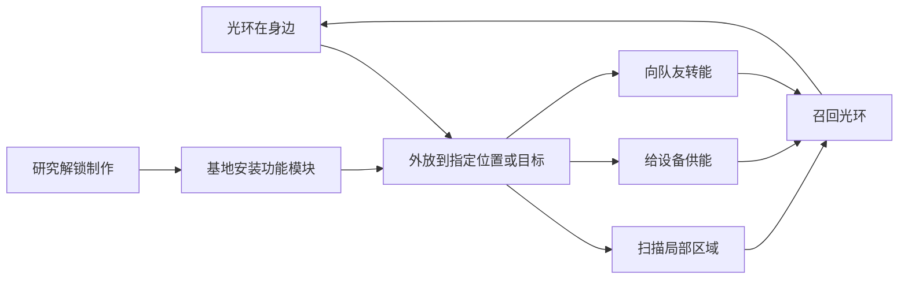

# 光环探索与协作方向

2026-11-04。四个发展方向已由用户选定。下文的具体玩法、限制和制作顺序属于设计建议，尚未实现，也未确定数值或按键。

## 已确定的方向

- 让光环参与探索。
- 允许光环暂时离开身体。
- 让合作围绕能量展开。
- 让改装和研究解锁新的操作方式。
- 不做精准防御、弹反时机奖励或按武器类别区分的防御性能。现有武器的攻击差异不在此次取舍范围内。防御球体仍跟随当前武器的形状和颜色。

现行能量、防御和 HUD 规则见 [光环共享能量](../HaloEnergy.md)。以下内容不能当作已交付功能。

## 建议的共同基础

把外放和召回作为探索与协作的共同操作。角色同一时刻只控制一个外放光环。它保留当前武器的图案和配色。

- 外放占用光环。召回完成后，恢复自身光环攻击和防御。切换武器不能绕过占用，也不能留下多个外放实体。
- 所有能力消费角色现有的同一条能量。电池和自动恢复继续走现有规则。持续供能和转能期间按实际消耗计费，并暂停自动恢复。
- 外放位置、目标和距离有明确边界。主动召回、能量耗尽、超出距离或失去行动资格时结束能力，并清理外放表现。
- 召回应短促、清楚。移动和镜头继续由玩家控制，避免长时间无法自救。
- HUD 沿用现有光环能量格。占用状态优先通过光环位置、连接线和目标附近的必要提示表达。

## 探索

建议先做短时脉冲扫描。扫描波从光环所在位置扩散，提示附近可调查的设施、设备异常和作者放置的痕迹。

扫描结果记录发现当时的位置，并在短时间后消失。玩家仍需靠近调查和完成实际交互。先明确每类线索的可见条件，再决定它是否能被墙体遮挡。首版不提供墙后敌人的持续位置，也不直接显示容器内的物品清单。

外放可以把扫描起点移到前方。它的价值是帮助选择路线和接近目标。扫描的声光暴露、范围、耗能和持续时间仍待原型验证。

## 外放与环境操作

建议第一种环境用途为临时供电。玩家把光环放到明确标识的接口上，为断电门或终端提供能源。光环占用期间，玩家需要安排自己的站位和撤退路线。

首版选一个有清楚供电条件的测试设备。之后再考虑维持门开启、短时封门等用途。任务已有的供电、扫描与交互规则不能被新能力直接跳过；是否接受光环供能由设备明确配置。

单人应能完成主要探索路线。合作可以缩短操作时间或改善掩护，不能让已有单人任务突然要求多名玩家同时供能。

## 围绕能量合作

建议先做主动向队友转能。光环移动到队友附近，建立可见连接。施术者持续付出能量，队友获得对应补充。

- 转能要求有效队友、合理距离和有效连接路径。玩家可以随时停止。
- 接收量不能超过对方当前缺口。供给方只按实际转移量和明确损耗扣能。
- 接收方能量充满、离开范围、死亡或连接断开时停止转移。
- 转能不能复制资源。双方相互转能、换武器或更换模块都不能产生额外能量。
- 支援消耗由施术者承担，不自动扣除接收方电池。

之后可评估把光环外放给队友提供保护。该方向仍沿用统一的基础防御规则，不加入武器专属防御数值或精准防御。它不是首个原型的必要内容。

## 改装与研究

建议让研究解锁可制作的操作模块，再由玩家在基地决定本次携带的能力。探索、设备供能与队友支援可以形成不同选择。

复用现有研究、制造、实体模块和物品树流程。研究知识永久保留，制作出的实体模块沿用现有部署、撤离和死亡掉落规则。模块之间的槽位取舍需明确，不能默认所有功能同时开启。

目前实体改装只支持步枪、紧凑步枪和霰弹。首版可先用这些兼容武器验证新模块；其他光环的兼容范围单独设计，不能把已有 13 种武器都视为支持现有改装。

基础扫描是否直接提供、哪些操作必须研究，以及使用哪个现有槽位，尚待确定。界面只展示当前已实现、已解锁且可装备的能力。

## 建议制作顺序

1. 做外放与召回基础。接通同一条能量、攻防占用、距离限制和中断清理。
2. 做一个探索样例：扫描发现断电终端，外放光环供能，完成交互后召回。先验证单人能理解并完成。
3. 做队友转能。验证供给方与接收方的资源守恒、满能量、中断和异常状态。
4. 把验证过的能力接入研究和实体模块。保留现有库存事务、掉落和保存链路。

能量会自动恢复。安全位置的一次耗能通常只是等待成本。因此，新能力的选择应同时来自光环占用、操作位置、时间和暴露程度。具体代价以原型体验为准。

## 后续实现的验收重点

- 外放、扫描、供能和转能均由权威状态确认。客户端不能自行生成奖励、任务进度或能量。
- 攻防与外放占用一致。切换、死亡、失去行动资格和回收后没有残留实体、扣能或输入锁定。
- 扫描只在触发时查询有限范围与数量。外放和转能复用表现资源，避免逐帧全场查找、重建网格和增加大量实时灯光。
- 原健康 HUD、统一防御规则、现有任务前置和单人路径保持有效。
- 开发和验证遵守项目单 Unity Editor、不做联机验收的约定。规则测试或隔离预览不能宣称已完成真实多人验证。
