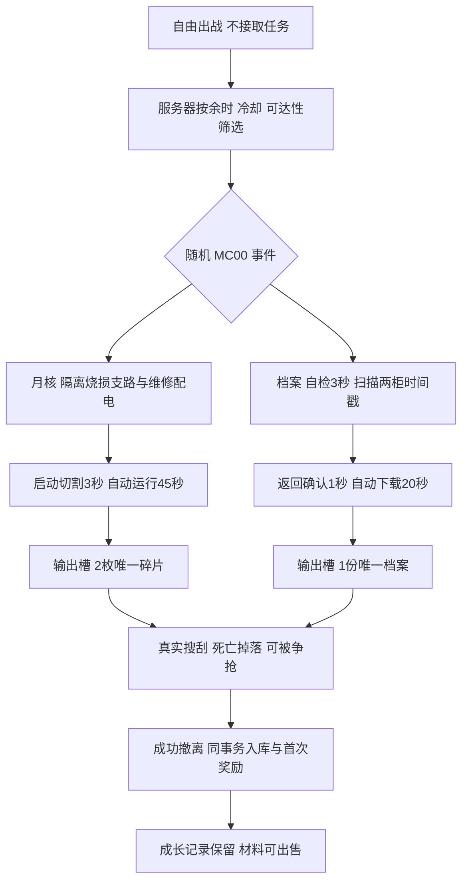

# 任务系统实施状态

更新：2026-10-19。产品规则：**局内随机出现，无需接取；每种任务有具体流程，追踪只影响显示。** 本页区分代码、实际验证和待验收范围。

## 已推送里程碑

- `fa02a445`：总体、MC00 行动、UI/后端设计。
- `a75ea564`：纯规则、两模板、随机导演和有限配置校验。
- `7670c064`：真实任务物品来源、在线/离线原子首次结算和防重复回执。
- `db6d31d9`：权威 RPC、输出槽/搜刮、客户端快照和原生 HUD。
- `84888463`：正式 MC00 五处设备、机械状态、音频、图标、成长页、保存结果和兼容能力。
- 本轮正式角色验收发现并修复同机节点遮挡启动的阻断问题，另修正任务输出槽误标尸体、过期状态说明；提交见 Git 历史。

## 当前可执行流程

- 世界：MC00 唯一设施槽，两种事件互斥；默认每服务器会话随机 seed，作者可填固定 seed 重现。个人再次出战不重抽或重置机器。
- 时间：首次随机窗口 50–110 秒；后续生成机会 90–150 秒，同模板至少 180 秒。候选受众须在设施 300 米内，剩余至少月核 420/档案 300 秒；公开行动时间与个人 600 秒分开。
- 无接取：模型无 `Accepted`，无 Accept RPC；直接操作有效。发现只开放信息，取消追踪不影响设备、物品或成长资格。
- 权威：服务端检查部署、行动编号/epoch、存活、距离、视线、朝向、受伤及交互租约；支持取消、设备竞争、错误线路不推进。档案两标签可提前扫描并保留。
- 物品：沿用版本化库存与输出槽；唯一物品保留世界/行动/版本来源，真实占格，死亡/丢弃沿用既有容器转移。到期统一清除未撤出的该批产物。
- 结算：M01 首次非保底回收 10、M02 首次月核 30、M03 首次档案 20 月尘，互不设完成顺序。材料保留；普通商店出售初值为碎片 50/档案 35 月尘。新研究配方尚未开放。
- 保存：在线 PostgreSQL schema 7 的唯一产物回执与库存/首次事实同事务提交；离线复用共享规则及原子档案保存。内存会话明确显示未写入账号。旧 HTTP 后端缺任务能力时停止生成新事件。
- UI：现有 UI Toolkit。HUD 显示步骤、楼层、方向、直线距离与公共窗口；J 页提供真实节点、线索与本地追踪。F/手柄共用交互仲裁；线路是离散配置；产物打开既有搜刮界面。结果等待保存确认后才显示首次收益。
- 成长页：M01/M02/M03 使用实际账号事实；月核/档案为现有 Painter2D 体系内原创图标，不替换既有光环/器官图像。

## 正式地图和表现

- 目标：`Assets/MoonEnvironment/Variants/TheophilusBase/Scenes/TheophilusGameScene.unity`。
- 新增一个 `Missions/MC00MissionSite.prefab` 实例；入口、L22 配电 A/B、取样、档案终端共五处。实际坐标/原始来源见同目录 `Authoring.txt`。
- 两柜同时承载 18:42/18:47 标签；档案扫描不会扳动供电杆。取样装置有夹具、两结晶、运行转子；档案有输出表现，状态条随快照改变。
- 两段原创单声道循环接现有声音池、空间衰减与 SFX 混音。机器声可暴露位置；没有宣称 NPC 已接入警报听觉，也未增加任务刷怪。
- 初版 SP05 取样点在作者视图受地形遮挡，已移到 L22；镜像/过大的铭牌已修正。最终五点检查通过，旧七点结果不作为最终地图证据。

## 已取得的最小验证证据

| 层级 | 结果与边界 |
|---|---|
| 纯规则/库存 | `Backend/MissionRulesChecks` 最新 223 项通过，覆盖无接取、配置、前置、计时、竞争、随机、来源、首次奖励。供电 A 改为配置后移除了原读条采样用例，不能累加旧计数。 |
| 在线事务 | `Backend/MissionPersistenceChecks` 8 项真实 PostgreSQL 检查通过：首次入库、重试、重开、同源跨账号拒绝、回滚、死亡不发奖等；唯一临时数据库已删除，没有真实账号写入。 |
| 原有库存 | `Backend/InventoryChecks` 12 项迁移/部署/结算检查通过。 |
| 离线档案 | Unity `MissionOfflineChecks.Run()` 8 项通过，含旧字段默认、首次奖励、关闭重开、重复来源、死亡；仅使用隔离临时档案。 |
| 编译 | Unity 动态命令实际引用新类型成功；在线后端构建 0 警告/0 错误。 |
| 网络 | 最终 RPC 结构 `MissionTransportChecks.Run()` 13 项真实 UDP 检查通过：1 服务端/2 客户端、晚连接、无接取、线路、争用、受伤、输出、同物争抢、死亡、再部署、过期；隔离 World 和真实处理器未证明正式角色同步。 |
| 正式地图 | `MissionFormalChecks.Start()` 用既有运行时导航构建器，五点地面/净空/视线/NavMesh/完整连接均通过；入口到 L22 操作点路径约 206–220 米。作者视图确认取样/档案可见、铭牌正常；不把直线距离当步行时间。 |
| 原生 UI | `MissionUIReview.Start()` 进入 Play 渲染真实 UXML/Presenter，四状态通过：HUD、配置、1280×720 档案、结果；真实按钮验证取消追踪不发 RPC、线路发 Configure、快照不覆盖故障线索。使用无传输/无档案服务的私有 World，未写玩家档案。 |
| 正式角色端到端 | 两种任务分别通过正常单人出战、正式地图 KCC/输入/UI/RPC、真实产物搜刮、原路撤离、离线保存和档案关闭重开。月核 2 枚、首次事实 3、月尘 140；新档档案盘 1 份、首次事实 5、月尘 130。完整步骤、实际失败、耗时及边界见[正式角色验收](Role-Validation-20261019.md)。 |

工具在 `Assets/Editor/Mission*Checks.cs`、`MissionUIReview.cs`。地图/原生 UI 证据输出到 `Library/BuildValidation/Missions/`，不是正式角色录像。运行后恢复 MainMenu、退出 Play，不保存验证场景。

## 明确的待验收与后续内容

1. **独立第二玩家与 HTTP**：当前两个 Unity 连接器已确认同属进程 12712；本轮只有单人模式的真实服务端/拥有者客户端，不是两个独立玩家。正式第二客户端输入与现场同步、HTTP 账号保存端到端仍未验收；不拼接夹具结论。
2. **人工体验与听感**：成功月核局约 5:09、档案局约 4:07，连续冲刺去/回程各约 59/62 秒；均含工具停顿，自动导航已知路线，不能证明新手 6–8 分钟、首次定位或战斗压力。物理标签近距可被第三人称角色遮挡，需人工视角复核；本轮无法可靠监听音频，未冒充听感通过。
3. **未纳入 P0**：额外增援、警报驱动 AI、应急补给间、多区域追踪/室内路径地图、小队共享、新研究配方。不会把这些占位宣传成可玩。

Editor 已经正常会话关闭后回到 MainMenu、退出 Play，虚拟输入设备与玩家名偏好已恢复，未改变真实玩家档案或正式默认随机配置。后续补前两项缺失条件，只修复暴露的问题，不先扩第三种任务或重跑相同底层检查。
