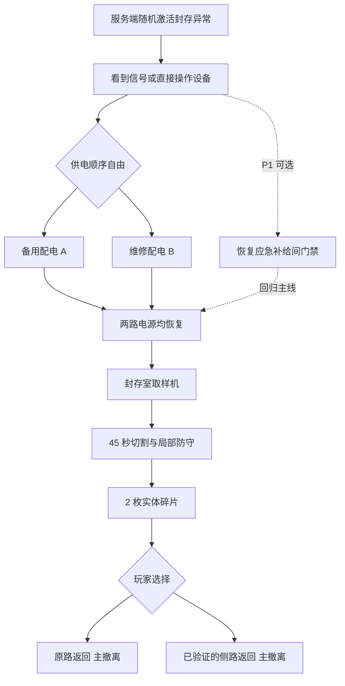
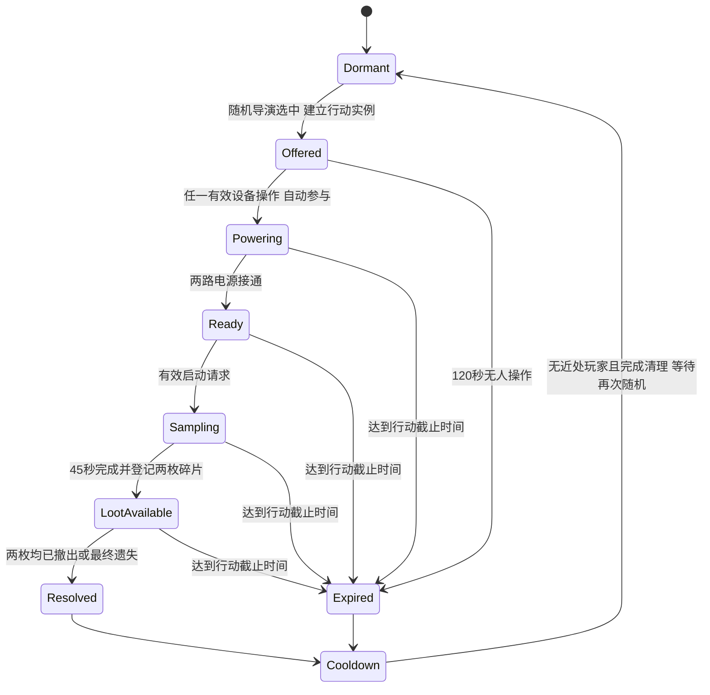

# MC00 月核回收行动

关联：`MS-020` 至 `MS-029`。这是[任务系统总体设计](README.md)随机池中的完整流程，并非每局必有的全员主线。无需接取，直接操作也有效。落地与验收证据见[实施状态](Implementation-Status.md)；本文同时保留明确标注的后续规格。“月核”指设施内的异常月质结晶。

## MS-020 玩家简报

**行动名：封存样本。区域：MC00 楼内。主要目标：取出至少 1 枚月核碎片，并成功带回。**

“MC00 的取样设施在失联前封存了一批异常结晶。恢复两路备用电源，启动封存室切割装置。设施启动会触发局部警报；取得碎片后自行选择撤离时机。月核碎片占用背包，死亡后可能被其他人拾取。完成切割不等于回收成功。”

这段简报在局内发现事件后显示，可直接关闭；出战前只提示此类事件可能发生。预计行动 6–8 分钟、切割 45 秒、推荐预留 2 分钟返回、当前氧气与医疗准备、奖励及用途。预计时间是设计目标，路线作者化后以真实走图修订。

### 出发前真正需要做的准备

- 预留至少 1 个可容纳碎片的背包格位；不把背包总数硬编码成旧版 12 格容量。
- 带足当前光环所需电池与基本医疗。推荐提示，不设装备等级门槛。
- 在地图简报知道 MC00 的入口方向与现有撤离点。首次只给建筑区域，不直接显示封存室穿墙坐标。
- 无须接取 M02 或先打开任务面板；任何人均能直接操作已激活的设备、搜刮和拾取碎片。首个发现者不独占整座楼。

## MS-021 空间与路线

使用正式地图 MC00 入口和 L22 设施区。入口、两处配电柜、取样装置、档案终端共五处可编辑锚点；两柜同时带有 18:42/18:47 标签。实际坐标与来源记录在 `Assets/MoonEnvironment/Variants/TheophilusBase/Missions/Authoring.txt`。导航连通已检查，角色走图时间仍需实测。

要求两个供电点相距足以形成路线选择，但单人可顺序完成；不能要求同步驻留。取样区提供至少两处可用掩体和可撤退通道；强制交互点不放在楼梯碰撞边缘。两条返回路线可共用末段，但不能都被同一扇任务门堵住。任务不得关闭现有公共撤离。

不以直线距离代替可达性。地图标记提供建筑/层级/入口，只有作者化过导航图后才展示路径长度；P0 标注“直线距离”，不假装已知最短路。

## MS-022 时间预算

目标为普通装备、熟悉基本操作的单人留出两分钟以上余量：

- 接近并定位：约 60 秒。
- 完成两路供电：约 90 秒，含移动。
- 到达封存室并处理沿途敌人：约 60 秒。
- 启动、切割与拾取：约 60 秒，含 45 秒设备运行。
- 向现有撤离点返回：约 120 秒，含 8 秒撤离。
- 合计约 390 秒，另留约 210 秒处理绕路、治疗与争抢。真实地图无法满足时，先缩短点间路线/设备等待，再考虑独立长局配置。

当前 UI 显示个人出战倒计时和公共回收窗口，运行前需要玩家判断返回余量。后续可加入“保守返回预算 + 45 秒”的针对性警告；尚未实现该风险预测，不能把导航连通当成实测步行预算。

地图行动时间与个人出战时间分开。行动不会因为后来的人刚进场而把机器计时加长；个人也不会因为别人触发事件丢失自己的 10 分钟。

## MS-023 分步交互规格

### S0 定位封存室

入口信号牌与设备上的故障/批次标识提供环境线索，玩家进入广播范围或直接操作有效设备后可按 J 查看流程与当前设施状态。阅读不计设备贡献，也不承担接取开关；直接找到配电 A/B 就能进行 S1。首版入口为可读信号牌，不额外增加无实际作用的 2 秒读条。

表现：入口状态条激活，铭牌和故障标签提供环境线索；HUD 显示当前步骤，J 页提供流程与已知区域。首版不伪造实时室内地图，不把其他玩家变成任务敌人标记。核心操作正式落在 L22 可见设施区，配电柜同时承载事故标签，稳定地标可跨次学习。

### S1 恢复两路备用供电

两处设备顺序任意：A 路根据烧损故障牌选择“隔离故障支路，保留备用母线”，是实际离散配置操作；B 路长按 4 秒闭合维修配电。选错不推进并给原因，不额外刷怪。B 路移动离开、松开或生命伤害会打断，已完成的另一路不回退。同一设备并发只推进一次；完成后其他人看到已完成状态。

表现：操纵杆/按钮明确位移，电源状态灯和封存室指示改变。新增电路与原有装饰/阅读灯开关分开作者化；只有受任务控制的设备受影响。

首版不消耗保险丝或稀有材料，避免新手无钥匙死局。进阶变体可从固定备用柜取得保险丝，且该柜必定可达并有保底供应。

### S2 启动切割

双路供电完成后，在取样终端长按 3 秒；开始前显示“运行 45 秒，将触发局部警报”。此操作不扣普通战利品，不消耗玩家自己的光环电池。

首个有效启动者写入启动账号与部署；设施使用一个全服共享行动实例。其他玩家能看到机器运行与粗略警报位置，可以介入，但不会被自动登记为队友或获得奖励。

启动后不要求玩家持续按住，离开房间也不停机。机器不设置可被普通枪火毁坏的血条，P0 不允许一个路人随手打坏机器令整局无解。玩家可撤退、躲避、换掩体或反击。

### S3 45 秒切割

显示服务端确认的进度，设备切割部件运动，运行状态条变化。P0 通过真实空间声响暴露位置，保留既有地图敌人与玩家造成的压力，不额外制造敌群。任务声到 AI 调查的接线尚未实现，不宣称 NPC 已能听懂设施警报。

P1 可在 15 秒与 30 秒各申请一次有限增援，每次最多 2 只；必须受既有 `AlienEncounterSettings` 总预算、并发、支撑、距离、视线和可达性约束。无安全点或预算不足就跳过，不瞬移到玩家背后，不强求补满。

后续增援必须由一次性服务端事件触发，暂停、快照重发与重连不得重刷。当前版本不写入该增援事件，也不绕过既有遭遇调度器直接生成敌人。

警报是局部风险：P0 有物理声源和视觉提示，**不向所有客户端广播携带者精确位置**。真空/室内声音规则以现有音频能力为边界；没有传播模拟时用明确作者化范围，不能据此宣称真实真空声学。

### S4 产出与拾取碎片

切割完成后，输出槽生成 **2 枚独立、不可堆叠、各占 1×1 格位的月核碎片**。它们是同批次的两件战利品，每件拥有唯一序列号；双人可以各取一枚，单人也可携带两枚，第一版不按入场人数复制物品。

物品代码 `mooncore_fragment`。说明写明成功带回自动记录、可出售或保留、研究配方未开放、真实占格及死亡掉落。当前库存没有新增安全容器。图标为有保护夹具的断裂结晶，避免与异形器官核心相混。

碎片进入版本化容器/背包事务；不得使用临时计数器代替物品。背包无合适空间时留在输出槽，提示“空间不足：需要 1×1 空位”，允许整理后再拿，不自动丢弃其他物品。

P0 持有碎片不改变移动速度、开火、氧耗与武器动作，不增加新网络移动状态。风险来自占用空间、掉落损失和取样警报。可见携带装置、脉冲信号和移动负重属于 P1，必须先有完整表现、规则与同步。

### S5 撤离与自动记录

普通撤离规则不变。服务端冻结库存和结果时检查碎片真实所有权、有效序列号、来源及个人部署结果。客户端收到撤离结果先显示“保存中”，后端确认后显示“已安全带回”。不查询任何接取或追踪条件。

第一次有效带回时，M02 自动完成，在同一结算事务发 30 月尘并记录分析许可事实；不检查接取、追踪或是否读过终端。碎片保留，可在已有商店出售；分析许可目前是成长记录，新的研究配方属于 P1。不能要求点击交付才承认本次任务完成。

## MS-024 行动生命周期

- `WorldSessionId` 表示实际服务器地图会话；`OperationInstanceId` 表示随机出现的某次 MC00 设施行动；个人 `DeploymentId`/`RaidId` 各自独立。
- 导演选中模板时建立实例、种子与 120 秒待参与窗口；无人操作则过期，不发奖励。任一有效设备操作开始 600 秒行动时限。两个时钟均不重置个人出战时间，读取说明不算有效启动贡献。
- 再次出战不能重置供电、机器、碎片、行动编号或增援预算；新部署只能加入仍有效的当前设施状态。
- 终态进入 120 秒清理冷却，另受总体导演至少 180 秒的模板/区域生成冷却约束。只有重置区域无存活玩家 40 米内、无活跃交互、两枚碎片都有终态，才重置设备；有人停留则延后。原子切换初始状态并提高行动 epoch，之后仍需重新随机选中，不自动循环刷取样。
- 已入库碎片保留来源与已撤出记录；不得因设备复位销毁仓库物品或让旧序列号重新产出。
- 行动截止时停止互动，未撤出的该批碎片失去回收资格并从世界/携带任务物品中一致清理。HUD 持续显示回收窗口；60 秒、15 秒独立提醒是待补交互细节，不声称已具备。
- 若行动窗口早于某位玩家个人超时，玩家仍可带普通物资撤离。任务物品过期不能结束整个个人战局。
- 全服无玩家时暂停新的任务生成；已启动行动使用连续服务器时钟到期，不在空服刷任务奖励。地图卸载会终止实时行动，不恢复为运行到一半的机器。

P0 不实现中途恢复整张战局；服务器崩溃后关闭开放部署并沿用明确的损失/恢复政策，已持久化的结算 outbox 继续重试。不得重启机器并复用旧物品 ID，不能承诺对未入库战利品无损恢复。

## MS-025 个人资格与多人争抢

### 第一阶段：个人回收资格

M02 要求“有效获取并带回”而不要求“本人按下所有开关”。因此可以合作操作，也允许后来者冒险夺走碎片。谁真正撤出一枚有效新碎片，谁满足物品目标；操作机器本身不发可刷取月尘。未追踪、后来发现均可满足条件。

成长页面尚未解锁时，先保存“曾有效带回月核”的事实，页面开放后自动补齐首次里程碑。旧档有真实有效来源记录时可迁移补齐；只有同名库存而无来源事实时不能伪造新任务。重复材料回收按有效来源部署去重，不要求事前登记。

拾取争抢按服务器处理顺序及容器版本裁决；一个唯一序列号同时只能属于输出槽、背包、掉落容器、已撤出或已销毁其中之一。

### 小队阶段：明确选择共享

P1 小队玩法可增加“完成设施行动并亲自撤离”的共享节点：首个有效贡献自动绑定当时的 `SquadId + MemberDeploymentIds`，不要求参加按钮。必须取得交互、任务目标有效伤害或已定义防守贡献，不能只站出生点领奖。共享设施节点和章节事实；实体材料仍只有两枚，不按人数复制。

小队“设施行动成功”节点可以与“本人带回一枚碎片”并存；队友独自撤离不让全队获得复制研究材料。退队、解散和踢人不抹掉已确认贡献；后来加入者从自己的有效贡献起自动参与，不追溯伪造此前操作。

P0 不显示小队共享按钮，不以附近玩家名单冒充队伍。未来共享条件改变时发布新的定义版本，不静默修改旧实例。

## MS-026 失败和边界

- **按键松开/被打断**：终止当前长按，已完成设备保留；界面显示打断原因。
- **离开房间**：切割继续；无强制牵绳。玩家可主动放弃回收。
- **死亡**：碎片跟随既有死亡掉落事务，先完成物品所有权转移再销毁角色。其他玩家可从尸体容器取得；原持有者任务追踪变为“碎片已遗失”，不能继续显示携带。
- **个人超时**：按现有超时损失政策处理，不给碎片入库；若物品转入掉落容器，须由明确规则实现，P0 统一销毁其仍携带的碎片，不假设超时已有尸体。
- **断线**：P0 断线不保留虚构可重连角色；按现有部署关闭/损失流程处理携带物，并取消交互锁。已存在的世界掉落不被复制。重登得到新部署；原碎片若仍合法留在世界可被再次搜得。
- **封存室无法到达/必要点失效**：启动前验证所有必要锚点与候选站位；失败时停用本次行动并给明确设施不可用提示。不能把任务发给玩家再让其盲找。
- **必要供电点被占用**：交互锁 2 秒无有效续约释放，不把设备永久锁给断线者。
- **取样完成但背包满**：保留输出槽真实库存；不用直接发邮件绕过撤离风险。
- **有人带走全部碎片**：其他人看到“输出槽已空”，任务可转为找回遗失样本或撤离；不显示该玩家实时坐标。抢夺是本次结果，不触发补产。
- **全员死亡**：机器可继续到行动截止；没有后台自动发奖励。冷却与重置仍需全部来源物品终态。
- **保存服务暂时不可用**：保留既有 outbox 重试，显示“已撤离，等待保存”；禁止重复入库、交付和再次部署竞争同一库存。
- **显示不同步**：客户端请求有权限的当前完整快照；不得通过重新按一次按钮补进度。

## MS-027 首轮美术与声音清单

- 入口定位面板 1 套、两种配电标识、取样设备 1 套，支持未供电/就绪/运行/完成/失效五类状态。
- 月核碎片模型与透明图标、输出槽的两件实体表现、任务拾取提示与库存中文说明。图标与模型轮廓一致。
- 恢复供电的一次确认音、切割运行循环、完成释放音、有限警报音；复用现有 SFX 混音与池化，不再建立声音总线。
- 世界标记用电源、设施、碎片、撤离四类语义图标，蓝色仅为追踪选择，不强制染色所有物品。
- 低动效模式减少警报频闪；危险仍有文字和稳定形状。警报不遮住枪口、敌人或现有氧气警告。

## MS-028 首轮观察指标

记录起止时间、退出原因和任务节点，不收集每帧位置。优先看：

- 新玩家是否在 30 秒内说清目标、出口和碎片用途。
- 到达取样机之前的时间，以及返回时间余量；目标路线中位数 6–8 分钟只是调参假设。
- 死亡发生在互动、切割还是返回；区分既有地图威胁与任务追加威胁。
- 背包满而无法取样的次数、因标记楼层错误而绕路的次数。
- “已经切割但误以为任务完成”的误解次数；“带回后误以为还要接取/点击领奖”的误解次数。
- 单人独占两枚的频率及无碎片离场者体验；据此再评估批量、收益和协作规则。

不预设所有人必须完成。撤退如果由资源压力和明确风险驱动，是有效选择；因任务没说明、机关不可达、存档失败导致的退出才是优先修复对象。

## MS-029 P0 通过标准

同一正式地图中完成：按种子随机启用月核或档案；单人不读简报、不设追踪也能直接操作并自动结算；双客户端争同一枚只成功一次；携带者死亡后第二人可取回；一人重新出战不重开机器；重发结算只发一次材料与奖励；离线和在线同规则。只对这些风险运行必要检查，不为文档或未改动系统重复全项目验证。
