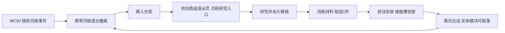

# 月核成长实施状态

2026-10-20。实现基于当前 `feat/aliens`，保留并行正式地图、字体及编辑器设置修改。

## 玩家路径与配方

MC00 月核任务仍随机出现、无需接取，追踪不影响资格。成功携带撤离后，月核保留且继续支持原出售收益；不会自动扣掉首次成果。

- 永久研究 `mooncore_stabilization`：已回收 `mooncore_fragment` ×1，`circuit_board` ×2。永久知识，不发模块、不自动装备，不要求分析许可或异形研究。
- 每件制造 `halo_mooncore_recycler`：已回收月核 ×1，`copper_coil` ×1，输出仓库实体 1×1 模块 ×1。每次制造独立主动确认，不免费购买、不加入普通补给箱池；可按 9 月尘出售。
- 兼容步枪、紧凑步枪、霰弹光环，储能槽与电容/快充桥互斥。耗能 `ceil(E × 2/3)`，充能时间 ×1.2，容量和基础伤害不变。步枪 3→2 能量、霰弹 12→8，均 2→2.4 秒充能。
- 调整原因：建议 -25% 会使步枪 `ceil(3×0.75)=3`，只剩负面效果。改为三分之一节能，保留原向上取整与参数顺序。命中标记器加耗在节能取整后计算，生物研究与器官活动保持原效果。

## 接入与界面

- Shared `AlienBiology` / `ShopRules` 统一配方、仓库库存统计与原子消费；必须校验来源有效且 `MissionRecovered=true`，不接受携带中或应急材料。
- 沿用线上库存版本/账号锁/交易凭据和离线档案原子快照/凭据。研究不重复扣料，制造扣料和新身份输出同次提交；空间不足不扣料。旧档研究位默认为 0；`HaloResearchBranches` 新增 bit 3 只表达知识，不进入伤害掩码。
- 新模块位为 `ushort` bit 11（2048）；器官活动继续使用 bits 12–15。真实权威/预测均经过 `WeaponRegistry`；部署、死亡、搜刮、撤离复用现有物品树。
- 原生 UXML/USS：研究左侧月核/生物分区和选中进度，主区大图标、用途/代价、真实前后参数、来源；材料已有/需求/缺口和确认按钮相邻。区分未解锁、缺材料、提交中、已研究、可制造、空间不足及待确认重试。
- 入口：供应商页「月核研究 / 模块制造」、成长页同名按钮，或供应商窗口「光环研究」。研究后「前往制造」，制造后「前往改装」。关闭重开保持研究选中项与步骤；已持有与已安装数量分列。
- 改装显示当前/装后能耗、充能、容量、伤害；槽冲突说明替换与旧模块返回位置，拆卸检查仓库空位。Painter2D 图标与冷银/青色回流弧段沿用原图形和 UI 音效路由；所有新文案提供中英文。

## 最小检查与交付

- 后端 `dotnet build Backend/MoonPersistence/MoonPersistence.csproj --no-restore`：0 警告、0 错误。
- Editor 定向检查 24 项通过：已回收来源、材料原子消费、仓库满、旧版本、离线请求重试/重启/冲突、模块位隔离、实际参数组合、装备与死亡身份。使用唯一临时档案，无玩家档案写入。
- 参数调整后只复核真实步枪/霰弹参数，均通过（3→2 / 12→8，2→2.4 秒）。Unity 脚本导入成功，`compilationFailed=false`。
- 中文原生研究面板已建立，但后台 runtime/Editor 离屏捕获未产生有效画面；屏幕捕获因 Unity 不在前台而跳过。用户明确选择“暂时不方便，记录视觉待验收”，因此未继续截图或切换 Play。中文布局与光环回流效果的最终目视验收仍待完成。保留 `Tools / Moonkov / Mooncore / Review Research Layout` 供之后一次原生检查；使用隔离示例库存，无玩家写入。
- 未做完整 Play 走图、实机听感、Host/第二客户端或 HTTP/数据库集成回归；不以本轮静态/Editor 证据替代这些验收。
- 提交与推送：待本轮最终检查后记录。本任务不包含先前地图提交或并行改动。
