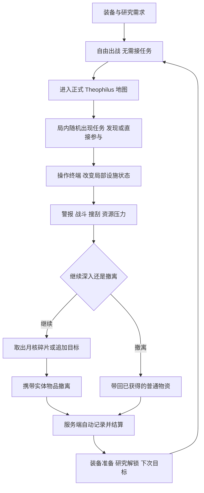

# 月面任务系统总体设计

版本：设计提案 v1.0，2026-10-19。关联需求前缀：`MS`。本文描述设计目标，不作为运行验收声明；实际实施与证据见 [实施状态](Implementation-Status.md)。文中的时间、奖励、容量和难度均为首轮试玩起点。

**核心规则：任务在局内随机出现，无需接取；玩家直接做也有效，每种任务都有具体流程。** 随机决定本局遇到哪种事件，流程决定玩家如何解决；追踪只影响界面，不决定资格。玩家可以忽略、合作、争抢或中途撤离，装备成长继续承担长期动机。

以塔科夫式开放搜打撤为体验基础，加入本项目自己的多步骤设施任务。首个交付包含完整的“发现 MC00 异常 → 恢复供电 → 启动取样 → 取得月核碎片 → 成功带回”路线，以及一种完整短流程事件，让随机确实发生在可玩内容之间。

## 阅读入口

- 本文：产品规则、任务体系、成长、内容库、范围和验收。
- [MC00 月核回收行动](MC00-Mooncore.md)：首个行动的逐步玩法、时间预算、设施状态、争抢和失败处理。
- [界面与后端规格](Technical-and-UI.md)：各屏布局、局内追踪、数据模型、服务端权威、RPC、存档与实现拆分。

## MS-001 当前基础与设计边界

本次以当前仓库为依据，而非早期策划的功能快照：

- 正式入口为 `Assets/MoonEnvironment/Variants/TheophilusBase/Scenes/TheophilusGameScene.unity`，场景包含 MC00 建筑。任务点必须在该正式地图落位。
- 场景当前配置为每次出战 600 秒、撤离持续 8 秒、半径 5 米；普通物资刷新为 300 秒。任务资源将使用独立生命周期，不能套用物资箱刷新。
- 已有 Entities/NetCode、GhostBridge、服务端拾取/死亡/撤离、库存图与容器事务、离线档案、ASP.NET Core `MoonPersistence` 和 PostgreSQL。**新增任务状态接入现有网络与结算，不再建立另一套游戏网络。**
- 已有异形器官掉落、食用与永久光环研究，可提供任务消耗与奖励出口。月核碎片是本设计新增物品，不等同于现有 `alien_core`、`quantum_core` 或 `helium3_sample`。
- 当前 UI 为 UI Toolkit；2026-10-19 主题是深色表面、浅色文字和蓝色选择态。出战已有角色、地点、简报、回收、确认五步。
- 目前个人再次出战可留在同一多人地图，其他人不会重开。当前代码不能据此推定已有小队、共享任务资格、设施行动或地图会话任务存档。

本设计支持单人及 PvPvE。第一阶段不依赖好友房、小队组建、全球战况或每日刷新。个人事实和公开设施先行，小队共享后续接入；不把所有同服玩家默认视为队友。

## MS-002 体验结构

采用三层任务：

1. **成长记录**：自动保存的跨局里程碑，例如“首次带回月核碎片”“完成器官分析”。无需接取，满足条件自动推进。
2. **随机地图任务**：本张地图里随机启用、可被多人观察和干预的流程，例如 MC00 取样机。它改变路线、灯光、警报和局部遭遇。
3. **局内目标**：当前行动的具体步骤，例如“恢复供电 0/2”“取样 38/45 秒”“携带碎片撤离”。它告诉玩家现在做什么。

探索发现、临时支线作为地图行动的补充，而非额外铺满一屏任务列表。

《绝地潜兵 2》提供了设施操作组合成具体目标的参考，可见 [Arrowhead 官方任务介绍](https://blog.playstation.com/2024/01/23/helldivers-2-galactic-war-gameplay-detailed-complete-missions-reclaim-planets-rescue-the-galaxy/)。本项目采用用户明确要求的局内随机任务与无接取条件，不引入出发前选择固定行动、全员统一胜负或全球战争。

### 六条体验原则

- **目标改变行为**：引导玩家进入房间、切换路线、暴露位置、携带资源，而不是只累积杀敌数。
- **每步看得见**：恢复供电亮起导引灯；取样机展开夹具；月核碎片有专属模型/图标；结算列出用途。
- **风险可预知**：启动前写清用时、声音、警报和剩余氧气；不在按下按钮后突然惩罚。
- **失败损失明确**：设施启动不代表碎片带回；死亡损失携带物，但已永久解锁的研究保留。
- **任务不封死撤离**：玩家可放弃深入，带着普通物资离场；主线不会要求先击杀 Boss 才允许撤离。
- **单人能做完，多人有选择**：不设必须两人同时按下的主线按钮，不用固定多人怪量阻断单人。

## MS-003 自动记录与追踪

### 追踪不是接取

- 所有已生成任务都有实际效力，不读简报、不打开任务面板、不设置追踪，也能完成并获得符合条件的收益。
- 最多固定显示 3 项，其中 1 项展开、2 项紧凑；这是 HUD 显示上限，不是可完成任务数上限。
- 取消追踪只隐藏提示，不重置进度、不放弃奖励。界面没有“接取”“放弃任务”按钮。
- 直接操作设备或取得任务物品时，服务端自动登记参与并揭示相关信息，不强制先经过入口终端。
- 出战时冻结任务内容版本，局内生成时再冻结实例种子与奖励版本；版本冻结不等于事前接取。
- 同一物品可让多个任务显示“持有”，交付消耗时必须指定用途；不能同时消费给委托、出售和研究。
- 首次回收等事实自动保存，即使成长页面尚未解锁；解锁时按真实记录补齐，避免“做早了不算”。材料交付或研究是主动消耗物品的局外事务，不是任务接取门槛。
- 任务没有强制日常、连续登录惩罚和每日重置链。可重复设施收益与一次性成长奖励分开。

### 首批成长链

以下为成长展示顺序，不是必须先接后做的链。事件生成不以账号章节为前置，先遇到后期事件也能完整完成。M01/M02/M03 首次奖励分别独立判断，无需依次做；后续研究若有前置，先保存实际事实，开放时补齐一次。

1. **M01 第一份回收物**：从任意正式物资点搜得 1 件非保底物品并成功撤离。奖励 10 月尘；展示仓库、出售、研究用途，不再新增教程货币。
2. **M02 MC00 封存样本**：从有效行动获取并带回 1 枚月核碎片，撤离保存时自动完成。首次奖励 30 月尘和“月核分析许可”；碎片保留供回收或研究。
3. **M03 事故之前**：完成随机档案任务，带回专用档案盘。首次奖励 20 月尘与设施日志，开放后续调查展示。
4. **M04 生物与月核**：交付 1 份现有异形组织、1 份指定物种器官与 1 枚碎片。奖励 25 月尘与月核研究入口；器官食用与保留由玩家决定。
5. **M05 深部信号**：完成高级变体的两个校准环节并带回相位记录。奖励装备方案选择；高级变体与装备奖励属于 P1，P0 不占位假发放。
6. **M06 回收权**：在已实现小队资格后进行协同转运，或在单人模式完成同等转运。奖励外观/记录；不把强制组队放在装备成长主链上。

“月核分析许可”只开放后续研究页面，不控制能否操作任务，也不直接提供全武器永久增伤。具体新研究必须先有可见效果、材料成本与平衡规格，不能用一个新布尔值替代整条成长线。

### 推荐与缺料引导

准备台显示“下一项研究缺少什么”，点击材料可查看历史已知来源与可能出现的事件；出发前不预告本局抽中了哪个任务。不泄露未发现房间、敌人位置或真实物资刷新状态。

## MS-011 局内随机生成与发现

服务端每 30 秒评估一次生成机会，只评估有存活玩家的区域。全图最多同时 1 个大型任务、2 个小型任务，同一区域最多 1 个大型任务；月核与档案互斥占用 MC00 设施槽。所有事件共享既有敌人和服务器预算。

第一版至少提供月核与档案两种完整任务。内容池示例权重为月核 45、档案 35、补给信号 20；未实现模板从池中移除后重新归一化。P0 只有前两种时实际概率是 56.25% 和 43.75%，不能用未实现内容做虚假随机。

生成先筛选地图标签、必要设备有效、站位可达、区域无冲突、受众剩余时间、冷却和遭遇预算，再抽取模板与合格位置。大型任务至少有一名候选玩家剩余 420 秒，档案至少 300 秒；这是新生成门槛，已存在任务仍允许任何玩家介入。该余量覆盖流程及保守返回时间，后续短小任务可设置更低门槛。

- 入场前 20 秒不新发事件；首个生成窗口在之后 30–90 秒随机选择。已有事件不因新玩家入场重抽。
- 后续全图生成冷却 90–150 秒，同模板/区域至少冷却 180 秒。用地图会话时钟，个人再次出战不刷新抽奖。
- 有合格受众且连续 90 秒没有有效任务机会，下一次评估保底从合格模板中生成一项；保底机会，不保底月核和奖励。
- 无合格点位、足够时间或预算时允许不生成，不为保底制造不可完成任务。失败原因仅进入运维日志。
- 已有设备只切换状态，可以在视野内通过自检/故障提示激活；新增物资或敌人必须通过距离、视线、支撑和可达性约束，不在玩家眼前凭空生成。
- MC00 可能发生取样异常、档案信号，也可能暂时无事件。未激活设备显示待机，不提供假互动。

发现渠道包括建筑灯光、区域广播、可见设备、日志与直接操作。局部信息揭示初值为 120 米并按建筑区域筛选；这是游戏信息范围，不冒充声学模拟。未发现事件不显示全图精确标记。

发现只揭示信息。玩家直接操作其中一步时，自动创建个人参与记录并发送真实步骤；不读终端也算。迟加入者见到共享设施当前状态，不重开机器；已被别人完成的步骤不能伪造成自己的贡献。

## MS-004 局内任务语法

首版支持以下目标能力，内容通过配置组合：

- `Interact`：长按确认终端/阀门/扫描点，验证距离、视线和存活。
- `ActivateSet`：激活若干候选设备，按稳定设备 ID 去重；可顺序或并列。
- `TimedProcess`：设备运行、供电或防守；进度由服务端时钟推进。
- `RecoverItem`：生成指定来源的实体物品，并取得真实库存所有权。
- `ExtractWithItem`：撤离结算冻结时仍实际携带符合来源的物品。
- `DeliverItem`：局外库存事务消耗指定物品，提交任务进度和奖励。
- `ScanSet`：若干有效站位/标签扫描，按稳定 ID 去重，完成点不因读取说明较晚而清空；用于 P0 档案流程。
- P1 扩展 `KillTagged`、`UploadData`；击杀仅针对任务生成的目标实例，不能把任意路边敌人算作指定首领。

配置表达 AND/OR、前置、数量、作用域、失败策略、可见性与奖励策略。主线使用无环目标图；不提供任意脚本字符串执行。对每个节点明确：进入条件、互动位置、进度保存、打断规则、完成反馈、失败与恢复。

任务禁止的设计包括：无提示地持有指定道具才可开门、随机必需钥匙导致死局、无限刷新防守、把付费/高级背包作为主线前置，以及从客户端按钮直接上报“任务完成”。

## MS-005 首批任务库

以下 12 项是随机内容池。P0 提供 M01/M02/M03 自动记录、月核与档案两种完整流程及一个简单路线交互；未实现模板不进入生成池。随机和无需接取都是 P0 要求。

### 1 封存样本（主行动，P0）

MC00 可选定位终端、两处供电、取样 45 秒、取得碎片、撤离自动记录。制造一次局部警报，产出 2 枚唯一碎片。重点是携带物选择与撤退，不强制清光全楼。详见独立行动规格。

### 2 应急补给间（可选路线交互，P0）

在已作者化的小房恢复门禁控制，长按 4 秒，打开原已配置的补给空间及指示灯，提供停留节点。补给沿用既有容器事务和原预算，不能反复开门刷新物资。P0 只改变门禁/指示；P1 接入真实服务端空气控制后才扩展“恢复通风”。该房仍可被进入，不宣称无敌。

### 3 事故之前（独立短流程，P0）

随机出现档案设备恢复信号，流程为“设备自检 3 秒 → 找到附近两处校验标签，各扫描 4 秒 → 返回下载 20 秒 → 取得档案盘 → 撤离”。两处标签均保底可达，已扫结果保留；不额外刷怪，只承受已有地图威胁。缺任一校验时下载按钮明确说明原因。档案盘 1×1、唯一、死亡可掉落；并发下载只产出一份。首次带回自动记录 M03，重复档案作为材料出售。不读入口日志也能扫描并完成。约 2–3 分钟加返回，与月核互斥占用 MC00 设施槽，适合晚入场玩家。

### 4 黯灯走廊（路线支线，P1）

选择恢复照明或保持黑暗。恢复照明让路线与警示清楚，同时暴露操作声；保持黑暗保留隐蔽。只接服务端任务电路，不能把现有纯表现灯光按钮当成已联网任务机关。

### 5 撤离窗口（转运支线，P1）

恢复中继 25 秒，为本行动的合格参与者开放一处备用撤离点。只改变特定行动/参与者的撤离条件，沿用原服务端停留验证；不能由客户端移动绿色信标就算开放。

### 6 生物谱系（研究委托，P1）

带回指定现有物种器官，不规定总击杀数。任务明确“食用将失去交付材料”；局外手动交付或保留研究。奖励主要是月尘和后续研究许可，避免替代现有研究成本。

### 7 异常源隔离（设施破坏，P1）

找到三处污染节点，至少切断两处再关闭控制器。节点位置来自合格候选，始终保留撤离通路。关闭后只降低附近任务增援概率，不清除现有敌人或让全图怪物失效。

### 8 留在月面的箱子（物资转运，P1）

将已有材料放入中继收集箱，上传 15 秒。提交前预览消耗和收益，使用版本化库存事务；不把全部背包物品自动捐出。任务回报为情报或小额固定报酬，防止成为无风险存仓。

### 9 最后一条通信（区域扫描，P1）

在三个预设站位各扫描 6 秒，三处有不同视野和风险。允许移动中断当前点，不清空已扫点；撤离后才保存账号委托。提供路线探索，避免站在一个像素点拍照。

### 10 拆除警报器（防守变体，P1）

月核行动开始后暴露一台干扰器，花 10 秒关闭可减少下一波任务增援；防守总时长保持原值。玩家可以选择花时间换低压力，不能因不拆而进入无限刷怪。

### 11 深部相位（高级主行动，P1）

在月核基本流程上增加异地校准和更强信号泄露，产出高级记录；不单纯增加敌人血量。默认 10 分钟地图中采用更短基本流程，完整长行动须单独配置更长局时并重新验证路线。

### 12 巨物残响（高风险委托，P2）

从已存在的正式 Boss 尸体取回记录，或扫描远距离残留。Boss 仅在已验证的宽阔候选点出现，不能把巨型 Boss 塞入 MC00 走廊；不阻挡基础月核主线。任务可追踪已有 Boss 预算，不强制额外生成第二只。

## MS-006 风险、难度与复玩

基础版目标完成路线为 6–8 分钟，给 10 分钟局保留撤离和失误余量。首局就不建议同时叠加资料盘、三点扫描和 Boss。

- **基础**：固定可读路线，2 处供电，45 秒取样；最多追加 4 只普通异形，分两批，每批至多 2 只。
- **进阶（P1）**：从已验收的候选路线选一处维修偏移、允许 1 只精英替换普通增援；不突破地图总预算。
- **深部（P1）**：增加携带/转运阶段和情报不完整；另设时间配置及路线验收，不自动套用 600 秒基础局。

单人不因现场人数变化被追加入多人波次。行动启动时冻结人数档位；P0 各档位共用保守基础预算。P1 根据实测建立多人档，不实时给落单玩家补充敌人。

随机只发生在已经验证可到达的候选房间、设备组合和掉落附加物。主线必要物品与必须终端均保底。任务开始时已确认合格的设备不在途中换位置。每次生成记录 `Seed + LayoutVersion + AnchorSet`，便于复现坏局。

## MS-007 奖励、材料与经济

奖励分三部分：首次成长、实体战利品、局外材料用途。界面逐项说明到账条件。

- M02 首次有效带回：自动获得 30 月尘及分析许可，碎片保留；奖励按账号只发一次，不检查是否追踪或读过说明。
- 重复完成主要收益是实体碎片。局外材料回收每个来源部署最多回收 1 枚，消耗碎片获得 8 月尘；普通出售初始 6 月尘，二者互斥，不再叠加每局完成奖金。
- 其余碎片可保留用于后续研究；作为永久研究材料时按独立配方消耗，不能自动交付。
- P0 碎片不提供战斗加成、不当氧气或电池使用。物品说明写“成功带回自动记录；材料可回收或研究”，并提供来源与任务标记。
- 30 月尘大约能覆盖当前目录一件 18–28 月尘的光环模块；这是有感的一次性推动。正式平衡需同时评估普通材料、已有商店与研究收益。
- 任何免费保底/紧急补给不能满足收集委托；任务系统不修订现有免费物品出售政策，经济验收前必须评估这一前置风险。

任务收益在成功撤离事务中自动保存到账户，不要求接取或点击领奖。M02 显示“首次回收完成”，并列出保留碎片的后续用途。研究和材料回收消耗物品时仍由玩家明确选择，不撤销已记录的任务事实。纯设施/扫描任务要求有效贡献并成功撤离才保存账号收益，事件详情写清条件。

容量不足时奖励物品进入持久化“待领取奖励”记录，不能静默消失、地上掉落或阻塞退出。该领取区只保存奖励 entitlement，不可用来存放任意战利品；P0 奖励采用货币和许可，先避免引入奖励容器。

## MS-008 信息与情感节奏

每 30–90 秒应有一次有意义的进展或选择：发现入口、恢复电源、听见设施启动、取得碎片、决定返回。战斗空隙保留建筑声音与静默，不用不停播报补满间隙。

任务进展要回答三件事：**做了什么、世界怎样改变、下一步往哪里去。** 示例：

- “备用供电已恢复 · 2/2。封存室已解锁。”
- “正在切割 · 31/45 秒。警报已启动。”
- “月核碎片已取得 · 尚未入库。成功撤离将自动记录。”
- “首次回收已保存 · 材料可回收或保留研究。”
- “设施操作完成；本次回收失败。携带碎片已遗失。”

任务许可、情报和未入库物资使用不同图标及文案；不只用同一个绿色勾表示所有“完成”。

## MS-009 交付阶段与验收门槛

### P0 一条完整闭环

范围：M01/M02/M03 自动记录、3 项 HUD 追踪、两种完整随机流程、一个简单路线交互、月核/档案物品、必要 UI、在线/离线结算、防重复与失败处理。基础个人体验不依赖小队。

必须看到：不接任何任务直接出战，随机遇到月核或档案，设备可辨识，物品真实占用背包，死亡后可抢回，撤离自动记录并发首次奖励，重开档案仍保留许可。隐藏任务 HUD 完成一遍，收益必须相同。

### P1 内容与协作

范围：更多扫描/备用撤离、更多合格候选、小队资格、地图覆盖层、研究扩展、难度变体。随机生成与无需接取已在 P0 完成。任何“共享目标”都先实现明确队伍与资格，再宣传共享奖励。

### P2 长期内容

范围：多区域行动串联、Boss 委托、章节叙事和设施事件轮换。全球战争、赛季、玩家交易、竞技排名不纳入此方案。

### 最小充分验收

设计阶段只检查规则一致性、现有文件引用和文档差异；不为文档进入 Unity Play 或运行构建。

实施后按风险验收：

1. 纯规则：状态迁移、资格、物品唯一性、交付消耗与奖励幂等。
2. 存档：在线事务、离线同规则、崩溃重试、旧档迁移。
3. 联机：Host + 第二客户端争同一碎片、死亡转移、迟加入、旧请求拒绝；不把两个本地对象的调用当作双端验收。
4. 正式地图：实际走完一条单人路线及一条双端争抢路线，确认无死局、时间够用、标记不穿墙泄露敌情。
5. UI：1600×900 与 1280×720 的中文长目标、忙碌/失败/自动完成、输入冲突和背包满提示；不追踪、未读简报也能完成。
6. 性能只检查新增风险：任务警报叠加现有敌人上限、UI 更新与服务端任务扫描；不重复全项目压力测试。

完成上述受影响检查后停止；出现失败或新的具体风险才扩大范围。

## MS-010 决策与待落位事项

### 三个参考方向的实际落地

- **绝地潜兵 2：设施流程与世界反馈。** 月核任务使用配电操作、设备校准、自动切割、真实拾取和携带返回；后续落位不能把所有阶段做成同一种长按。验证要看灯光、机械动作、声音与步骤变化，并能说明每一步为何必要。参考：[Arrowhead 官方任务介绍](https://blog.playstation.com/2024/01/23/helldivers-2-galactic-war-gameplay-detailed-complete-missions-reclaim-planets-rescue-the-galaxy/)。
- **塔科夫：冒险回收与撤离取舍。** 本项目让任务物真实占位、死亡丢失、个人带回与设施完成分开；回收进入已有研究/装备成长。验证看争抢、死亡转移、背包满和提前撤退。无需接取是本项目自定规则。参考：[官方 Steam 页面](https://store.steampowered.com/app/3932890/Escape_from_Tarkov/)。
- **森林之子：环境线索与持续探索。** 月核入口留下“线路曾被人为隔离”的短记录；档案通过烧损面板、两处校验标记与恢复记录呈现事故，带回揭示下一处调查方向。验证要求不读日志仍能操作，阅读后对空间与事故多理解一层。只借鉴探索方向，不新增洞穴或建造系统。参考：[官方 Steam 页面](https://store.steampowered.com/app/1326470/Sons_Of_The_Forest/)。

以上是本项目的设计提炼，不声称三款原作采用本方案的全部规则。两个任务各至少包含一条环境线索和一项可永久保存的调查发现；永久知识与每次设施进度、死亡掉落分开。随机仅选合格模板、点位和有限变体，已知地标与空间逻辑保持可学习。

本方案默认决定：局内随机任务、无需接取、追踪不影响有效性、每种事件有具体流程；基础 10 分钟不变；始终允许提前撤离；实体战利品；个人资格先行；账号成长持久化；不加全服战争和强制日常。

实施前需在正式地图确定的不是抽象功能，而是具体资源：入口/供电/封存室的可达锚点、两个不互相堵塞的撤退路线、设备模型和取样动画、月核物品模型及透明图标、任务提示音/警报的听觉范围、按键绑定冲突。缺少时在内容清单标记，不以临时文本冒充完整接入。

## 仓库依据

以下为本次核对的现有入口；技术文件中的新增命名均为提议。

- [正式地图](../../../Assets/MoonEnvironment/Variants/TheophilusBase/Scenes/TheophilusGameScene.unity)、[地图配置](../../../Assets/Scripts/Gameplay/MoonRaidMap.cs)。
- [局状态与协议](../../../Assets/Scripts/Networking/Shared/RaidData.cs)、[服务端撤离](../../../Assets/Scripts/Networking/Server/ServerGameSystem.Raid.cs)。
- [库存交换](../../../Assets/Scripts/Networking/Shared/LootInventoryExchange.cs)、[库存模型](../../../Assets/Scripts/Networking/Shared/InventoryModel.cs)。
- [持久化桥接](../../../Assets/Scripts/Networking/Server/RaidPersistenceContext.cs)、[在线后端](../../../Backend/MoonPersistence/Program.cs)、[离线档案](../../../Assets/Scripts/Networking/Client/OfflineProfileStore.cs)。
- [商店与经济](../../../Assets/Scripts/Networking/Shared/ShopModel.cs)、[异形研究](../../../Assets/Scripts/Networking/Shared/AlienBiology.cs)。
- [出战界面](../../../Assets/Scripts/UI/Game/MoonkovTerminal.Operations.cs)、[当前 UI 方向](../../UI/Integration-20261019.md)、[正式地图压力](../../TheophilusRaidPressure.md)、[异形层级](../../AlienHorrorSystem.md)。
