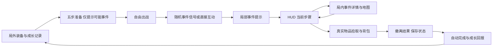
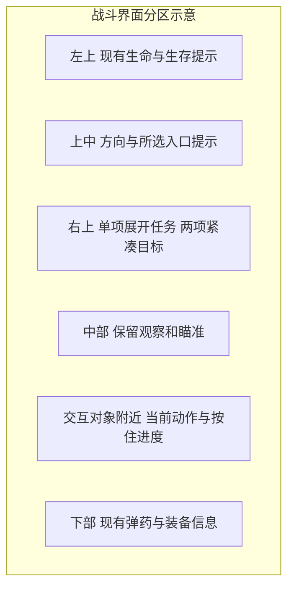
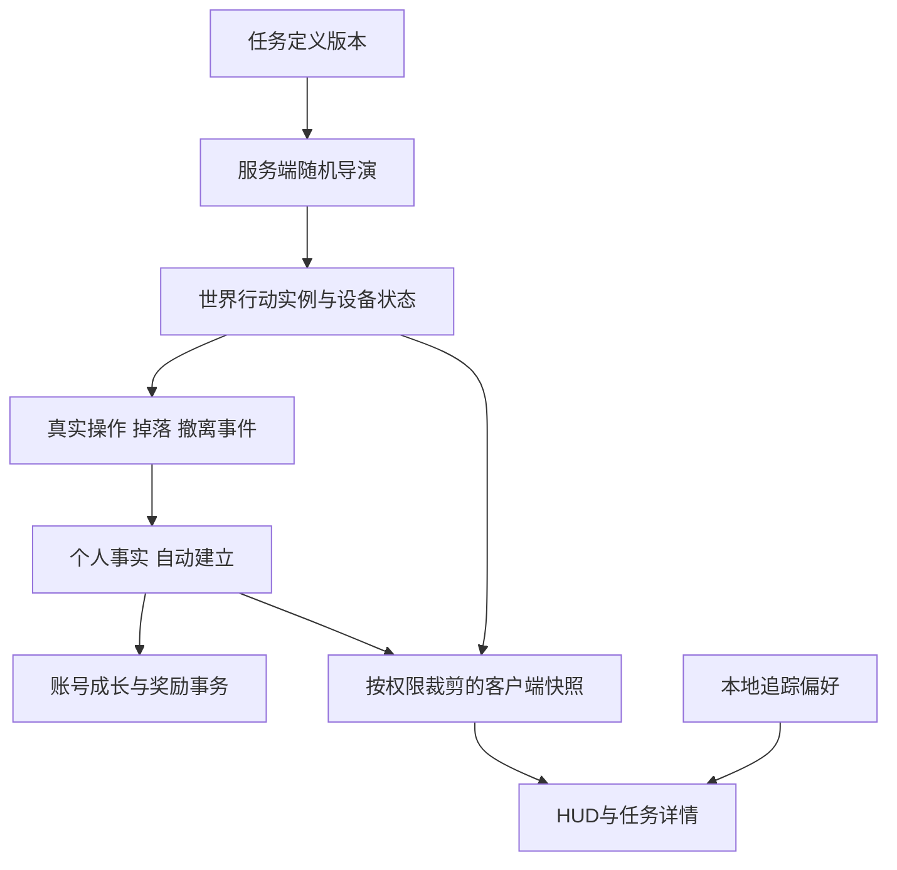
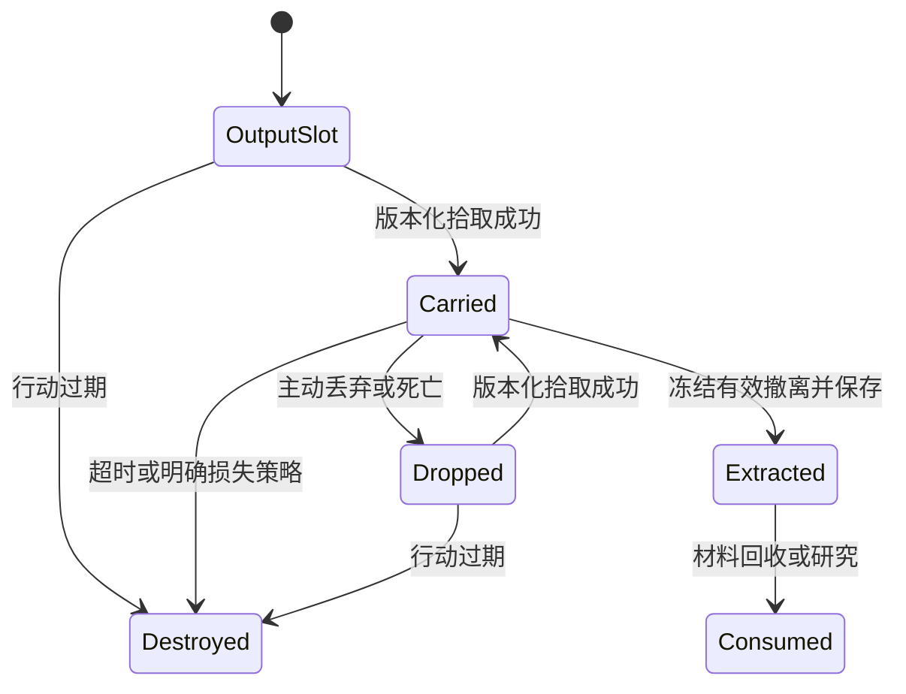

# 随机任务界面与后端规格

关联：`MS-030` 至 `MS-039`。与[总体规则](README.md)和[月核流程](MC00-Mooncore.md)一起评审。以下新增类型、接口、文件和配置均为拟议；本次没有实现运行代码。

## MS-030 界面总原则

**任务无需接取，流程必须具体。** UI 负责说明已经发生的事件与下一步操作，服务端负责承认所有真实有效行为。`Track/Untrack` 只保存本地显示偏好，不能改变任务状态、完成条件、掉落或奖励。

沿用现有 Unity UI Toolkit、PanelSettings、中文本地化和 UI 音效。固定结构放 UXML，样式放 USS，Presenter 绑定服务端快照；不改成网页/Canvas 框架，不把整屏设计图烘焙成不可编辑界面。

视觉延续当前深色表面、浅色正文、蓝色选择；危险使用已有危险色，完成使用图标与文字。世界物品保留自身色彩。功能文案、进度、按钮和错误必须是原生文本/控件。

### 全流程界面

## MS-031 各屏设计

### 1 局外成长与回收记录

接入现有管理终端的“行动”内容区，提供“回收记录 / 设施日志 / 材料用途”三种内容，不新增接任务大厅作为出战必经步骤。

左侧约 30% 为章节与已知事件类别，中间约 45% 为当前成长要求和历史完成记录，右侧约 25% 为材料用途与下次准备建议。1280 宽时右列折叠为详情页下方，不强压三栏。

- 成长卡显示“首次带回月核 · 未发现 / 已记录 / 已完成”，没有接取按钮。
- 已经提前满足条件的记录立即显示，不等玩家点开页面才计算。
- 材料回收/研究按钮明确展示将消耗的具体物品、数量和收益；它是物品事务，不改变任务是否生效。
- 未实现的高级任务不呈现为能点击但没反应的卡片；可在日志说明中作为故事线索出现。

### 2 现有五步出战准备

保留角色、地点、简报、回收、确认五步：

- **角色**：已有装备检查，增加“建议预留任务物品空间”；不给背包不足设置硬性出击门槛。
- **地点**：说明 MC00 可能出现设施异常/档案信号，显示已知建筑地形；没有本局事件精确位置。
- **简报**：讲清“事件局内随机出现，无须接取”“完成需要真实行动与撤离”；可查看已知事件流程，但不选定本局任务。
- **回收**：任务物品死亡可丢失、首次成长奖励自动到账、材料后续可研究；不混入未开放保险购买。
- **确认**：显示实际装备、携带物和局时。没有“未选任务无法出战”，原有 `m_Prepare` 仍是唯一最终部署动作。

### 3 局内随机事件提示

当玩家通过有效信号发现事件，右上角短条显示约 4 秒：“MC00 封存异常 · 两路备用电源待恢复”。只提供“固定追踪”或“稍后查看”，不暂停、不抢鼠标、不出现接受/拒绝弹窗。

只在第一次发现、阶段变化或重要失败时提示，同一 `EventId` 去重。直接操作设备时先显示当前实际步骤；自动补建参与记录不弹“已接任务”。正在战斗或处理危急氧气提示时，普通事件提示排队/缩短，不能盖过生存信息。

### 4 战斗 HUD

主任务区域位于右上，按现有弹药/生存/战报布局避让，中心瞄准区域保持清楚。1600×900 时主块建议宽 300–340、展开高不超过 180；1280×720 收缩到约 260，次目标默认折叠。字号优先复用现有 14–16 正文，在紧凑模式只减少次要信息，不压缩核心步骤到微型字。

主追踪内容最多四层：

1. **事件名**：MC00 · 封存样本。
2. **当前动作**：恢复备用供电 · 1/2。
3. **位置提示**：维修区 · 与当前层不同 · 直线 47 米。
4. **风险/结果**：启动后警报 45 秒；或“已持有碎片 · 尚未入库”。

取样运行时将动作替换为进度条与秒数，不同时堆出未来全部节点。玩家展开详情才看到完整流程。其他最多 2 个固定目标只显示名称与简短状态；未固定任务仍照常记录。

这只是信息分区，不是 Unity 已渲染界面。最终锚点以当前 `RaidHUD`/`InGameHUD` 实际占位和明暗背景检查为准。

### 5 世界标记与楼层引导

- 远处只显示已知建筑/入口，避免透视整楼机关。进入区域后才显示已揭示的关键设备。
- 未发现的事件不给全球精确坐标；追踪不得扩大服务器允许的信息范围。
- 场内关键电源标记结合设备状态灯、墙上编号和门牌，不能只靠悬浮光点。
- 遮挡后的标记降为边缘方向/区域，近处可交互物由真实射线选中。楼上/楼下用图标和文字同时表达。
- 不显示敌方携带者位置。自己丢失的碎片可显示最后已知位置与时间；只有再次被有效感知才更新。
- 每帧只投影少量已追踪标记，不扫描所有场景物体；距离文字约 4 Hz 更新。

### 6 局内事件详情与地图覆盖层

通过 Input System 独立的事件详情动作打开；默认键位实施前核对当前侧身、搜刮、背包和灯光输入，提示从实际绑定读取，不硬写 E/F。

左侧是已知区域示意和入口，右侧是事件状态、已完成节点、当前节点、风险、产出及个人结果。支持“固定追踪 / 取消追踪”，不提供接取或放弃。页面顶端常驻“未追踪的事件仍会记录成果”。

多人游戏中打开详情不暂停；进入页面后走现有 UI 输入控制，防止点击穿透开火。关闭时恢复之前焦点与瞄准输入；聊天、背包、交互长按的优先级由现有 UI 状态统一协调。

P0 先提供详情列表和建筑区域示意；完整战术地图覆盖层属于 P1，不能用装饰地图假称动态导航。

### 7 世界交互提示

提示必须覆盖真实状态：

- 可用：“按住〔实际绑定〕恢复配电 · 4 秒”。
- 前置未满足：“取样机未就绪 · 备用供电 1/2”。
- 已被操作：“配电已接通”。
- 等待服务器：“正在确认”，短时去重，不重复发启动。
- 打断：“操作已中断 · 移出范围 / 受到伤害”。
- 背包满：“需要 1×1 空位 · 碎片仍在输出槽”。
- 行动失效：“本次回收窗口已关闭”。

按钮/长按提示先发意图，服务端确认后才改变阶段。进度条可本地预估，必须被服务端校正；被拒绝不能仍播放完成音。

### 8 物品与结算

碎片详情显示名称、图标、来源设施、已入库/未入库、死亡后果和用途。来源序列号用于后端，不把 GUID 印满产品界面。档案盘显示“带回解锁设施日志”。

结算分三段：

- **行动事实**：供电已恢复；切割完成；实际带回碎片 1 枚。区分设施成功、个人回收、保存成功。
- **自动成长奖励**：首次回收完成，30 月尘，分析许可已保存；重复完成显示“首次奖励已领取”，不造假再次动画。
- **材料去向**：碎片已入仓库，可回收或保留研究。死亡则显示损失，不给假入库数字。

保存中显示“已撤离，正在保存”；失败重试保留结果，不能改成死亡。后端确认才播放到账反馈，已有重试继续阻止竞争同一库存的再次部署。

### 输入、可读性与无障碍

关键状态同时有文字/图形，动态进度用稳定数字，不强频闪。支持减少 HUD 动画与任务语音，不能静音任务后连设备交互提示也消失。键鼠/已有手柄导航都处理焦点、返回、滚动跟随；没有项目依据不新增触屏方案。

## MS-032 状态模型

严格区分四种对象，不能只用一个 `QuestState`：

1. `MissionDefinition`：版本化内容模板，包括具体流程和奖励策略。
2. `OperationInstance`：服务端随机生成的真实世界事件；共用设备和资源。
3. `PlayerMissionFact`：某个账号/部署的有效行为和结果；未发现、未追踪也可创建。
4. `AccountMilestone`：跨局保存的成长事实与已发奖励。

客户端另外保存 `Discovered`、`Pinned`、折叠状态。`Discovered` 是信息权限结果，`Pinned` 是显示偏好；均不是完成前置。模型中**不设置 `Accepted` 字段、Accept RPC 或接取时间条件**。

### 内容模板字段

`DefinitionId`、`DefinitionVersion`、`LocalizationKeys`、`MapTags`、`RegionTags`、`Weight`、`MinAudienceTimeLeft`、`ConcurrentClass`、`OfferLifetime`、`OperationLifetime`、`Cooldowns`、`AnchorRequirements`、`Objectives`、`SpawnBudget`、`VisibilityPolicy`、`RewardPolicyVersion`。

每个目标含 `ObjectiveId`、类型、前置 ID、完成数量、稳定设备/区域引用、交互时长、打断策略、进度作用域、是否必须成功撤离、信息揭示范围及失败恢复。配置校验拒绝循环依赖、重复 ID、无法到达前置、未定义图标和无对应服务器处理器的类型。

模板通过 ScriptableObject 作者化，导出纯 C# DTO/受控 JSON 供后端和离线规则消费；内容哈希随协议握手/部署记录保存。Shared 层不依赖 UI、场景对象和 `AssetDatabase`；不把运行时任意反射脚本放进配置。

### 世界行动字段

`WorldSessionId`、`OperationInstanceId`、`Epoch`、`DefinitionId/Version`、`Seed`、`LayoutVersion`、`AnchorIds`、阶段、节点状态、`OfferedAt`、`ActivatedAt`、`Deadline`、增援已消耗位、`Revision`、产出序列号与各自所有权状态。

设备组件只提供稳定 `AnchorId` 和作者引用，服务端 World 注册表持有权威状态。不能用场景遍历索引、Unity InstanceID 或个人 RaidId 代替跨消息稳定标识。Host 的 Server/Client World 不共享可写静态任务进度。

### 个人事实字段

`PlayerId`、`DeploymentId`、`OperationInstanceId`、节点 ID、服务端事件 ID、贡献类别、首次/末次有效时间、有效来源物品 ID、撤离结果、已持久化结果版本。禁止仅凭客户端面板上显示 100% 就创建事实。

参与者可迟加入；看见一台已完成机器不等于本人操作过。P0 回收任务最终由真实物品来源和成功撤离裁定，故没有任何供电贡献也能抢到物品完成；纯设施任务则由模板规定有效贡献，驻足路过不计贡献。

### 档案任务实例

档案流程与月核使用同一节点系统：`SelfCheck → ScanSet(2) → Download(20s) → Output(1) → Extract`。自检是实质校验前置，读入口说明不是前置。直接扫标签会登记事实；若自检尚未完成，设备提示已记录标签但等待自检，而不是吞掉早做的行为。

## MS-033 服务端事件与运行顺序

事件来源只允许权威逻辑：互动验证、设备运行、库存提交、伤害/击杀、死亡掉落、撤离冻结。UI 只订阅结果。

同一 tick 的裁决顺序约定为：生命伤害/死亡 → 取消失效交互 → 有效互动与设备推进 → 库存转移 → 行动截止清理 → 对仍存活且有效者撤离冻结 → 生成快照。死亡与撤离同 tick 默认死亡优先；截止与撤离同 tick 默认截止优先。把该顺序写成明确规则，避免两端各自猜测。

输入先解析请求再在此顺序提交效果；验证和完成之间再次检查存活、范围、视线和 epoch。共享设备只锁必要操作，断线释放；不可跨 HTTP 请求持有 ECS 引用。异步持久化仅处理 DTO，返回主线程后再更新 World 状态。

随机导演按 30 秒节奏评估，设备定时器按已有服务器更新推进。仅活跃交互做短周期范围检查；空闲任务无每节点 MonoBehaviour Update，不每帧全场 `FindObjects`。有限 NPC 增援通过现有调度器申请。

## MS-034 RPC 与客户端同步

复用 NetCode 可靠定向 RPC，不新开 WebSocket。拟议消息：

- `MissionInteractRpc`：个人 `RaidId`、`OperationInstanceId`、`Epoch`、`ObjectiveId`、`AnchorId`、`RequestId`、动作开始/取消；连接决定账号，客户端不提交任意 PlayerId。
- `MissionInteractionResultRpc`：请求 ID、确认/拒绝原因、服务器 tick、交互状态；重复请求返回同一结果，不重复执行。
- `MissionSnapshotRpc`：世界会话、个人部署、快照序号、已知实例、节点进度、截止时间、个人事实、保存状态。
- `MissionResyncRpc`：请求自己有权限的完整当前快照，受频率限制，不能按任意实例 ID读取隐藏事件。
- Pinned 状态只在客户端保存；跨设备同步若后续需要，也独立于任务权威事务。

快照发现/变更时发送；活跃进度最多沿用当前局状态约 4 Hz，空闲不全量重复。可靠事件去重，客户端以服务器计时平滑进度；客户端显示到 45 秒不自行产出物品。

消息包含 `WorldSessionId + OperationInstanceId + Epoch + Revision`。旧部署、旧行动、旧 revision 丢弃；发现序列缺口请求当前快照。迟加入先拿有权限的基线，再消费增量。对离场连接不继续推事件。

不能把任意长任务列表塞进现有 `RaidSnapshotRpc`。新增有界传输，单消息保持当前项目约 1378 字节传输预算内的保守余量；大基线使用序号、分片数、长度上限和超时重组，完整校验后才暴露给 UI。复用现有库存分片思路，勿把半份状态呈现为任务完成。

隐私裁剪在服务器做：未发现玩家只接收其能感知的粗略事件，不能先发所有精确点位再让 UI 隐藏。不下发敌方背包、携带者位置或任务随机种子的可利用细节。

## MS-035 物品所有权与来源

月核碎片和档案盘接入 `InventoryCatalog`、库存图、死亡掉落、仓库、物品说明、图标与后端共享源码。新增不可篡改来源元数据：物品唯一 ID、来源世界/行动、定义版本、批次序号、产出 tick、取得/撤出部署、是否紧急补给、来源是否失效。

服务器维护每批唯一产物注册表：

一个序列号只能有一个所有者/终态。转移同时修改容器与背包版本，失败不修改任何一方。材料回收、出售、研究对同一库存加锁并比较版本，不能各自成功一次。已撤出记录保留为 tombstone，不随场景设备重置删掉。

任务完成不强制销毁 M02 首次回收物；其重复出售/研究由实体消耗控制。首次事实奖励用账号唯一键控制，不能用“背包里有两枚”发两次。

## MS-036 后端存储与事务

继续扩展 `Backend/MoonPersistence` 和现有数据库；不为任务新增独立微服务。实时机器/交互留在 Unity 服务器，数据库保存账号事实、奖励及可靠结果；不把每一帧设备进度写数据库。

拟议新增表：

- `mission_content_versions`：允许的内容版本与哈希、奖励策略、兼容状态。
- `mission_deployment_manifests`：部署 ID、账号、服务器会话、允许内容版本。它是参与任何事件的通用版本凭证，不是接取清单。
- `mission_results`：唯一 `(operation_id, deployment_id, result_kind)`，保存服务端提交的结果摘要与 payload hash。
- `account_mission_facts`：唯一 `(player_id, fact_key, fact_scope)`，保存首次回收/扫描等有效事实及完成计数。
- `mission_reward_receipts`：唯一奖励键与请求哈希，阻止首次奖励重发。
- `mission_artifact_receipts`：产物序列号、来源、撤出/消耗状态，阻止跨结算重复入库。
- P1 `pending_reward_grants`：需要领取的物品奖励 entitlement；P0 只有货币/许可时不建立空奖励仓库。

### 接口与现有入口

拟议 `GET /auth/missions` 读取个人事实、已知事件档案、成长与奖励记录；拟议 `POST /auth/missions/recycle` 执行材料回收，携带 `RequestId + ExpectedInventoryVersion + ItemIds`。没有 accept/abandon/complete 客户端接口。

实时交互仍走 NetCode。扩展现有 `/internal/deployments` 的内容版本凭证，以及 `/internal/settlements` 的版本化任务结果、物品来源和奖励输入；沿用服务器专用凭据。客户端不得通过 HTTP提交“我完成了 MC00”。

后端信任当前授权游戏服务器的实时裁决，同时检查部署归属、内容版本、合法结果、来源唯一性和奖励上限。Host 控制的本地服务器不能提供等同托管服的抗作弊保证；离线成果不自动合并在线账号。

### 一次原子结算

1. 验证服务器身份和开放部署，按既有账号库存锁顺序取得锁。
2. 查询 `SettlementId` 及 payload hash：相同 ID/相同载荷返回原回执；同 ID 不同载荷返回冲突。
3. 验证任务结果绑定本部署、合法世界实例/物品来源，以及定义版本允许的奖励策略。
4. 按既有撤离结果处理库存；仅有效撤出的产物登记入库唯一回执。死亡不保存任务物资收益。
5. 更新有效个人事实，计算当前及此前已满足前置的首次里程碑；不查询接取、发现或追踪状态。
6. 在同一事务发月尘/许可、增加必要版本、写奖励回执与结算回执，关闭部署并提交。
7. 提交成功后才返回档案/库存/任务新快照；任何一步失败全部回滚。

不要先存仓库、再发一次独立 HTTP 奖励：那会在网络中断后制造只拿到一半成果或重复发奖。重试必须发送原始冻结 payload，不能重新读取已经变化的背包拼装同一个结算 ID。

首次奖励键例如 `player:M02:first-recovery`；重复材料回收键为 `player:source-deployment:mooncore-recycle`，同来源部署最多一枚。定义换版本不自动生成新的首次奖励键；奖励更改是否追补需显式迁移策略。

## MS-037 崩溃、离线与兼容

### Outbox

扩展 `RaidPersistenceContext` 现有结算 outbox，将库存与任务结果冻结为同一版本化记录，原子写入后重试。服务重启加载后按原结算 ID 提交；不得因没有在线连接就丢弃已确认撤离成果。界面保留 `Saving/Retrying`，恢复时刷新状态。

内存机器进度不承诺崩溃恢复。服务器重启产生新的 `WorldSessionId`，关闭/核对旧开放部署；已保存 outbox 与后端回执先完成恢复，再开放冲突账号出战。未冻结成功的战利品按明确损失政策处理，不凭客户端截图补偿。

### 离线

`OfflineProfileStore` 使用同一纯规则、同一来源和奖励唯一键；扩展档案 schema，保留现有临时文件/原子替换/备份/待结算恢复机制。离线可完整体验随机流程，内容 seed 与在线算法一致，但账号与奖励账本隔离。

### 迁移与能力握手

- 旧档新增空事实集；已有真实任务来源回执可一次性迁移，不能按普通 `quantum_core` 物品推断月核完成。
- 协议、档案与内容版本分别管理。服务健康能力拟新增 `missions-v1`；缺能力时任务入口不进入生成池，客户端显示版本不兼容而非照常完成后丢奖励。
- 部署固定内容哈希；未知定义或不支持奖励策略拒绝创建新实例，不影响已保存回执读取。
- 坏配置停用对应模板，不扩大到全图任务服务；已有运行实例继续使用自己的冻结版本。

## MS-038 实现拆分与资源交付

以下为建议提交顺序，不是本轮已经发生的实现，也不承诺具体天数：

1. **共享规则与内容**：任务定义、状态迁移、无接取事实模型、月核/档案模板与静态校验。
2. **随机导演**：权重、合格区域、时间余量、冷却、并发、固定种子回放；无合格候选安全退让。
3. **正式地图锚点**：定位、配电、取样、档案标签与输出槽；实际站位、碰撞、楼层和退路记录。
4. **权威互动与物品**：设备 RPC、计时、唯一产物、背包满、死亡和过期清理；接现有库存事务。
5. **持久化**：在线 schema/事务、outbox、离线迁移、首次奖励与材料回收。
6. **UI Toolkit**：随机事件提示、HUD、详情、结算、成长页面，沿用五步准备与现有输入。
7. **艺术与音频**：设备状态、取样动作、碎片/档案图标与世界表现、有限声效；明确缺失资产。
8. **闭环检查**：先规则/存档，再受影响双端与正式地图路线；失败才扩大检查。

拟议路径：

- `Assets/Scripts/Networking/Shared/Missions/`：纯规则、DTO、内容导出结构。
- `Assets/Scripts/Networking/Server/ServerGameSystem.Missions.cs`：服务器事件接入。
- `Assets/Scripts/Gameplay/Missions/`：设备作者组件、锚点、表现与导演配置。
- `Assets/Scripts/Networking/Client/MissionClientSystem.cs`：受序号保护的快照消费。
- `Assets/Scripts/UI/Game/Missions/` 与 `Assets/Resources/Moonkov/UI/Missions/`：Presenter、UXML/USS。
- `Assets/Resources/Moonkov/Missions/`：内容资产；图标进入项目已有图标体系。
- `Backend/MoonPersistence/InventoryRepository.Missions.cs`：与现有库存锁和事务共用的任务逻辑。

这些路径落地前须核对 asmdef 依赖，不能因目录方便让 Shared 引入客户端程序集。只修改正式场景，避免创建另一个“任务演示地图”替代实际接入。

## MS-039 最小必要验证用例

### 规则与后端

- 完全不打开任务 UI，直接操作并撤离，与已追踪路径得到相同完成与奖励。
- 先扫档案标签再读说明，已做进度保留；取消追踪后继续完成有效。
- 两个固定种子覆盖月核/档案选择；不合格点被排除；冷却与并发不突破；晚入场不刷无法完成的新大型事件。
- 重复互动、错部署、错 epoch、阶段跳跃、伪造客户端物品均被拒绝。
- 相同产物并发拾取仅一人成功；死亡转移不复制；过期与撤离边界按既定顺序裁决。
- 同结算重试返回原结果；不同载荷冲突；首次奖励跨两次部署只发一次；碎片不会同时出售与研究。
- 任务/库存/奖励事务人为失败时全部回滚；重启从原 outbox 恢复，在线和离线语义一致。

### Unity 与实际路线

- 编译与资源导入；只检查此次新增设备/图标/字体/场景引用。
- Host + 第二客户端走一次争抢、死亡转移、迟加入与个人再次出战不重置设施。
- 正式 MC00 单人走完整流程；验证 600 秒中的返回余量、真实门洞、楼层提示和警报叠加原有威胁。
- 只看两种有风险的尺寸与状态：中文长目标、任务物品满格、保存重试、自动奖励、设备忙碌；不重复截图同一正常状态。
- 新增任务预算与既有异形/PMC 并发上限同时生效；观测一次代表性切割过程，出现超限或帧时间异常才进一步分析。

通过后停止本轮验证。文档静态检查、规则测试、UDP 双端、正式角色 Play 和目标设备帧率是不同证据，不相互替代。
