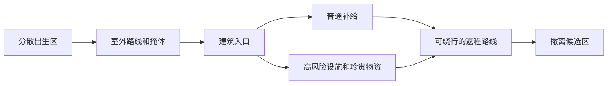

# Theophilus 局内地图需求

状态：待转交 DOT。本文是玩法和验收要求，不是已完成的地图设计。建筑模型和最终布局由 DOT 处理。本次没有修改地图几何或场景坐标。

## 要解决的问题

玩家需要在有限时间内选择路线、争夺物资、避开或处理敌人，再承担带物撤离的风险。建筑是搜刮、交火和绕行的场所。第一章设施使用已有锚点，不在建筑定稿前扩写剧情。

当前正式场景的 8 个玩家出生点位于同一片区域。它们到唯一撤离点的水平直线距离约为 14–24 米。普通战局时限为 600 秒，撤离需要 8 秒。附近玩家可能很快碰面，也可以很快原路离场。

正式场景有 61 个固定补给点。以一次单人测试中 17.85 公斤负重的实测冲刺速度 5.34 米/秒估算，从最近出生点经过补给点再到撤离点，水平直线路程超过 3161 米的有 26 个。这里已经假设全程匀速冲刺，且没有计算地形、体力恢复、搜索和交火。远处可通过不同速度、增益或后续撤离点改变结果，不能把这个估算当成实机可达性测试。

直线估算超限的补给点序号为 13、14、15、16、17、18、19、20、21、25、26、27、33、40、41、47、48、53、54、55、56、57、58、59、60、61。序号从 1 开始，对应 `MoonRaidMap.m_LootPositions` 的数组顺序。

《逃离塔科夫》使用多个撤离点，具体可用点会随出生位置等条件变化。可借鉴它让玩家选择路线和承担风险的做法，不照搬地图造型或现成坐标。参考[游玩说明的撤离规则](https://escapefromtarkov.fandom.com/wiki/How_to_Play_Guide_for_Escape_from_Tarkov)。

## DOT 需要交付的玩法布局

- 在计划开放的活动区内分散出生候选点。检查出生后立即被其他出生点直视、被堵在死角，或过近进入撤离区的情况。
- 为主要建筑提供至少两条可理解的接近路线和离开路线。两条路线可以汇合，但不应被同一个狭窄门口完全封死。近处交火有可用掩体，也有撤退空间。
- 把低风险基础补给和高风险高价值物资放在不同位置。珍贵物资应使玩家决定是否继续深入，而不是保证每次获得。保留空容器的可能。
- 给撤离候选区留出清晰的进入方向、可观察的接近路线和适量遮蔽。避免出生点和撤离候选区集中在同一个小区域。保证至少一条可由单人完成的路线。
- 配电、取样和室内抽屉周围留出交互站位。物品前方不能被碰撞体挡住。抽屉需要从玩家和人形敌人的可行走位置看见、接近和搜索。
- 标出可以成为有效掩体的墙面与物件。装饰物不能让视觉上可穿过的空隙变成隐形墙。楼梯、门洞、层间落差和绕路应支持实际角色移动与敌人导航。
- 交付建筑碰撞、可行走区域、主要路线和候选出生／撤离锚点。使用语义名称，附带场景坐标和朝向。保留 `entry`、`power_a`、`power_b`、`sampler` 及现有撤离锚点的绑定或提供明确替换关系。

## 接入边界

当前运行时只支持一个普通战局撤离位置。多个撤离点、出生点与撤离点的分配、开放条件和地图提示都需要另行接入和测试。不能只在地图里摆标记，就宣称多撤离已完成。

当前第一章的教学出生点、供电和取样流程依赖既有锚点。保留单人可完成的教学路线。设施的两路供电可以顺序完成；取样区要有掩体和撤离路径。任务产物仍由服务器生成，死亡会掉落，成功撤离后才记录。

## 验收

1. 使用正常出装，在真实场景从多个出生点走到基础物资区和设施，再走到可用撤离点。分别记录行走、搜索、短交火、治疗和 8 秒撤离所需时间。不能用直线距离代替路线测试。
2. 实测每条入口和返程路线。检查碰撞、坡度、门洞、视线、抽屉交互及人形敌人寻路。至少验证一条受阻后的替代路线。
3. 用真实箱子和抽屉验证共享物资：玩家搜刮、敌人争夺、敌人死亡后取回，以及成功撤离后的保存。
4. 检查出生点互相视线、撤离区附近露头和掩体。没有试玩前，不认定遭遇密度或物资收益已经平衡。
5. 在目标设备检查地图导航生成、碰撞查询、灯光和敌人数量对性能的影响。记录场景版本、硬件和实测条件。

计算依据为 `Assets/MoonEnvironment/Variants/TheophilusBase/Scenes/TheophilusGameScene.unity` 和 `TheophilusSpawnPointsSubScene.unity`。实际路径与地图设计仍需 DOT 和 Unity 编辑器验证。
