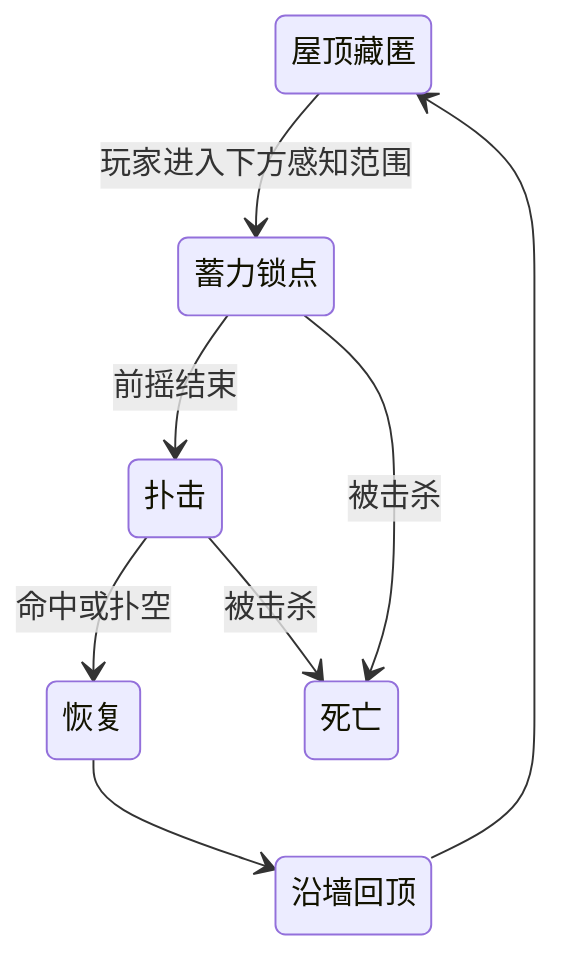
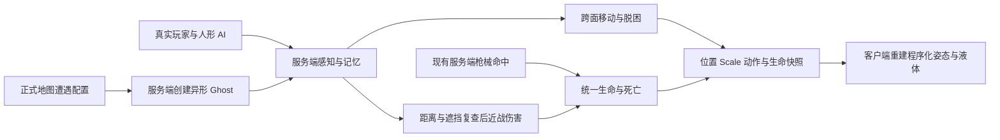

# 正式地图的程序化异形敌人

当前正式入口是 `TheophilusGameScene`，其中 `AlienEncounterSettings` 注册蜘蛛、蛇、毛毛虫、触手兽、蜈蚣、水蛭、黏液兽、根须与独立抱脸虫九种异形。Apollo12 保留历史配置。正式预制体不添加实验输入和摄像机，已有 DollSinger / PMC 敌人继续使用原服务端 AI。

## 2026-10-18：解剖、异形食物与局外光环研究

异形尸体按 **E** 解剖，服务端计时 6 秒。移动超过 0.75 米、失去距离／视线、受伤、死亡或结束战局会中断；关闭背包可主动取消。完成前不会发送尸体物品，也不接受转移。每具尸体只生成一份共享战利品，多人解剖不会重复抽取；完成后再次搜索直接打开。无需额外刀具。

当前共有 **13 类异形掉落物**：4 类通用物品与 9 类专属器官。普通异形掉落 1 份组织、1–2 份生肉、1 个本物种器官，并有 12% 概率额外掉落稀有神经器官；Boss 掉落 5 份组织、4 份生肉、1 个首领核心、1 个稀有神经器官和 1 个本物种器官。

战利品直接创建为尸体容器，不再借用人类四个口袋生成，Boss 的五类掉落可同时容纳。专属器官均可局内食用、存放或出售，指定器官用于不同局外研究。

| 物种 | 专属器官 | 完整食用效果 |
|---|---|---|
| 蜘蛛 | 蜘蛛丝腺 | 持续 60 秒：光环散布降低 40%；能量 +5，水分 -15。会替换其他物种器官的活性效果。 |
| 蛇 | 蛇肾上腺 | 持续 45 秒：移动速度提高 15%，水分消耗提高 50%；能量 +10，水分 -10。会替换其他物种器官的活性效果。 |
| 毛毛虫 | 毛毛虫营养囊 | 能量 +60，最多恢复 10 点生命，水分 -5，饱腹 +45。适合长时间探索的高饱腹食物。 |
| 触手兽 | 触手兽收缩心脏 | 持续 45 秒：光环伤害提高 40%，移动速度降低 15%；能量 +10，水分 -15。会替换其他物种器官的活性效果。 |
| 蜈蚣 | 蜈蚣毒腺 | 持续 45 秒：光环伤害提高 35%，每秒因中毒损失 0.6 点生命，可能致死；能量 +5，水分 -10。会替换其他物种器官的活性效果。 |
| 水蛭 | 水蛭再生囊 | 持续 60 秒：每秒恢复 1 点存活组织生命，能量消耗提高 50%；能量 +5，水分 -10。会替换其他物种器官的活性效果。 |
| 黏液兽 | 黏液兽胶质囊 | 持续 45 秒：受到的战斗伤害降低 25%，移动速度降低 20%；能量 +5，水分 -10。会替换其他物种器官的活性效果。 |
| 根须 | 根须氧储瘤 | 持续 90 秒：宇航服耗氧降低 25%，移动速度降低 10%；能量 +15，水分 -10。会替换其他物种器官的活性效果。 |
| 抱脸虫 | 抱脸虫神经节 | 持续 45 秒：开火间隔缩短 20%，散布降低 30%，水分消耗提高 75%；能量 +5，水分 -15。会替换其他物种器官的活性效果。 |

同一时间仅保留一种专属器官活性，食用另一种会替换，重复食用刷新时长。原有稀有神经器官的 60 秒光环伤害 +30% 独立计时；生肉仍恢复最多 20 生命、35 能量，水分 -20、饱腹 +30。再生不修复坏死部位。中毒、再生及资源消耗由服务器结算，活性与剩余时间写入 Ghost 状态；多人争抢和食用重放仍由服务器裁定。

撤离后将材料移至个人仓库，在补给商 **光环研究** 页选择独立分支。效果覆盖现有及未来的步枪、霰弹、左轮与狙击光环，不占配件槽，死亡后保留：

| 分支 | 消耗材料 | 永久收益 |
|---|---|---|
| 异形生物火力研究 | 稀有异形神经器官 ×3、封装异形组织 ×5 | 所有光环伤害永久提高 60%，死亡后保留。 |
| 异形生物蓄能研究 | 毛毛虫营养囊 ×2、黏液兽胶质囊 ×2、触手兽收缩心脏 ×1 | 所有光环弹容量永久提高 40%。升级不会凭空补充弹药。 |
| 异形生物充能研究 | 蛇肾上腺 ×2、根须氧储瘤 ×1、封装异形组织 ×5 | 所有光环充能时间永久缩短 25%。 |
| 异形生物稳定性研究 | 蜘蛛丝腺 ×2、抱脸虫神经节 ×2、封装异形组织 ×5 | 所有光环散布永久降低 30%，操控惩罚减轻 15%。 |

永久状态存于账号库存 JSON：`HaloResearchLevel` 保留原火力研究，`HaloResearchBranches` 保存三个新增分支。旧存档新增位默认为 0，已完成的 +60% 火力不会重置；出战复制研究，战利品与归还库存不能覆盖账号研究。复用商店版本校验、幂等请求、活动战局锁和离线／数据库事务，无需数据库表结构迁移。

光环与弹丸的模块字段扩为 16 位以携带研究和器官活性，**联机服务器和客户端须使用同版构建**。九种器官有独立轮廓图标及中文说明；健康页显示活性与剩余秒数，光环显示活性类别及研究层。

定向规则检查通过 103 项、双账号 HTTP／数据库检查通过 49 项、真实双客户端 UDP 检查通过 16 项。规则入口为 `Tools → Moonkov → Aliens → Check dissection food and permanent research`；联机入口见 `Docs/PostgreSQLPersistence.md`。这些检查不代替正式地图 Play、角色 Ghost 的实际画面或跨设备验收。

## 2026-10-18：物种攻击、屋顶伏击与 Boss

局内不绘制圆圈、扇形或冲撞走廊等攻击范围线。前摇通过已有身体姿态和蓄力声传达；攻击生效时保留实际地刺、酸液与砸击残留，液体使用不规则轮廓与受光材质，不以规则圆形标出精确判定半径。

所有攻击由服务端推进前摇、有效阶段和恢复；客户端根据 Ghost 中的攻击类型、锁定点、方向、阶段和时间重建姿态与危险区域。前摇开始后不追踪修改落点。攻击期间死亡会中断后续伤害；多肢体命中不重复结算同一轮伤害。

| 物种 | 战斗职责与攻击 | 玩家反制 |
|---|---|---|
| 蜘蛛 | 优先从屋顶/天花板藏身点等待，锁定玩家位置后向下扑击；扑空或命中后优先沿墙回顶 | 听到蓄力后侧移，利用扑空与回顶过程射击 |
| 蛇 | 短距离直线突进撕咬，一次出招对每目标最多命中一次 | 横向避开锁定方向 |
| 毛毛虫 | 在锁定的酸液落点产生三次范围伤害 | 观察吐酸动作，避开落地酸液 |
| 蜈蚣 | 长距离冲撞，扫过路径上的多个目标，各命中一次 | 离开冲撞走廊，别沿冲撞方向后退 |
| 水蛭 | 近距离对同一目标连续吸血三次，将实际伤害的 50% 转为自身生命；不再抱脸 | 前摇时拉开距离，打断其吸血机会 |
| 抱脸虫 | 独立的第九物种，低矮爬行后蓄力起跳，命中头部后附着，默认 2.4 秒后松脱 | 躲开起跳；附着后可由队友射击其腹部或抓握肢体 |
| 黏液兽 | 身体周围连续三次范围脉冲 | 在前摇期间拉开距离 |
| 触手兽 Boss | 900 生命、较大体型；主动接近，前方扇形横扫与锁点砸击交替 | 观察触手蓄力和抬起方向，利用出招后的恢复窗口 |
| 根须 Boss | 1200 生命、固定区域防守；在三个分离地块爆发突刺，保留中间通道 | 观察根须蓄力，移动避开地刺并选择间隙接近/撤离 |

两个 Boss 在半血后进入第二阶段：前摇和恢复略缩短，触手兽增加反向横扫或第二次砸击，根须增加突刺轮次。一个 Boss 遭遇每张地图只生成一次。`AlienCreatureProfile.Boss`、`EnrageHealthFraction`、`FaceAttachSeconds` 可以调节；Boss 参数由 `Tools → Moonkov → Aliens → Configure species and boss roles` 设置。

抱脸虫使用独立的程序化身体：扁平腹部贴住面部，八根关节肢从脸前扣到后脑，细长尾巴绕住颈部。行走时肢体使用实际接触落脚点，起跳时收拢再展开。它的附着对象是服务端选择的 Ghost Entity，同一目标最多附着一只。客户端使用映射后的目标姿态跟随本地头部，组织命中体沿相同的抓握曲线布置。目标死亡、目标消失、时间结束或头部空间被世界碰撞占据时松脱；抱脸虫死亡同样立即结束附着。附着不会修改玩家输入、相机旋转或永久移动状态。

### MC00 小型遭遇与路径

正式地图 MC00 一层北侧走廊的 G02/G03 各配置一只顶面蜘蛛。普通蜘蛛槽也优先寻找头顶的真实支撑面，没有屋顶时延后生成。`Set up MC00 spider ambush` 对选定建筑局部范围采样实际碰撞，生成可搜索的支撑面图；路线由 A* 选择，未写死一条伏击运动轨迹。当前图含 1828 节点、4734 连边，采样间距 1.10 m。局部图覆盖此段遭遇，其余地图仍使用已有局部表面移动。

连接检查身体净空、连续支撑和转角圆弧；运行时定期复查下一段，阻挡或不可达时停止并重新规划。沿墙回顶优先选择相连、可观测目标的天花板节点。场景碰撞或建筑位置改变后需重新采样。现有客户端远距离姿态降频和最近两个液体预算继续使用。

同一区域另有两处地面抱脸虫遭遇。`Tools → Moonkov → Aliens → Set up dedicated face parasite` 注册其独立 Profile、Ghost 预制体、Addressables 和正式地图刷新槽。

### 搜取收益

普通异形死亡掉落 1 份「封装异形组织」，Boss 掉落 5 份组织与 1 个「异形首领核心」。它们复用原有死亡袋的服务端库存、距离校验、多人搜取、撤离保存与出售流程。组织售价 8 月尘，核心售价 65 月尘，均为仅出售物品。异形残骸使用独立组织外观，`CharacterIndex=-1`，不会生成一具人形尸体；同一死亡仅掉落一次。

### 本轮验证边界

- Unity Editor 编译通过；原有非蜘蛛攻击的隔离服务器检查通过，包括冲撞双目标、酸液/黏液三次脉冲、根须锁点可躲避和两个 Boss 的半血阶段。
- 抱脸拆分后的定向检查通过：水蛭造成近距离伤害并回血、保持未附着；独立抱脸虫起跳命中、跟随移动头部并在目标死亡后松脱。附着造型已离屏渲染检查，预览图如上；入口为 `AlienEnemyChecks.RunFaceSeparationContract()`。
- 触手兽横扫/砸击交替、一次性 Boss 战利品、库存编码解码和客户端异形残骸记录接收通过。
- 正式 MC00 的走廊进 G02、地面经墙回顶两条路径通过真实碰撞 motor 检查；隔离服务器中的顶面蜘蛛完成向下扑击、一次命中及回顶。
- 检查入口：`Check species attacks bosses and face attachment`、`Check MC00 doorway and roof routes`。结果在 `Library/BuildValidation/AlienIntegration/`。
- 上述为 Editor 与隔离 World 证据。真实 Host + 第二客户端、迟加入、第一人称抱脸遮挡、音效体验、完整战局和目标机器性能尚未验收；客户端与服务器需使用同版新 Ghost 布局。

## 两类敌人与目标规则

人形玩家敌人使用已有 `DollSingerEnemySystem`，保留搜刮、战斗、撤退和撤离行为。异形使用 `ProceduralAlienEnemy`：巡游、发现目标、追击、搜索最后感知位置、攻击前摇、扑击、恢复和死亡。枪声只提供带误差的搜索位置；失去视线后使用有限时长记忆。近战结算再次检查目标存活、实际命中体距离和遮挡。

异形只接受同一服务端 World 中有 `PlayerGhost` 的存活目标，包括真实玩家、模板人形角色和 PMC；带异形状态的实体明确排除，不按名字、外观或负 NetworkId 猜阵营。PMC 能识别异形的实际体积位置，并保存其瞄准偏移，避免向不存在的人形胸口开枪。

## 物种体型层次

本轮调整的五种普通异形，其正式 Profile 与新建 Profile 的默认尺寸保持一致。使用同一个 Scale 同步身体、肢体、移动碰撞、组织命中体、生成净空和攻击范围；根 Transform 保持单位缩放。

| 物种 | Scale | 体型定位 |
|---|---:|---|
| 水蛭 | 0.22 | 小型地面吸血生物，基础链长约 0.62 m（原为 1.82 m） |
| 蛇 | 0.40 | 细长中型生物，基础链长约 1.84 m |
| 蜘蛛 | 0.45 | 保持现有顶面伏击尺寸与已烘焙路径 |
| 抱脸虫 | 0.45 | 保持可抓握人头的独立身体尺寸 |
| 毛毛虫 | 0.55 | 中型厚身生物，基础链长约 1.60 m |
| 黏液兽 | 0.80 | 较宽的地面压迫型生物 |
| 蜈蚣 | 0.85 | 大型长身冲撞生物，基础链长约 3.74 m |
| 触手兽 Boss | 1.10 | 保持大型主动追击首领 |
| 根须 Boss | 1.20 | 保持大型区域封锁首领 |

链长是 Profile.Chain.length × Scale 的基础长度，实际弯曲姿态与肢体外廓会变化，不把不同骨架的相同 Scale 当作相同体长。此次保存资产时补偿 Speed 参数，保持原有世界移动速度；小水蛭仍需实际接近目标才能吸血。检查入口 `Check authored species sizes in combat` 使用正式 Profile 的体型和速度，验证五种已调整敌人的攻击命中与水蛭回血。本轮检查通过：水蛭吸血 3 次且回血、蛇命中 1 次、毛毛虫酸液 3 次、蜈蚣冲撞命中 2 个目标、黏液脉冲 3 次。未将此检查视作真实多人或第一人称体验验收。

## 手动调节 Scale

打开 `Assets/AlienCreatures/Profiles/`，选择对应物种资产，调整 **Scale**。它是统一尺寸倍率，范围 0.1–4；可在 Edit Mode 保存，也可在运行时临时调节。服务端应用修改并把 Scale 写入 Ghost 状态，客户端接收后重建当前身体。

Scale 同时影响体长、粗细、头部、触手 / 足的尺寸、身体移动碰撞半径、地面高度、跨面转弯尺寸、服务端命中体和近战伸展范围。移动速度和扑击速度使用基础参数乘 Scale，因此小体型不会保留巨大体型的步幅速度。感知距离和伤害有独立参数。

程序化身体已经输出世界尺寸，网络根对象保持单位 Transform Scale，避免再乘一次尺寸。请使用 Profile 的 **Scale**，不要同时修改生成对象根 Transform 的缩放。液体保持标准粒子采样和体积网格，在缩放后的坐标框架内渲染，缩小模型时不按比例删除细节粒子；黏度、拉丝和相对沉降风格保持模型空间参数。

每种资产还暴露生命、速度、转向、视距、听觉范围、记忆时长、巡游半径、伤害、攻击距离、前摇、恢复、冷却和扑击速度，以及原有身体 / 步态 / 液态参数。尺寸倍率变化会重建引导与命中体，不重置实体生命、目标、冷却或服务器身份。

Scale、战斗参数和液态材质 / 解算参数可以运行时调整；其他体形 / 拓扑参数在生成身体时读取，修改后需重生该怪或重新进局。默认基础速度已经按初始 Scale 换算，保持各物种原实验的实际移动速度。

## 遭遇、武器与性能

正式场景的 `Moon Raid` 对象上，`AlienEncounterSettings` 控制异形刷新。原有八种物种与新增抱脸虫使用各自独立的遭遇槽；每槽的 `Position` 与新增 `CandidatePositions` 都是世界坐标候选锚点。服务端轮换候选，并在锚点附近做有限半径搜索；新地图会随机选择起始槽位和候选，降低活体上限也不会截掉后面的物种。

默认同时最多 8 只、整个地图生命周期最多生成 24 只、每槽最多生成 3 次，每秒最多创建 2 只。首次等待 3 秒，检测到死亡或 Ghost 消失后等待 90–115 秒再补充；失败候选等待 8 秒再试，不消耗预算。预算与已用次数在地图切换或服务器 World 结束时重置，玩家反复部署或全员临时离线不会重置同一地图的预算。`maximumAliens`、`maximumTotalSpawns`、`spawnsPerEncounter`、`respawnDelay` 与 `respawnDelayJitter` 可独立调整；实际场景配置可覆盖默认值。

仅真实存活玩家进入默认 240 m 激活范围才尝试生成；靠近玩家、玩家当前视野内无遮挡、无地面、斜坡过陡、身体空间被占据或身体跨越断崖时会延后。其他活体也保留最小间距，防止同次生成互相重叠。接地高度和身体检查随 Profile.Scale 变化，长身体沿尾部检查，触手与蜘蛛检查周围落脚空间。所有物理搜索都有尝试上限；无法安全生成时保留等待状态。地图卸载时清理活体与仍保留的死亡 Ghost。

九个预制体通过现有 `GhostPrefabsAuthoring` 和 Addressables 注册，均为服务端控制的插值 Ghost。它们复用现有 `PredictedPlayerGhost` 的生命字段，因此现有 hitscan、弹丸和范围攻击继续经服务端命中处理；没有添加玩家输入或玩家移动组件。身体与肢体的命中体在服务端使用 `ServerPlayer` 层，客户端使用 `ClientPlayer` 层，命中反馈按肉体分类。死亡停止攻击、生成一次可搜取的组织残骸，短暂保留姿态后由服务端销毁。

服务端不创建材质、渲染网格或 GPU 液体；只解接触、姿态和命中体。客户端默认只让最近两个异形运行 GPU 液体，超过距离或预算使用实体回退外观；预算和距离也在 Profile 中暴露。判断按 World 分开，近距离敌人切换不会影响生命或 AI。

## 验证入口与边界

`Tools → Moonkov → Aliens → Set up eight alien enemies` 幂等注册缺失资产并接入正式场景，保留已有 Profile 调参。`Check enemy integration and Scale` 在加载的 MC00 碰撞场景上运行隔离 ECS World 检查：真实人形组件 / PMC 目标、排除异形、现有弹丸伤害入口、死亡销毁、缩放命中体、客户端状态应用与液体有限值。输出位于 `Library/BuildValidation/AlienIntegration/report.json`。

这些隔离检查不等同于真实网络传输、迟加入或完整进局测试。异形路径使用局部表面移动与脱困，不复用人形 NavMesh 巡路；跨房间绕行、极窄缝和长身体在复杂转角的效果仍需按正式地图试玩调整。

2026-10-13 定向结果：八种都通过人形 / PMC 伤害、异形排除、现有弹丸伤害入口、死亡退出 Ghost、0.35→1.4 倍命中体缩放和客户端 0.7 倍状态重建检查；八种液体粒子均为有限值。首轮发现的问题保留在 `report.json`，后四种修复后的结果在 `remaining-report.json`。另外将异形从真实玩家的死亡 / 复活连接查询中排除，防止负 NPC ID 被用于玩家连接索引；销毁后的 cleanup 实体回调也不再读取已经移除的生命数据。未跑真实 Host + 第二客户端、迟加入或玩家完整战斗验收。
