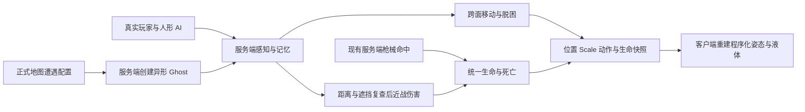

# 正式地图的程序化异形敌人

`Apollo12GameScene` 现在包含 `AlienEncounterSettings`，注册蜘蛛、蛇、毛毛虫、触手兽、蜈蚣、水蛭、黏液兽和根须八种异形。实验场景继续保留；正式预制体不会添加实验控制器、摄像机或 F1 / WASD 等输入。已有 DollSinger / PMC 敌人仍走原服务端 AI。

## 两类敌人与目标规则

人形玩家敌人使用已有 `DollSingerEnemySystem`，保留搜刮、战斗、撤退和撤离行为。异形使用 `ProceduralAlienEnemy`：巡游、发现目标、追击、搜索最后感知位置、攻击前摇、扑击、恢复和死亡。枪声只提供带误差的搜索位置；失去视线后使用有限时长记忆。近战结算再次检查目标存活、实际命中体距离和遮挡。

异形只接受同一服务端 World 中有 `PlayerGhost` 的存活目标，包括真实玩家、模板人形角色和 PMC；带异形状态的实体明确排除，不按名字、外观或负 NetworkId 猜阵营。PMC 能识别异形的实际体积位置，并保存其瞄准偏移，避免向不存在的人形胸口开枪。

## 手动调节 Scale

打开 `Assets/AlienCreatures/Profiles/`，选择对应物种资产，调整 **Scale**。它是统一尺寸倍率，范围 0.1–4；可在 Edit Mode 保存，也可在运行时临时调节。服务端应用修改并把 Scale 写入 Ghost 状态，客户端接收后重建当前身体。

Scale 同时影响体长、粗细、头部、触手 / 足的尺寸、身体移动碰撞半径、地面高度、跨面转弯尺寸、服务端命中体和近战伸展范围。移动速度和扑击速度使用基础参数乘 Scale，因此小体型不会保留巨大体型的步幅速度。感知距离和伤害有独立参数。

程序化身体已经输出世界尺寸，网络根对象保持单位 Transform Scale，避免再乘一次尺寸。请使用 Profile 的 **Scale**，不要同时修改生成对象根 Transform 的缩放。液体保持标准粒子采样和体积网格，在缩放后的坐标框架内渲染，缩小模型时不按比例删除细节粒子；黏度、拉丝和相对沉降风格保持模型空间参数。

每种资产还暴露生命、速度、转向、视距、听觉范围、记忆时长、巡游半径、伤害、攻击距离、前摇、恢复、冷却和扑击速度，以及原有身体 / 步态 / 液态参数。尺寸倍率变化会重建引导与命中体，不重置实体生命、目标、冷却或服务器身份。

Scale、战斗参数和液态材质 / 解算参数可以运行时调整；其他体形 / 拓扑参数在生成身体时读取，修改后需重生该怪或重新进局。默认基础速度已经按初始 Scale 换算，保持各物种原实验的实际移动速度。

## 遭遇、武器与性能

正式场景的 `Moon Raid` 对象上，`AlienEncounterSettings` 控制异形刷新。八个槽仍分别引用八种物种；每槽的 `Position` 与新增 `CandidatePositions` 都是世界坐标候选锚点。服务端轮换候选，并在锚点附近做有限半径搜索；新地图会随机选择起始槽位和候选，降低活体上限也不会截掉后面的物种。

默认同时最多 8 只、整个地图生命周期最多生成 24 只、每槽最多生成 3 次，每秒最多创建 2 只。首次等待 3 秒，检测到死亡或 Ghost 消失后等待 90–115 秒再补充；失败候选等待 8 秒再试，不消耗预算。预算与已用次数在地图切换或服务器 World 结束时重置，玩家反复部署或全员临时离线不会重置同一地图的预算。`maximumAliens`、`maximumTotalSpawns`、`spawnsPerEncounter`、`respawnDelay` 与 `respawnDelayJitter` 可独立调整；实际场景配置可覆盖默认值。

仅真实存活玩家进入默认 240 m 激活范围才尝试生成；靠近玩家、玩家当前视野内无遮挡、无地面、斜坡过陡、身体空间被占据或身体跨越断崖时会延后。其他活体也保留最小间距，防止同次生成互相重叠。接地高度和身体检查随 Profile.Scale 变化，长身体沿尾部检查，触手与蜘蛛检查周围落脚空间。所有物理搜索都有尝试上限；无法安全生成时保留等待状态。地图卸载时清理活体与仍保留的死亡 Ghost。

八个预制体通过现有 `GhostPrefabsAuthoring` 和 Addressables 注册，均为服务端控制的插值 Ghost。它们复用现有 `PredictedPlayerGhost` 的生命字段，因此现有 hitscan、弹丸和范围攻击继续经服务端命中处理；没有添加玩家输入或玩家移动组件。身体与肢体的命中体在服务端使用 `ServerPlayer` 层，客户端使用 `ClientPlayer` 层，命中反馈按肉体分类。死亡停止攻击，短暂保留姿态后由服务端销毁，暂不生成物资袋。

服务端不创建材质、渲染网格或 GPU 液体；只解接触、姿态和命中体。客户端默认只让最近两个异形运行 GPU 液体，超过距离或预算使用实体回退外观；预算和距离也在 Profile 中暴露。判断按 World 分开，近距离敌人切换不会影响生命或 AI。

## 验证入口与边界

`Tools → Moonkov → Aliens → Set up eight alien enemies` 幂等注册缺失资产并接入正式场景，保留已有 Profile 调参。`Check enemy integration and Scale` 在加载的 MC00 碰撞场景上运行隔离 ECS World 检查：真实人形组件 / PMC 目标、排除异形、现有弹丸伤害入口、死亡销毁、缩放命中体、客户端状态应用与液体有限值。输出位于 `Library/BuildValidation/AlienIntegration/report.json`。

这些隔离检查不等同于真实网络传输、迟加入或完整进局测试。异形路径使用局部表面移动与脱困，不复用人形 NavMesh 巡路；跨房间绕行、极窄缝和长身体在复杂转角的效果仍需按正式地图试玩调整。

2026-10-13 定向结果：八种都通过人形 / PMC 伤害、异形排除、现有弹丸伤害入口、死亡退出 Ghost、0.35→1.4 倍命中体缩放和客户端 0.7 倍状态重建检查；八种液体粒子均为有限值。首轮发现的问题保留在 `report.json`，后四种修复后的结果在 `remaining-report.json`。另外将异形从真实玩家的死亡 / 复活连接查询中排除，防止负 NPC ID 被用于玩家连接索引；销毁后的 cleanup 实体回调也不再读取已经移除的生命数据。未跑真实 Host + 第二客户端、迟加入或玩家完整战斗验收。
