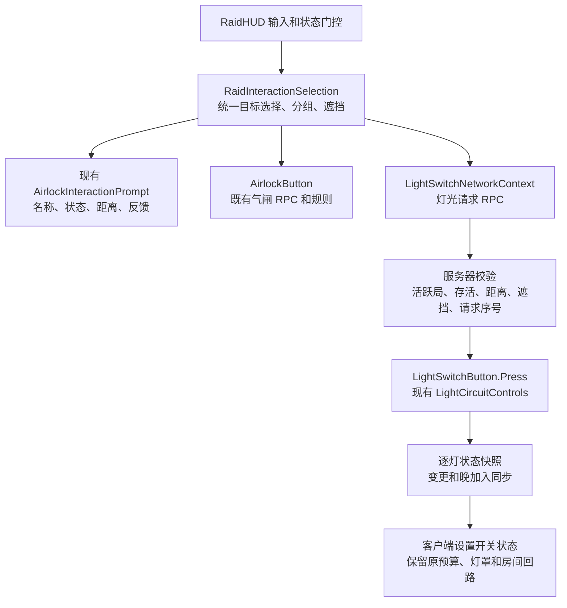

# 局内场景交互

2026-10-16：正式 RaidHUD 共用一套气闸／灯光目标选择与提示。保留原场景组件、ID、气闸规则和灯光控制所有者，无需重新挂接场景或预制体。

- 准星附近、操作距离内且没有实体遮挡的控制按钮显示提示；优先选择最靠近准星的目标。
- 同一气闸同侧操作组，或同一灯光控制面板上相邻 0.75 米内的按钮，列入同组操作列表。滚轮或手柄方向键上下选择，F／手柄 X 执行；观察同一面板时保持已选择的操作。
- 提示显示名称、距离、气闸压力与门开度／灯光开关状态，以及阻止原因或服务器确认状态。黄色标记指示目标，橙色标记表示等待或受阻。
- 背包、暂停、结算、死亡和鼠标解锁时停止交互。按键执行前重新检查目标、距离和遮挡。手柄 X 在瞄准控制面板时由面板优先消费；附近物资提示随之隐藏，键盘 E 的物资入口保留。
- 中文通过既有 MoonkovUI 字符表与字体绑定，不新增独立本地化系统。

灯光每次请求仅上传按钮 ID、会话与序号；动作和灯列表取自服务器现有配置。拒绝重复／过期请求及重复按钮 ID，并限制每个连接的按压频率。客户端等待确认时抑制连按，不提前切换灯光；2.5 秒未确认后可重试。状态最多每 0.2 秒检查，已有连接只接收变化；新连接收到当前完整状态。Host 场景由服务器修改，客户端不重放 Toggle。逐灯快照使用明确的开／关值，避免重复切换。按钮与灯 ID 的 UTF-8 长度限制为 120 字节。

当前新增对象种类可在 `RaidInteractionTarget` 的类型适配处扩展；选择、分组和 UI 不需再加另一套输入循环。本轮只接入现有气闸和灯，不新增战利品、消耗品、修理或存档玩法。灯光状态保留于本次场景／服务器会话，不新增跨局持久化。

客户端按控制器批量应用同批快照，避免一次总开关操作按每盏灯重复合成烘焙光照。

验证入口：`Tools > Moonkov > Interaction > Run focused checks`；报告位于 `Temp/RaidInteraction/checks.json`。本轮 Unity 编译与 32 项检查通过，覆盖编辑态物理选择、阻挡、距离、状态门控、气闸兼容入口、服务器资格判断、请求去重、晚连接当前状态、客户端快照与确认、HUD 资源导入。它使用临时场景和独立 ECS World，不替代正式地图 Host＋第二客户端实际交互、真实网络传输或视觉手感验收。
