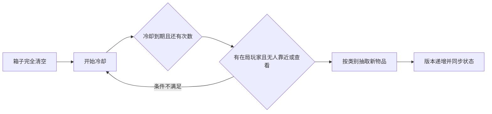

# 战局箱子与敌人刷新

三套逻辑均由服务端控制。配置与预算属于当前地图和服务器 World：关闭箱子、玩家重新部署、同地图断线重连不会重新生成整批资源；切换地图或创建新服务器 World 才重新初始化。

| 对象 | 正式 Theophilus 配置 | 安全规则 |
| --- | --- | --- |
| 箱子 | 12 个固定场景位置；补给、医疗、工业、装备四类随机内容 | 四角支撑、箱体空间、至少一侧可站立交互；首个服务端快照前隐藏 |
| 空箱补货 | 清空后 300 秒；每箱最多补 2 次 | 有在局存活玩家；18 m 内无人且无人查看；剩余或存入任何物品均不重置 |
| PMC | 初始 6 人、同时最多 6 人；额外预算 12 人；缺员后 45 秒补最多 2 人 | 真人 30 m、其他角色 8 m 间距；80 m 内视线排除；完整 NavMesh 路径连通撤离区 |
| 异形 | 八物种、16 个遭遇槽；同时最多 12 只、累计最多 48 只、每槽最多 4 次 | 真人 25 m 间距；75 m 内视线排除；落地及身体空间检查；长身体与触手额外检查支撑 |

PMC 初次延迟 2 秒，首次出现真人后经过地图战局时长的 85% 就停止新增。异形初次延迟 3 秒，玩家进入 240 m 激活范围才尝试；死亡后等待 35–50 秒补充，每秒最多生成 2 只。找不到安全点时，PMC 每 5 秒、异形每 4 秒重试，失败不消耗额度。正式地图的氛围、候选点覆盖与配置差异见 [TheophilusRaidPressure.md](TheophilusRaidPressure.md)。

箱子位置是客户端与服务端共用的场景锚点，不在玩家搜刮期间移动；每次初始生成及补货重新抽取内容。补给箱保证食物和水，医疗箱保证医疗物资，工业箱保证月尘与合金，装备箱保证电池并抽取模块或装备。加权池在 `Assets/Scripts/Networking/Shared/RaidLootTable.cs`，使用实际库存目录中的物品，并保留物品唯一 ID、拾取标记及容器版本检查。新物品不会混入玩家已有的嵌套容器。

## 编辑位置与参数

选择正式场景的 `Moon Raid`：

- `Loot Positions`、`Loot Profiles`、`Loot Yaw` 按相同数组索引对应，Scene 视图显示编号和类别，可拖动位置手柄；接地工具记录 `Loot Ground Normals`，让箱体随自然斜坡倾斜。
- `Check cache support and access` 检查接地、箱体空间和交互侧；`Repair cache grounding (within 12 m)` 只在锚点附近寻找合适位置，全部成功才写入箱子坐标，支持 Undo。移动后照常保存场景。
- `Enemy Spawn Positions` 是 PMC 独立入场位置，不改变它们的搜刮、战斗或撤离目标。旧地图没有配置时回退到物资路线。
- 正式地图的 `Enemy Tuning` 引用 `Assets/Resources/Moonkov/TheophilusPMC.asset`，调整 PMC 补充预算、间隔和安全距离；未指定配置的其他地图仍使用 `DollSingerAI.asset`。
- 同对象的 `AlienEncounterSettings` 调整异形预算、间隔及每物种额外候选位置，原有 Profile 与 Ghost 注册保持不变。

空箱显示继续复用原来的空箱指示灯；尸体容器不会补货。正式地图原有 12 个物资区域保持，修正新增建筑基础覆盖旧坐标的问题，并将箱体抬至真实支撑面。敌人安全检查使用服务端角色视角（含自由观察偏移），不依赖客户端自行随机生成。

## 验证边界

本次采用 Unity 编译、库存/补货规则检查，以及保存正式地图时的物理接地检查。已提供隔离 ECS World 的异形死亡与刷新额度检查入口 `Tools/Moonkov/Aliens/Check spawn cooldown and budgets`，按最小充分原则未扩展执行。没有运行 Play、Host + 第二客户端、迟加入、完整巡路和战斗试玩；PMC 在正式地图的实际导航连通与持续战斗表现仍需试玩验收，没有安全路径时会延后入场。
