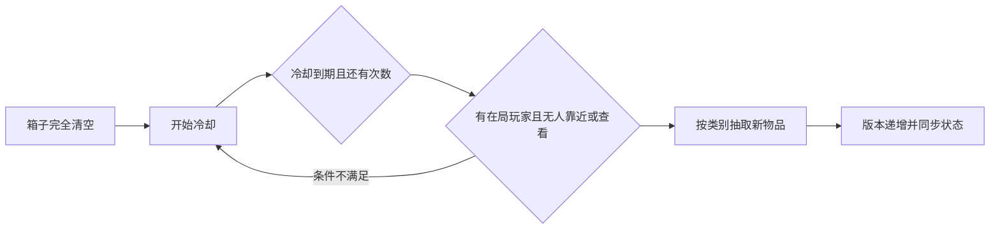

# 战局箱子与敌人刷新

三套逻辑均由服务端控制。配置与预算属于当前地图和服务器 World：关闭箱子、玩家重新部署、同地图断线重连不会重新生成整批资源；切换地图或创建新服务器 World 才重新初始化。

## 玩家出生与撤离

2026-11-05 的临时布局使用 20 分钟战局上限。玩家可以提前撤离。前两章设施任务的有效时间跟随地图时长，普通随机设施仍使用各自的任务时限。

8 个玩家出生点位于当前可见的 MC00 一层室内，分布在不同房间和通道。最近点间距约 16.5 米，到最近出口的水平直线距离约 149–203 米。没有使用已关闭显示的外围旧建筑。室内不代表自动补充储气，供氧规则不变。

| 出口 | 世界位置 X / Y / Z | 条件 |
| --- | --- | --- |
| 东侧 | 1792.019 / 182.218 / 2173.000 | 半径 5 米内停留 8 秒 |
| 西北侧 | 1470.000 / 185.270 / 2400.000 | 半径 5 米内停留 8 秒 |
| 南侧 | 1550.000 / 218.683 / 1950.000 | 半径 5 米内停留 8 秒 |

三个出口均开放。离开出口或切换出口会重置计时。地图和方向提示沿用已有多出口逻辑。

布局源为 `Assets/Editor/TheophilusRaidLayout.asset`。先打开正式地图，再选中该资产。出生点保存建筑根路径和局部坐标，出口保存 `Moon Raid` 根下的局部坐标。换地图时重绑根路径、位置、朝向和出门路线，执行检查，再发布到正式地图与出生子场景。不要只改子场景，否则下次发布会覆盖手工坐标。工具不会自动增删出生点。

检查会拒绝缺失锚点、倾斜模型转换根、无地面、身体空间不足、无可见屋顶、通道受阻，以及过近的出生和撤离点。旧建筑可能只剩碰撞体，不能只靠射线认定它仍是室内。保存后的场景需再次检查，并目视核对出生画面。

本轮在唯一 Editor 中检查了 8 个出生视角，并用正式角色的碰撞胶囊走通全部出门路线及三个方向的撤离路线。另通过 1021 项撤离规则检查、战役时限回归和 134 项场景物资检查。路线测试通过 `CharacterController.Move` 驱动碰撞体，不是完整战局、真实键鼠或多人测试。临时脚本与截图在忽略目录 `LocalData/RaidLayoutReview`。8–12 分钟整局解说的遭遇节奏仍需实际试玩。

本轮编译通过。Console 保留了改动前出现的 SubScene 编辑态断言，以及两次工具调用超时；超时后的场景保存结果已回读确认。没有将 Console 记为零错误。

## 物资与敌人

| 对象 | 正式 Theophilus 配置 | 安全规则 |
| --- | --- | --- |
| 箱子 | 64 个普通箱，另有 32 个路线箱；补给、医疗、工业、装备四类随机内容 | 落点需检查支撑、箱体空间和可交互站位；普通箱在首个服务端快照前隐藏 |
| 空箱补货 | 清空后 300 秒；每箱最多补 2 次 | 有在局存活玩家；18 m 内无人且无人查看；剩余或存入任何物品均不重置 |
| PMC | 初始 6 人、同时最多 6 人；额外预算 12 人；缺员后 45 秒补最多 2 人 | 真人 30 m、其他角色 8 m 间距；80 m 内视线排除；优先选择连通撤离区的路径 |
| 异形 | 23 个遭遇槽；同时最多 12 只、累计最多 48 只、每槽最多 4 次 | 真人 25 m 间距；75 m 内视线排除；落地及身体空间检查；长身体与触手额外检查支撑 |

PMC 初次延迟 2 秒，首次出现真人后经过地图战局时长的 85% 就停止新增。异形初次延迟 3 秒，玩家进入 240 m 激活范围才尝试；死亡后等待 35–50 秒补充，每秒最多生成 2 只。找不到安全点时，PMC 每 5 秒、异形每 4 秒重试，失败不消耗额度。正式地图的氛围、候选点覆盖与配置差异见 [TheophilusRaidPressure.md](TheophilusRaidPressure.md)。

当前地图有 261 个人形敌人出生候选点，只尝试距真人 450 m 内的候选点。若候选点无法连通正式撤离区，但附近有可行走路线，敌人仍可从该处入场，离开时回到自身入场点。这些是代码和场景配置，不代表正式导航已验证。

2026-10-31 新增路线箱使用已有场景容器编号，地图会话内只生成一次，不补货。原有 30 个建筑抽屉保留，共 126 个物资点。入口与附近建筑的 35 个新增落点已通过保存后的接地、站位和选择检查。详见[路线补给扩充](LootContainers.md#路线补给扩充)。

箱子位置是客户端与服务端共用的场景锚点，不在玩家搜刮期间移动；每次初始生成及补货重新抽取内容。补给箱保证食物和水，医疗箱保证医疗物资，工业箱保证月尘与合金，装备箱保证电池并抽取模块或装备。加权池在 `Assets/Scripts/Networking/Shared/RaidLootTable.cs`，使用实际库存目录中的物品，并保留物品唯一 ID、拾取标记及容器版本检查。新物品不会混入玩家已有的嵌套容器。

补货后，玩家需要重新搜索这批新物资；之前搜索过箱子不等于已经看过新内容。普通取放物品只改变库存版本，不要求重复搜索。搜索期间若内容批次改变，本次搜索中断。搜索记录在更换地图或重新部署时清空。

## 编辑位置与参数

选择正式场景的 `Moon Raid`：

- `Loot Positions`、`Loot Profiles`、`Loot Yaw` 按相同数组索引对应，Scene 视图显示编号和类别，可拖动位置手柄；接地工具记录 `Loot Ground Normals`，让箱体随自然斜坡倾斜。
- `Check cache support and access` 检查接地、箱体空间和交互侧；`Repair cache grounding (within 12 m)` 只在锚点附近寻找合适位置，全部成功才写入箱子坐标，支持 Undo。移动后照常保存场景。
- `Enemy Spawn Positions` 是 PMC 独立入场位置，不改变它们的搜刮、战斗或撤离目标。旧地图没有配置时回退到物资路线。
- 正式地图的 `Enemy Tuning` 引用 `Assets/Resources/Moonkov/TheophilusPMC.asset`，调整 PMC 补充预算、间隔和安全距离；未指定配置的其他地图仍使用 `DollSingerAI.asset`。
- 同对象的 `AlienEncounterSettings` 调整异形预算、间隔及每物种额外候选位置，原有 Profile 与 Ghost 注册保持不变。

空箱显示继续复用原来的空箱指示灯；尸体容器不会补货。敌人安全检查使用服务端角色视角（含自由观察偏移），不依赖客户端自行随机生成。当前出生、物资和唯一撤离点的布局问题及 DOT 验收要求见 [Theophilus 局内地图需求](Planning/Theophilus-Raid-Map-Brief.md)。

## 验证边界

本次采用 Unity 编译、库存/补货规则检查，以及保存正式地图时的物理接地检查。已提供隔离 ECS World 的异形死亡与刷新额度检查入口 `Tools/Moonkov/Aliens/Check spawn cooldown and budgets`，按最小充分原则未扩展执行。没有运行 Play、Host + 第二客户端、迟加入、完整巡路和战斗试玩；PMC 在正式地图的实际导航连通与持续战斗表现仍需试玩验收，没有安全路径时会延后入场。
