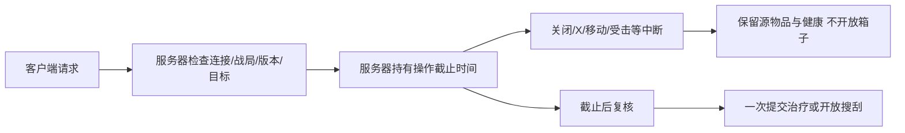

# 局内丢弃、快捷转移与耗时操作

2026-10-21：本次仅支持战局内把随身物品放到地面。账户/主菜单的永久销毁没有新增入口。

- 右键随身物品选择「丢弃到地面 / DROP」。整叠丢弃；背包/胸挂连同完整后代容器树一起丢弃。需要分量时先拆分再丢弃。服务器使用连接所属角色当前位置落地，客户端不能提供地面坐标。地面显示为小型包块，可按原搜刮入口重新拾取。
- `RaidInventoryDropRpc` 携带当前战局、单调请求号、玩家库存版本和唯一物品ID。服务器验证活动战局、存活/连接/所有权、版本且没有进行中的耗时操作；地面所有权注册成功后才替换玩家物品树。注册失败回滚地面注册、保留源物品。完整树保留唯一ID、数量、拾取/紧急补给/任务标记和电池电量。再次拾取沿用箱子版本、距离和视线校验，竞争拾取不会复制物品。
- 普通战局的人形敌人也会搜索附近可见的地面包，并与玩家竞争普通物资。搜索有计时；旧库存版本不能重复取走物品。任务关键物品仍留在地面包中。具体条件和验证范围见[人形敌人](AI/DollSingerEnemies.md)。
- Ctrl 点击和 QUICK TRANSFER 的目标仅依次寻找口袋、已装备胸挂、已装备背包的直接格位/兼容叠堆，不自动装备拾取到的包，也不递归进入嵌套包。显式拖动、装备和手动打开嵌套包后放入仍使用原规则。原 `CarryContainers` 未全局改变，补给生成等其他用途不受影响。
- 快捷转移与服务器共用叠堆条件。来源标记不同、叠堆已满或两堆都含不满电的电池时，会继续找兼容物品堆或空格，不会停在一次注定失败的合并上。14 项规则检查覆盖共享箱子、免费补给、普通物品和部分电量；尚未在编辑器内验收实际点击。
- 医疗的所有玩家入口（4快捷键、右键物品、健康页面指定部位）统一调用服务端3秒治疗。开始时只检查，不治疗或消耗；结束时再次使用同一ID和原库存版本原子消耗一件并治疗。移动离开起点超过0.75m、受到攻击或护盾命中、开火/投掷、换武器/换弹、库存变化、死亡/断线/战局结束，或主动取消会中断，不产生医疗收益。饥渴和缺氧的持续伤害不会打断医疗，但伤害仍会持续；燃烧、中毒和流血仍会打断普通医疗。装备/健康Tab只改变展示，不取消。开始搜刮也会取消正在进行的医疗。
- 进食与饮水共用同一条耗时动作通道。进食 3 秒，饮水 2 秒；完成前不恢复资源或扣物品。移动不会中断吃喝。吃喝期间最高移动速度为 1.5 米／秒，禁止冲刺，结束或取消后恢复原速。其余中断条件与医疗相同，开始合法的任务设备操作会取消吃喝。氧气罐和护盾充能不受此改动影响。详见[局内营养](RaidNutrition.md)。
- 武器正在装填或切换时，不能开始治疗、吃喝、搜索或使用战术道具。已开始的动作遇到新装填或切换会中断。等待装填自然完成，不提前发放弹药，也不额外扣电池。
- 手动操作任务设备同样由服务器检查。开始后移动超过 0.75 米、视线或距离失效、身体或护盾受击、开火、投掷、换弹或切枪都会中断；完成时先检查这些变化，再确认进度。装填或切枪未结束时不能开始。此前已完成的步骤和设备自动运行不受影响。
- 每位玩家首次打开容器或箱子补货后的新一批物资时，由服务端逐件计时，普通物品默认每件2秒。开始时先发全部物品的占格位置和宽高，界面显示灰色遮蔽块。每件独立走一轮原准星光环，完成后才发送名称、图标和数量。界面不显示总数或问号。随身装备和背包始终可见。搜索完成前仍不能取物。关闭重开同一批已搜索的内容立即开放。异形材料每件使用6秒解剖时间。搜索时移动超过0.75m、身体或护盾受到攻击、开火或投掷、换弹或切换武器、失去距离/视线、关闭/X取消或战局结束均取消；取消不记录搜索完成。护盾在同一服务器更新内再次受击也会打断。更换地图/重新部署清空个人搜索完成记录。
- UI 显示倒计时、进度条及取消按钮，X可随时取消；Tab 打开或收起装备界面不取消治疗、吃喝和战术道具；关闭搜索界面仍取消搜索。医疗中断显示具体原因；结束与取消反馈保留3秒。倒计时归零仍等待服务器确认，客户端计时不会发放收益。

`MoonRaidMap` 的 `m_MedicalSeconds` / `m_SearchSeconds` 可在Inspector调整，默认3 / 2秒，旧场景未配置、0或非有限值回退默认。未改写正式场景/预制体。客户端、Host和独立服务器需使用同一版本。

## 搜刮声音

打开或搜索容器会发出空间声音。人形敌人开始搜刮时也会发出同一种声音。敌人最多在 10 米内听到；异形不会超过自身配置的听距。墙体将有效听距缩短至 55%。声音只提供有误差的搜索线索，不提供视线或直接开火条件。关闭容器、无效请求和重复请求不会产生声音；连续打开请求有 0.8 秒的发声间隔。

`AlienEnemyChecks.RunLootAcousticsContract()` 的 21 项检查覆盖音效资产、真实人形搜刮、人形与异形听觉、遮挡和远距离。真实服务端请求检查覆盖无效请求、重放、关闭和发声间隔。单人战局使用临时档案，实际丢弃并搜索地面物，服务器与客户端都收到事件。独立音效池检查了空间声源、遮挡和距离。多人对局听感仍需试玩。

2026-10-27：`RaidSearchActionChecks.Run()` 的 47 项检查覆盖实际搜索状态、补货批次、同更新内护盾吸收、开火、投掷、换弹、武器切换、移动、失去权限、重新搜索和异形解剖。游戏与编辑器程序集使用项目 Unity 编译参数在隔离目录编译通过；检查在隔离运行时执行。已补充真实服务端请求夹具，尚未在编辑器运行；正式战局尚未实测。

手动任务设备的 46 项生产规则检查通过，包含临近完成时受击、战斗动作、移动、合法投掷与无效投掷，以及正常完成。游戏与编辑器程序集隔离编译通过；真实服务端请求夹具已补充，尚未在编辑器执行，正式地图也未试玩。

## 当前动作反馈

治疗和搜索使用用户选定的 P2 光环填充、简短动作名称和倒计时。光环围绕准星，直接复用头顶正式精灵。装备页保留小型取消入口。界面不展示网络确认过程。起手和收尾继续显示原动作名称；收尾隐藏归零倒计时，实际结果到达后再显示完成或具体中断原因。取消和中断没有满进度条，取消请求不会重复发送。健康页使用相同动作名称。

`RaidTimedActionReview.Check()` 的 19 项检查通过。原 75 项动作规则与 43 项实际服务端处理器回归通过。编译通过。样例原生截图在 `LocalData/TimedActions/immersive-feedback.jpg`，不代表真实战局或联机验收。

## 2026-10-21 交互补修

- 空的动态丢弃包立即退出 E 候选；人类/异形尸体与固定箱子保留原用途。同距包以瞄准和稳定 ID 决定首次目标。查看地面包时，若附近还有可见非空包，标题栏显示「切换附近包」并按 ID 循环；无需先把当前包拿空，切换沿用服务器距离/视线与首次两秒搜索。
- 只有空动态包才回收：无查看/搜索者时开始十秒宽限，重新放入物品或有人查看会重置宽限。非空包不因年龄删除。服务器处理请求后再回收，旧版本取物仍沿库存版本与当前打开 ID 拒绝。
- `RaidGroundMarkerRpc` 独立于旧尸体协议，按连接事件序列原子发送显示/移除；`Deleted` 区分真实回收和离开兴趣范围。动态包仅在 80 米兴趣范围内发送，当前查看/搜索包例外；回到范围重新发送完整元数据，每五秒重发当前可见元数据。客户端每 ID 拒绝旧事件，序列记忆限于最近 4096 个事件，窗口之前的消息统一拒绝；重发可恢复极端延迟，避免永久墓碑。地图同步销毁已移除标记，服务端同步清理已回收的搜索记录与已发版本。
- 手动丢弃要求脚下 1.25 米内有坡度、包体支撑、净空与短路径检查均通过的地面。空中离地过远、悬崖边缘支撑不足、缝隙或别层落点均拒绝，源库存保持原样。没有增加刚体模拟。
- 医疗、搜索与手动任务设备操作共用单调请求顺序；最新合法开始取消旧手动操作，非法目标、旧请求或无权请求不能取消正在进行的合法操作。已启动的机器自动 Process 独立运行。取消信息通过既有操作反馈快照传给 HUD；`RaidHUD.TimedActionInputActive` 只读报告客户端医疗/搜索状态，供展示输入消费 X。
- 异形检查逐枚举验证有效器官/目录和每个规范定义的反向覆盖，只允许现有明确别名 `StiltWalker → Tentacle`；后续物种采集、活动及研究断言保持。

## 本轮补修验证

Unity 6000.5.10f1 重编译通过，2026-10-21 16:12（Asia/Shanghai）同一轮执行结果：

- `MoonkovRaidActionChecks.Run()`：75 项，包含原动作/库存检查，以及空包回收边界、当前查看者保护、非空包不按年龄过期、RPC 乱序/兴趣重入、序列记忆上界、随身格位已满时重叠非空包仍可循环选择。
- `MoonkovRaidActionChecks.RunServerRequests()`：43 项，真实隔离 World/服务端处理器，包含平地/小跳/长坠落/悬崖支撑/缝隙/别层/无地面不扣物，兴趣退出与重入、晚加入、真实删除及搜索记录清理，任务与医疗双向替换、非法医疗/搜刮/任务不取消旧操作、同 tick 旧请求不反抢、受伤不完成任务或误扣医疗。
- `AlienHarvestChecks.Run()`：135 项，逐物种与显式别名、原采集/活动/火力/生物分支 mask=7 均保留。数量断言解锁后暴露旧研究夹具把月核分支混入生物循环、普通 AddSupply 又不能生成合法任务来源；分离合法来源月核夹具，新增未回收拒绝、回收后解锁及 mask=15 保存/出战检查。
- `dotnet run --project Backend/RaidLootChecks/RaidLootChecks.csproj`：128 箱生成及掉落/快捷转移两段通过。`git diff --check` 通过。

最终 Editor 仍为 WeaponGestureLab 单场景、dirty=false、Play=false、无活动地图/任务站点、隔离 World 已销毁；Console groundTruth 为 0 errors / 13 条既有 Airlock 弃用及序列化编译警告。未运行翻译批处理、未 Play、未接触账户/正式场景。真实 Host/Client 网络传输、标题栏按钮点击及最终画面未测；本轮通过的是规则、生成的 RPC 与实际处理器，不代表这些端到端体验已验收。

## 原实现验证记录

- `dotnet run --project Backend/RaidLootChecks/RaidLootChecks.csproj`：生成128份箱子和新增丢弃/快捷容器逻辑；旧版本/外人ID/根节点拒绝、整树重新拾取、竞争拾取、保留电量/来源。
- Unity EditMode：`MoonkovRaidActionChecks.Run()`：医疗截止边界/一次收益、十种中断、搜索截止/取消/实际ID记忆、丢弃重放/注册失败回滚、客户端地面标记、生成的专用RPC、医疗快照分片、满直接容器时不自动套包且显式套包仍可用、slotLayer穿透与装备按钮拾取、地图默认值/0值回退。
- Unity实际服务器入口：`MoonkovRaidActionChecks.RunServerRequests()`，20项断言通过，使用隔离World并调用实际ServerGameSystem处理器，覆盖医疗服务端时钟/取消/重放、错误战局/外人/死亡/断线/旧版本拒绝、落点、距离与遮挡、首搜取物门禁、关闭重开、重新拾取与竞争旧版本拒绝。
- 回归：`MoonkovRaidInventoryChecks.Run()`、`MoonkovRaidHealthChecks.Run()`、`MoonkovDeathBagChecks.Run()`、`MoonkovLootChecks.Run()`、`AlienHarvestChecks.Run()`。

本轮实测：Unity6000.5.10f1重编译完成，0编译错误；58项动作/物品/UI结构断言及20项实际服务端处理器断言通过。库存/健康/搜刮回归通过。死亡包旧夹具与`InventoryGraph.Create(false)`的自带武器重复初始化，改为只补缺少的槽位，保留原满装备/完整树断言后通过；最大嵌套树检查耗时约7秒，Pipeline在5秒发出工具超时，但07:15:40 UTC Console明确记录死亡包与搜刮回归成功。最终Editor回到原WeaponGestureLab，dirty=false、sceneCount=1、Play=false、activeMap=false，Console groundTruth为0 errors/13项原有编译warnings。

`AlienHarvestChecks.Run()` 当时的前半段检查通过，后半段的物种数量断言失败。长脚异形现在明确复用触手心脏，物种覆盖检查已识别这条映射。2026-10-27 的 68 项隔离检查覆盖十种异形的普通及首领掉落、食用和效果时限；旧胶质防护检查也已改为使用战斗伤害入口。完整编辑器解剖夹具仍未重跑。后端 RaidLootChecks 曾通过；数据库流程没有执行。

上述检查不代表真实Host/Client网络端到端、最终画面或手柄体验已经验收；手动验收应覆盖两个客户端竞争同一地面物、治疗进度时移动/射击/切武器/取消、首开/重开箱子、满直接容器时Ctrl无法自动塞进嵌套包。
