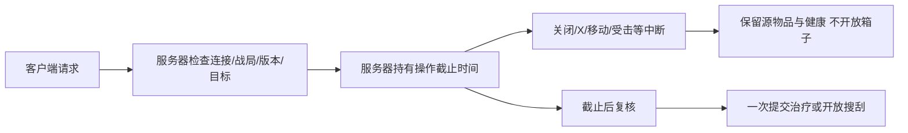

# 局内丢弃、快捷转移与耗时操作

2026-10-21：本次仅支持战局内把随身物品放到地面。账户/主菜单的永久销毁没有新增入口。

- 右键随身物品选择「丢弃到地面 / DROP」。整叠丢弃；背包/胸挂连同完整后代容器树一起丢弃。需要分量时先拆分再丢弃。服务器使用连接所属角色当前位置落地，客户端不能提供地面坐标。地面显示为小型包块，可按原搜刮入口重新拾取。
- `RaidInventoryDropRpc` 携带当前战局、单调请求号、玩家库存版本和唯一物品ID。服务器验证活动战局、存活/连接/所有权、版本且没有进行中的耗时操作；地面所有权注册成功后才替换玩家物品树。注册失败回滚地面注册、保留源物品。完整树保留唯一ID、数量、拾取/紧急补给/任务标记和电池电量。再次拾取沿用箱子版本、距离和视线校验，竞争拾取不会复制物品。
- Ctrl 点击和 QUICK TRANSFER 的目标仅依次寻找口袋、已装备胸挂、已装备背包的直接格位/兼容叠堆，不自动装备拾取到的包，也不递归进入嵌套包。显式拖动、装备和手动打开嵌套包后放入仍使用原规则。原 `CarryContainers` 未全局改变，补给生成等其他用途不受影响。
- 医疗的所有玩家入口（4快捷键、右键物品、健康页面指定部位）统一调用服务端3秒治疗。开始时只检查，不治疗或消耗；结束时再次使用同一ID和原库存版本原子消耗一件并治疗。移动离开起点超过0.75m、受伤、开火/投掷、换武器/换弹、库存变化、死亡/断线/战局结束，或主动取消会中断，不产生医疗收益。装备/健康Tab只改变展示，不取消。开始搜刮也会取消正在进行的医疗。
- 每位玩家每个战局首次打开某个实际容器ID需服务端搜索2秒；搜索完成前不发送该箱子的内容快照，也不能取物。关闭重开已搜索的同ID箱子立即开放。异形尸体保留原6秒解剖。搜索时移动超过0.75m、受伤、失去距离/视线、关闭/X取消或战局结束均取消；取消不记录搜索完成。更换地图/重新部署清空个人搜索完成记录。
- UI 显示倒计时、进度条及取消按钮，X可随时取消；关闭耗时操作窗口也取消。医疗中断显示具体原因；结束与取消反馈保留3秒。倒计时归零仍等待服务器确认，客户端计时不会发放收益。

`MoonRaidMap` 的 `m_MedicalSeconds` / `m_SearchSeconds` 可在Inspector调整，默认3 / 2秒，旧场景未配置、0或非有限值回退默认。未改写正式场景/预制体。客户端、Host和独立服务器需使用同一版本。

## 验证

- `dotnet run --project Backend/RaidLootChecks/RaidLootChecks.csproj`：生成128份箱子和新增丢弃/快捷容器逻辑；旧版本/外人ID/根节点拒绝、整树重新拾取、竞争拾取、保留电量/来源。
- Unity EditMode：`MoonkovRaidActionChecks.Run()`：医疗截止边界/一次收益、十种中断、搜索截止/取消/实际ID记忆、丢弃重放/注册失败回滚、客户端地面标记、生成的专用RPC、医疗快照分片、满直接容器时不自动套包且显式套包仍可用、slotLayer穿透与装备按钮拾取、地图默认值/0值回退。
- Unity实际服务器入口：`MoonkovRaidActionChecks.RunServerRequests()`，20项断言通过，使用隔离World并调用实际ServerGameSystem处理器，覆盖医疗服务端时钟/取消/重放、错误战局/外人/死亡/断线/旧版本拒绝、落点、距离与遮挡、首搜取物门禁、关闭重开、重新拾取与竞争旧版本拒绝。
- 回归：`MoonkovRaidInventoryChecks.Run()`、`MoonkovRaidHealthChecks.Run()`、`MoonkovDeathBagChecks.Run()`、`MoonkovLootChecks.Run()`、`AlienHarvestChecks.Run()`。

本轮实测：Unity6000.5.10f1重编译完成，0编译错误；58项动作/物品/UI结构断言及20项实际服务端处理器断言通过。库存/健康/搜刮回归通过。死亡包旧夹具与`InventoryGraph.Create(false)`的自带武器重复初始化，改为只补缺少的槽位，保留原满装备/完整树断言后通过；最大嵌套树检查耗时约7秒，Pipeline在5秒发出工具超时，但07:15:40 UTC Console明确记录死亡包与搜刮回归成功。最终Editor回到原WeaponGestureLab，dirty=false、sceneCount=1、Play=false、activeMap=false，Console groundTruth为0 errors/13项原有编译warnings。

`AlienHarvestChecks.Run()`的前半6秒解剖/禁止提前获取/中断/共享版本及快照隐藏检查通过，后续`CheckSpeciesAndBranches`的`one organ definition per species`断言失败：现有10种AlienSpecies与9份AlienBiology.Organs不一致。相关枚举、器官定义与断言文件相对起始提交`8ef39963`均无改动，本次没有扩展物种/器官内容。后端RaidLootChecks通过（128箱及丢弃/快捷逻辑），ContainerChecks构建0警告/0错误；数据库流程未执行（直接运行缺少必需项目路径参数，在进入数据库前退出）。

上述检查不代表真实Host/Client网络端到端、最终画面或手柄体验已经验收；手动验收应覆盖两个客户端竞争同一地面物、治疗进度时移动/射击/切武器/取消、首开/重开箱子、满直接容器时Ctrl无法自动塞进嵌套包。
