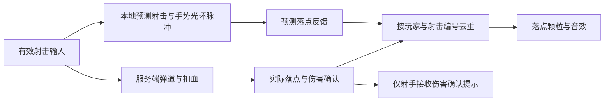
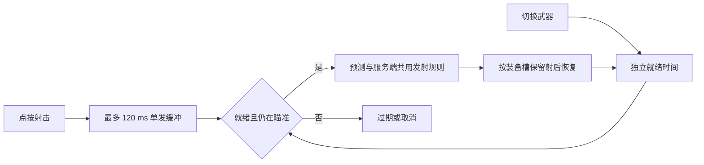

# 步枪手势与光环射击反馈

本轮集中打磨步枪，不更改射速、伤害、散射、瞄准倍率或弹道。单机与联网使用同一套表现。

## 释放与回稳

发射瞬间内环收紧并短促提亮，外环随后弹开、回稳。连续射击在已有运动上叠加脉冲，
幅度与压力都有上限；停止射击后自然衰减。中央小点保持稳定，仍沿最终瞄准方向对齐。
所有几何维持平面图形。

第一人称射击手向后、向下短促回弹并转腕，支撑手以较小幅度跟随。
射击手抬高，以距光环中心下方 0.035 米的大拇指尖作为可见瞄准参照；支撑手再低 0.08 米。
第三人称也有轻微的手臂回弹。保持骨骼长度，沿用原手指姿态和拇指下方留白。
动作不推动镜头，也不更改服务端发射位置。充能期间优先使用原充能手势。

可在 `RifleHalo.prefab` 的 `RifleHaloVisual` 中调：

| 字段 | 默认值 | 用途 |
|---|---|---|
| Release Expansion | 0.019 m | 外圈释放幅度，随后乘现有光环缩放 |
| Wrist Travel | 0.016 m | 射击手回弹距离 |
| Wrist Angle | 5° | 射击手转腕幅度 |

射击编号贯穿预测效果、远端效果与光环状态，相同编号不会重启释放动画或重复播射击音。
现有金属击音与清脆起音仍通过 SoundSystem 池播放；下一发使上一发余音短促淡出，
最后一发保留自然尾音。没有新增音频源或改写现有音频素材。

## 落点与确认

岩石／月壤为灰褐碎屑，金属为短促暖色火花，人物为少量粉色能量碎片，各自有落点声音。
默认地形和无标记表面按岩石处理。金属物理材质／渲染材质名称可被识别；
复杂道具可在碰撞体或父对象添加 `RifleImpactSurface` 明确指定表面类型。

本人的预测弹体碰撞立即表现落点；服务端通过现有 VFX 管理器发送实际碰撞事件。
同一玩家和输入 tick 的落点去重，预测弹体被接管后也不会重复播放。远端使用服务端事件，
即使弹体在快照到达前已销毁，仍能看到实际落点。
若服务端落点与预测明显不同，或落点表面类型被纠正，会补充表现实际服务端落点。

只有服务端实际扣血才显示短暂白色四角命中提示和轻提示音；致命伤害使用金色与更低的音调。
客户端碰撞、命中尸体、撞墙不触发伤害确认。提示中心留白并随 QE 侧身旋转。

落点由 VFX 管理器所属客户端维护，最多 16 组粒子，每组最多 16 颗，无逐发实例化。
反馈配置位于 `Assets/Resources/Moonkov/RifleFeedback.asset`，音效引用已有素材。
`Tools / Moonkov / Weapons / Create Missing Rifle Feedback` 只补缺失资源，保留 Inspector 调整。

客户端与服务器应使用同版本构建：射击效果 RPC 新增编号，并增加步枪落点事件。
最终回弹幅度、声音混合与持续连射观感仍需实际游玩确认。

## 本轮验证

Unity 编译与落点 Shader 检查通过。定向检查覆盖释放去重、连续射击上限、停火回稳、
不同帧步长一致性、平面顶点、固定小点、资源引用、预测／确认落点去重及粒子池容量。

使用临时独立档案完成一次实际单机战局检查：真实角色手腕回弹约 0.0132 m，
瞄准中心、镜头旋转和手臂长度保持稳定；真实服务端弹体造成非致命和致命伤害，
客户端收到落点事件并显示对应命中／击倒提示，随后返回菜单清理。
未使用正式玩家档案，未进行截图、完整双客户端验收或可执行程序构建。

## 2026-10-16：输入、节奏与精确瞄准

正式单机与联机战斗共用以下规则，沿用原伤害、散射、弹速、重力、能量消耗和射击音效。

- 左轮、霰弹和狙击的点按保留最多 120 ms。冷却结束前短暂提前点按，可以接续一枪；更早的输入自然过期。缓冲只保留一枪，发射时使用当前瞄准。光环失去瞄准、切枪或死亡会清除缓冲；装填只接受最后 120 ms 内的点按，仍由服务端保留能量并决定补弹结果。
- 脉冲控制器也支持末段点按缓冲，一次按下仍仅启动三发；持续按住不会重复启动。装填、松开瞄准和切枪继续中断连发。
- 连射保留最多一个正常模拟步长的计时余量，避免每发清零造成累计节奏漂移。空闲时间和超过发射间隔的长帧不积攒追赶连射。
- 切枪使用独立 `WeaponData.EquipTime`：步枪 0.22 s、左轮 0.18 s、霰弹 0.28 s、狙击 0.34 s，仍受手臂伤势等操作速度修正。每个装备槽保留射后恢复时间，快速切走再切回不会绕过射速；余弹仍按原物品保存。切枪与开火同一 tick 时，切枪优先。
- 视角转向按当前实际开镜倍率缩放；默认 8 倍镜为原角速度的 1/8。缩放跟随开镜和换镜过渡，保留原鼠标/手柄基础灵敏度，自由观察保持原速度。`DollSingerView` 的 `Aimed Look Sensitivity` 可调瞄准比例。独立角色演示同时移除了相机对细小转向的额外阈值，避免精细输入被吞掉；其演示射击计时仍独立于正式战斗。
- 本人光环直接使用最新采样的瞄准输入与目标，不等待预测状态回写；其他角色继续使用同步状态。密集碰撞体下，相机取点缓冲按需扩容并复用，避免固定 32 个无序结果遗漏最近墙面。装填表现的进度同时计入操作速度修正。

新增预测 Ghost 计时字段，服务端与客户端需要一起重新编译；无需修改场景、预制体或存档。

### 验证证据

- Unity 6000.5.10f1 编译通过。`MoonkovShootingFeelChecks` 覆盖点按接续、过期、单次消费、取消条件、装填衔接、脉冲重启、切枪恢复、跨帧步长节奏、长帧限额、8 倍镜比例与微小转向；另运行 `HaloModuleChecks`、`MoonkovShotChecks` 和 `MoonkovBallisticsChecks`。头部检查修正了旧 Edit Mode 夹具缺失的控制器/ghost 初始化，并增加同一路径上 80 个遮挡碰撞体的最近点验证。
- 使用提交 `02dc9aef` 的原 `HaloModuleFire` 与本次实现，按相同输入模拟现有 0.1 s 步枪持续射击 8 s：30/60 Hz 两者均 80 发；144 Hz 原实现 77 发、最大节奏偏移 316.67 ms，本次 80 发、最大偏移 5.56 ms。另以 0.13 s 间隔覆盖 30/60/144 Hz 和交替长短步长，偏移始终在一个步长内。这是计时规则测量，不是渲染 FPS 提升。
- 正式 Theophilus 单机战局以独立临时档案启动真实 ClientWorld / ServerWorld，通过现有命令输入路径验证：步枪约 1.3 s 连发 13 发；霰弹和左轮各发射两次，第二次输入分别提前约 55 / 61 ms，均成功接续。最终客户端与服务端均为左轮、3 发余弹、射击 tick 6565，缓冲为空，角色生命 440；相机 FOV 43.61°，目标坐标有限。
- 已返回菜单、释放临时档案、恢复玩家名称并退出 Play。最终 Console 当前错误数为 0。验证中发现的新增层掩码初始化异常已修复并经预制体加载和真实开局复验；未将历史工具缓冲中的旧异常视作仍存在的问题。
- 未运行独立远端双客户端、延迟/丢包矩阵或可执行程序构建，未进行主观画面与声音验收。缓冲、开镜灵敏度及切枪时长仍可根据实际游玩反馈继续调整。
