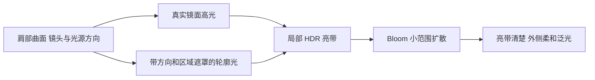

# 肩膀轮廓高光与 Bloom

2026-10-17，基于 `character-lookdev` 的 `b53380e8`。本轮只做研究与只读检查，正式材质、Shader、场景和 Volume 不变。

用户描述的目标是：肩膀弧面的局部边缘出现晶莹的亮带，亮带外侧带柔软的光晕，同时保留周围肤色与体积。按这一描述，优先研究 **掠射角镜面高光、方向性轮廓光与 Bloom 的组合**。这是一种观感描述，不能据此断定某个 MMD 或 VRChat 作品具体采用了哪套实现。

## 亮带与光晕的来源

| 层次 | 作用与辨别方式 | 当前项目可用能力 |
| --- | --- | --- |
| 掠射角镜面高光 | 光源、视角和表面法线共同决定位置；转动角色或光源时，高光移动，有时离开轮廓进入弧面 | lilToon 原生 GGX 与局部光泽遮罩 |
| 艺术化轮廓光 | 以接近轮廓的区域为基础，再用光向与遮罩控制分布，适合保持二次元亮带造型 | lilToon Rim Light，支持方向、颜色遮罩、范围与模糊 |
| Bloom | 将足够亮的像素向邻域扩散，形成轮廓外的柔软光晕；关闭后亮带应仍存在 | 已有 URP Bloom |

掠射角下反射增强有 Fresnel 依据，但“接近轮廓就增加一个颜色”的 Rim 并不等于完整镜面反射。物理 GGX 的 Fresnel 使用视线与半程向量的关系；项目里的艺术化 Rim 则以 `pow(1 - abs(dot(N,V)), power)` 为基础。两者可以配合，不能用无条件的一圈发亮替代受光。[Filament Fresnel 说明](https://google.github.io/filament/Filament.html)、[Unity Fresnel 节点](https://docs.unity3d.com/Packages/com.unity.shadergraph@17.0/manual/Fresnel-Effect-Node.html)

肩膀的弧面使法线连续转向，容易在合适的侧光或斜后方光照下出现这种亮带；肩部是否露肤、衣料材质、法线质量和镜头都会改变其形状。它不是肩膀专属特效。局部亮带应跟随三维表面与光照，外侧光晕由后处理产生。

lilToon 已有 Rim 的颜色遮罩、光向控制、照明调制及阴影抑制能力，适合作为第一条试验路线。其 Reflection 可以控制光滑度和镜面表现。[lilToon Rim Light](https://lilxyzw.github.io/lilToon/ja_JP/reflections/rimlight.html)、[lilToon Reflection](https://lilxyzw.github.io/lilToon/ja_JP/reflections/reflection.html)

## 项目当前为什么不明显

通过已连接 Unity Editor 的只读脚本核对资产，结果保存在 [ShoulderRimAudit.json](Research/ShoulderRimAudit.json)。这次没有进入 Play，也没有把资产配置检查当作实际肩部渲染验证。

| 项目 | 已核实的配置 | 对目标观感的影响 |
| --- | --- | --- |
| 角色管线资产 | MoonSoftAnimePipeline 支持 HDR | HDR 通路具备基础条件；实际相机和运行时 Volume 栈仍需拍摄时确认 |
| Body / Face Rim | 启用，alpha 0.06，Fresnel Power 4，Border 0.6，Blur 0.4 | 目前作为很弱的窄边缘补光，难以承担明显 HDR 亮带 |
| Hair Rim | 启用，alpha 0.12 | 比皮肤稍强，仍以克制的轮廓分离为主 |
| Dress Rim | 关闭 | 若目标肩部区域属于此材质，该区域没有原生 Rim 贡献；具体槽位需结合网格确认 |
| Rim 颜色混合 | MainStrength 0.6；RimEnableLighting 1；ShadowMask 1 | 会乘入底色、受光和 toon 明暗，实际贡献通常进一步减弱 |
| 漫反射受光上限 | 1 | 底色保持受控，不应重新整体抬高 |
| Bloom | 启用，Threshold 1.5，Intensity 0.1，Scatter 0.55 | 当前更偏向压住泛光，并未针对肩部亮带配置 |

项目安装的 URP 在 `BloomPostProcessPass.cs` 中执行 `Mathf.GammaToLinearSpace(threshold)`，并将 soft knee 设为线性阈值的一半。Unity 实测 Threshold 1.5 对应 **2.44006157**，soft knee 下缘约 **1.22003078**。`Bloom.shader` 用预滤波颜色的最大 RGB 通道计算亮度，并不是把最终截图中接近白色的像素直接模糊。不能简单地把 Inspector 的 1.5 当成线性 HDR 阈值。

在主光、无额外补光且其他增亮项不计的条件下，底色最多约 1，当前皮肤 Rim 的最大附加量还受 alpha 0.06 限制；其独立贡献不足以把这一底色推入上述 soft knee。其他镜面、MatCap、额外灯光或采样混合会改变总亮度，因此这是对弱 Rim 的解释，不是对所有像素都不产生 Bloom 的断言。此前增加的 HDR 镜面兼容代码只包住 `lilReflection`，**没有同时增强 `lilGetRim`**。

Unity 官方也将 Bloom 定义为从明亮区域边界向外扩散的效果，Threshold 控制参与区域，Intensity 控制强度，Scatter 控制扩散范围。[URP Bloom 说明](https://docs.unity3d.com/6000.0/Documentation/Manual/urp/post-processing-bloom.html)

## 下一轮实现方向

先在现有独立 LookDev 场景中做肩部近景，比较同一光照下的三种处理：原生 GGX、方向性 Rim、两者组合。每种都各拍 Bloom 关闭与开启版本。这样可以判断用户想要的亮带来自哪里，并单独检查光晕，避免靠后处理掩盖表面问题。

原生 Rim 试验应先加肩部区域遮罩，保持面部与嘴部当前设计。将 HDR 颜色强度、遮罩、亮带范围和柔软程度分开调节，让少数受光边缘越过 Bloom 起效区。HDR 颜色仍乘实际照明，不使用无条件 Emission。先在原 Bloom 阈值下建立足够清楚的亮带，再微调 Bloom 扩散与强度；不要先把全局阈值大幅降低。

不宜直接套用某个固定的 HDR 色值：Rim alpha、MainStrength、光向门控和表面底色都会改变最终强度。应以 Bloom 前的线性 HDR 像素与实际截图为准，确认只有需要的亮带有足够能量，而不是整片皮肤或白衣都进入泛光。

特别需要区分 **toon 明暗** 与 **真实遮挡**。本版 `RimShadowMask` 乘的是 `fd.shadowmix`；它可能压掉原本想保留的逆光边缘。只有该开关为 1，并不能证明高光在所有顶棚下都正确消失。若需要调整此门控，应单独保留真实太阳可见度与局部灯光遮挡，并复查已有高顶棚诊断异常。

## 视觉与运行验收

- 肩部近景包含侧光、斜后方光、正面光；至少转动光源和角色，观察亮带随曲面变化。
- 关闭 Bloom 后保留清楚的局部亮带；开启后外侧出现柔和光晕，肤色和衣服细节仍清晰。
- 同镜头、姿态、灯光、曝光下比较，且分别记录材质变化与后处理变化，不能把两者混成一次无法解释的对照。
- 在正常游戏镜头下检查亮带是否变成亚像素闪烁、断线或过宽白边；肩部近景好看不能代替游戏距离验收。
- 强光可以增强局部高光，但不把整个身体抬白；全黑、顶棚遮挡与遮挡内点光分别验证。
- 优先复用已有 Rim 与 Bloom，不增加额外全屏效果或每角色专属灯。只改变现有参数不代表 GPU 成本必然不变，最终以相同分辨率和镜头的性能对照为准。

只读检查脚本：[InspectShoulderRim.cs](../Tools/LookDev/InspectShoulderRim.cs)。它读取当前资产，不修改材质与 Volume。
