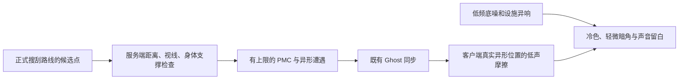

# 正式地图的遭遇密度与恐怖氛围

本轮只配置 TheophilusGameScene。敌人仍由现有服务器 World 生成，客户端不生成敌人、不改变命中或库存规则。

| 内容 | 原配置 | 本轮配置 |
| --- | --- | --- |
| PMC 初始 / 同时上限 | 3 / 3 | 6 / 6 |
| PMC 额外预算 / 补员 | 3 人 / 75 秒、每次 1 人 | 12 人 / 45 秒、每次最多 2 人 |
| PMC 停止新增时点 | 战局 65% | 战局 85% |
| 异形遭遇槽 / 同时上限 | 8 / 8 | 16 / 12 |
| 异形总预算 / 每槽预算 | 24 / 3 | 48 / 4 |
| 异形死亡后补充 | 90–115 秒 | 35–50 秒 |
| 异形落点失败重试 | 8 秒 | 4 秒 |

PMC 使用新增的地图专用 `TheophilusPMC.asset`，`MoonRaidMap.EnemyTuning` 为空的地图继续使用原共享 `DollSingerAI.asset`。初次延迟、玩家 30 m 距离、80 m 视线排除、8 m 角色间距和完整导航路径要求保留。导航仍在服务器运行时烘焙，编辑模式没有 NavMesh 不代表运行时失败。

异形保留原八物种的主锚点，再增加八个覆盖路线前段和搜刮路线的槽，各槽有其他路线候选点；最多每秒生成两只。并发槽不会超过全图 12 只上限，总预算仍有限。玩家 25 m 距离、75 m 视线排除、240 m 激活范围和每种身体的支撑/碰撞检查保留。找不到安全点不扣预算，也不强行塞进墙里。

`Moon Raid` 上的 `RaidThreatAtmosphere` 只在本地存活玩家入场后启用：

- 低电平、无旋律的循环低频纹理；不会替换飞船音乐。
- 每 14–25 秒尝试在附近 8–55 m 的路线锚点播放一次金属应力异响。
- 42 m 内有本客户端已同步的存活异形时，才从其实际位置每 4–8 秒播放摩擦声；遮挡会衰减。天花板待机伏击保持安静，不提前泄露伏击。
- 客户端以 0.5 秒采样，渐变到轻度降饱和、冷色和 0.18–0.28 暗角；不修改曝光、太阳、真空雾或既有天空。在本地角色相机上临时启用 URP 后处理及 Default Volume 层，离场恢复原值。
- 使用原 SoundSystem 声音池和 SFX 混音组，尊重音量设置；死亡、撤离、断线失去本地角色或组件停用时停止声音并移除效果。没有额外 AudioSource、逐帧场景搜索或网络 RPC。

三条音频是本项目自行合成的单声道纹理，可从仓库根目录运行 `python Tools/Audio/build_raid_atmosphere.py` 重建；不引用外部录音。最终响度由三个 `Raid*.asset` SoundDef 控制。

## 验证边界

Unity 编译通过；正式地图 16/16 遭遇槽均有通过实际身体支撑/碰撞检查的候选点；既有调度检查通过死亡冷却、尸体移除、槽/总量/并发上限和空服务器预算保留；三段 WAV 均为 22050 Hz 单声道，无削波且端点检查通过。编辑模式直接调用相机绑定、替换和停用清理方法，确认后处理开关及 Volume 掩码还原；MoonRenderer 的 PostProcessData 引用有效。未进入 Play，未做 Host/Client 战斗、听感、画面或帧率验收。数量上调会提高 AI/身体模拟成本，不能据此声明帧率或恐怖感已经通过试玩。
