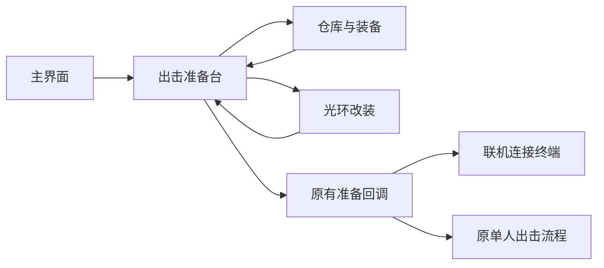

# Moonkov 全界面接入：2026-10-19

这轮是项目内 UI Toolkit 实现，不是网页或整屏样稿。主菜单 C/D 和白色 C 账户入口沿用上次已接入版本；其余入口使用同一字体、边线、蓝色选择状态与独立图片层。功能文字、编号、箭头、数量和错误均保留为原生 UI。

## 层级调整

主菜单继续保留认可的分级卡片。用户否定上一轮的等高黑色侧栏后，管理页面改为页顶三个主要摄影入口（行动、仓库、光环），搭配收敛的次级导航。主要入口使用不同图片和可编辑的切角边线，保留原九个 Button ID 与事件；移除占据左侧的等高黑按钮列。仓库使用装备、随身容器、个人仓库三块区域，六个装备槽环绕真实角色模型。物品操作和容器命中区域保持规则矩形。

出击准备由原五个重复分页收束为一张准备台：左侧是现有地点与行动规则，右侧是角色/装备入口、真实携带电池输入、无回收保障提示和最终确认。风险说明与行动说明都保留；长内容由标准 ScrollView 承载。没有增加区域、组队、保险购买或其他玩法。

最终操作仍调用原 m_Prepare；没有绕过账号、携带数量、部署、结算或服务端校验。准备中的 busy 状态继续禁用输入和最终操作。原 TerminalMotion 换页实现未更改。

## 接入对应关系

| 认可提案 / 功能 | 真实项目入口与实现 |
|---|---|
| 00 主界面、01 账户 | Ship.uxml、AccountAccess.uxml；上一轮原生实现保持 |
| 02–06 连接与加载 | MainMenu、StartHostPopup、DirectConnectPopup、ConnectionStatus、Loading；原表单/事件与加载状态保留 |
| 07 仓库、08 检查/容器 | ContainerInventoryView、ContainerInventory.uxml、ItemInspection.uxml、Window.uxml；库存版本、拖放坐标、事务未替换 |
| 09 光环、10 改装 | Halo.uxml 的原光环外观和六种真实模块节点，与右侧原生检查区；MODIFY HALO 进入已有拥有物选择/模块安装面板；不展示普通枪改装 |
| 11–14 供应商/交易/紧急补给/研究 | Suppliers、ShopCatalog、ShopProduct、MoonkovShopView；原真实商品与研究事务保持 |
| 15 任务、16 基地、17 通讯、18 设置 | 原各 UXML 与 presenter，分别采用目标流程、基地全景/资源、安静频道、黑色设置表；未实现项继续禁用 |
| 19–23 原出击各步 | 合并至 Operation.uxml 单页准备台，未丢弃携带输入、地点说明、回收风险与最终动作 |
| 24 HUD、25 背包、26 搜刮、27 健康 | PlayerHUD、RaidUI、ContainerInventoryView、RaidHealthView；只显示已有生命、弹药、氧气、货物等真实来源 |
| 28 灯光、29 交互、30 撤离、38 警告 | HaloLightPanel、RaidHUD、AirlockPrompt；原按住/关闭、交互与撤离显示契约保持 |
| 31–33 结果/货物/入库 | RaidHUD 原三页结果，连续白色月面底图与原生明细；真实保存结果决定可继续/返回 |
| 34 暂停、35 死亡 | 原 PauseMenu 与 Respawn，仅压暗真实画面；不添加假复活或背景关卡图 |
| 36 计分、37 诊断 | 现有 ListView/状态字段，保留显示条件与数据绑定 |

“接入”表示真实资源、结构与控制器已使用这些样式，不表示未实现的在线服务或禁用系统已被创建。

## 编辑、素材与成本

- ProposalSystem.uss：管理页面一级导航、各页构图、准备台和节点状态。ArchiveTheme / MoonkovControls：共享颜色与状态；InventoryTheme / FieldTheme / AccessTheme：密集库存、局内与连接界面。
- Components/ItemInspection.uxml：独立物品检查组件；Components/PrimaryNavigation.uxml：分级摄影入口。ArchiveCardFrame.cs：原生 Painter2D 静态切角、状态边线和构筑轨道线，不烘焙文字、不改变命中区、不新增循环刷新。默认/悬停/焦点/按下/选中由原按钮与事件驱动；其他现有导航、商品、装备槽、模块槽等继续是可编辑 UXML。
- PageArt：四张无字连续画布和五张独立摄影插画裁切。manifest.json 记录来源与矩形。原提案不作破坏修改；人物继续由原 MenuCharacterView 渲染。
- 颜色：纸白 #F1F2ED、近黑 #08090C、强调蓝 #164BFF、深蓝 #12234B、危险红 #963D32。功能字号以中文可读性为准，标题约 22–38px，正文 14–16px，密集次要物品标记 11–13px；不是把图中微型标注当正文。
- 四张背景为静态压缩纹理，不使用实时后处理或新增循环动画。移除对应 USS background-image 即可关闭画布纹理；原生控件与文本仍成立。背景压缩、最高尺寸 2048、无 mipmap；4K 锐度与 GPU 成本尚未实测。
- 悬停/焦点/选中使用亮边、蓝色状态及原生文字；禁用由真实 Button 状态决定；错误保留文字/标记与危险色；拖拽、等待、失败仍走原库存与账号控制器。

## 验证边界

使用 Unity 导入和编译、真实 UXML/presenter 的私有 RenderTexture、本地明确标注的数据检查视觉。针对本轮新布局检查 1600×900 与 1280×720（仓库、设置、准备台）。修复过一次不支持的 USS 伪类和浅色准备页字色继承；无内容的全黑捕获不算通过，验证工具已增加拒绝条件。

原生 NavigationSubmit 检查最终准备回调只触发一次、装备检查往返以及 busy 禁用；物品检查由原生 PointerDown 的右键菜单进入。没有移动鼠标、键盘或前台窗口，也没有使用电脑接管工具。截图的 LOCAL REVIEW 标记表示展示数据，不能冒充真实交易或正式地图截图。

尚未验证：实际账号登录/注册、真实购买/研究/结算、Host/client 联机、物理手柄、正式地图运动/动态明暗、4K/超宽屏与 GPU 性能。仓库拖放算法未更改，但本轮不把可视验证当成完整联网拖放验收。

自查：继承月面尺度、精密线条、粗糙摄影与大块负空间；去掉背景后仍有统一控件状态；不同功能使用不同构图；密集信息保留网格与对齐，未让装饰越过点击区；中文和状态以原生字体绘制。最终艺术质量仍可继续打磨，但不会用概念图声称运行完成。

## 物品外观纠正

用户明确指出光环图是游戏中的真实外观，头盔/胸挂/背包不是战术装备，后续会有专门美术。本轮已恢复 StashVisuals 原先的 HaloIcons/Rifle、Revolver、Shotgun、Sniper 引用，撤掉上一轮 ArchiveHaloMark 线稿替代，以及整个生成的 InventoryArt 图集和映射。没有接入随后生成的机械光环 atlas。

构筑页布局重新设计，不恢复旧版排布：真实光环作为中央主视觉放大，左侧储能、右侧整形、下方功能模块采用错位切角卡片；右侧用摄影标题区与纸白信息区区分层级，取消原先的通栏表单框与中央小卡片。围绕原 Halo Rifle 图显示现有的电容、充能桥、聚焦透镜、扇形阵列、脉冲控制器、命中标记模块；名称与说明读取 InventoryCatalog/HaloModules，不再使用提案中臆造的发射器/框架/核心照片。没有新增或重命名任何库存物品。头盔、胸挂、背包沿用项目原有表现，留待专门美术替换。原物品的颜色不被 UI 蓝白规范强制覆盖。

本次纠偏检查聚焦构筑页与共享一级导航：halo、warehouse-compact、settings-compact、deployment，随后复查修正的对比度/标题间距和新增 halo-compact。旧截图仍可追溯，不能把旧侧栏截图当成当前状态。物理键鼠/手柄和 GPU 性能边界仍如上所述；原生事件检查不代表实际设备全流程验收。
