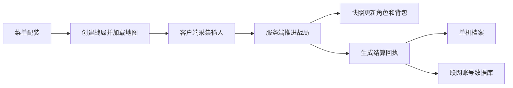

# Moonkov

Moonkov 是一款发生在月球上的第一人称撤离射击游戏。项目于 2026 年 10 月 1 日为学校「艺术盒子」的 30 天开发活动立项。玩家在仓库配装，进入远征搜集物资，成功撤离后把战利品带回仓库。死亡、超时和中途退出也要结算装备。

## 先玩一局

1. 用 Git LFS 拉取 `develop`，用 Unity Hub 打开仓库根目录。编辑器版本是 `6000.5.10f1`，渲染管线是 URP 17.5。[Windows 下载和启动](Docs/CloneAndRun.en.md)
2. 打开 [MainMenu.unity](Assets/Scenes/MainMenu.unity)，点 Play，再选「单机模式」。新档可按教学提示开始。进入仓库后，从「行动」进入「就绪」，开始标准远征。
3. 单机在同一个进程中创建客户端和服务端。服务端执行战局规则，结果写入本地档案。账号服务和 PostgreSQL 用于联网档案。[单机存档说明](Docs/SinglePlayer.md)

## 沿一局远征读代码

| 面试时可以讲的问题 | 从哪里读 |
| --- | --- |
| 点「就绪」后发生了什么？ | `GameManager.StartGameAsync` 依次开连接、创建模拟世界、加载地图并等待角色同步。标准远征使用 `TheophilusGameScene`。[开局流程](Assets/Scripts/Gameplay/GameManager/GameManager.cs) / [创建 World](Assets/Scripts/Gameplay/GameManager/RaidWorldBootstrap.cs) / [选择场景](Assets/Scripts/Gameplay/GameManager/SceneLoader.cs) |
| 一次按键如何变成角色移动？ | 客户端采集输入，发送系统按模拟 tick 合并按键。客户端预测和服务端移动使用同一个控制器。远端角色用同步后的姿态播放动画。[输入采集](Assets/Scripts/Gameplay/Input/ClientInputReaderSystem.cs) / [按 tick 发送](Assets/Scripts/Gameplay/Input/ClientInputSenderSystem.cs) / [服务端移动](Assets/Scripts/Gameplay/Player/Movement/ServerPlayerMovementSystem.cs) / [移动控制器](Assets/Scripts/Gameplay/Player/Movement/FirstPersonController.cs) |
| 拖动一件物品，谁决定能否放下？ | 物品用 ID 和父容器记录位置。`InventoryGraph.TryApply` 检查版本、格子和负重。局内由服务端裁决，再把库存快照发回客户端。[放置规则](Assets/Scripts/Networking/Shared/Inventory/InventoryGraph.Placement.cs) / [服务端处理](Assets/Scripts/Networking/Server/ServerGameSystem.Inventory.cs) / [快照协议](Assets/Scripts/Networking/Shared/RaidInventoryData.cs) |
| 撤离时断线，重试会不会重复发奖？ | `RaidPersistenceContext.BeginSave` 为这次结算保留回执。单机档案记录已处理的回执。联网服务在同一数据库事务里登记结算 ID、核对重复请求并更新仓库。[战局结算](Assets/Scripts/Networking/Server/RaidPersistenceContext.cs) / [单机存档](Assets/Scripts/Networking/Client/OfflineProfileStore.cs) / [数据库事务](Backend/MoonPersistence/StashRepository.cs) |

## 找其他系统

- 战局背包、生命和撤离提示由 HUD 显示。网格选择和拖放由容器视图处理。[战局 HUD](Assets/Scripts/Gameplay/UI/RaidHUD.cs) / [容器视图](Assets/Scripts/UI/Game/ContainerInventoryView.cs)
- 账号、大厅、出战与赏金各自注册 HTTP 路由。服务启动、鉴权和限流集中在后端入口。[MoonPersistence](Backend/MoonPersistence/Program.cs)
- 面试偏图形或技术美术时，可以从月面地形的真实高程、材质光照和远近景细节讲起。[月球环境实现与面试示例](Docs/Development/01-Lunar-Environment-Resume.md)
- 按功能找文档时可以读[容器与装备](Docs/ContainerInventory.md)、[网络会话](Docs/NetworkSessions.md)和[数据库存档](Docs/PostgreSQLPersistence.md)。维护约束、验证命令和旧资料的位置见[项目交接](HANDOFF.md)。
