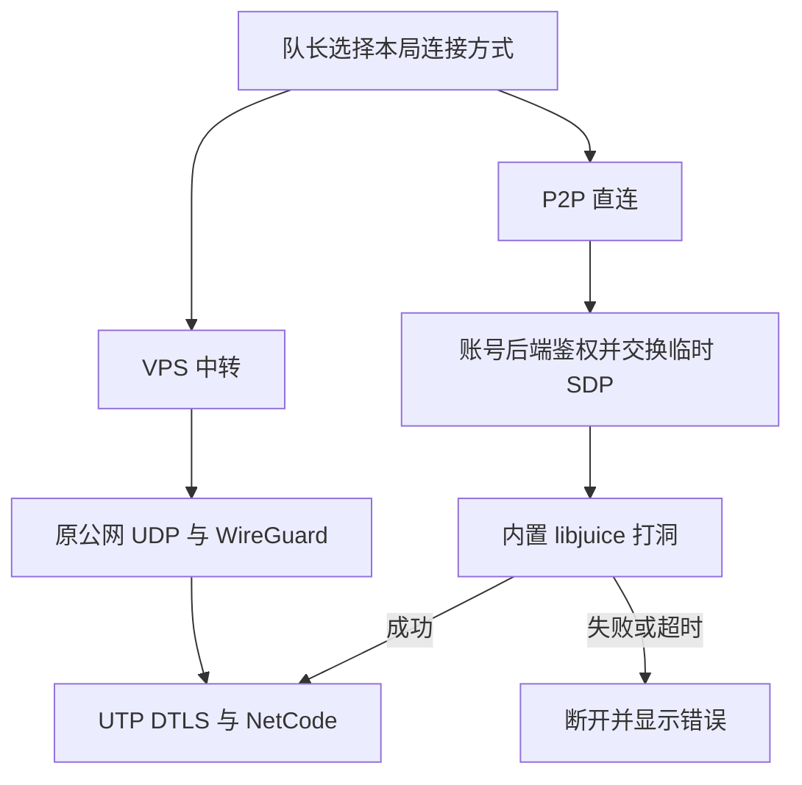

# 内置 P2P 与开局选线

小队的「连接方式」提供「P2P 直连」和「VPS 中转」。新队伍默认 P2P。只有队长能在准备阶段修改；修改后全队取消准备。排队与战局开始后锁定。公开匹配只合并连接方式相同的队伍。

玩家只安装游戏。原生插件支持 Windows x64 和 macOS（Apple Silicon、Intel）。P2P 失败就结束连接，不自动改走 VPS。玩家可以重试，或回到下一局的准备阶段重新选择。



## 下一次打包

1. 客户端可构建为 Windows x64 或 macOS，独立服务器仍使用 Windows x64。协议变更时同步更新双方。客户端分发完整输出，不能只复制可执行文件。
2. 独立服务器仍放在后端配置的 `Build/MoonServer/MoonServer.exe`。普通 Unity Build Profiles 和项目构建菜单都会生成 `moon-network-protocol.txt`，当前值为 `2`。
3. 账号后端需要 `embedded-ice-v2` 功能。此次已经编译并更新本机后端。之后可用 `Backend/Start-Backend.ps1 -Background -Update` 更新。
4. 在小队准备界面选择连接方式，再准备和出发。没有新的 VPN 登录、虚拟网卡安装或手动连接码。

旧客户端会收到更新提示。没有新协议标记的旧独立服会被后端拒绝启动，避免继续分发过期版本。修改源码不会自动改写已有 Player 包。

账号登录、协商和仓库仍使用现有 HTTPS。P2P 只改变战局数据路径。数据库、后台密钥和服务器私钥不分发给玩家。

## 连接与生命周期

- 后端将选线写入每局分配，并通过环境变量传给独立服。本局只创建对应的 ICE 或普通 UDP driver。
- ICE 使用当前账号令牌与战局名单授权。协商按玩家、战局、尝试编号隔离。SDP 只在内存保留 45 秒，不写日志和存档。客户端与服务器不能读取其他玩家的客户端答复。
- 客户端协商总时限 20 秒。取消、失败或退出时释放上下文，并通知后端结束尝试。游戏握手继续由现有 NetCode/DTLS 管理；中途断线沿用原重连入口，不换线路。
- 服务端每 500 ms 向本地后端交换一次协商消息，不逐帧请求。已建立的游戏连接不依赖 SDP 长期保留。
- 默认 STUN 为 `stun.cloudflare.com:3478`。它只帮助发现地址，不转发游戏数据。地址依据 [Cloudflare 官方文档](https://developers.cloudflare.com/realtime/turn/)。没有启用 Cloudflare TURN。
- 优先绑定当前可用的物理网卡。可在公开客户端配置中设置可选的 `IceBindAddress`；服务端可设置 `OnlineInstances.IceBindAddress`、`IceStunHost`、`IceStunPort`。换网络后旧绑定地址会被拒绝，不沿用失效地址。
- 没有修改 VPN 或系统路由。VPN 与校园网的实际路由、NAT 类型和防火墙仍决定能否直连。

自己的客户端会通过每局主机标识和本地网卡地址识别同机服务器。双方都移除本机、内网候选，只尝试公网 NAT 路径。校园出口不支持这种回环时会失败，不偷偷改用 localhost、IPC 或局域网。

## 原生模块

- 固定 libjuice v1.7.4，提交 `b89c792e3612faf2f12cf35bcc56857313a06be3`，上游源码未修改。
- 单个 `moon_ice.dll` 使用静态 C/C++ 运行库。插件不预加载。许可和对应源码入口随包放入 `StreamingAssets/ThirdPartyNotices`。
- macOS 使用 `Assets/Plugins/EmbeddedIce/macOS/libmoon_ice.dylib`。一个文件包含 arm64 和 x86_64，已进行本地签名；只依赖系统运行库。导入设置只启用 macOS Editor 和 macOS Player，Windows 插件保持独立。
- Editor 按实际运行系统选择支持路径，不使用当前打包目标判断宿主系统。Mac 切到 Windows 目标后仍须加载 macOS 库。`DllNotFoundException` 或 `dlopen moon_ice` 表示原生组件未加载，此时尚未开始 ICE 打洞。
- Windows 的 UTP 托管包装使用 struct。逻辑端点对应 ICE peer，不伪装成 IPv4 地址。打洞和游戏数据始终使用同一个 agent。
- 每个上下文最多 64 个对端。客户端默认缓存 256 包，服务端 1024 包；每包最多 1472 字节。满队列直接丢包并计数，不扩容。
- 共享 POLL 工作线程。原生回调只入队，不调用 Unity。托管收发复用缓冲区，不逐包创建数组。driver 独占上下文并负责释放。
- 适配器每批会完成前置 jobs；尚未做完整战局 CPU、内存、帧时间和丢包验收。

重新构建原生模块需要 PowerShell 7、CMake、Ninja、Git 和 Visual Studio C++ x64 工具：

```powershell
./Tools/Networking/EmbeddedIce/Build.ps1 -InstallPlugin
```

脚本在忽略目录获取固定源码，构建并执行原生检查后复制插件。Editor 已加载 DLL 时不要覆盖正在使用的文件。正常游戏打包直接使用仓库中的插件，无需运行此脚本。

macOS 使用 Xcode 命令行工具、CMake 和 Git：

```bash
bash Tools/Networking/EmbeddedIce/Build-macOS.sh --install-plugin
```

也可使用仓库的 `Embedded ICE macOS` 工作流生成通用库。工作流只构建原生模块，不运行 Unity 或打包整个游戏。库以 Git LFS 保存；Mac 更新项目后须确保拿到真实二进制，而非 LFS 指针。构建前会检查对应平台的库及导入设置。Unity 的原生插件规则见[官方说明](https://docs.unity3d.com/cn/2022.3/Manual/PluginsForDesktop.html)。

## 高延迟记录

- P2P 连接建立后，客户端和独立服每 10 秒向各自日志写入一组 `[NetDiag]`。只读取本地计数，不发探测包或额外 RPC。
- 记录每条连接的 RTT、抖动、待发送 RPC 字节数和输入滞后 tick。另记当前进程的更新频率、最长更新间隔、ICE 收发速率、接收队列、丢弃及发送错误。一次 Unity 帧内的多次模拟不重复计帧。
- ICE 计数属于整个进程。服务器的该组计数是所有玩家合计，不能当作某一个玩家的流量。快照接收／丢失数只在客户端有效，服务端显示 `n/a`。首条 `baseline=True` 尚无区间速率；连接 World 停止采样或传输上下文更换后重置。
- Windows 默认客户端日志在 `%USERPROFILE%\AppData\LocalLow\DefaultCompany\FPS_Template\Player.log`。按局启动的服务器日志在项目的 `LocalData/instances/<本局目录>/server.log`。覆盖启动参数可能改变日志位置。
- 对照同一时段的两端记录。高 RTT 同时出现较长更新间隔，需要继续查进程停顿；RPC 或 ICE 队列持续增长，需要查发送量和收发处理。两端更新正常且无本地积压时，再检查外网线路与丢包。计数只能缩小范围，不能单凭一条记录定因。
- 不记录账号、地址、SDP、令牌或数据包内容。常规健康连接也保留低频样本，便于对比自行恢复和玩家死亡前后。
- `Tools/Validation/RaidNetworkDiagnosticsReview.cs` 通过隔离 ECS 和空原生队列检查采样、限频、恢复及清理。没有创建 ICE 对端、socket 或游戏客户端，不能代替 Windows 跨网验收。

## 已有证据与本次边界

Windows 原生模块有 65 项断言通过。单 Editor 的底层检查已覆盖客户端自动绑定，共 38 项断言通过，包含 NetCode 管线、DTLS 双向 64/1200 字节和资源释放。错误服务器名称在普通 UDP 与 ICE 下都未建立应用连接，均返回 `MaxConnectionAttempts=2`，不能把它当作明确的认证失败回码。

2026-11-07 补齐 macOS 库。[原生构建](https://github.com/MorrowHome/Moonkov/actions/runs/42367470298)已通过，包含通用架构、签名和本机原生收发检查。现有 Windows Editor 编译、Windows 原生加载和两平台的插件构建前检查通过。此项修复未重新打包游戏；Mac Editor 加载及跨网络入场仍需在更新后的 Mac 上确认，不能用原生检查代替。

保留的隔离检查入口是 `Tools/Moonkov/Check Embedded ICE Transport (Isolated)`。它不创建游戏世界或访问账号后端。报告和临时测试证书只在忽略目录 `LocalData/EmbeddedIce`。
